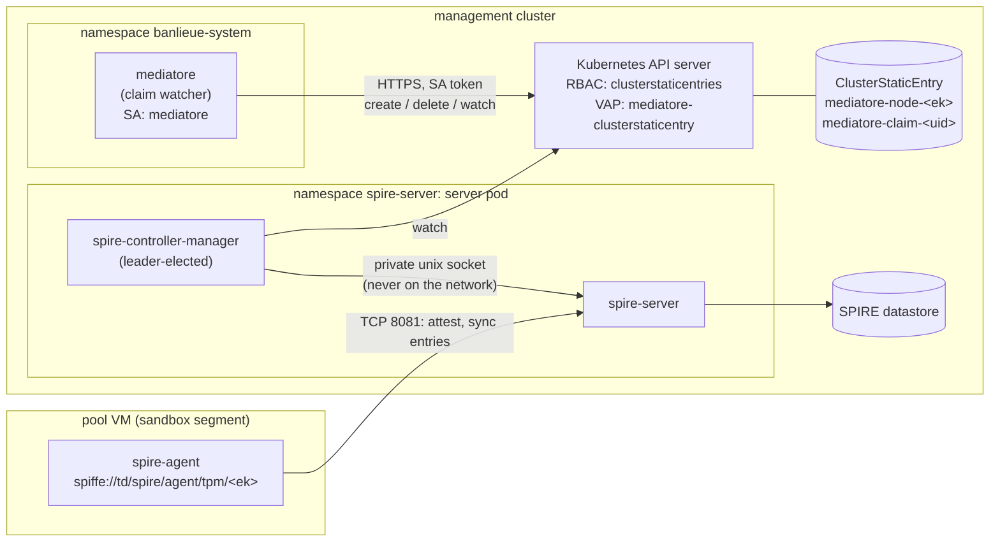

<!-- Copyright (c) 2026 Erick Bourgeois, mediatore -->
<!-- SPDX-License-Identifier: Apache-2.0 -->

# ADR-0006: Registration entries are declared as ClusterStaticEntry, never pushed over the SPIRE admin API

**Status:** Accepted · **Date:** 2026-10-10 · **Accepted:** 2026-10-11

Amends [ADR-0005](0005-spire-topology.md) (the entry transport only; the topology stands).
Companion: [ADR-0007](0007-broker-identity-and-spiffe-mtls.md) (how mediatore gets its own
identity and terminates mTLS).

## Context

mediatore creates exactly two kinds of SPIRE registration entry
([ADR-0004](0004-spiffe-identity-scheme.md)): a node entry
`spiffe://<td>/banlieue/node/<ek-hash>` for the in-guest agent and a claim entry
`spiffe://<td>/banlieue/claim/<uid>` for the jailed workload. Roadmap 01 planned to create them
by speaking the SPIRE server's gRPC entry API with an **admin SVID**: vendored
`spire-api-sdk` protos compiled with `tonic`, `admin: true` on the broker's `ClusterSPIFFEID`,
and the server's TCP endpoint reachable from the broker (`spire.endpoint` in ADR-0005).

Three things argue against that design.

**1. A SPIRE admin identity is trust-domain-wide, not path-scoped.** `admin: true` lets the
holder create *any* entry: any SPIFFE ID, any parent, any selector, including entries flagged
`admin` or `downstream`. ADR-0005 contains the blast radius to one environment by granting
admin on the downstream server only; nothing contains it *within* the environment. A
compromised broker, or a bug in the entry code, can mint an identity for anything the
downstream server serves. The threat model's TB-3 row "Forged registration entry" names the
intended control as "admin identity restricted to `/banlieue/{node,claim}/` paths", and SPIRE
has no such restriction to offer.

**2. The admin API would be a network-reachable surface.** The entry API shares the server's
TCP listener with node attestation, so granting the broker admin over the network means the
most powerful API in the trust domain is one stolen SVID away from any host that can reach
port 8081. The SPIRE Controller Manager, by contrast, reaches the server over a private Unix
socket inside the server pod; the admin surface never leaves the pod.

**3. The management cluster already has the declarative path deployed.** The hardened
`spiffe/spire` chart installs the SPIRE Controller Manager beside each server replica
(leader-elected), with the `ClusterStaticEntry` CRD and `reconcile.clusterStaticEntries: true`.
A `ClusterStaticEntry` carries every field the two entry kinds need (`spiffeID`, `parentID`,
`selectors`, `x509SVIDTTL`, `className`) and reports `status.rendered`, `status.masked` and
`status.set`. mediatore already depends on `kube-rs` for the claim watcher, so the Kubernetes
API is a client it has; a second RPC stack (tonic, prost, vendored protos) would exist only
for this one call.

A fourth, verified fact removes the only reason the gRPC design needed the server's
`ListAgents`: the TPM node attestor's agent ID is
`spiffe://<td>/spire/agent/tpm/<hex sha256 of the EK's DER SubjectPublicKeyInfo>`
(`bloomberg/spire-tpm-plugin`, `pkg/common/tpm_attestor.go`, `GetPubHash` over
`x509.MarshalPKIXPublicKey`). That is byte-for-byte the hash `mediatore-guest` computes
(`crates/mediatore-guest/src/identity.rs`) and byte-for-byte derivable from the EK
certificate banlieue publishes on `VirtualMachine.status.tpmEndorsementCertificates` and
mirrors onto the bound claim (banlieue ADR-0045). The parent of every entry on a node is
therefore computable from control-plane data, before the agent has attested.

## Decision

**1. mediatore holds no SPIRE admin identity, ever.** `admin: true` is removed from
`deploy/base/clusterspiffeid.yaml`. The broker's SVID (`spiffe://<td>/mediatore`) is a
transport identity only (ADR-0007). ADR-0005's "`admin_ids` on the downstream server"
becomes "the downstream server's controller manager renders entries declared in its
cluster"; the per-environment containment it argued for still holds, and is tighter.

**2. Registration entries are `ClusterStaticEntry` resources, created and deleted by the
claim watcher through the Kubernetes API with the broker's ServiceAccount.** The SPIRE
Controller Manager renders them into server entries over its private socket. mediatore
never opens a connection to the SPIRE server.



**3. Entry shapes are fixed, names are deterministic, and creation is idempotent.**

| Entry | `metadata.name` | `spiffeID` | `parentID` | `selectors` | `x509SVIDTTL` |
| --- | --- | --- | --- | --- | --- |
| node | `mediatore-node-<ek-hash>` | `spiffe://<td>/banlieue/node/<ek-hash>` | `spiffe://<td>/spire/agent/tpm/<ek-hash>` | `unix:uid:0`, `unix:path:/usr/local/bin/mediatore-guest` | server default |
| claim | `mediatore-claim-<uid>` | `spiffe://<td>/banlieue/claim/<uid>` | `spiffe://<td>/spire/agent/tpm/<ek-hash>` | `unix:user:sb-<12 hex>` | `1h` |

Every resource carries `spec.className` (the controller manager this cluster runs with
`watchClassless: false`, so a classless resource is silently ignored; the value is
configuration, `spire.entries.class_name`) and labels
`app.kubernetes.io/managed-by: mediatore`, `mediatore.io/kind: node|claim`,
`mediatore.io/claim-uid` where applicable. `admin`, `downstream`, `storeSVID`,
`federatesWith` and `dnsNames` are never set. The deterministic name makes "ensure" a plain
create that tolerates `409 AlreadyExists`, and release a plain delete that tolerates
`404 NotFound`; `Reconciler::bind` and `Reconciler::release` keep their idempotency without
a lookup.

**4. The node entry is created from the published EK certificate, not from an agent
listing.** When a `VirtualMachine` (or the claim that mirrors it) carries
`tpmEndorsementCertificates`, the watcher parses the PEM, DER-encodes the
SubjectPublicKeyInfo, hashes it and emits the node entry. `EntryManager::list_agents` and
the `Agent` type are deleted. The agent may attest before or after the entry exists; SPIRE
delivers the entry on the agent's next sync either way. A VM whose provider publishes no EK
certificate never gets a node entry and never joins the pool: fail closed, by construction.

**5. mediatore waits for `status.set` before it treats an entry as existing.** A
`ClusterStaticEntry` is a declaration; the controller manager renders it asynchronously.
The watcher records the entry as ready only when it observes `status.set == true` with
`status.masked == false`. `masked == true` (another entry already claims the same parent,
selectors and ID) is treated as a conflict: the claim is failed, never served; a status
without `rendered` means the controller manager refused the spec and fails the claim too.

`set` is transient, not a steady state (measured against controller manager 0.7.0 and
unchanged on `main`): the reconcile pass that creates or updates the server entry writes
`set: true`, and the next pass, which that status write itself triggers, rewrites it to
`false` about 20 ms later, since nothing was created or updated. The steady state of a
healthy entry is therefore `rendered: true, masked: false, set: false`, which is also what a
failed server-side create looks like (the controller manager retries those itself). Polling
cannot tell the two apart and cannot catch the transition, so mediatore opens a watch on the
resource name, completes the watch's initial list, and only then creates the resource; the
API server replays every status write from that resource version, and the `set` transition
is the acceptance. A resource that already exists (409) and is `rendered` is accepted as
is. The wait is bounded (`spire.entries.ready_timeout_secs`, default 30 s), after which the
bind fails and is retried by the reconciler. `/v1/me` does not return a subject for a claim
whose entry was never observed set.

**6. Admission policy constrains what the broker's ServiceAccount may declare.** A
`ValidatingAdmissionPolicy` (`deploy/base/admission/clusterstaticentry-mediatore.yaml`),
bound to requests from `system:serviceaccount:banlieue-system:mediatore`, rejects any
`ClusterStaticEntry` that is not one of the two shapes above:

- name prefixed `mediatore-`;
- `spiffeID` under `/banlieue/node/<64 hex>` or `/banlieue/claim/<uuid>`;
- `parentID` under `/spire/agent/tpm/<64 hex>` in the same trust domain, and for a node
  entry the same hash as the `spiffeID` (a node entry can only be parented to its own
  agent);
- selectors are all `unix:*`; a node entry contains `unix:uid:0`; a claim entry is exactly
  one `unix:user:sb-<12 hex>`;
- `admin`, `downstream`, `storeSVID` absent or false; `federatesWith`, `dnsNames` absent or
  empty; `className` present; `x509SVIDTTL`, when set, at most 4 h.

RBAC (`deploy/base/rbac.yaml`) grants the ServiceAccount `get`, `list`, `watch`, `create`
and `delete` on `clusterstaticentries` and nothing on `clusterspiffeids` or
`clusterfederatedtrustdomains`. There is no `update` or `patch`: an entry is replaced, never
edited, so the policy's CREATE check is the only path. The policy is enforced by the API
server (CEL, no webhook), so it holds even if mediatore's own validation is wrong.

**7. Nothing else creates entries under `/banlieue/`.** The controller manager is the only
writer of server entries in this cluster. No `spire-server entry create`, no second
controller. Entries it creates carry the `entryIDPrefix` it is configured with; an entry
without it is by definition not part of the declared state and is an incident, not a
feature. (The controller manager's treatment of foreign entries is a deployment property
and is deliberately not relied on here.)

**8. Enterprise split.** Resources live in the cluster that hosts the downstream server and
its controller manager (ADR-0005). In the homelab collapse that is the management cluster
and the in-cluster client is used. In the enterprise split, `spire.entries.kubeconfig`
names a kubeconfig whose identity has the same narrow RBAC and policy in that cluster.
ADR-0005's `spire.endpoint` (a gRPC address) is retired unimplemented.

**9. Orphan sweep.** A cluster-scoped resource cannot carry an owner reference to a
namespaced `VirtualMachineClaim`, so deletion is explicit (decision 3) and a periodic sweep
lists `ClusterStaticEntry` with `app.kubernetes.io/managed-by: mediatore` and deletes any
whose claim no longer exists or is released. The sweep runs on the leader, at the claim
watcher's resync interval.

### Bind sequence

```mermaid
sequenceDiagram
  autonumber
  participant B as banlieue
  participant K as Kubernetes API<br/>(RBAC + VAP)
  participant W as mediatore watcher
  participant C as spire-controller-manager
  participant S as spire-server
  participant A as spire-agent (VM)
  participant G as mediatore-guest

  B->>K: VirtualMachineClaim: Bound, status.tpmEndorsementCertificates
  K-->>W: watch event
  W->>W: ek = sha256(DER SPKI of EK cert)<br/>node = store.node(ek)  (409 on clone)
  W->>K: create ClusterStaticEntry mediatore-claim-&lt;uid&gt;<br/>parent /spire/agent/tpm/&lt;ek&gt;, selector unix:user:sb-…
  K->>K: VAP: shape, prefix, same-hash, selectors, no admin
  K-->>C: watch event
  C->>S: CreateEntry over private socket
  S-->>C: entry id
  C->>K: status.rendered = status.set = true
  K-->>W: watch event: set
  W->>W: store: entry ready; claim live
  A->>S: sync (TCP 8081)
  S-->>A: entries for this agent
  G->>W: GET /v1/me over node SVID (ADR-0007)
  W-->>G: subject, username
```

### What does not change

The SPIFFE ID scheme and selectors (ADR-0004), the `EntryManager` trait as the single
boundary in `crates/mediatore-spire` (its implementation changes from "gRPC, planned" to
`KubeEntryManager`; `Noop` stays for `dev_mode`), the release ordering (entry first, then
refresh material), and the nested topology (ADR-0005).

## Security analysis

STRIDE for the boundary this ADR creates or changes. "Control" names what the
implementation must provide; the threat model records it only once the code exists
(`rules/threat-modeling.md`).

| Boundary | Threat | S/T/R/I/D/E | Control |
| --- | --- | --- | --- |
| broker → API server | Broker SA stolen or broker bug: forge an entry for an arbitrary ID or parent | S/E | VAP (decision 6): only the two shapes, only under `/banlieue/`, parent only a tpm agent, node hash equal to parent hash; no `admin`/`downstream`. RBAC: no `update`/`patch`, no other SPIRE CRDs |
| broker → API server | Entry for a claim on a node the claim is not bound to | E | Parent hash comes from the claim's own mirrored EK certificate; `put_node` cloned-EK 409 (existing); VAP same-hash rule for node entries |
| broker → API server | Replay: re-creating a deleted claim entry after release | E | Deterministic name plus `mediatore.io/claim-uid` label; the sweep (decision 9) deletes entries whose claim is released; the store refuses `/v1/token` for a revoked claim regardless of entry state (existing) |
| API server → controller manager | A second controller or an operator creates a `/banlieue/` entry by hand | S | Decision 7 (operating rule) and RBAC on `clusterstaticentries` for other principals (deployment); the audit log records every create |
| controller manager → server | Admin surface reachable over the network | E | None needed: private Unix socket in the server pod; the server's TCP listener serves attestation and agent sync only |
| controller manager → server | Controller manager unavailable: entries never render | D | Fail closed: decision 5 (`status.set` gate, bounded wait, claim fails); two leader-elected replicas (deployment) |
| broker → API server | Masking: an attacker-declared entry with the same parent and selectors shadows the broker's | S | `status.masked` fails the claim (decision 5); only the broker's SA may declare `/banlieue/` entries (decision 6, RBAC for everyone else) |
| banlieue → broker | A guest reports another VM's EK certificate so its agent ID is wrong | S | The EK certificate is a public key: an entry parented to an agent the guest does not control yields no SVID to that guest (banlieue ADR-0045, "the lie is self-defeating"); `put_node` cloned-EK 409 |

### Threat-model deltas to apply when roadmap 01 lands

- §1 item 3 "SPIRE entry administration" becomes "declares entries under `/banlieue/`,
  constrained by admission policy".
- §2 Claim watcher privilege: "SPIRE admin" becomes "`clusterstaticentries` create/delete,
  VAP-constrained".
- §3 A-7 (broker ServiceAccount): add "declare `/banlieue/{node,claim}/` entries".
- §5 TB-3 is no longer "mediatore → SPIRE server"; it becomes "mediatore → Kubernetes API
  (`ClusterStaticEntry`)" and a new boundary "controller manager → SPIRE server (private
  socket)" is recorded as a deployment control. The Mermaid diagram changes accordingly.
- §6 TB-3 rows map to the controls above, with the *(stub)* marker removed.
- §8: no new accepted risk from this ADR. R-7 (homelab collapse) is unchanged.

## Consequences

- The `spire-api-sdk` vendoring, `tonic` and `prost` never enter the dependency tree. One
  RPC client (kube-rs) talks to one control plane.
- Entries are visible, auditable cluster state: `kubectl get clusterstaticentries -l
  app.kubernetes.io/managed-by=mediatore` is the inventory; the API server audit log is
  the entry audit log; a kine or etcd backup restores declared state and the controller
  manager re-renders it.
- The broker's authority is reduced from "any entry in the trust domain tier" to "two shapes
  under one prefix", enforced outside mediatore's own code.
- Creation is asynchronous and readiness is observed, not assumed. The bind path gains a
  watch and a bounded wait; the e2e suite gains a fake API server (kube-rs `tower-test`
  mocks) that drives `status.set` and `status.masked`.
- `EntryManager::list_agents`, `Agent` and `ensure_node_entry(parent_id, node_id)` change:
  the node entry is derived from an EK certificate, so the trait takes the hash.
- mediatore depends on the controller manager being deployed and healthy, with
  `reconcile.clusterStaticEntries: true` and a known `className`. Roadmap 02 verifies both
  on the homelab cluster (already true as of 2026-10-03) and records them in the runbook.
- Operators must not create entries by other means. Decision 7 is an operating rule, and
  the runbook states it.
- ADR-0005's `spire.endpoint` and the phrase "mediatore reaches the entry API over gRPC"
  are amended in place; the topology decision stands.
