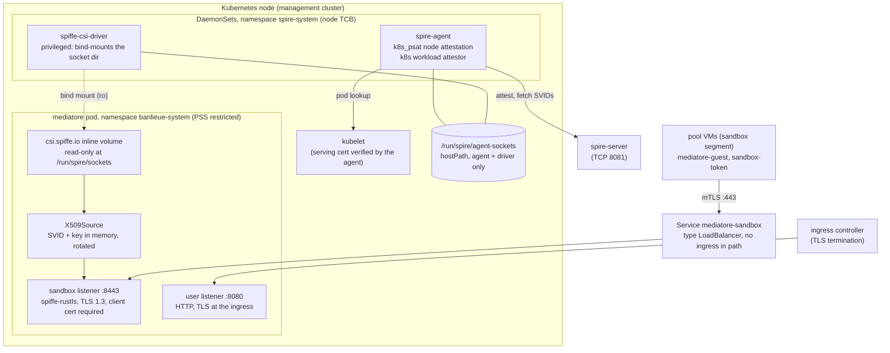

<!-- Copyright (c) 2026 Erick Bourgeois, mediatore -->
<!-- SPDX-License-Identifier: Apache-2.0 -->

# ADR-0007: Broker identity from the Workload API over the SPIFFE CSI driver; the sandbox listener terminates SPIFFE mTLS in-process

**Status:** Accepted · **Date:** 2026-10-10 · **Accepted:** 2026-10-11

Companion: [ADR-0006](0006-registration-entries-as-clusterstaticentry.md) (registration
entries). Together they are roadmap 01 and delete threat-model accepted risk **R-1**.

## Context

The sandbox API (`POST /v1/nodes`, `GET /v1/me`, `POST /v1/token`) is the load-bearing
boundary: whoever it believes is `spiffe://<td>/banlieue/claim/<uid>` gets a delegated token.
Today the peer identity is a header honoured only under `dev_mode`
(`crates/mediatore-api/src/lib.rs`, `peer_spiffe_id`); outside `dev_mode` the scaffold refuses
to start. Production needs mTLS where the peer's SPIFFE ID comes from a certificate chained
to the trust domain, and where the broker itself holds a SPIFFE identity to present and to
be verified against.

Three questions had to be answered precisely, because each is a one-way door for the
threat model.

**Where does mediatore run?** As a `Deployment` in `banlieue-system` on the management
cluster (ADR-0005), two replicas, ServiceAccount `mediatore`, UID 65532, read-only root
filesystem, all capabilities dropped, `RuntimeDefault` seccomp, no `hostPath`
(`deploy/base/deployment.yaml`). That spec is admissible under the Pod Security Standard
`restricted`, and this ADR keeps it so.

**How does the broker obtain its SVID?** The SPIFFE Workload API is a gRPC service on a
Unix socket served by the SPIRE agent on each node. The agent is a DaemonSet with a
`hostPath` socket directory. A pod can reach that socket in four ways:

| Option | What enters the pod | Key at rest | Extra TCB | PSS `restricted` |
| --- | --- | --- | --- | --- |
| `hostPath` volume in the broker pod | the host directory | no | none | **rejected** (hostPath forbidden) |
| **SPIFFE CSI driver, inline ephemeral volume, read-only** | a read-only bind mount of the socket directory | no (in memory) | the CSI DaemonSet (already node TCB) | allowed |
| `spiffe-helper` sidecar writing PEM to a shared `emptyDir` | files with the private key | **yes**, on the volume | a second container image, a file watcher | allowed |
| cert-manager `csi-driver-spiffe` | files with the private key | **yes** | a second issuer (cert-manager) with its own CA | allowed |

The CSI driver exists for exactly this: it gives a pod the Workload API without granting
it a `hostPath`, and it is already deployed on the management cluster
(`spire-system/spire-spiffe-csi-driver`, `csi.spiffe.io`). The driver DaemonSet runs
privileged because it must perform bind mounts into other pods' mount namespaces; that is
the same tier as the kubelet, which already holds every pod's ServiceAccount token on the
node, so the driver adds no authority the node does not already have.

The Workload API is gRPC, but the `spiffe` crate (Apache-2.0, `maxlambrecht/rust-spiffe`,
0.18) wraps it: `X509Source` keeps the SVID and its key in process memory, re-fetches on
rotation, and `spiffe-rustls` turns it into rustls client and server configs with SPIFFE
authorizers. No proto is vendored and no RPC is written by hand. Compared with
`spiffe-helper`, the private key never touches a filesystem, rotation is push rather than
poll, and there is one fewer image to patch.

**What verifies what?** The agent's `k8s` workload attestor identifies the calling pod via
the kubelet and emits `k8s:ns`, `k8s:sa`, `k8s:pod-label:*`, `k8s:container-name` and
image selectors. The deployed agent verifies the kubelet's serving certificate
(`skip_kubelet_verification: false`, threat model TB-4). A `ClusterSPIFFEID` maps those
selectors to `spiffe://<td>/mediatore`. On the VM, the `unix` workload attestor identifies
the guest agent by `unix:uid:0` and path, and the jailed workload by `unix:user:sb-…`
(ADR-0004).

## Decision

**1. The broker's identity is `spiffe://<td>/mediatore`, obtained from the Workload API
through the SPIFFE CSI driver, held in memory only.** `deploy/base/deployment.yaml` mounts
`csi.spiffe.io` read-only at `/run/spire/sockets` and sets
`SPIFFE_ENDPOINT_SOCKET=unix:///run/spire/sockets/spire-agent.sock` (the hardened chart's
socket name; configuration, `spire.workload_api_socket`). No `hostPath`, no sidecar, no
PEM on any volume. The `ClusterSPIFFEID` (`deploy/base/clusterspiffeid.yaml`) selects
namespace `banlieue-system`, pod label `app.kubernetes.io/name: mediatore`, and adds
`workloadSelectorTemplates` `k8s:sa:mediatore` and `k8s:container-name:mediatore`, with
`ttl: 1h`, `className` set, and **no** `admin` (ADR-0006).



**2. The sandbox listener terminates SPIFFE mTLS in-process.** `spiffe-rustls` builds the
server config from the `X509Source`: server certificate is the broker SVID; TLS 1.3 only;
client certificate **required**; the client chain is verified against the trust domain's
X.509 bundle from the same Workload API stream; the authorizer accepts a peer whose SPIFFE
ID is under `spiffe://<td>/banlieue/node/` or `spiffe://<td>/banlieue/claim/` and
nothing else (not even another broker). The verified URI SAN becomes the request's peer
identity as a typed connection extension; the existing per-route checks (`/v1/nodes`,
`/v1/me` for node IDs, `/v1/token` for claim IDs, `Naming::claim_uid_from`) run on it
unchanged.

**3. The dev header survives only under `dev_mode`, and `dev_mode` is refused unless the
sandbox listener binds a loopback address.** `Config::load` rejects
`dev_mode: true` with a non-loopback `listen.sandbox`, so the header path cannot be reached
from any network. Outside `dev_mode` the header is not read at all.

**4. The listener is exposed without an intermediary.** A dedicated `Service`
(`deploy/base/service-sandbox.yaml`, type `LoadBalancer`, port 443 to 8443) gives the VMs
an address; nothing in the path terminates or inspects TLS. The user API stays on 8080
behind the ingress controller as today. Pool VMs verify the broker by SPIFFE ID, not by
hostname, so the address is free to change and SNI carries no trust.

**5. Guests use the same model.** `mediatore-guest` (root) and `sandbox-token` (jail) read
their SVIDs from the VM agent's socket (`/run/spire/sockets/agent.sock` on the host,
bind-mounted into the jail as `/run/spire/agent.sock`, already in `JailSpec`), present them
as client certificates, and accept the server only if its SPIFFE ID is exactly
`spiffe://<td>/mediatore`. Both binaries remove their `--dev-spiffe-id` path except under
a `dev` cargo feature that the release build does not enable.

```mermaid
sequenceDiagram
  autonumber
  participant J as sandbox-token (jail, user sb-…)
  participant A as spire-agent (VM)
  participant M as mediatore :8443
  participant K as spire-agent (k8s node)

  J->>A: Workload API: fetch X509-SVID (unix:user:sb-…)
  A-->>J: spiffe://td/banlieue/claim/uid + bundle
  M->>K: Workload API: X509Source (k8s:sa:mediatore)
  K-->>M: spiffe://td/mediatore + bundle
  J->>M: TLS 1.3 ClientHello
  M-->>J: Certificate: broker SVID
  J->>J: chain to bundle; URI SAN == spiffe://td/mediatore
  J->>M: Certificate: claim SVID
  M->>M: chain to bundle; URI SAN under /banlieue/claim/
  J->>M: POST /v1/token {audience}
  M->>M: claim_uid_from(peer); claim live; audience allowed
  M-->>J: short-lived token (never a refresh token)
```

**6. One cryptographic provider, post-quantum key exchange.** The process installs
`aws-lc-rs` as the rustls default provider at startup; `spiffe-rustls` is built with its
`aws-lc-rs` feature, and `reqwest` and `kube` are built with their no-provider features so
that `cargo tree -i ring` is empty. Every TLS connection mediatore makes or accepts then
negotiates X25519MLKEM768 by default, which is the revisit condition of threat-model R-8.
R-8 narrows to signatures (SVIDs, JWS), which SPIRE and JOSE cannot yet make post-quantum.

**7. Network policy (deployment).** The namespace carries a `NetworkPolicy` for the broker
pods: ingress to 8443 from the sandbox segment's CIDR only and to 8080 from the ingress
controller only; egress to the API server, the IdP's discovery and token endpoints, and
nothing else. The Workload API is a socket, not a network path, so no egress rule is needed
for it. The manifest is deployment-specific (CIDRs) and lands with roadmap 02.

**8. Tests.** `mediatore-testkit` gains a test CA that mints SPIFFE-shaped X.509 SVIDs
(URI SAN, short TTL) and an in-memory source, so the e2e suite runs the real
`spiffe-rustls` server and clients over loopback with no SPIRE. Negative cases: no client
certificate, certificate from another trust domain, a `/mediatore` peer calling the
sandbox API, an expired SVID, a node SVID calling `/v1/token`, the dev header outside
`dev_mode`. The fake is never more permissive than the real thing (`rules/testing.md`).

## Security analysis

| Boundary | Threat | S/T/R/I/D/E | Control |
| --- | --- | --- | --- |
| VM / jail → sandbox API (TB-6) | Peer identity forgery | S | Client certificate required; chain to the trust-domain bundle; authorizer restricts the path prefix; peer ID taken from the verified URI SAN only (decision 2) |
| VM / jail → sandbox API | Dev header injected from the network | S | Header read only under `dev_mode`; `dev_mode` refused unless the listener is loopback (decision 3) |
| VM / jail → sandbox API | Broker impersonated to a guest (rogue listener on the segment) | S | Guests accept only `spiffe://<td>/mediatore`, verified against the bundle the VM agent delivered (decision 5); no hostname trust |
| VM / jail → sandbox API | Harvest-now-decrypt-later on issued tokens in flight | I | X25519MLKEM768 via `aws-lc-rs` (decision 6) |
| VM / jail → sandbox API | Revoked claim's SVID still valid for its TTL | E | Entry deleted on release (ADR-0006); store refuses `/v1/token` for a revoked claim immediately (existing `is_live`); claim SVID TTL 1 h bounds an offline agent |
| pod → agent socket (new) | Another pod obtains the broker SVID | S/E | Agent attests the caller by pod via a kubelet whose certificate it verifies; `ClusterSPIFFEID` requires ns, label, SA and container name; creating a pod with SA `mediatore` in `banlieue-system` is RBAC-gated (deployment; cluster admin trusted, §9) |
| pod → agent socket | Broker SVID or key read from disk | I | Never on disk: in-memory `X509Source`; read-only root filesystem; no sidecar (decision 1) |
| node → pod (CSI) | CSI driver or agent compromised on a node | E | Same tier as the kubelet, which already holds every pod's SA token on that node: no new authority; both DaemonSets come from the hardened chart (deployment) |
| node → pod (CSI) | Driver unavailable: pod cannot start or stop | D | Fail closed: without the socket the broker has no identity and serves nothing; readiness probe stays false |
| ingress → user API | In-cluster hop to 8080 is plaintext | I | Unchanged from today and out of this ADR's scope; recorded as a follow-up (the user listener can present the SVID with a `dnsNames` entry) |

### Threat-model deltas to apply when roadmap 01 lands

- §2 Deployment row: add the CSI inline volume and the `LoadBalancer` service for 8443.
- §5: TB-6 loses *(stub)*; new boundary "broker pod → SPIRE agent (Workload API over the
  CSI mount)" with the two rows above; diagram gains the agent and CSI driver on the node.
- §6 TB-6: every row's control becomes real code, cited by file; TB-4 keeps the kubelet
  verification row and gains "`ClusterSPIFFEID` selector set".
- §7 Hardening: add "SVID and key in memory only", "TLS 1.3, `aws-lc-rs`, client cert
  required", "`dev_mode` requires loopback".
- §8: **R-1 deleted.** R-8 rewritten to signatures only, with its revisit condition
  "ML-DSA in SPIRE and JOSE". No new accepted risk: the CSI driver's privilege is argued
  above to add nothing beyond the kubelet's, and that argument is recorded in TB-4.

## Consequences

- mediatore is admissible under PSS `restricted` and has no secret on any volume: its
  identity lives and dies with the process.
- The `spiffe`, `spiffe-rustls` and `spiffe-rustls-tokio` crates enter the tree (with
  `tonic` as their transitive dependency for the Workload API only). `cargo deny` already
  allows Apache-2.0. The `ring` provider leaves the tree.
- The sandbox listener is reachable only by holders of a `/banlieue/` SVID; everything
  else fails the handshake before a byte of HTTP is parsed.
- The broker and the guests agree on one trust source (the trust domain bundle from their
  respective agents) and one verification rule (SPIFFE ID equality or prefix). Nothing
  depends on DNS, SNI or an ingress certificate.
- `dev_mode` becomes strictly local. The `make e2e` demo keeps working on loopback.
- The threat model's R-1 and the dev-header residue are deleted, not weakened, once the
  code lands; the stamp moves to ADR-0007.
