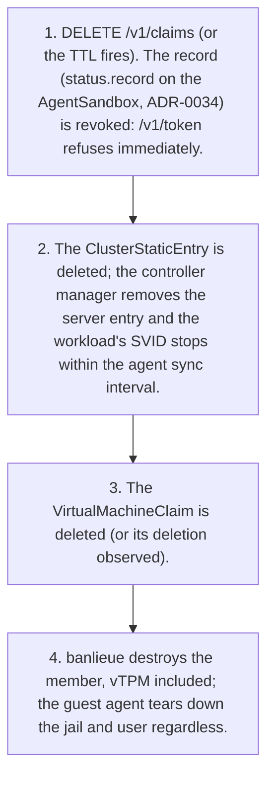
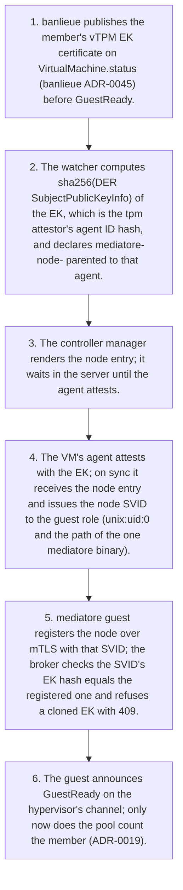
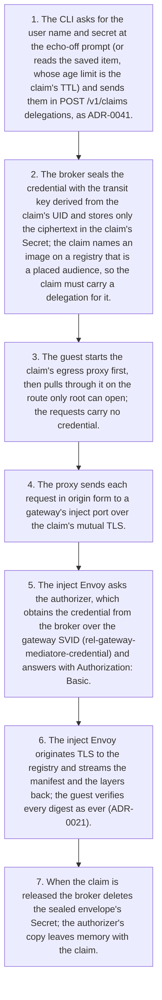
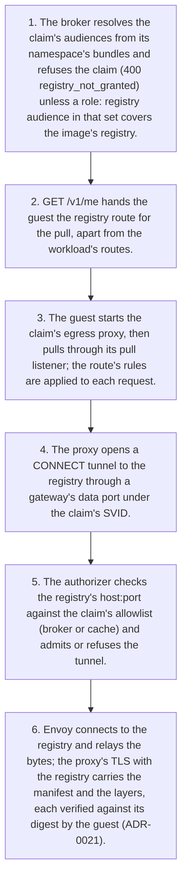

# Architecture Flows

!!! note "Auto-generated"

    Rendered from `docs/architecture/calm/architecture.json` by the CALM
    CLI (`calm template`). **Do not edit this file by hand** — edit the
    architecture JSON or the Handlebars template at
    `docs/architecture/calm/templates/mermaid/flows.md.hbs` and regenerate
    with `make calm-diagrams`.

Each business flow defined in the CALM architecture is rendered below as
its own Mermaid `flowchart TD`: one diagram per flow, linking the
transitions in sequence order. The flows modelled today, from the
`flows` of `architecture.json`:

- **Claim a sandbox and act as the user** (`flow-claim-to-token`)
- **Release and cut-off** (`flow-release-cutoff`)
- **Node bootstrap: from EK certificate to node SVID** (`flow-node-bootstrap`)
- **A policy bundle, verified and compared in shadow** (`flow-policy-shadow`)
- **A private image pulled with the person&#x27;s own credential, which the VM never sees (ADR-0043)** (`flow-registry-pull-placed`)
- **A one-shot workload&#x27;s output read back by its owner (ADR-0045)** (`flow-workload-output`)
- **A claim&#x27;s image pulled through its own proxy and a gateway, under its namespace&#x27;s policy (ADR-0063)** (`flow-registry-pull-gateway`)

## Claim a sandbox and act as the user

The happy path from login to a delegated downstream call: login, claim, bind, subject fetch, jail, token.

```mermaid
flowchart TD
    t1["1. User logs in; receives a token with aud = mediatore."]
    t2["2. POST /v1/claims; mediatore validates the token and derives the subject."]
    t3["3. mediatore creates an AgentSandbox with spec.subject; its reconciler creates the owned VirtualMachineClaim and the store record keyed by the claim's UID (ADR-0008)."]
    t4["4. banlieue binds a Ready, already-attested pool member and mirrors its EK certificate onto the claim."]
    t5["5. The watcher hashes the EK certificate's public key, resolves the node, and declares the claim's ClusterStaticEntry (admission policy checks the shape)."]
    t6["6. The controller manager renders the entry over the private socket and reports status.set; the watcher marks the claim live."]
    t7["7. The in-guest agent fetches the subject, the workload, the egress endpoints and the pull credential for the image's registry, if any (ADR-0022), over its node SVID, creates the sb- user and mounts the per-claim sandbox tmpfs (ADR-0021)."]
    t8["8. The guest pulls the workload image into the tmpfs as the rootfs, manifest and layers verified against their digests and the manifest digest logged (ADR-0021); then it loads the nftables ruleset keyed by the sb- uid (ADR-0020), starts the egress proxy as that user with the claim's routes and a fresh phantom token (ADR-0025), and starts the jail in the VM's network namespace."]
    t9["9. The workload calls http://127.0.0.1:3128/<host>/<path> with the phantom token; the proxy checks the host against the claim's routes and the method and path against the audience's rules."]
    t10["10. The proxy presents its claim SVID over mTLS and trades it for a short-lived, audience-scoped token, kept in its memory only."]
    t11["11. The proxy forwards the request to the downstream API with the real token in place of the phantom, on the user's behalf."]
    t1 --> t2 --> t3 --> t4 --> t5 --> t6 --> t7 --> t8 --> t9 --> t10 --> t11
```

Source: flow `flow-claim-to-token` in `architecture.json`.

## Release and cut-off

Any of four independent cut-offs stops the sandbox acting as the user; this is the ordered normal release.

Source: flow `flow-release-cutoff` in `architecture.json`.

## Node bootstrap: from EK certificate to node SVID

How a fresh pool member gets the in-guest agent's identity without the broker ever listing agents or holding a SPIRE admin credential (ADR-0006, ADR-0007).

Source: flow `flow-node-bootstrap` in `architecture.json`.

## A policy bundle, verified and compared in shadow

How notaio's reviewed policy reaches the broker and what the broker does with it in shadow, the default: observe and report, never admit, refuse or mint differently (ADR-0026). ADR-0030 and ADR-0040 add the enforcing mode.

```mermaid
flowchart TD
    t1["1. notaio compiles the SandboxPolicy, signs the bundle with its transit key and writes <policy>-bundle in the policy's namespace."]
    t2["2. The broker's reflector sees the ConfigMap and verifies the envelope against policy.trusted_keys at the current time; a bundle that fails is logged with its reason and goes no further."]
    t3["3. notaio's floor rule decides from the held floor (the same uid never goes down; a new uid only if issued after the held one); the store writes the next floor to its PolicyFloor resource only if the held one is still what was read, a compare-and-set on resourceVersion (ADR-0034), and a replica that lost the race reads and decides again."]
    t4["4. Only after the write succeeds does the verified payload enter the cache; each sandbox naming the policy is reconciled, the name resolved only in the sources of the sandbox's namespace (policy.sources, ADR-0054; P011 outside them, P012 when two hold it), every gap between the broker's configuration and the bundle is logged with its code, and PolicyConformant is set True, False with the codes, or Unknown while no bundle has been read."]
    t5["5. In shadow (policy.egress: shadow, the default) tokens are minted exactly as before: the comparison changes no admission, no claim and no mint. Under policy.egress: enforce the bundle's servable direct egress is served at the gateway (ADR-0030) and a gateway-placed audience must be one the policy admits (ADR-0040)."]
    t1 --> t2 --> t3 --> t4 --> t5
```

Source: flow `flow-policy-shadow` in `architecture.json`.

## A private image pulled with the person&#x27;s own credential, which the VM never sees (ADR-0043)

From the person's prompt to the first layer, for a registry that is a placed audience: the credential is sealed with OpenBao transit in the broker, placed by the gateway as Basic on each registry request, and the pool VM holds neither it nor any token derived from it.

Source: flow `flow-registry-pull-placed` in `architecture.json`.

## A one-shot workload&#x27;s output read back by its owner (ADR-0045)

From the opt-in on the claim to the owner reading the finished workload's output: capture and redaction in the VM, batches over the node SVID, the Secret ring at the broker, the owner's NDJSON read, the sweep.

```mermaid
flowchart TD
    t1["1. mediatore sandbox create --logs: the claim carries workload.logs: true; a broker with logs.enabled false refuses it 501 before anything is created."]
    t2["2. GET /v1/me returns the workload with logs: true; the guest spawns nsjail with piped stdout and stderr, redacts each line in the VM, writes it through to the console and queues it with a sequence number."]
    t3["3. POST /v1/me/logs on the leading edge (at once after a quiet half second, otherwise every half second, or at 32 KiB; a line that has not ended goes as a partial record) over the node SVID through the control relay; the broker checks the node is the claim's, the opt-in, the shape, the size and the rate (two batches a second), stores the batch and wakes the claim's followers."]
    t4["4. The batch is appended to the claim's Secret ring; a retried batch is a no-op; the oldest segment goes when the cap is reached and the dropped bytes are counted."]
    t5["5. The workload exits under its restart policy: the guest flushes the queue (five seconds at most), then POSTs /v1/me/exit and the claim is released (ADR-0033)."]
    t6["6. mediatore sandbox logs <name>: the owner reads the stored output as NDJSON (stdout lines to stdout, stderr to stderr, a gap or a truncation one line on stderr) for the retention window after the claim ended; another subject is 403."]
    t7["7. The leader's resync sweeps the segments logs.retention_secs after the claim ended, or at once when the record is gone; the AgentSandbox's garbage collection takes owned segments with it."]
    t1 --> t2 --> t3 --> t4 --> t5 --> t6 --> t7
```

Source: flow `flow-workload-output` in `architecture.json`.

## A claim&#x27;s image pulled through its own proxy and a gateway, under its namespace&#x27;s policy (ADR-0063)

The default pull in a gateway-era environment: the registry is a role: registry audience the claim's namespace was granted, the pull is decided by the authorizer like any other egress, and no path from the pool VM to a registry skips it.

Source: flow `flow-registry-pull-gateway` in `architecture.json`.

