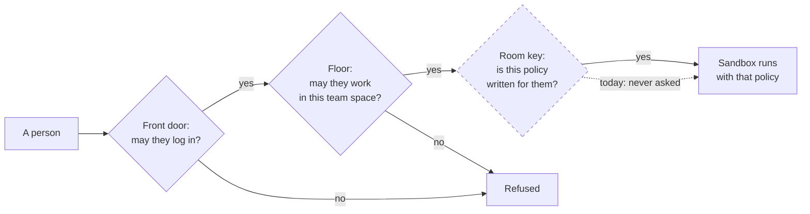

<!-- Copyright (c) 2026 Erick Bourgeois, mediatore -->
<!-- SPDX-License-Identifier: Apache-2.0 -->

# Who may use a policy: the overview

!!! info "Status: proposal, not built"
    This page explains a gap and a proposed fix. Nothing on it is built yet. The technical
    version, with the design and diagrams, is [Who may use a policy: the design](policy-subjects.md).

## In one sentence

Today a policy says **what** an AI agent's sandbox may reach, but nothing checks **who** is allowed
to use that policy; this proposal adds that check.

## The picture

Think of an office building with keycards.

- **The front door** decides who may enter the building at all. mediatore already does this: you
  must log in, and you must be in an approved group.
- **The floor** decides which team area you may work in. mediatore already does this too: each team
  has its own space (a *namespace*), and only that team's members can start sandboxes there.
- **The room key** decides which equipment you may use. That is a *policy*: "this sandbox may talk
  to the code repository and to the build server, and nothing else". Policies are written by teams,
  approved by Security, and signed so nobody can tamper with them.

The gap: **every room key on a floor is hanging on an open hook.** Anyone who can stand on the floor
can take any key on it. Each policy already lists the groups it was written for, but that list never
reaches the system that hands out the keys, so nobody checks it.

## Why it matters

| | Today | With this change |
| --- | --- | --- |
| A team keeps all its policies in one team space | Fine | Fine |
| Two teams share one space for their policies | Each team can use the other team's policies, and so reach the other team's systems | Each team can use only the policies written for it |
| An intern and a senior engineer are on the same team | Both can use the "production read access" policy | Only the groups the policy names can use it |
| An auditor asks "who can use this policy?" | The answer is "anyone on that floor", which is not what the policy file says | The answer is the list in the policy file, and it is enforced |

The risk is already written down and accepted in the security model (it is risk **R-54**). The
current workaround is to give every team its own policy space so nobody shares a floor. That works,
but it costs more setup per team and does nothing for people *inside* a team who need different
access.

## What changes

1. **The policy system (notaio) starts signing the group list into each policy.** The list already
   exists in every policy file. It is simply not included in the signed copy today.
2. **mediatore reads that list and checks it** when someone starts a sandbox: if none of the
   person's groups is on the policy's list, the request is refused.
3. **It is switched on in two steps**, like every other control in mediatore: first in *watch-only*
   mode, which reports who *would* be refused without refusing anyone, then in *enforce* mode once
   the reports look right.

## What it costs

- **Two coordinated releases**, notaio first and then mediatore. They must be rolled out in the
  right order, or the policies stop working until both are updated.
- **Policy authors must keep the group lists accurate.** Some lists are empty or approximate today
  because nothing checked them. Watch-only mode shows which ones.
- **Group names must be spelled exactly** as the login system spells them. Some login systems spell
  the same group two ways, so some policies will need both spellings listed.

## What it does not do

- It does not change what a policy may reach. That stays with Security's approved limits.
- It does not remove the team spaces. The floor check stays, and this adds the room-key check
  behind it.
- It does not react instantly when someone leaves a group. A sandbox that is already running keeps
  running until its time is up, as it does today.

## Decisions needed from the maintainer

1. Approve the approach, so the two design records (one in each project) can be written.
2. Decide what happens to sandboxes created directly through Kubernetes, not through mediatore's
   front door. That path does not carry the person's groups. The recommendation is to refuse those
   sandboxes for any policy that limits who may use it, unless a separate admission check is in place.
3. Decide whether Security's approval (the ExposureCeiling) should also cover **who**, not only
   **what**. The recommendation is not in the first step.

The [technical design](policy-subjects.md) has the detail behind each of these.
