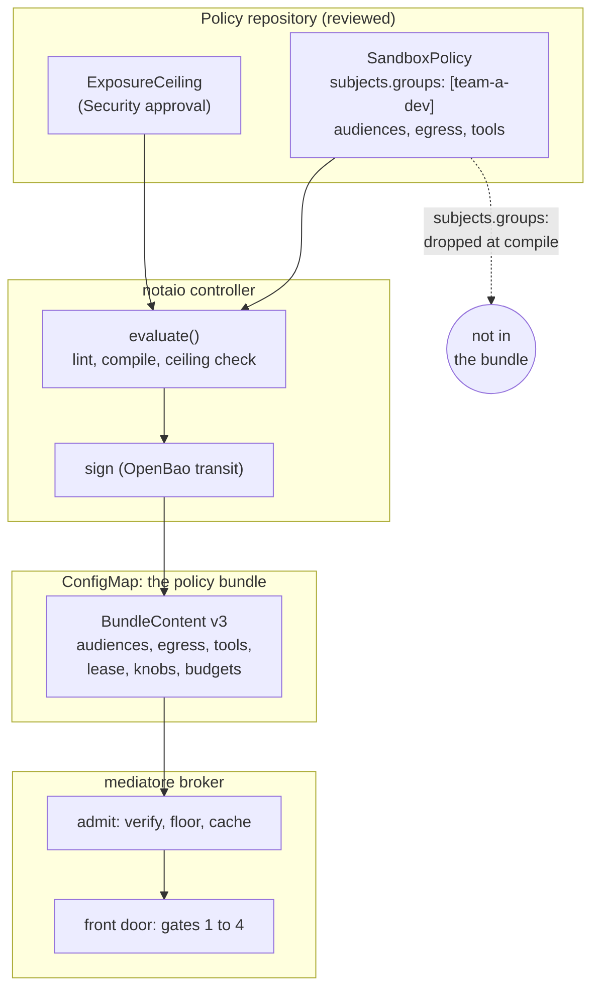
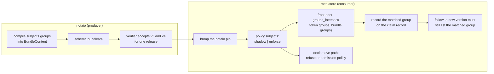
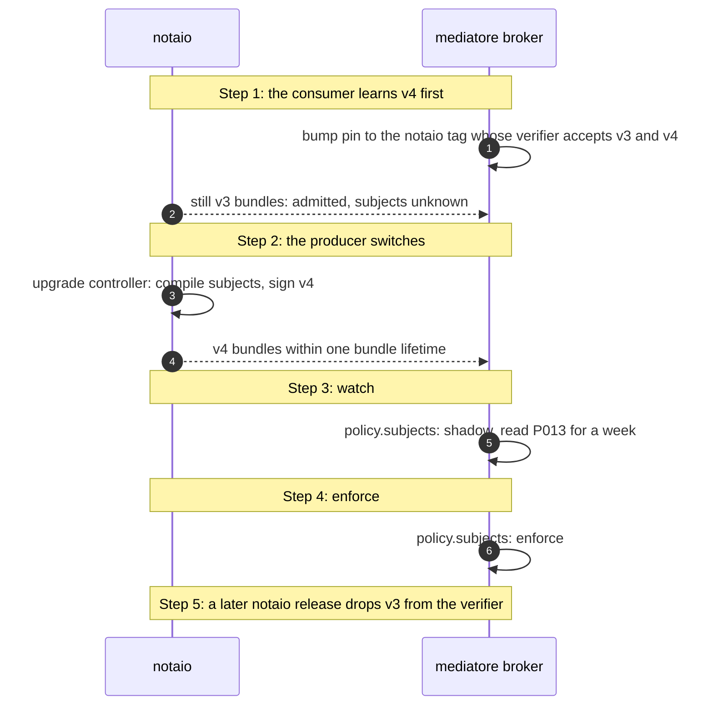
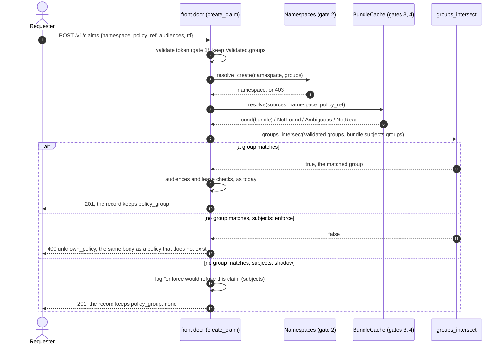
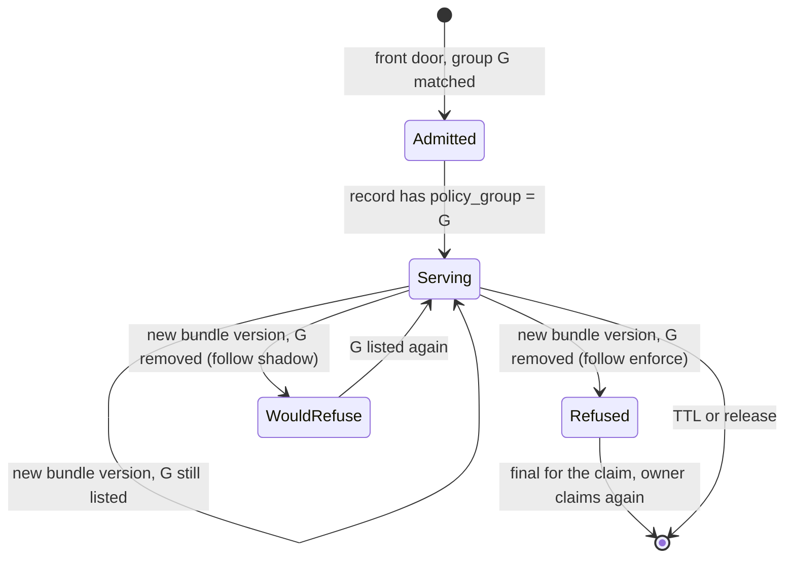
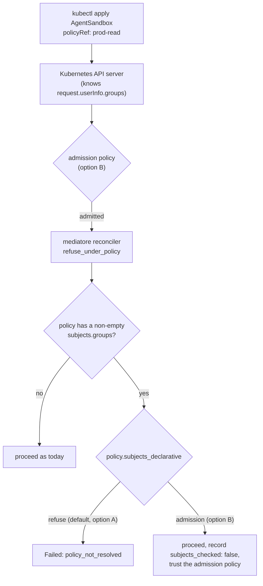

<!-- Copyright (c) 2026 Erick Bourgeois, mediatore -->
<!-- SPDX-License-Identifier: Apache-2.0 -->

# Who may use a policy: the design

!!! warning "Status: proposal, not built"
    Nothing on this page exists in the code yet. Names marked *(proposed)* are suggestions for the
    ADRs this work needs, one in notaio and one here. Everything described as *today* was checked
    against mediatore `main` and notaio `v0.8.0` (the tag `Cargo.toml` pins) on 2026-11-25. The
    plain-language version is [Who may use a policy: the overview](policy-subjects-overview.md).

!!! note "Superseded in part by ADR-0066 (2026-11-26)"
    [ADR-0066](../adr/0066-eligibility-by-group-from-the-signed-bundle.md) decides what this page
    proposed, and differs from it. Where they disagree, ADR-0066 holds:

    - the switch is `policy.eligibility: off | shadow | enforce`, default `off`, not
      `policy.subjects` (sections 4.1, 4.2 and 7);
    - the findings are `P015` (`policy_not_eligible`) and `P016` (`policy_without_subjects`), not
      `P013` and `P014`, which the rejected ADR-0065 still defines (section 4.6);
    - a refused claim is a `403`, the groups are not kept on the claim record, and a running claim
      is not checked again when it follows a new bundle (sections 4.3 to 4.5).

    **Built in shadow only (2026-11-28).** ADR-0066 is accepted and built as
    `policy.eligibility: off | shadow` (`enforce` is not built and does not start): each claim is
    judged and recorded in one log line, nothing is refused. notaio's v4 `subjects` carries groups
    only, no user subject and no issuer per group. See the ADR's amendments of 2026-11-28 and
    [the policy bundle guide](../guides/the-policy-bundle.md).

    The producer side is notaio's ADR-0024 (the groups in the bundle) and ADR-0026 (bundle schema
    v4 and its rollout: a verifier that reads v3 and v4 in one release, then
    `NOTAIO_BUNDLE_SCHEMA` switches the producer), planned in notaio's roadmap 05.

This page closes [ADR-0054](../adr/0054-which-policies-a-namespace-may-name.md) decision 7
("eligibility by subject ... belongs with notaio's signed bundle, in an ADR of its own") and the
accepted risk **R-54** in the [threat model](../security/threat-model.md). In notaio it is K7.2 and
item D3 of its roadmap 00.

## 1. Today: four gates, and the one that is missing

A claim through the broker's front door passes four checks before a policy decides anything:

| # | Gate | Answers | Where it lives | Signed? |
| --- | --- | --- | --- | --- |
| 1 | Issuer gate | may this login use the broker at all | `issuers[].required_groups`, `crates/mediatore-entra/src/lib.rs` | no, the broker's config |
| 2 | Namespace groups | may this login create sandboxes in namespace N | `sandboxes.namespaces`, `resolve_create` in `crates/mediatore-api/src/lib.rs` ([ADR-0046](../adr/0046-who-may-claim-a-list-of-groups-and-a-namespace-to-groups-mapping.md)) | no, the broker's config |
| 3 | Policy sources | which policy namespaces N may draw from | `policy.sources`, `PolicySources` in `crates/mediatore-claims/src/policy.rs` ([ADR-0054](../adr/0054-which-policies-a-namespace-may-name.md)) | no, the broker's config |
| 4 | Policy resolves | the named policy has a verified, unexpired bundle in those sources | `admit_under_policy`, `crates/mediatore-api/src/lib.rs` | yes |
| **5** | **Policy subjects** | **is this login in the groups the policy was written for** | **nowhere** | **no: not in the bundle** |

The data for gate 5 exists. notaio's `SandboxPolicy` has `spec.subjects.groups` ("identity
provider group ids allowed to claim a sandbox under this policy"), and notaio's lint warns when it is
empty (`L010`, a warning, "nobody can claim a sandbox under this policy"). But
`compile_content` in notaio's `crates/sandboxpolicy-core/src/evaluate.rs` never copies it.
`BundleContent` (schema `sandbox.firestoned.io/bundle/v3`) holds `policy`, `profile`, `knobs`,
`audiences`, `egress`, `tools`, `lease` and `budgets`, and no `subjects`. So the broker has nothing
signed to check against, and ADR-0054 decision 7 rules out reading the unsigned `SandboxPolicy`
resource instead.



### What the gap allows

With `policy.audiences: enforce`, a policy grants reach: audiences, their endpoints and rules, the
direct egress of [ADR-0030](../adr/0030-policy-egress-enforced-at-the-gateway.md), and the
gateway-placed credentials of [ADR-0040](../adr/0040-the-gateway-places-an-audiences-credential-the-pool-never-holds-it.md).
Because gate 5 is missing, **everyone who passes gate 2 for namespace N can name every policy that N
draws from.** Two concrete cases:

- *Shared policy namespace.* `team-a` and `team-b` both draw from `shared-policies`, which holds
  `team-a-deploy` (written for `team-a-dev`) and `team-b-deploy` (written for `team-b-dev`). A
  member of `team-b-dev` can claim under `team-a-deploy` and reach team A's systems.
- *Within one team.* `team-a` holds `prod-read` (written for `team-a-sre`) and `scratch` (written
  for `team-a-dev`). Every member of `team-a-dev` can claim under `prod-read`.

The current mitigation (ADR-0054 open question 1, answered "split per tenant") fixes the first case
by giving each tenant its own policy namespace. Nothing fixes the second.

## 2. The design in one picture



## 3. The producer: notaio signs the group list

### 3.1 The bundle shape

Add one field to `BundleContent` in notaio's `crates/sandboxpolicy-bundle/src/content.rs`:

```rust
// sandboxpolicy-types: the same shape as the CRD's Subjects, with no kube dependency (ADR-0014).
pub struct Subjects {
    /// Identity provider group values that may claim under this policy. Sorted, no duplicates.
    /// Matched exactly and case-sensitively by the consumer. Empty means nobody.
    pub groups: Vec<String>,
}

pub struct BundleContent {
    pub policy: PolicyRef,
    pub profile: ProfileRef,
    pub subjects: Subjects,      // new (proposed)
    pub knobs: BTreeMap<KnobId, Step>,
    // audiences, egress, tools, lease, budgets: unchanged
}
```

This changes the RFC 8785 canonical form, so per notaio's rules it is an **amendment to notaio
ADR-0002 and a `SCHEMA` bump** to `sandbox.firestoned.io/bundle/v4`. `sandboxpolicy-types` gains
`Subjects` (it may not depend on `kube`, and this type does not need to).

`compile_content` copies `spec.subjects.groups`, sorted and deduplicated, the same way it sorts
scopes and endpoints today.

### 3.2 What each value means

| In the bundle | Meaning | Why |
| --- | --- | --- |
| `subjects.groups: ["a", "b"]` | a login holding `a` or `b` may claim | any-of, as `required_groups` and namespace groups already are (ADR-0046 decision 1) |
| `subjects.groups: []` | **nobody** may claim | fail closed. It is what `L010`'s message already says, and an empty list must never read as "open" |
| no `subjects` at all (a v3 bundle) | **unknown**: the bundle predates the field | the consumer must tell "nobody" from "not stated" during the rollout (section 4.2) |

### 3.3 Composed policies

notaio's composed policies (its ADR-0023, roadmap 04) already decide this: a composite's `subjects`
are its own, never merged from its includes, and `L033` requires every group of the composite to be
in every include's `subjects.groups`. The composite's own list is what gets signed. No new rule is
needed.

### 3.4 Lint

- `L010` stays as it is. An empty list is legal and means nobody, so the warning is correct.
  *Open question:* promote it to an error for policies with `publish: true`, since a published
  policy that nobody may use is almost always a mistake.
- New *(proposed)*: refuse an empty string, leading or trailing whitespace, or a duplicate in
  `subjects.groups`, with the same reasons as ADR-0046 decision 14. A stray space would make a group
  that matches nothing, and the author would not see why.

### 3.5 Versions and the floor

A change to `subjects.groups` changes the content digest, so it bumps the bundle version like any
other content change. The broker's `PolicyFloor` moves up as usual. **Narrowing who may use a policy
is therefore a new version that the broker follows, and that cannot be replayed away.**

### 3.6 Should the ceiling cover subjects?

The `ExposureCeiling` bounds *what* a policy exposes (audiences, endpoints, hosts, tools, lease) and
needs Security's approval. Who may use the policy is not part of it today. Widening
`subjects.groups` (for example adding `all-staff`) widens exposure just as adding an audience does,
but it needs only the policy's own review.

*Option:* add `subjects: { groups: [...] }` to `ExposureCeilingSpec` and a lint like `L014` that
every policy group is listed in the ceiling. *Recommendation:* not in the first step. Ship the
check first, then decide whether Security wants to own the list. Adding it later is additive.

## 4. The consumer: mediatore checks it

### 4.1 Pin and rollout order

notaio's verifier compares the schema exactly (`payload.schema != SCHEMA` refuses with
`BundleError::Schema`, notaio `crates/sandboxpolicy-bundle/src/verify.rs`). So:

- a broker pinned to `v0.8.0` **refuses every v4 bundle**;
- a broker on the new tag would refuse every v3 bundle, unless the verifier accepts both.

Bundles are re-signed at half their lifetime, so within one lifetime of a notaio upgrade every
bundle is v4. Under `policy.audiences: enforce` a lockstep mistake takes every claim's audiences
away. The proposal: **notaio's verifier accepts v3 and v4 for one release**, parsing v3 with
`subjects` absent. The order is then:



### 4.2 The switch

A new key beside the three that exist (`egress`, `audiences`, `follow`), with the same values and
the same default:

```yaml
policy:
  trusted_keys: [ ... ]
  namespaces: [team-a, shared-policies]
  audiences: enforce
  subjects: shadow        # new (proposed): shadow | enforce, default shadow
```

| Bundle | `shadow` | `enforce` |
| --- | --- | --- |
| v4, caller in `subjects.groups` | admitted | admitted |
| v4, caller in none of them | admitted, `P013`, the log line "enforce would refuse this claim" | refused |
| v4, `subjects.groups: []` | admitted, `P013` | refused |
| v3, no `subjects` | admitted, `P014` *(proposed)* "the bundle predates subjects" | refused: unknown is not allowed |

`subjects: enforce` only has an effect with `audiences: enforce`, the way `follow: enforce` does
([ADR-0061](../adr/0061-a-running-claim-follows-a-new-bundle-only-while-it-is-still-inside-it.md)).
Without `audiences: enforce`, naming a policy grants nothing, so there is nothing to refuse.

### 4.3 The front door (API path)

The check goes in `admit_under_policy` (`crates/mediatore-api/src/lib.rs`), right after the bundle
resolves and before the audience and lease checks. It uses the same matching function as gates 1
and 2, `groups_intersect` in `crates/mediatore-entra/src/lib.rs`, so the three can never disagree
about what a match is (exact, case-sensitive, no prefix stripping).



**The refusal is `400 unknown_policy`, byte for byte the answer for a policy that does not exist.**
A distinct `403 not_in_policy_subjects` would let anyone in a namespace list the policies in its
sources and learn which ones they are excluded from. This follows ADR-0054 decision 4 (one answer
for "elsewhere" and "nowhere") and ADR-0046 decision 6. The operator's log line says what happened:
subject, namespace, policy, decision `denied`, reason `subjects`. As in ADR-0046 decision 13, it
never logs the caller's group list.

### 4.4 The claim record keeps the matched group

`ClaimRecord` (`crates/mediatore-store/src/lib.rs`) already keeps `policy_uid` and
`bundle_version`. Add *(proposed)*:

```rust
/// The value from the bundle's subjects.groups the requester matched at creation; None when
/// the claim was created with no subjects check (shadow, a v3 bundle, no policy).
pub policy_group: Option<String>,
```

It stores **a value from the signed list**, not the caller's groups. It is a configuration value,
the same choice ADR-0046 made for `matched_group` in its audit line. It serves three purposes:
the audit, the shadow verdict (section 4.6), and the follow check (section 4.5). It is
`#[serde(default)]`, so records written before this field read as `None`.

**How the outcome reaches the record.** The front door decides, but the reconciler writes the
record (`record_of`, `crates/mediatore-claims/src/sandbox.rs`), later and possibly on another
replica. So the outcome needs a carrier that only the broker can write. It must not go in a
label or an annotation on the `AgentSandbox`, because the requester on the declarative path can
write those. The existing precedent is the session the front door parks under the sandbox's UID, a
Secret in the broker's own namespace (`park_session`, `crates/mediatore-api/src/lib.rs`). But a
session is parked only when there is one to delegate. The ADR has to choose the carrier: a small
broker-namespace Secret for every front-door claim, or a field on the parked object made universal.
Either way, **a sandbox with no carrier was not checked**, and section 4.7 treats it that way.

### 4.5 A running claim and a narrower list

The broker cannot re-check a person's groups after creation. Gateway asks, mints and `GET /v1/me`
carry the claim's identity, not the person's token. What it *can* check is whether the group the
claim was admitted under is still on the policy's list.

ADR-0061 already decides when a running claim may follow a newer bundle: only "while it is still
inside it" (`serve_under`, `crates/mediatore-claims/src/follow.rs`). Add one condition:

> the newer version's `subjects.groups` still contains the record's `policy_group`.

If it does not, under `follow: enforce` the claim gets `403 policy_changed` with reason `subjects`,
and the gateway denies it as it denies a released claim. Under `shadow` the `PolicyFollowed`
condition reads `WouldRefuse`. Removing a group from a policy therefore **withdraws reach from
running claims on their next ask**, the same way a narrowed audience does today.



What this does **not** cover: a person removed from group G *in the IdP*. Their running claim keeps
serving until its TTL, which is the same accepted behaviour as ADR-0046's "a group removed from a
namespace". Re-checking at the refresh of a delegated session
([ADR-0035](../adr/0035-a-requesters-own-session-delegated-at-claim-time.md)) is possible, since
the refresh yields fresh groups, but it is a separate decision (open question 4).

### 4.6 Shadow findings

Two new codes in `Code` (`crates/mediatore-claims/src/shadow.rs`), which today runs from `P001` to
`P012`:

| Code *(proposed)* | Meaning |
| --- | --- |
| `P013` | the claim was created with no group of the policy's `subjects.groups` (or the list is empty) |
| `P014` | the policy's bundle predates subjects (v3), so who may use it is not stated |

`shadow.rs` stays pure. The outcome reaches the record through the carrier of section 4.4
(`policy_group`, plus a *(proposed)* `subjects_checked: bool` so that "not checked" and "checked,
no match" stay distinct), and the comparison reads it from there. That way a declarative sandbox (section 4.7) reports
truthfully that it was never checked.

### 4.7 The declarative path: no token, no groups

A team with Kubernetes RBAC can `kubectl apply` an `AgentSandbox` directly. The reconciler sees it,
but there is no token, so there are no groups. The only identity is `spec.subject`, which the
`mediatore-agentsandbox-subject` admission policy pins to the requester's username
(`deploy/base/admission/agentsandbox-subject.yaml`). The broker has nothing to run
`groups_intersect` on.



| Option | What happens | For | Against |
| --- | --- | --- | --- |
| **A. Refuse** *(recommended default)* | Under `subjects: enforce`, the reconciler (`refuse_under_policy`, `crates/mediatore-claims/src/sandbox.rs`) fails a sandbox that did not come through the front door and names a policy whose `subjects.groups` is non-empty | fail closed, no new trust, simple | declarative users must use the API for subject-restricted policies |
| **B. Admission policy** | notaio's planned ValidatingAdmissionPolicy (its roadmap 00, D3) checks `request.userInfo.groups` against the `SandboxPolicy` given as parameter, and the operator sets *(proposed)* `policy.subjects_declarative: admission` to trust it | the declarative path works | the parameter is the unsigned `SandboxPolicy` resource (guarded by notaio's GitOps-only admission, but not signed); the API server's groups come from its own OIDC configuration and may be spelled differently from the broker's issuer |
| C. Ignore | the declarative path skips the check | nothing to build | it reopens R-54 for anyone with `create agentsandboxes` |

To tell the two paths apart, the reconciler does not try to work out who created the sandbox. It
asks whether the broker-written carrier of section 4.4 exists for that sandbox's UID. A declarative
sandbox has no carrier, so under option A it is refused for a subject-restricted policy. Under
option B it proceeds with `subjects_checked: false`.

## 5. Failure modes: every one fails closed

| Situation | `subjects: enforce` result |
| --- | --- |
| Token carries no groups claim (or the IdP left groups out of the token) | matches nothing, refused |
| `subjects.groups: []` | refused |
| v3 bundle, no `subjects` | refused, `P014` in shadow beforehand |
| Group spelled differently by two connectors (`example-org:APP_TEAM` vs `APP_TEAM`) | refused unless the policy lists both. This is ADR-0046 decision 2's rule, and the policy author writes both |
| Bundle expired or not yet read | the existing `unknown_policy` and `503 policy_not_synced`, unchanged |
| Group removed from the policy while a claim runs | refused on the next ask under `follow: enforce` (section 4.5) |
| Person removed from the group in the IdP while a claim runs | **not caught** until TTL (accepted, section 4.5) |

## 6. Threat model impact

To be applied in the full pass once implemented, not before:

- **R-54** ("within a policy namespace every mapped tenant may name every policy until notaio's
  bundle carries subjects"): retired for the API path under `subjects: enforce`, and retired for the
  declarative path under option A. It stays accepted under `shadow`, and for option C.
- **TB-1** (requester and front door): new rows for the subjects refusal and its non-disclosure
  (`unknown_policy` for both cases).
- **TB-2** (broker and the Kubernetes API): the declarative path row, with option A or B.
- **Assets**: `subjects.groups` becomes signed security data, with the standing of the rest of the
  bundle. It is no longer advisory text in an unsigned resource.
- **Layering stays narrowing-only**: gate 5 runs after gates 1 to 4 and can only refuse.
  It never admits a login that an earlier gate refused.

## 7. Work breakdown

| Repository | Item | Kind |
| --- | --- | --- |
| notaio | ADR: subjects in the signed bundle; amend ADR-0002; `SCHEMA` to `bundle/v4` | ADR |
| notaio | `Subjects` in `sandboxpolicy-types`, the field in `BundleContent`, `compile_content` copies it sorted | code, TDD |
| notaio | verifier accepts v3 and v4 for one release | code, TDD |
| notaio | lint for empty, padded and duplicate group values | lint rule and its weakening test |
| notaio | threat-model mapping pass, `docs/air`, release | docs |
| mediatore | ADR: eligibility by subject; amends ADR-0054 decision 7, ADR-0061, ADR-0026 | ADR, CALM |
| mediatore | bump the notaio pin; `policy.subjects` in `PolicySection` with `deny_unknown_fields` | code, TDD |
| mediatore | front door check in `admit_under_policy`; `policy_group` and `subjects_checked` on `ClaimRecord` | code, TDD |
| mediatore | `serve_under` condition; `P013`, `P014` in `shadow.rs` | code, TDD |
| mediatore | declarative path, option A in `refuse_under_policy` | code, TDD |
| mediatore | `kind-e2e-policy`: two groups, one policy namespace, one claim admitted and one refused | e2e |
| mediatore | guides: `the-policy-bundle.md`, `multi-tenant-authorization.md`; threat-model pass | docs |

Test names, to be written first and failing *(proposed)*:
`a_caller_outside_the_policys_subjects_is_400_unknown_policy_under_enforce`,
`the_subjects_refusal_body_equals_the_unknown_policy_body`,
`an_empty_subjects_list_admits_nobody`,
`a_v3_bundle_is_refused_under_subjects_enforce`,
`under_shadow_a_caller_outside_the_subjects_is_admitted_and_reports_p013`,
`the_record_keeps_the_matched_value_from_the_bundle_not_the_callers_groups`,
`a_running_claim_whose_group_leaves_the_policy_is_refused_on_the_next_ask`,
`a_declarative_sandbox_naming_a_subject_restricted_policy_fails_under_enforce`.

## 8. Open questions

1. **The declarative path**: option A (refuse) or B (trust notaio's admission policy)?
   *Recommendation:* A by default, with B available once notaio's admission policy exists.
2. **The ceiling and subjects**: should Security approve *who* as well as *what* (section 3.6)?
   *Recommendation:* not in the first step.
3. **`L010` as an error** for published policies? *Recommendation:* yes, in the notaio ADR.
4. **Re-check at refresh**: should a delegated session's refresh, which yields fresh groups, end a
   claim whose person has left the matched group? *Recommendation:* a separate ADR. It touches
   ADR-0035 and the session lifecycle, not the bundle.
5. **A v3 bundle under `enforce`**: refuse (proposed) or treat it as "namespace only, as today"?
   *Recommendation:* refuse. "Not stated" must not read as "anyone", and the rollout order in
   section 4.1 makes v3 transient.

## Read next

[Policy](policy.md) for how bundles are admitted and enforced today,
[The policy bundle, in shadow](../guides/the-policy-bundle.md) for operating it,
[Multi-tenant authorization](../guides/multi-tenant-authorization.md) for gates 1 to 3, and
ADR-0046, ADR-0054 and ADR-0061.
