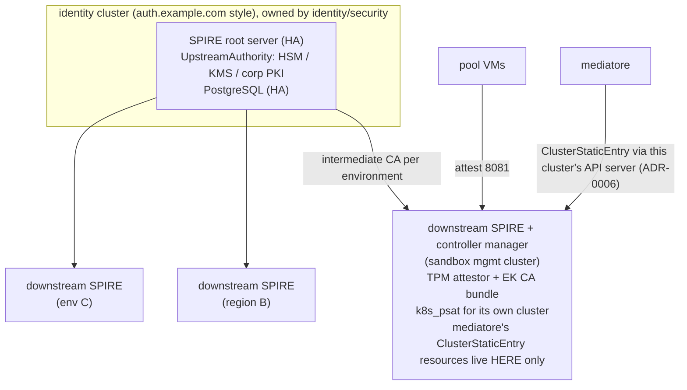

<!-- Copyright (c) 2026 Erick Bourgeois, mediatore -->
<!-- SPDX-License-Identifier: Apache-2.0 -->

# Splitting SPIRE out: the enterprise topology

> The homelab runbook installs one SPIRE server next to banlieue and mediatore. That is
> the deliberate collapse of the topology this guide describes. Decision record:
> [ADR-0005](../adr/0005-spire-topology.md); risk posture: threat model
> [§8 R-7](../security/threat-model.md).

## Why split it out

The SPIRE server is the root of workload identity for every sandbox: whoever controls
it can mint an SVID for any node or claim in the trust domain. Left inside the
management cluster, that power sits within reach of ordinary cluster administration —
anyone who can exec into pods where sandboxes are managed can reach the signing key.
Treat it like your PKI: its own tier, its own owners, its own change control.

## Target shape

One trust domain across the tree. Nesting, not federation: federation (bundle
exchange) is for genuinely separate trust domains, e.g. two organisations.

## The rules that make it work

1. **Root issues intermediates only.** No agent, workload or broker ever talks to the
   root. Its `UpstreamAuthority` is an HSM, cloud KMS or the corporate PKI, so even the
   identity cluster's own compromise does not yield a portable root key.
2. **One downstream server per environment**, holding exactly that environment's
   attestation surface: the TPM attestor with the EK CA bundle for its hypervisors
   (vCenter VMCA roots, swtpm fleet CAs), and a `k8s_psat` config that can validate
   ServiceAccount tokens from that environment's cluster only.
3. **mediatore declares entries in the downstream server's cluster, never the root's, and
   never holds a SPIRE admin identity.** Entries are `ClusterStaticEntry` resources that
   the downstream server's controller manager renders over its private socket
   ([ADR-0006](../adr/0006-registration-entries-as-clusterstaticentry.md)); an admission
   policy restricts the broker to two shapes under `/banlieue/`. A compromised broker can
   then forge at most those shapes, only in its own environment; the containment row in
   the threat model (TB-3) depends on this.
4. **Revocation flows down.** Rotating or revoking one environment's intermediate cuts
   that environment off without touching the others.
5. **Network:** pool VMs reach only their downstream server (TCP 8081); mediatore
   reaches only the Kubernetes API of the cluster that hosts its downstream server, and
   never any SPIRE server port. Nothing in any workload cluster needs a route to the
   identity cluster except the downstream servers themselves.

## What changes in mediatore configuration

Nothing structural — the SPIRE endpoint is already configuration, not an assumption:

- `spire.entries.kubeconfig` points at the cluster that hosts the environment's
  downstream server and controller manager (unset, meaning in-cluster, in the homelab; a
  kubeconfig with the same narrow RBAC and admission policy in the enterprise).
- `spire.workload_api_socket` is the broker pod's own agent socket, delivered by the
  SPIFFE CSI driver ([ADR-0007](../adr/0007-broker-identity-and-spiffe-mtls.md)); it is
  the same in every topology.
- The trust bundle baked into the VM image (runbook Part 1.5) is the trust domain
  bundle, which is identical whether the tree has one server or ten.
- Registration entry shapes, SPIFFE ID paths and the username derivation
  ([ADR-0004](../adr/0004-spiffe-identity-scheme.md)) are unchanged.

## Migration path from the collapsed homelab

1. Stand up the identity cluster; install the root with the `UpstreamAuthority` plugin.
2. Install a downstream server in the management cluster, configured with the existing
   TPM attestor, EK bundle and datastore; point it at the root.
3. Point `spire.entries.kubeconfig` at the downstream server's cluster and apply
   `deploy/base/rbac.yaml` and the admission policy there.
4. Roll the pool (new members attest to the downstream server; old ones drain by TTL).
5. Decommission the flat server and delete threat-model row R-7.
