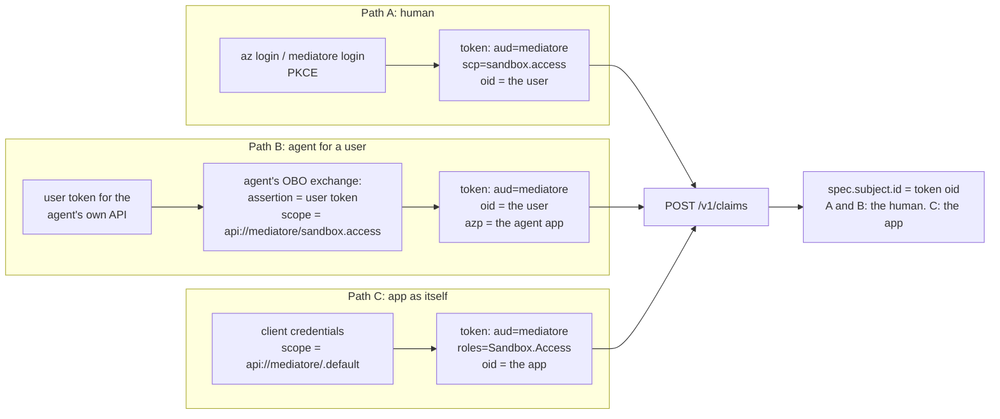

<!-- Copyright (c) 2026 Erick Bourgeois, mediatore -->
<!-- SPDX-License-Identifier: Apache-2.0 -->

# Running workloads on a claimed VM

How code actually ends up executing inside a sandbox, for each kind of caller:

- **A** — a human user, directly;
- **B** — an existing agent (an orchestrator, a bot, a CI job) acting *on behalf of* a
  user;
- **C** — a service acting *as itself*, with an app-only JWT from another Entra ID app
  registration.

All three converge on the same call, `POST /v1/claims` with a bearer token whose
audience is mediatore, and everything after that call is identical. The differences
are only in how the token was obtained and who the sandbox's *subject* ends up being.
The call creates an `AgentSandbox` resource with that subject (ADR-0008); a caller with
RBAC on the cluster can create the same resource directly, see
[Requesting a sandbox](requesting-a-sandbox.md).

## The one rule that shapes everything

**Nothing inbound ever reaches the VM.** There is no SSH, no exec API, no reverse
channel from mediatore. The workload is declared *at claim time* (`workload.image` +
`workload.args`), started by the in-guest agent, and speaks to the world only through
its allowed egress: the claim's downstream audiences, reached through the egress proxy
on the VM's loopback ([ADR-0025](../adr/0025-phantom-token-egress-proxy.md)). If you
need interactivity, the workload dials **out** (see
[Interaction patterns](#interaction-patterns)).

## Path A: a user, directly

1. Log in and get a broker-audience token:

   ```bash
   # Entra (work)
   az login --scope api://mediatore/sandbox.access
   TOKEN=$(az account get-access-token --scope api://mediatore/sandbox.access \
             --query accessToken -o tsv)

   # Dex (homelab): PKCE flow as mediatore's own public client, loopback redirect
   mediatore login --issuer https://dex.home.example
   # an issuer on a private PKI: trust exactly that CA (the broker's issuers[].ca_file)
   mediatore login --issuer https://dex.home.example --ca-file ~/.config/mediatore/dex-ca.pem
   ```

   The token's `aud` is mediatore and (on Entra) `scp` contains `sandbox.access`.
   A kubectl/kubelogin token for the Kubernetes API does **not** work here: wrong
   audience, rejected with 401 by design.

   On Dex the login also yields a refresh token (`offline_access`), which the next
   step delegates to mediatore: an issuer configured with a `session` requires it, and
   mediatore refreshes the session before every token it mints for the sandbox, so a
   login revoked at Dex, or removed from the required group, stops the sandbox at its
   next token ([ADR-0013](../adr/0013-dex-session-delegation.md)). The CLI forgets the
   refresh token once delegated (Dex rotates it); a second claim is a second login.

2. Claim, naming the workload (an argument that starts with a dash goes in the `--arg=-p`
   form, or the CLI reads it as a flag of its own):

   ```bash
   # Dex: the CLI posts the claim with the session delegated
   mediatore sandbox create --mediatore https://mediatore.sandbox.example \
     --pool pool-a --ttl 3600 --audience api://trading-data \
     --image registry.internal:5000/sandbox/claude:latest \
     --arg /usr/bin/claude --arg=-p --arg "reconcile the ledgers"

   # Entra, or any issuer without a session: the same call by hand
   curl -sS https://mediatore.sandbox.example/v1/claims \
     -H "Authorization: Bearer $TOKEN" \
     -d '{
       "pool_ref": "pool-a",
       "ttl_seconds": 3600,
       "audiences": ["api://trading-data"],
       "workload": {
         "image": "registry.internal:5000/sandbox/claude:latest",
         "args": ["/usr/bin/claude", "-p", "reconcile the ledgers"]
       }
     }'
   ```

3. mediatore validates the token, writes `spec.subject` = *you* (`oid` on Entra, the
   GitHub login via Dex), and creates the `VirtualMachineClaim`. banlieue binds a
   warm, already-attested pool member; mediatore declares the claim's SPIFFE entry as
   a `ClusterStaticEntry` and the SPIRE Controller Manager creates it (no entry ever
   exists any other way, ADR-0006); the in-guest agent fetches the subject over mTLS,
   creates your `sb-` user, mounts a fresh tmpfs, pulls your image into it as the
   rootfs, loads the ruleset, starts the egress proxy as that user and starts your
   command under nsjail with a phantom token in its environment.
   No further input from you is needed or possible.

```mermaid
sequenceDiagram
    autonumber
    participant U as User / Agent / App
    participant IdP as Entra or Dex
    participant M as mediatore
    participant K as Kubernetes API<br/>(banlieue)
    participant S as SPIRE server
    participant G as in-guest agent<br/>(on the bound VM)
    participant P as egress proxy<br/>(sb- user, outside the jail)
    participant W as workload (jailed)
    participant D as downstream API

    Note over G,S: pool member booted earlier and<br/>attested its vTPM: node SVID exists<br/>before any claim does
    U->>IdP: login (PKCE) / OBO / client credentials
    IdP-->>U: token, aud = mediatore
    U->>M: POST /v1/claims {pool, ttl, audiences, workload}
    M->>M: validate iss/aud/sig/group, derive subject
    M->>K: create VirtualMachineClaim (spec.subject)
    K-->>M: claim Bound to VM (banlieue picked a Ready member)
    M->>K: declare ClusterStaticEntry spiffe://td/banlieue/claim/(uid),<br/>parent = VM node, selector unix:user:sb-hash
    K-->>S: controller manager renders the entry; status.set observed
    G->>M: GET /v1/me (mTLS, node SVID)
    M-->>G: subject, expires_at, workload {image, args}, egress, routes
    G->>G: useradd sb-hash, tmpfs at /mnt/sandbox, pull image into rootfs (digests checked),<br/>nft ruleset keyed by its uid, phantom token
    G->>P: start mediatore egress-proxy as sb-hash (routes, phantom)
    G->>W: nsjail as sb-hash: exec workload.args, MEDIATORE_TOKEN = phantom
    W->>P: http://127.0.0.1:3128/host/path, Authorization: Bearer phantom
    P->>M: POST /v1/token {audience} (mTLS, claim SVID)
    M-->>P: 15-min token, aud = one audience, acting for subject
    P->>D: the request with the real token (audit shows broker on behalf of subject)
    D-->>P: response
    P-->>W: response
    Note over M,W: TTL expires or DELETE /v1/claims:<br/>entry deleted, tokens refused, jail torn down, VM destroyed
```

## Path B: an agent acting on behalf of a user

An orchestrating agent (its own confidential Entra app) already holds a token *its
users* gave it — `aud` = the agent's API, not mediatore's. It cannot forward that
token; mediatore would reject the audience. Instead the agent performs its own
**On-Behalf-Of exchange** to get a mediatore-audience token that still carries the
user's identity:



Setup, once, in Entra:

1. The agent's app registration gets a **delegated permission** on mediatore's app
   (`api://mediatore/sandbox.access`) with admin consent.
2. mediatore's app lists the agent in `knownClientApplications` (or the agent is
   pre-authorised), so the consent chain is clean.

At runtime the agent exchanges every user's token before claiming
(`grant_type=jwt-bearer`, `requested_token_use=on_behalf_of`, its own
`client_assertion`). The result: `spec.subject.id` is the **human's** `oid` — the
sandbox belongs to the user, not to the agent. The agent shows up as `azp` in
mediatore's audit log, exactly like mediatore itself shows up as `azp` downstream.
This is runbook §4.3 and the recommendation of open decision #10: an agent claiming
for a user must present an OBO chain, so `subject` is always a human unless the
caller is explicitly app-only.

Two properties worth noticing:

- The user's original token still never reaches mediatore or the VM — mediatore sees
  the OBO *result*, and the VM sees no user token at all, ever.
- The sandbox's downstream tokens are minted for the **user**; the agent cannot widen
  them beyond the audiences it requested at claim time, and the user's Conditional
  Access / revocation applies to the whole chain.

**Homelab note (Dex):** Dex has no OBO. The equivalent is the `trustedPeers`
cross-client flow: the agent's Dex client lists `mediatore` in its audience request
(`audience:server:client_id:mediatore` scope), producing an ID token with
`aud: [agent, mediatore]` and the user's login as subject. Same shape, weaker
attestation of the agent; acceptable at homelab trust levels. Such a token logs in,
but a session issuer also needs a refresh token issued to mediatore's own client
(ADR-0013 decision 3), which an agent gets by running the same PKCE flow as the CLI
against the `mediatore` client.

## Path C: a service with an app-only JWT (another Entra app)

A pipeline or scheduled service with no human in the loop uses **client
credentials**:

1. mediatore's app registration defines an **app role** (e.g. `Sandbox.Access`,
   member type *Application*).
2. The calling app is granted that application permission + admin consent.
3. It requests `scope=api://mediatore/.default` with its client secret/certificate
   and receives a token with `aud` = mediatore and `roles: ["Sandbox.Access"]` — no
   `scp`, no user.

mediatore records `spec.subject.id` = the **app's** `oid` and issues downstream
tokens app-only as well (runbook §4.3: OBO is replaced by app-only tokens with
`roles`; there is no user to act for). The `sb-` username derives from the app's
`oid` exactly like a human's. Use this for fleet jobs — nightly report generation,
scheduled data pulls — where the audit trail should say *the service did this*,
not a person.

> The `required_group` gate reads `roles` as it reads `groups`, so an app role gates an
> app-only login. What an app-only principal cannot do is the On-Behalf-Of exchange,
> which Entra reserves for user principals (ADR-0016): a claim from one gets `sts`
> tokens, and an `entra-obo` audience for it is refused at the exchange.

## What "the workload" is

Two images are involved, and they are not the same thing:

| | The VM image | The workload image |
| --- | --- | --- |
| What | The pool member's disk: Kairos, the SPIRE agent and its TPM plugin, the one `mediatore` binary, `nsjail`, `nftables` | An ordinary OCI container image: the runtime, the agent framework, the tools, your code |
| Who chooses it | The operator, once, when the pool is baked ([deploying](deploying.md) step 6) | The requester, per claim: `workload.image` on the claim or the `AgentSandbox` |
| Who runs in it | `mediatore guest`, as root, outside the jail | Your `workload.args`, as the `sb-` user, inside the jail |
| How it gets there | Built from `image/Dockerfile`, a Kairos derivative published as `ghcr.io/firestoned/mediatore-guest` ([ADR-0023](../adr/0023-sandbox-vm-image-kairos-derivative.md)); every member boots it | Pulled by the guest at bind into the per-claim tmpfs, as a rootfs for `nsjail`; no container runtime is involved |

So "the workload" is your agent packaged as a container image, and the VM is what
mediatore runs it on. One VM image serves every workload image; the pull credential of
[ADR-0022](../adr/0022-registry-pull-credentials-from-the-broker.md) is the operator's
because the registry it opens is where the organisation publishes its sanctioned agent
images, not anything of the user's. Nothing of mediatore's is in your image either: the
guest bind-mounts the one binary into the jail for the confinement step
([ADR-0014](../adr/0014-one-binary-roles-as-subcommands.md), [ADR-0024](../adr/0024-landlock-inside-the-jail.md)),
and the credential never enters the jail at all ([ADR-0025](../adr/0025-phantom-token-egress-proxy.md)).
[The research agent, front to back](research-agent-walkthrough.md) follows one workload
image from the team that publishes it to the report it pushes, with the policy notaio
certifies for it.

`workload.image` is an OCI reference the in-guest agent pulls itself and unpacks into
`/mnt/sandbox/rootfs`, on a tmpfs mounted for that claim (`nosuid,nodev`, size-bounded;
[ADR-0021](../adr/0021-sandbox-filesystem-tmpfs-and-rootfs-from-the-registry.md)): every layer is verified against its digest and the
manifest digest is logged with the claim, so a reference pinned by digest
(`name@sha256:…`) is what makes the record reproducible; a tag is whatever the registry
says it is at bind time. The registry is reached over HTTPS (Docker Hub, `ghcr.io`,
your own), anonymously unless the operator configured a credential for it
(`registries[]` in the broker's config, [ADR-0022](../adr/0022-registry-pull-credentials-from-the-broker.md)): the
guest gets that credential with the claim and uses it for the pull; nothing in the jail
sees it. A reference the broker cannot parse is refused at `POST /v1/claims`
(`invalid_workload_image`). `tar` and `tar+gzip` layers are accepted, zstd is not yet. `workload.args` is the argv executed
under nsjail as the per-subject user. The jail gives it:

| Inside the jail | Purpose |
| --- | --- |
| `MEDIATORE_EGRESS_PROXY` env (`http://127.0.0.1:3128`) | The **only** way out: a reverse proxy on the VM's loopback, run by the guest as your `sb-` user outside the jail. Call `$MEDIATORE_EGRESS_PROXY/<host>[:<port>]/<path>` and the proxy forwards to `https://<host>:<port>/<path>`, for the `egress` endpoints of the claim's audiences and no other host, trusting the Mozilla roots or the CA the operator named for that audience ([ADR-0025](../adr/0025-phantom-token-egress-proxy.md)) |
| `MEDIATORE_TOKEN` env | A **phantom** token: send it as `Authorization: Bearer $MEDIATORE_TOKEN` and the proxy replaces it with a real token for the host's audience on the way out. The real token lives in the proxy and never enters the jail. Any other `Authorization` value is refused (`401`); no header at all is forwarded bare |
| The audience's rules | The operator may bound an audience to methods and paths (`audiences[].rules`, nono's `endpoint_rules` shape: `{ method, path }`, `*` one segment, `**` any). A request outside them is refused (`403`) before anything is forwarded; no rules means every method and path |
| The rootfs (read-only) | Your image's filesystem as pulled: root-owned, setuid bits dropped, no device nodes ([ADR-0021](../adr/0021-sandbox-filesystem-tmpfs-and-rootfs-from-the-registry.md)) |
| `/work` (writable), tmpfs `/tmp` + `$HOME` | Scratch space; `/work` is your `sb-` user's on the per-claim tmpfs, gone with the unmount at teardown |
| `/usr/bin/mediatore` (read-only, the same file the guest runs from) | What `nsjail` execs before your argv, for the confinement below; the rootfs ships nothing of mediatore's ([ADR-0014](../adr/0014-one-binary-roles-as-subcommands.md)). `mediatore token` is still in it, with no socket and no route to the broker: inside the jail it does nothing |
| The VM's network, filtered by the sandbox uid | TCP to the proxy on loopback, and for the proxy's own sockets (the same uid) the broker, the `egress` endpoints and DNS to the VM's resolvers; everything else the uid sends is logged (`mediatore-sandbox drop:`) and dropped, and a packet to the proxy's port from any other uid is dropped ([ADR-0020](../adr/0020-jail-network-nftables-keyed-by-sandbox-uid.md), [ADR-0025](../adr/0025-phantom-token-egress-proxy.md)) |
| Landlock, applied before your argv runs | What `nsjail` execs is `mediatore jail-exec`, which confines its own process and then execs your command: writes only to `/work`, `/tmp` and `$HOME` whatever your image's file modes say, TCP `connect()` only to the proxy's port, no `bind()`, signals and abstract sockets scoped to the jail; inherited by every process you start. A write elsewhere fails with `EACCES`, a listener fails at `bind()`, a direct connection to anything fails too ([ADR-0024](../adr/0024-landlock-inside-the-jail.md)) |

No socket, no token files, no baked-in secrets, and no network beyond the proxy and,
through it, the endpoints the claim's audiences declare (`audiences[].egress` in the
broker's config, [ADR-0020](../adr/0020-jail-network-nftables-keyed-by-sandbox-uid.md)):
an audience with none gives nowhere to go, which is the default until the operator says
where. Tools that take a base URL and a bearer from the environment work unchanged:
`OPENAI_BASE_URL=$MEDIATORE_EGRESS_PROXY/api.openai.com/v1 OPENAI_API_KEY=$MEDIATORE_TOKEN`;
`git clone -c http.extraheader="Authorization: Bearer $MEDIATORE_TOKEN" $MEDIATORE_EGRESS_PROXY/git.home.example/platform/services.git`.
Nothing in the jail mints, refreshes or caches a token: the proxy does, over the claim's
SVID, as `mediatore token` used to from inside.

## Interaction patterns

Because nothing inbound reaches the VM, pick one of:

1. **Fire-and-forget.** The workload does its job and writes results to a downstream
   API (a bucket-like service, a ticket system, a data API) that was listed in
   `audiences`. The claim's TTL is the job timeout.
2. **Dial-out interactive.** For a conversational agent, run the agent *as* the
   workload and have it connect outward to your orchestrator or relay (WebSocket,
   queue). Register the orchestrator's endpoint as a **downstream audience**: the
   workload then both *reaches* it (through the egress proxy) and *authenticates* to it
   (the proxy injects the audience-scoped token carrying the subject + the RFC 8693
   `act` claim naming the sandbox). Your orchestrator can verify it is talking to the
   sandbox for claim X acting for user Y, not just anyone holding a URL. The proxy
   speaks HTTP/1.1; a WebSocket upgrade is not relayed, so a dial-out relay is a plain
   HTTPS API or a long poll.
3. **Poll-the-broker.** The caller polls `GET /v1/claims/{name}` for phase and
   deadline; that endpoint mirrors state but never carries workload output. Output
   always travels via pattern 1 or 2.

## Status and caveats

- Implemented today: path A end to end on any session issuer (Dex with GitHub, Google, Auth0; [issuers](issuers.md)), with the session
  delegated and refreshed before every issue (ADR-0013, `make check` runs it against
  the fake issuer's real grants); paths A and B on Entra, with the caller's token
  exchanged On-Behalf-Of and every issue refreshed at Entra (ADR-0016, against the fake
  issuer playing Entra; [the Entra path](the-entra-path.md) has the live run); the SVID
  legs over SPIFFE mTLS (roadmap 01); the claim as a real `VirtualMachineClaim` behind
  an `AgentSandbox` (roadmaps 03 and 08); the persistent store (roadmap 05); the
  transit sealer (ADR-0015).
- Still to come: roadmap 04's live run against a tenant; 02 gives VMs a real SPIRE
  server to attest to; 06's open items are root's own egress and the input chain with
  the image, seccomp, the image bake and the live libvirt proof. See
  [`ROADMAPS.md`](https://github.com/firestoned/mediatore/blob/main/ROADMAPS.md).
- Threat model: the workload holds no token since the egress proxy
  ([ADR-0025](../adr/0025-phantom-token-egress-proxy.md), roadmap 07): what a
  prompt-injected workload can do is drive requests through the proxy, within the
  audience's rules, while the claim lives (R-3, rewritten). The dial-out pattern narrows
  that to one audience.
