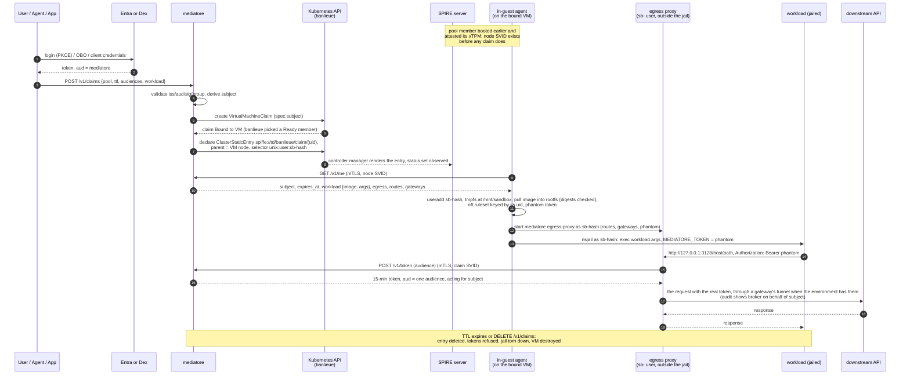
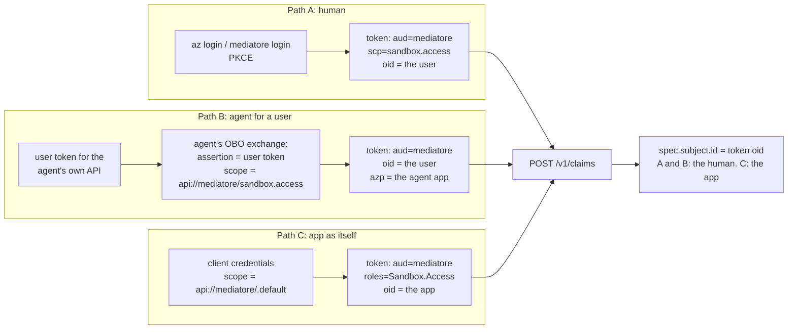

<!-- Copyright (c) 2026 Erick Bourgeois, mediatore -->
<!-- SPDX-License-Identifier: Apache-2.0 -->

# Running workloads on a claimed VM

How code actually ends up executing inside a sandbox, for each kind of caller:

- **A**: a human user, directly;
- **B**: an existing agent (an orchestrator, a bot, a CI job) acting *on behalf of* a
  user;
- **C**: a service acting *as itself*, with an app-only JWT from another Entra ID app
  registration.

All three converge on the same call, `POST /v1/claims` with a bearer token whose
audience is mediatore, and everything after that call is identical. The differences
are only in how the token was obtained and who the sandbox's *subject* ends up being.
The call creates an `AgentSandbox` resource with that subject (ADR-0008); a caller with
RBAC on the cluster can create the same resource directly, see
[Requesting a sandbox](requesting-a-sandbox.md).

## The one rule that shapes everything

**Nothing inbound ever reaches the VM.** There is no SSH, no exec API, no reverse
channel from mediatore. The workload is declared *at claim time* (`workload.image` +
`workload.args`), started by the in-guest agent, and speaks to the world only through
its allowed egress: the claim's downstream audiences, reached through the egress proxy
on the VM's loopback ([ADR-0025](../adr/0025-phantom-token-egress-proxy.md)). If you
need interactivity, the workload dials **out** (see
[Interaction patterns](#interaction-patterns)).

## Path A: a user, directly

1. Log in and get a broker-audience token:

   ```bash
   # Entra (work)
   az login --scope api://mediatore/sandbox.access
   TOKEN=$(az account get-access-token --scope api://mediatore/sandbox.access \
             --query accessToken -o tsv)

   # Dex (homelab): PKCE flow as mediatore's own public client, loopback redirect
   mediatore login --issuer https://dex.home.example
   # an issuer on a private PKI: trust exactly that CA (the broker's issuers[].ca_file)
   mediatore login --issuer https://dex.home.example --ca-file ~/.config/mediatore/dex-ca.pem
   ```

   `mediatore login` redirects back to a loopback listener on a fixed port: `http://localhost:8000`,
   or `http://localhost:18000` when 8000 is busy (kubelogin's own pair). An issuer that matches a
   public client's redirect URIs exactly, as Dex does, cannot register a port chosen at random, so
   register these two for the `mediatore` client. `--redirect-port` (repeatable), `--redirect-host`
   and `--redirect-path` change them for an issuer that registered something else, and
   `--redirect-port 0` asks the OS for a port, for an issuer that accepts any loopback one. Where
   the CLI is not installed, kubelogin with `--oidc-client-id=mediatore` does the same login and
   its ID token is the bearer for the API.

   The token's `aud` is mediatore and (on Entra) `scp` contains `sandbox.access`.
   A kubectl/kubelogin token for the Kubernetes API does **not** work here: wrong
   audience, rejected with 401 by design.

   On Dex the login also yields a refresh token (`offline_access`), which the next
   step delegates to mediatore: an issuer configured with a `session` requires it, and
   mediatore refreshes the session before every token it mints for the sandbox, so a
   login revoked at Dex, or removed from the required group, stops the sandbox at its
   next token ([ADR-0013](../adr/0013-dex-session-delegation.md)). The CLI forgets the
   refresh token once delegated (Dex rotates it); a second claim is a second login.

2. Claim, naming the workload (an argument that starts with a dash goes in the `--arg=-p`
   form, or the CLI reads it as a flag of its own). `--pool` is optional: with neither it nor
   `--pool-selector key=value`, the claim is made across every pool in the sandbox namespace
   ([ADR-0044](../adr/0044-a-sandbox-selects-its-pool-by-label.md)). `--strategy spread` asks
   banlieue for a member on a host where you hold the fewest sandboxes, `--strategy
   most-available` for the host with the most Ready members; without the flag the member Ready
   longest is taken ([ADR-0047](../adr/0047-a-sandbox-chooses-its-member-by-strategy.md)):

   ```bash
   # Dex: the CLI posts the claim with the session delegated
   mediatore sandbox create --mediatore https://mediatore.sandbox.example \
     --pool pool-a --ttl 3600 --audience api://trading-data \
     --image registry.internal:5000/sandbox/claude:latest \
     --arg /usr/bin/claude --arg=-p --arg "reconcile the ledgers"

   # A broker behind a private PKI: `create`, `get` and `delete` take the CA as `login` does
   # (--ca-file, or MEDIATORE_CA_FILE), and then trust nothing else.

   # Entra, or any issuer without a session: the same call by hand
   curl -sS https://mediatore.sandbox.example/v1/claims \
     -H "Authorization: Bearer $TOKEN" \
     -d '{
       "pool_ref": "pool-a",
       "ttl_seconds": 3600,
       "audiences": ["api://trading-data"],
       "workload": {
         "image": "registry.internal:5000/sandbox/claude:latest",
         "args": ["/usr/bin/claude", "-p", "reconcile the ledgers"]
       }
     }'
   ```

3. mediatore validates the token, writes `spec.subject` = *you* (`oid` on Entra, the
   GitHub login via Dex), and creates the `VirtualMachineClaim`. banlieue binds a
   warm, already-attested pool member; mediatore declares the claim's SPIFFE entry as
   a `ClusterStaticEntry` and the SPIRE Controller Manager creates it (no entry ever
   exists any other way, ADR-0006); the in-guest agent fetches the subject over mTLS,
   creates your `sb-` user, mounts a fresh tmpfs, pulls your image into it as the
   rootfs, loads the ruleset, starts the egress proxy as that user and starts your
   command under nsjail with a phantom token in its environment.
   No further input from you is needed or possible.



## Path B: an agent acting on behalf of a user

An orchestrating agent (its own confidential Entra app) already holds a token *its
users* gave it: `aud` = the agent's API, not mediatore's. It cannot forward that
token; mediatore would reject the audience. Instead the agent performs its own
**On-Behalf-Of exchange** to get a mediatore-audience token that still carries the
user's identity:



Setup, once, in Entra:

1. The agent's app registration gets a **delegated permission** on mediatore's app
   (`api://mediatore/sandbox.access`) with admin consent.
2. mediatore's app lists the agent in `knownClientApplications` (or the agent is
   pre-authorised), so the consent chain is clean.

At runtime the agent exchanges every user's token before claiming
(`grant_type=jwt-bearer`, `requested_token_use=on_behalf_of`, its own
`client_assertion`). The result: `spec.subject.id` is the **human's** `oid`, the
sandbox belongs to the user, not to the agent. The agent shows up as `azp` in
mediatore's audit log, exactly like mediatore itself shows up as `azp` downstream.
This is runbook §4.3 and the recommendation of open decision #10: an agent claiming
for a user must present an OBO chain, so `subject` is always a human unless the
caller is explicitly app-only.

Two properties worth noticing:

- The user's original token still never reaches mediatore or the VM: mediatore sees
  the OBO *result*, and the VM sees no user token at all, ever.
- The sandbox's downstream tokens are minted for the **user**; the agent cannot widen
  them beyond the audiences it requested at claim time, and the user's Conditional
  Access / revocation applies to the whole chain.

**Homelab note (Dex):** Dex has no OBO. The equivalent is the `trustedPeers`
cross-client flow: the agent's Dex client lists `mediatore` in its audience request
(`audience:server:client_id:mediatore` scope), producing an ID token with
`aud: [agent, mediatore]` and the user's login as subject. Same shape, weaker
attestation of the agent; acceptable at homelab trust levels. Such a token logs in,
but a session issuer also needs a refresh token issued to mediatore's own client
(ADR-0013 decision 3), which an agent gets by running the same PKCE flow as the CLI
against the `mediatore` client.

## Path C: a service with an app-only JWT (another Entra app)

A pipeline or scheduled service with no human in the loop uses **client
credentials**:

1. mediatore's app registration defines an **app role** (e.g. `Sandbox.Access`,
   member type *Application*).
2. The calling app is granted that application permission + admin consent.
3. It requests `scope=api://mediatore/.default` with its client secret/certificate
   and receives a token with `aud` = mediatore and `roles: ["Sandbox.Access"]`, no
   `scp`, no user.

mediatore records `spec.subject.id` = the **app's** `oid` and issues downstream
tokens app-only as well (runbook §4.3: OBO is replaced by app-only tokens with
`roles`; there is no user to act for). The `sb-` username derives from the app's
`oid` exactly like a human's. Use this for fleet jobs (nightly report generation,
scheduled data pulls) where the audit trail should say *the service did this*,
not a person.

> The `required_group` gate reads `roles` as it reads `groups`, so an app role gates an
> app-only login. What an app-only principal cannot do is the On-Behalf-Of exchange,
> which Entra reserves for user principals (ADR-0016): a claim from one gets `sts`
> tokens, and an `entra-obo` audience for it is refused at the exchange.

## What "the workload" is

Two images are involved, and they are not the same thing:

| | The VM image | The workload image |
| --- | --- | --- |
| What | The pool member's disk: Kairos, the SPIRE agent and its TPM plugin, the one `mediatore` binary, `nsjail`, `nftables` | An ordinary OCI container image: the runtime, the agent framework, the tools, your code |
| Who chooses it | The operator, once, when the pool is baked ([deploying](deploying.md) step 6) | The requester, per claim: `workload.image` on the claim or the `AgentSandbox` |
| Who runs in it | `mediatore guest`, as root, outside the jail | Your `workload.args`, as the `sb-` user, inside the jail |
| How it gets there | Built from `image/Dockerfile`, a Kairos derivative published as `ghcr.io/firestoned/mediatore-guest` ([ADR-0023](../adr/0023-sandbox-vm-image-kairos-derivative.md)); every member boots it | Pulled by the guest at bind into the per-claim tmpfs, as a rootfs for `nsjail`; no container runtime is involved |

So "the workload" is your agent packaged as a container image, and the VM is what
mediatore runs it on. One VM image serves every workload image; the pull credential of
[ADR-0022](../adr/0022-registry-pull-credentials-from-the-broker.md) is the operator's
because the registry it opens is where the organisation publishes its sanctioned agent
images, not anything of the user's. Nothing of mediatore's is in your image either: the
guest bind-mounts the one binary into the jail for the confinement step
([ADR-0014](../adr/0014-one-binary-roles-as-subcommands.md), [ADR-0024](../adr/0024-landlock-inside-the-jail.md)),
and the credential never enters the jail at all ([ADR-0025](../adr/0025-phantom-token-egress-proxy.md)).
[The research agent, front to back](research-agent-walkthrough.md) follows one workload
image from the team that publishes it to the report it pushes, with the policy notaio
certifies for it.

`workload.image` is an OCI reference the in-guest agent pulls itself and unpacks into
`/mnt/sandbox/rootfs`, on a tmpfs mounted for that claim (`nosuid,nodev`, size-bounded;
[ADR-0021](../adr/0021-sandbox-filesystem-tmpfs-and-rootfs-from-the-registry.md)): every layer is verified against its digest and the
manifest digest is logged with the claim, so a reference pinned by digest
(`name@sha256:…`) is what makes the record reproducible; a tag is whatever the registry
says it is at bind time. The registry is reached over HTTPS (Docker Hub, `ghcr.io`,
your own), anonymously unless the operator configured a credential for it
(`registries[]` in the broker's config, [ADR-0022](../adr/0022-registry-pull-credentials-from-the-broker.md)): the
guest gets that credential with the claim and uses it for the pull; nothing in the jail
sees it. A reference the broker cannot parse is refused at `POST /v1/claims`
(`invalid_workload_image`). `tar` and `tar+gzip` layers are accepted, zstd is not yet. `workload.args` is the argv executed
under nsjail as the per-subject user. The jail gives it:

| Inside the jail | Purpose |
| --- | --- |
| `MEDIATORE_EGRESS_PROXY` env (`http://127.0.0.1:3128`) | The **only** way out: a reverse proxy on the VM's loopback, run by the guest as your `sb-` user outside the jail. Call `$MEDIATORE_EGRESS_PROXY/<host>[:<port>]/<path>` and the proxy forwards to `https://<host>:<port>/<path>`, for the `egress` endpoints of the claim's audiences, plus, where the operator has turned `policy.egress` to `enforce`, the direct `egress[]` hosts of the claim's policy bundle, and no other host, trusting the Mozilla roots or the CA the operator named for that audience ([ADR-0025](../adr/0025-phantom-token-egress-proxy.md), [ADR-0030](../adr/0030-policy-egress-enforced-at-the-gateway.md)); in an environment with egress gateways the connection is a tunnel through one of them, opened as your claim, and a gateway's refusal is `502` with `gateway_refused` ([ADR-0028](../adr/0028-egress-gateway-envoy-with-spiffe-identity.md)) |
| `MEDIATORE_TOKEN` env | A **phantom** token: send it as `Authorization: Bearer $MEDIATORE_TOKEN` and the proxy replaces it with a real token for the host's audience on the way out. The real token lives in the proxy and never enters the jail. On a route without a credential (a policy bundle's direct egress host, or an audience the operator declared `via: none`) the phantom is dropped and the request leaves bare, so a tool that sends it to every host works there too. Any other `Authorization` value is refused (`401`) on every route; no header at all is forwarded bare |
| The audience's rules | The operator may bound an audience to methods and paths (`audiences[].rules`, nono's `endpoint_rules` shape: `{ method, path }`, `*` one segment, `**` any). A request outside them is refused (`403`) before anything is forwarded; no rules means every method and path |
| The rootfs (read-only) | Your image's filesystem as pulled: root-owned, setuid bits dropped, no device nodes of its own ([ADR-0021](../adr/0021-sandbox-filesystem-tmpfs-and-rootfs-from-the-registry.md)) |
| `/dev/null`, `/dev/zero`, `/dev/urandom` | The only device nodes, bind-mounted read-only from the VM (a read-only bind still opens for writing on a device node). Landlock lets the workload write `/dev/null` alone, as a single file; the other two are read-only to it. There is no `/dev` tree, no terminal, no kernel memory. Tools such as `git` fail without `/dev/null` (`could not open '/dev/null'`) |
| `/work` (writable), tmpfs `/tmp` + `$HOME` | Scratch space; `/work` is your `sb-` user's on the per-claim tmpfs, gone with the unmount at teardown |
| `/usr/bin/mediatore` (read-only, the same file the guest runs from) | What `nsjail` execs before your argv, for the confinement below; the rootfs ships nothing of mediatore's ([ADR-0014](../adr/0014-one-binary-roles-as-subcommands.md)). `mediatore token` is still in it, with no socket and no route to the broker: inside the jail it does nothing |
| What ran, on the record | After the pull and the tables, before your command runs, the guest reports the image's manifest digest, the sandbox ruleset's hash and the host table's hash (or that it was missing) to the broker over the node SVID; `mediatore sandbox get <name>` prints the report once it is there ([ADR-0029](../adr/0029-the-pull-on-a-routeless-segment-and-the-pool-vms-root-rules.md) decision 5), so the record says which bytes and which rules ran |
| The VM's network, for every uid (with egress gateways) | TCP to the three gateways' data and relay ports, loopback and established traffic, nothing else out and nothing in: the image's host table, loaded before the network ([ADR-0029](../adr/0029-the-pull-on-a-routeless-segment-and-the-pool-vms-root-rules.md), [ADR-0063](../adr/0063-the-image-pull-goes-through-the-claims-proxy-and-the-gateway-like-any-egress.md)). Your image is pulled through the claim's egress proxy and a gateway, so it must live in a registry your namespace was granted, an audience of `role: registry` your claim names (`--audience <registry>`), or the claim is refused with `registry_not_granted`; your workload cannot reach that registry itself (`404 pull_only`) |
| The VM's network, filtered by the sandbox uid | TCP to the proxy on loopback, and for the proxy's own sockets (the same uid) either the environment's gateways and the broker through their control relay, by address and with no DNS at all, or, in an environment without gateways, the broker, the `egress` endpoints and DNS to the VM's resolvers; everything else the uid sends is logged (`mediatore-sandbox drop:`) and dropped, and a packet to the proxy's port from any other uid is dropped ([ADR-0020](../adr/0020-jail-network-nftables-keyed-by-sandbox-uid.md), [ADR-0025](../adr/0025-phantom-token-egress-proxy.md), [ADR-0028](../adr/0028-egress-gateway-envoy-with-spiffe-identity.md) decision 6) |
| Landlock, applied before your argv runs | What `nsjail` execs is `mediatore jail-exec`, which confines its own process and then execs your command: writes only to `/work`, `/tmp` and `$HOME` whatever your image's file modes say, TCP `connect()` only to the proxy's port, no `bind()`, signals and abstract sockets scoped to the jail; inherited by every process you start. A write elsewhere fails with `EACCES`, a listener fails at `bind()`, a direct connection to anything fails too ([ADR-0024](../adr/0024-landlock-inside-the-jail.md)). A client tool that binds before it connects (busybox `nc`) fails in the jail too, since Landlock refuses every bind; `wget` and `curl` do not bind |
| A seccomp filter, applied after Landlock | Your process may open `AF_UNIX` sockets and TCP (stream) sockets over IPv4 and IPv6 and nothing else: `socket(AF_VSOCK)`, `AF_NETLINK` and `AF_PACKET` fail with `EAFNOSUPPORT`, a UDP or raw socket fails with `EPERM` (so the libc resolver cannot resolve a name: use numeric addresses or `/etc/hosts`; the proxy resolves for you), and `io_uring_setup` fails with `EPERM`, so a runtime that probes for `io_uring` falls back to `epoll` ([ADR-0051](../adr/0051-socket-families-and-io-uring-denied-to-the-workload-by-seccomp.md)). Inherited by every process you start |

No socket, no token files, no baked-in secrets, and no network beyond the proxy and,
through it, the endpoints the claim's audiences declare (`audiences[].egress` in the
broker's config, [ADR-0020](../adr/0020-jail-network-nftables-keyed-by-sandbox-uid.md)):
an audience with none gives nowhere to go, which is the default until the operator says
where. A public API your tools reach as themselves, with no token of mediatore's, is an
audience the operator declares `via: none`: same `egress`, same rules, the phantom dropped
on the way out. Tools that take a base URL and a bearer from the environment work unchanged:
`ANTHROPIC_BASE_URL=$MEDIATORE_EGRESS_PROXY/api.anthropic.com ANTHROPIC_AUTH_TOKEN=$MEDIATORE_TOKEN`
for the Anthropic SDKs and Claude Code (or `ANTHROPIC_API_KEY=$MEDIATORE_TOKEN`: the proxy
recognises the phantom in `x-api-key` when the operator declared that audience `via: secret`
with that header, [ADR-0032](../adr/0032-operator-held-credentials-as-an-audience-backend.md));
`OPENAI_BASE_URL=$MEDIATORE_EGRESS_PROXY/api.openai.com/v1 OPENAI_API_KEY=$MEDIATORE_TOKEN`;
`git clone -c http.extraheader="Authorization: Bearer $MEDIATORE_TOKEN" $MEDIATORE_EGRESS_PROXY/git.home.example/platform/services.git`.
Nothing in the jail mints, refreshes or caches a token: the proxy does, over the claim's
SVID, as `mediatore token` used to from inside.

The jail sets no `PATH` and reads nothing of the image's configuration (`ENTRYPOINT`,
`ENV`, `WORKDIR`): `workload.args` is the whole argv, so name the interpreter and the
program by absolute path (`/usr/local/bin/python3 /usr/local/bin/research-agent …`), and
expect a `127` from the supervisor when a bare name is not under `/bin` or `/usr/bin`.
What happens when your command exits before the deadline is the claim's `workload.restart`
([ADR-0033](../adr/0033-a-one-shot-workload-the-restart-policy-and-the-claim-released-when-it-is-done.md)):
`always` restarts it (the default: an agent that runs until told), `on-failure` restarts a
non-zero exit and ends the claim on `0` (an agent that runs once), `never` ends the claim
on any exit. The exit goes on the claim's record and the member is recycled.

What your command prints is, by default, visible on the VM console and nowhere else. Opt the
claim in with `--logs` (`workload.logs: true`;
[ADR-0045](../adr/0045-a-sandbox-workloads-output-streamed-to-its-owner.md)) and the guest
tees stdout and stderr, redacts each line before it leaves the VM (the phantom and every
secret-bearing value it placed in the jail, literally and in their base64 and percent-encoded
forms; JWTs, `Authorization` values and private-key PEM blocks by shape), and ships them to the
broker in batches; `mediatore sandbox logs -f <name>` prints them as they arrive, stdout to
stdout and stderr to stderr so `2>&1` merges them as a terminal would, and a plain `mediatore
sandbox logs <name>` reads a finished one-shot workload's output for the retention window after
it ended. The workload never waits for the broker: a slow or unreachable one costs the queue's
oldest lines, which the reader sees as an explicit gap, never silence. Redaction is best effort
and the broker keeps the newest `logs.max_bytes` (1 MiB by default) per claim; the exit code
stays on `sandbox get`. The broker needs `logs.enabled: true`, or the claim is refused, and
it stores the output sealed: each batch is encrypted with the broker's OpenBao transit key
before it is written, so a copy of etcd or a `get secrets` shows ciphertext
([ADR-0052](../adr/0052-a-sandbox-workloads-stored-output-sealed-per-batch-with-the-transit-key.md)).
If OpenBao is unreachable a read answers `503`; retry it.

Output reaches a follower as it is written, not in bursts. A line is shipped when it ends,
at a newline or at a bare carriage return (a progress line rewritten with `\r` arrives as it
moves), at once when the workload has been quiet and at most every half second while it
keeps printing, and the broker wakes a follower when a batch is stored. A line that has not
ended is not held for its newline: after 150 ms of silence the guest ships what it has of it,
and `sandbox logs` joins the pieces into the line the workload wrote. The last few hundred
bytes of such a line still wait, for more output or for the end of the line, because the
redactor must see a secret whole before it lets go of anything near it; a prompt shorter than
that shows when its line ends. A workload that block-buffers its own stdout because it is
writing to a pipe and not to a terminal is out of this path's reach: nothing in the sandbox
can ship what the workload has not written yet. The usual remedies are the workload's own:
`PYTHONUNBUFFERED=1`, `stdbuf -oL`, or a logger that flushes each line.

### When a socket or `io_uring` call fails in the jail

The seccomp filter ([ADR-0051](../adr/0051-socket-families-and-io-uring-denied-to-the-workload-by-seccomp.md))
is on for every claim and has no setting: no flag, environment variable or claim field relaxes it.
What it looks like from inside, and what to do:

| You see | Cause | What to do |
| --- | --- | --- |
| `socket: Address family not supported by protocol` (`EAFNOSUPPORT`) | A family other than `AF_UNIX`, `AF_INET` or `AF_INET6`: `AF_VSOCK`, `AF_NETLINK`, `AF_PACKET`, `AF_ALG` and the rest | Nothing in the workload needs these. If a runtime enumerates interfaces with `getifaddrs` (some Go and Java runtimes), that is `AF_NETLINK`: it is denied outright today (ADR-0051 open question 2), so avoid the call or tell the operator |
| `Operation not permitted` (`EPERM`) opening a UDP or raw socket, or a name that will not resolve (`getaddrinfo`, `Temporary failure in name resolution`) | The jail refuses every inet socket that is not a stream, so the libc resolver, which speaks UDP to port 53, cannot run | Use numeric addresses or `/etc/hosts`. Name the proxy by its loopback address (`$MEDIATORE_EGRESS_PROXY`); the proxy resolves hosts for you, outside the jail |
| `io_uring_setup: Operation not permitted` | `io_uring` is refused | Runtimes that probe for it (libuv, tokio, recent Node and Python event loops) fall back to `epoll` by themselves; one that requires `io_uring` cannot run here |
| `mount`, `unshare`, `setns`, `bpf`, `perf_event_open` or `userfaultfd` fail with `EPERM` | Refused; already out of reach without capabilities, now independently of them | Not available to a workload |

To confirm the filter is the cause, ask the operator for the member's journal
(`journalctl -u mediatore-guest`): the jail's line reads `confinement applied; exec ...
seccomp_filters=2` when the filter is on. On the VM, `grep Seccomp /proc/<workload pid>/status`
shows `Seccomp: 2` and `Seccomp_filters: 2` for the workload and every process it starts. A claim
whose filter cannot load ends with exit 125 and the output `confinement refused`; it never runs
without it.

### Reading the output

```sh
# Ask for the output when you create the sandbox. Without --logs nothing is captured.
mediatore sandbox create --mediatore https://mediatore.sandbox.example --pool pool-a \
  --audience api://trading-data --image ghcr.io/example/agent:1 --arg /agent --arg run --logs

# Stream it as it arrives; the stream ends when the claim does.
mediatore sandbox logs -f my-agent

# After a one-shot workload has exited: the last 50 records, with the time the guest read each.
mediatore sandbox logs --tail 50 --timestamps my-agent

# Resume from a sequence number you saw earlier (every record carries one).
mediatore sandbox logs --since 1200 my-agent

# A sandbox declared as an AgentSandbox in another namespace.
mediatore sandbox logs --namespace team-a -f my-agent
```

The CLI reads `GET /v1/claims/{name}/logs`, which any client with the session bearer can
call directly. The body is NDJSON: a header line, then one line per record or gap in
sequence, then an end line saying why the stream stopped (`client`, `claim_ended`, `ttl`).
A record is a line of output, or a piece of one: a record with `"partial": true` continues
in the next record of the same `stream`, and a client that prints lines joins them as the
CLI does (the field is absent on a whole line and on the piece that ends one).
`?follow=true` holds the connection open and sends an empty line every 15 s as a keepalive;
`?tail=N`, `?since=SEQ` and `?namespace=` match the flags above.

```sh
curl -sN -H "Authorization: Bearer $SESSION" \
  "https://broker.sandbox.home.example/v1/claims/my-agent/logs?follow=true&tail=20"
```

Where it lives and for how long:

- **In the cluster**, as a ring of Secrets in the broker's namespace, one per 64 KiB segment,
  named `mediatore-logs-<claim uid>-<segment>` and labelled `mediatore.io/logs=segment`.
  `kubectl -n mediatore get secrets -l mediatore.io/logs=segment` lists them; reading one
  directly is break-glass and shows in the API server's audit log. Under `dev_mode` the
  in-memory store keeps the same ring and loses it on restart.
- **The newest `logs.max_bytes`** per claim (1 MiB by default, 64 KiB to 4 MiB). Older
  records are dropped and the reader is told how many bytes went that way.
- **For the claim's life, then `logs.retention_secs`** after it ends (default
  `store.retention_secs`, one hour). The watcher's resync and the audit sweep remove rings
  past that window and rings whose claim record is gone; deleting the `AgentSandbox` removes
  them at once when it lives in the broker's namespace.
- **Only the claim's subject** can read them through the broker. Nothing is stored unless
  the requester passed `--logs` and the operator set `logs.enabled: true`
  ([the store guide](the-store.md#workload-output) has the operator side).

## Interaction patterns

Because nothing inbound reaches the VM, pick one of:

1. **Fire-and-forget.** The workload does its job and writes results to a downstream
   API (a bucket-like service, a ticket system, a data API) that was listed in
   `audiences`. The claim's TTL is the job timeout.
2. **Dial-out interactive.** For a conversational agent, run the agent *as* the
   workload and have it connect outward to your orchestrator or relay (WebSocket,
   queue). Register the orchestrator's endpoint as a **downstream audience**: the
   workload then both *reaches* it (through the egress proxy) and *authenticates* to it
   (the proxy injects the audience-scoped token carrying the subject + the RFC 8693
   `act` claim naming the sandbox). Your orchestrator can verify it is talking to the
   sandbox for claim X acting for user Y, not just anyone holding a URL. The proxy
   speaks HTTP/1.1; a WebSocket upgrade is not relayed, so a dial-out relay is a plain
   HTTPS API or a long poll.
3. **Poll-the-broker.** The caller polls `GET /v1/claims/{name}` for phase and
   deadline; that endpoint mirrors state but never carries workload output. With `--logs`
   the caller can also read what the workload printed, `GET /v1/claims/{name}/logs`
   (`mediatore sandbox logs`, [ADR-0045](../adr/0045-a-sandbox-workloads-output-streamed-to-its-owner.md)):
   the answer of a one-shot agent, redacted in the VM and bounded in size and time, for the
   owner alone. Structured results still travel via pattern 1 or 2.

## Status and caveats

- Implemented today: path A end to end on any session issuer (Dex with GitHub, Google, Auth0; [issuers](issuers.md)), with the session
  delegated and refreshed before every issue (ADR-0013, `make check` runs it against
  the fake issuer's real grants); paths A and B on Entra, with the caller's token
  exchanged On-Behalf-Of and every issue refreshed at Entra (ADR-0016, against the fake
  issuer playing Entra; [the Entra path](the-entra-path.md) has the live run); the SVID
  legs over SPIFFE mTLS (roadmap 01); the claim as a real `VirtualMachineClaim` behind
  an `AgentSandbox` (roadmaps 03 and 08); the persistent store (roadmap 05); the
  transit sealer (ADR-0015).
- Still to come: roadmap 04's live run against a tenant; 02's SPIRE manifests rendered
  into a tracked overlay and `make live-admission-test` against the cluster; 06's tier
  that boots the guest under the image's own units on a Kairos VM; 07's remaining proxy
  items; 11's rollout of `enforce` across the tiers; 12's repository run against Claude.
  See [`ROADMAPS.md`](https://github.com/firestoned/mediatore/blob/main/ROADMAPS.md).
- Threat model: the workload holds no token since the egress proxy
  ([ADR-0025](../adr/0025-phantom-token-egress-proxy.md), roadmap 07): what a
  prompt-injected workload can do is drive requests through the proxy, within the
  audience's rules, while the claim lives (R-3, rewritten). The dial-out pattern narrows
  that to one audience.
