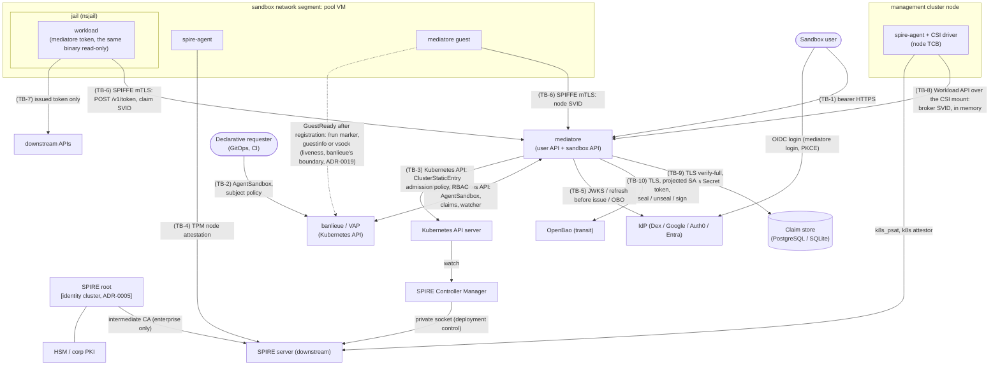

<!--
Copyright (c) 2026 Erick Bourgeois, mediatore
SPDX-License-Identifier: Apache-2.0
-->
# Threat Model

> **Status:** Living document. Last full pass **2026-10-24**, against the
> architecture defined by **ADR-0001 … ADR-0019** (ADR-0009 and ADR-0010 are
> adopted platform ADRs with no code of their own). This pass covers ADR-0019:
> `GuestReady` announced by the guest after it is attested and registered,
> not by a boot stage, on the channel the hypervisor reads. No new asset and no
> broker code; the guest gains one outbound, unauthenticated, liveness-only
> signal to banlieue (its provider's boundary, read nowhere here) and the VM
> units an installed-disk guard. TB-2 gains two rows (a forged and a missing
> announcement), TB-4 one (the live installer as an agent); §2, §4 and §9
> reworded, the diagram one edge, §7 one item. Earlier the same day, the pass
> followed the
> first live run of the TPM attestation path, the kind tier with a vTPM
> behind the node (`make kind-e2e-tpm`), which corrected two things the
> previous pass took from the manuals: the EK certificate is signed by the
> hypervisor's swtpm local CA *issuing* certificate, not its root, and the
> plugin verifies against the files in `ca_path` with no intermediates, so the
> issuing certificate is what the bundle carries; and the plugin reads a
> ConfigMap volume's `..data` link as a file, so the component's init
> container now copies the certificates beside the plugin. No new component,
> asset, boundary or broker code; TB-4's EK CA row and A-15 reworded, §7 one
> item, the tier cited as the live proof the previous pass called open. The
> pass before, 2026-10-22, covered ADR-0018, TPM node attestation with `spiffe/spire-tpm-plugin` as a
> kustomize component on the SPIRE server (the plugin from a digest-pinned
> image, its checksum verified by the server) with one swtpm local CA root per
> hypervisor host as the EK trust bundle, and the agent's configuration and
> plugin for the VM image. No code in the
> broker; TB-4 rewritten around what now exists (three rows replaced, two
> new), **A-15 new** (the hypervisors' swtpm CA keys), §2 one row, §7 one
> item, R-6 reworded. The day before, roadmap 02's first half, the broker on a homelab cluster: the `NetworkPolicy`
> of ADR-0007 decision 7 now exists as a manifest in the example overlay
> (`deploy/overlays/homelab-example`), cited by TB-1 and TB-6 rows and §7; no
> new component, asset or boundary, no code. Earlier the same day,
> ADR-0017, issuer profiles: the session path is any OIDC issuer (Dex with
> GitHub behind it, Google, Auth0), not Dex's alone; the CLI takes the login's
> scopes, extra authorization parameters and the client secret an issuer's
> token endpoint wants from a public client, the broker sends that secret on
> refreshes, and the group gate reads a configurable claim. No new boundary
> or actor; TB-1 gains one row, TB-5 two, **A-14 new** (the installed-app
> client secret, a parameter rather than a credential), §2 the user tools
> row, §7 one item, the IdP's name throughout. The pass before, 2026-10-16,
> covered ADR-0016, the Entra path: the caller's access token is exchanged On-Behalf-Of
> at claim creation for a refresh token issued to mediatore for that user and
> sealed like a Dex session, every issue refreshes it for the audience's
> resource (a token for mediatore itself validated like a login for an `sts`
> audience, Entra's token handed to the workload unread for an `entra-obo`
> audience), a refusal releases the claim and an outage revokes nothing, and
> the broker's credential at Entra is a PS256 client assertion signed by a key
> file, by OpenBao transit or presented as a federated ServiceAccount token.
> TB-1 gains three rows, TB-5 seven, TB-7 one reworded, TB-10 two; §2 two rows
> reworded and the OpenBao row widened, **A-13 new** (the client assertion
> credential), A-2 and A-3 reworded, the diagram's TB-10 edge, §7 one item.
> **R-2 rewritten** around the live proof that is still pending (Entra is
> proven against the fake issuer only), **R-3 widened** to Entra's token
> lifetime, R-4 reworded. The day before, ADR-0015, the transit sealer: the wrapping key for refresh material stays in
> OpenBao's transit engine, the binding UID is the derivation context, the
> broker logs in as its ServiceAccount with a projected token for that audience
> and holds only a short-lived OpenBao token, a startup probe fails closed, an
> outage is `503 sealer_unavailable` and revokes nothing; every kind tier runs
> the broker on it. New boundary TB-10 (broker to OpenBao) with eight rows, a
> new component, A-10 rewritten, the diagram and the boundary list, §7 one
> item, **R-4 narrowed**. Earlier the same day, ADR-0014,
> one binary with the roles as subcommands: `mediatore serve`, `guest`,
> `token`, `login`, `sandbox` and `session` are one static musl artifact that
> the server image, the VM image and the kind pods all carry; the guest
> bind-mounts the binary at the pinned path read-only into the jail so `mediatore token` is
> on every workload's path; the node entry pins `/usr/local/bin/mediatore` and
> `unix:uid:0` is the selector that tells the guest role from a jailed
> workload. No new boundary, asset or actor; §2 three rows reworded, the
> diagram relabelled, TB-4 and TB-7 gain a row each, TB-6's impersonation row
> cites the shared client and the `dev` feature's new home, §7 one item,
> R-11 reworded. Same day, the Dex path's kind tier (`make kind-e2e-dex`): the
> real CLI at a real Dex from a pod, every issue refreshing at Dex, revocation by
> a group change in the directory and by a deleted refresh token; the issuer
> trust anchor pinned per issuer with `issuers[].ca_file` (TB-5 one row, TB-1
> and TB-5 rows cite the tier). Earlier, 2026-10-14, roadmap
> 04's first slice, the Dex path (ADR-0013): the caller delegates its upstream
> refresh token with the claim, it is sealed under the sandbox's UID and
> follows the claim into its record, every token issue refreshes it first
> (fresh groups minted, rotation re-sealed), a refusal upstream or at the
> group gate releases the claim at once while an outage revokes nothing, a
> per-claim limit sits ahead of the upstream call, and the CLI (then `mediatore-cli`, now `mediatore login`) logs in
> as mediatore's own public client. TB-1 gains four rows, TB-5 five, TB-6
> three, TB-9 one; new asset A-12 (the CLI's session file) and a new
> component; A-2 is now produced; R-2 narrowed to the Entra half, new R-11.
> Earlier the same day, roadmap
> 05's persistent store (ADR-0012): one sqlx store over SQLite or PostgreSQL,
> PostgreSQL only over TLS the client verifies with the URL in a Secret,
> refresh material as a sealed envelope bound to its claim, claim rows swept
> into an audit table, revocations and the node registry surviving a restart.
> New boundary TB-9 (broker to database) with twelve rows, new assets A-10
> and A-11, **R-5 deleted**, R-4 widened to the local sealer, new R-10. Earlier
> the same day, roadmap
> 08's `AgentSandbox` (ADR-0008, now built): the request for a sandbox is a
> custom resource whose `spec.subject` is pinned to the caller at admission,
> mediatore creates and owns one `VirtualMachineClaim` per sandbox and the
> store record keyed by its UID, refuses an audience or issuer outside its
> configuration before any claim exists, and holds a finalizer until the
> claim is gone. TB-1 gains three rows and TB-2 seven; new asset A-9 (the
> `brokers` lists) and a new actor (the declarative requester); A-7 widened;
> R-5 narrowed, since records are now rebuilt from the resource. The day
> before, roadmap 03's claim watcher (ADR-0011): a `VirtualMachineClaim` is
> bound by the EK hash banlieue mirrors onto it and nothing else, an
> unresolved bind fails closed, node entries come from pool members that
> publish a certificate, and one replica leads by Lease. Earlier the same
> day, roadmap 01: registration entries
> as `ClusterStaticEntry` resources through the Kubernetes API with no SPIRE
> admin identity (ADR-0006), and SPIFFE mTLS on the sandbox listener with the
> broker's SVID from the Workload API over the SPIFFE CSI driver (ADR-0007);
> TB-3 rewritten, TB-6 real, TB-8 added, **R-1 deleted**, R-8 narrowed to
> signatures. The pre-history: the first pass (2026-09-26) covered the
> dev-mode loop and recorded every unbuilt edge as a fail-closed stub or an
> accepted risk, never as a control that exists; 2026-10-03 measured the
> deployed homelab SPIRE and Dex (R-7 concrete, R-8 and R-9 new); 2026-10-04
> deleted R-9 when the datastore moved to post-quantum-only TLS. The revision
> log in §10 has the details.
>
> **Method:** asset/actor enumeration, trust-boundary decomposition, STRIDE
> per boundary, control mapping to the crates in `crates/` and the manifests
> in `deploy/`.
>
> This document describes *what mediatore defends, from whom, and how*. It is
> the companion to [`SECURITY.md`](https://github.com/firestoned/mediatore/blob/main/SECURITY.md), which describes how to
> **report** a vulnerability. Specific unremediated findings go through
> [private vulnerability reporting](https://github.com/firestoned/mediatore/security/advisories/new),
> never this page.

## 1. What mediatore is, in security terms

mediatore turns "a person logged in" into "a process on an attested VM may act
as that person, for one audience at a time, for fifteen minutes at a time". It
holds three things an attacker wants:

1. **The power to mint delegated tokens.** Via the refresh material it holds
   for a user (a Dex session, ADR-0013, or the session Entra issued it
   On-Behalf-Of, ADR-0016) or its own STS signing key, mediatore can produce a
   token that downstream APIs accept as "on behalf of user X". Refresh material
   rests in the store only as a sealed envelope (ADR-0012).
2. **The subject binding.** It writes `spec.subject` on every `AgentSandbox`
   it creates for an API caller and on every `VirtualMachineClaim` it creates
   for a sandbox, and admission exempts it from the caller-equals-subject
   rule for exactly that; corrupt that and a sandbox is issued to the wrong
   person.
3. **Entry declaration.** It declares which SPIFFE identity exists on which
   node, as `ClusterStaticEntry` resources under `/banlieue/` that admission
   policy constrains; a forged entry is a forged workload identity. mediatore
   holds no SPIRE admin identity (ADR-0006).

## 2. Components

| Component | Crate / manifest | Runs where | Privilege |
| --- | --- | --- | --- |
| User API (bearer) | `crates/mediatore-api`, `crates/mediatore-entra` | `banlieue-system` pod | Creates, reads and deletes `AgentSandbox` resources as the broker ServiceAccount, which the subject admission policy exempts; its token validation is the control. For an Entra issuer it exchanges the caller's token On-Behalf-Of, authenticating as the broker with a client assertion (ADR-0016) |
| Sandbox API (SPIFFE) | `crates/mediatore-api` | same pod | Issues tokens; reads the node/claim identity the listener verified; opens the claim's refresh envelope and refreshes upstream before each issue (ADR-0013, ADR-0016), handing an Entra token over unread for an audience Entra serves |
| User tools (`mediatore login`, `sandbox`, `session`) | `crates/mediatore-client`, composed into the one binary by `crates/mediatore/src/main.rs` (ADR-0014) | the user's machine | Logs in at the issuer as mediatore's public client (PKCE), with the scopes, extra parameters and installed-app secret the issuer wants (ADR-0017), keeps the ID and refresh tokens in a 0600 session file, delegates the refresh token with a claim and forgets it |
| Sandbox listener | `crates/mediatore-tls` | same pod, :8443 | Terminates SPIFFE mTLS; holds the broker SVID and key in memory |
| Claim reconciler and `AgentSandbox` reconciler | `crates/mediatore-claims`, `crates/mediatore-spire` | same pod (leader-elected) | `clusterstaticentries` create/delete/list/watch through the Kubernetes API, admission-constrained; no SPIRE admin. `virtualmachineclaims` create/delete, `agentsandboxes` patch (status, finalizer) |
| STS | `crates/mediatore-sts` | same pod | Holds the signing key handle |
| Claim store | `crates/mediatore-store` (`SqlStore`, one query set) | PostgreSQL at work, SQLite for one replica; in-memory only under `dev_mode` | Sealed refresh envelopes, revocations, the node registry, audit rows; the request fields are a copy of the `AgentSandbox` spec. Migrated at startup; swept at resync |
| Store database | the operator's PostgreSQL, or a SQLite file on the pod's volume (`dev/kind/postgres/` in kind) | management cluster or beside it | Holds every row; reached with the URL in Secret `mediatore-store` over TLS `verify-full` |
| OpenBao (transit) | the operator's OpenBao (`dev/kind/openbao/` in kind), `crates/mediatore-openbao` (the client), `crates/mediatore-store/src/seal.rs` (`TransitSealer`) and `crates/mediatore-entra/src/assertion.rs` (the transit signer) on the broker's side | management cluster or beside it | Holds the derived sealing key and, when configured so, the RSA key behind the broker's client assertion, and never releases either; encrypts, decrypts and signs for a token it issued to the broker's ServiceAccount (ADR-0015, ADR-0016) |
| In-guest agent (`mediatore guest`) | `crates/mediatore-guest` (`guest.rs`, `ready.rs`), the same static binary as the broker (ADR-0014) | root on each pool member | `useradd`, mount, nsjail; bind-mounts the binary at the pinned path read-only into the jail; writes the `GuestReady` announcement to the hypervisor's channel (the `/run` marker, `guestinfo`, vsock) once the node is registered, never before (ADR-0019) |
| Workload client (`mediatore token`) | `crates/mediatore-guest` (`token.rs`), the binary the guest mounted at `/usr/local/bin/mediatore` | inside the jail, as the `sb-` user | Holds one token in memory; nothing but the token on standard output |
| Deployment | `deploy/base/*.yaml`, with `deploy/overlays/homelab-example/` as the single-cluster shape (one replica on SQLite, the local sealer, the Tailscale ingress class, the `NetworkPolicy`) | management cluster | SA, RBAC, `ClusterSPIFFEID`, the `AgentSandbox` CRD (`crds/`, generated), the entries and the sandbox-subject admission policies, the CSI inline volume for the agent socket, the `LoadBalancer` service for :8443, ingress for :8080, the store URL from Secret `mediatore-store` (operator-created) |
| SPIRE Controller Manager | hardened chart (not this repo) | `spire-server` pod | Renders `ClusterStaticEntry` into server entries over the server's private socket |
| SPIRE TPM node attestor | `deploy/spire-tpm` (a kustomize component: the init container from the digest-pinned `spiffe/spire-tpm-plugin` image, the EK CA ConfigMap, the `server.conf` block with the checksum); the agent plugin in the VM image from `make dist-tpm-plugin` with `image/spire/agent.conf` | `spire-server` pod (the init container copies the binary); each pool VM | Verifies a VM's EK certificate against the hypervisor CAs and activates a credential on its vTPM; assigns `spiffe://<td>/spire/agent/tpm/<ek-hash>` (ADR-0018) |

## 3. Assets

| # | Asset | Where | Impact if stolen / forged |
| --- | --- | --- | --- |
| A-1 | STS signing key | file (`sts.signing_key_file`) or OpenBao transit | Mint tokens for any configured audience and any subject |
| A-2 | Refresh material (a Dex session delegated by the caller, or the session Entra issued the broker On-Behalf-Of) | store rows as `Sealed` envelopes only: key id, nonce, AES-256-GCM with the `AgentSandbox` UID as associated data (ADR-0013 revised ADR-0012's binding); parked in `sessions` between the API call and the record, then in the record; in the broker's memory only for the duration of one refresh | Act as the user at the issuer until the next rotation or revocation: a refresh yields a fresh token for mediatore's audience, and on Entra, with the broker's credential (A-13) as well, a token for any downstream the user consented to |
| A-3 | Upstream bearer tokens in flight | `POST /v1/claims` request; on Entra also the `assertion` of one On-Behalf-Of exchange, then dropped | Create claims as the user until `exp`; on Entra, with A-13, exchange it for a session |
| A-4 | Issued access tokens | workload memory, ≤ 15 min | One audience, until expiry |
| A-5 | Claim ↔ subject ↔ node binding | store + SPIRE entries | Sandbox issued to, or read by, the wrong person |
| A-6 | EK-hash ↔ DMI-UUID registry | store `nodes` table | A cloned or impostor VM accepted as a pool member |
| A-7 | Broker Kubernetes ServiceAccount | pod token | Create `AgentSandbox` resources and claims with arbitrary `spec.subject` (exempt from both subject policies); patch any sandbox's status; declare `/banlieue/{node,claim}/` entries, within what the entries admission policy allows |
| A-8 | Broker SVID and private key (`spiffe://<td>/mediatore`) | process memory only, from the Workload API | Impersonate the broker to every guest; terminate the sandbox listener elsewhere |
| A-9 | The `brokers` lists: ConfigMaps `mediatore-agentsandbox-subject-policy` and `banlieue-claim-subject-policy` | `banlieue-system` | List a principal and it may attribute a sandbox, and every token minted for it, to anyone; both ship empty |
| A-10 | The sealing key: a derived transit key inside OpenBao (`store.sealing.transit`, the work shape), or the local key file (`store.sealing.key_file`, the homelab shape) | OpenBao, which never releases it; the broker holds a short-lived OpenBao token from its projected ServiceAccount token. Or: a Secret volume, read into broker memory at start | With the rows, open every envelope in the store. On transit, only while a valid OpenBao token is held and only through OpenBao, which audits every call and whose administrator can retire the role; the local key opens them all, offline. A key rotated at OpenBao keeps old versions readable until retired; a rotated local key strands envelopes under the old id (fail closed) |
| A-11 | The store URL and its password (Secret `mediatore-store`) | the broker pod's environment, never logged | Read and alter every row: resurrect a revoked claim, rebind a node, register a clone's DMI under a known EK, delete audit rows |
| A-12 | The CLI session file (`~/.config/mediatore/session.json`) | the user's machine, mode 0600 | The user's ID token until `exp` and, until it is delegated, a refresh token for mediatore's audience: a login, bounded by the issuer's session |
| A-14 | The client secret an issuer's token endpoint wants from mediatore's public client (Google's installed-app clients): `issuers[].session.client_secret_file` on the broker, `--client-secret-file` for the CLI | a Secret volume read at start; a file the user keeps, read for one login | Nothing on its own: Google documents it as not confidential, and the token endpoint still needs a code bound to a PKCE verifier or a refresh token issued to that user. It is a parameter the protocol wants, not a credential (ADR-0017) |
| A-15 | The hypervisors' swtpm local CA keys (`/var/lib/swtpm-localca/swtpm-localca-rootca-privkey.pem`, `signkey.pem` on each host) | the hypervisor, owner `tss`, mode 0640, never copied anywhere; only the issuing certificate (`issuercert.pem`, the public half of `signkey.pem`) leaves the host, into ConfigMap `spire-tpm-ek-cas` | Sign an EK certificate for any key, so a VM the operator never created attests as a pool member of that host; the same reach as owning the hypervisor (R-6) |
| A-13 | The broker's credential at Entra (`issuers[].entra`): an RSA key in a Secret volume with its certificate registered on the app, or the same key inside OpenBao transit, or the pod's projected ServiceAccount token under a federated credential | a file read at start (`key_file`), OpenBao (`transit`, never released, `sign` only), or the kubelet's projection (`token_file`, read per request); never logged, never in the store | Authenticate as mediatore at Entra: with a user's token (A-3) exchange it for a session, with a session (A-2) refresh it for any consented downstream. Alone it mints nothing for anyone: Entra needs a user grant on every call. The signed assertion itself is good for five minutes at one token endpoint |

## 4. Actors

| Actor | Trust level | Notes |
| --- | --- | --- |
| Sandbox user | Authenticated, not trusted | May only claim for themself; group-gated |
| Declarative requester (GitOps, CI, an app-only service with `create` on `agentsandboxes`) | Authenticated by the API server, not trusted | May only request a sandbox for the subject it is, unless listed in A-9; never sees a token |
| Jailed workload | Hostile by assumption | Prompt-injected agents run here; that is the design case |
| In-guest agent | Trusted root on the VM | Bounded by the VM's own blast radius |
| Pool VM (pre-claim) | Attested hardware identity, no subject | Holds a node SVID only; counted by a `GuestReady` pool only once its guest announced, which it does after registering (ADR-0019) |
| banlieue control plane | Trusted | Binds claims; never sees tokens |
| SPIRE server | Trusted | Root of workload identity |
| SPIRE Controller Manager | Trusted | Turns admitted `ClusterStaticEntry` resources into entries; the only thing that talks to the server's admin surface |
| SPIRE agent + SPIFFE CSI driver (node DaemonSets) | Node TCB | Same tier as the kubelet, which already holds every pod's ServiceAccount token on that node |
| Upstream IdP | Trusted for authentication | Dex (GitHub, LDAP behind it), Google, Auth0, Entra; group membership is the authz gate where the issuer carries groups (ADR-0017), who may log in at the issuer where it does not (Google) |
| Cluster operator | Trusted | Can read anything in the namespace; see §8 |
| Store database (PostgreSQL / SQLite) and its administrator | Trusted | Holds the rows; a compromise there is a compromise of A-2, A-5 and A-6 directly. mediatore never deletes audit rows; whether its database role can is the operator's grant (§9) |

## 5. Trust boundaries

- **TB-1** user ↔ mediatore user API (bearer token over HTTPS)
- **TB-2** mediatore and declarative requesters ↔ Kubernetes API (`AgentSandbox` and
  claims; the two subject admission policies and their `brokers` lists)
- **TB-3** mediatore ↔ Kubernetes API (`ClusterStaticEntry`; entries admission policy and
  RBAC), then controller manager → SPIRE server over its private socket (a deployment
  control; mediatore never reaches the server)
- **TB-4** VM ↔ SPIRE server (TPM EK node attestation)
- **TB-5** mediatore ↔ IdP (JWKS discovery, the refresh of sessions, the On-Behalf-Of
  exchange, the broker authenticating with a client assertion)
- **TB-6** VM / jail ↔ mediatore sandbox API (SPIFFE mTLS, terminated in-process)
- **TB-7** jail ↔ downstream APIs (issued token only)
- **TB-8** broker pod ↔ SPIRE agent (Workload API over the SPIFFE CSI driver's read-only
  mount: the broker's own SVID)
- **TB-9** mediatore ↔ store database (sqlx over TLS `verify-full` to PostgreSQL, or a
  SQLite file; the rows that outlive the process)
- **TB-10** mediatore ↔ OpenBao transit (the sealing key that never leaves OpenBao; the
  broker's ServiceAccount token for that audience, exchanged for an OpenBao token)

The guest's `GuestReady` announcement (ADR-0019) leaves the VM over the hypervisor's
channel to banlieue's provider, which treats it as untrusted input (banlieue ADR-0043
decision 9, its threat model). mediatore reads it nowhere, so it is no boundary of this
document; what a forged or missing one can do here is in TB-2.

## 6. STRIDE, per boundary

Controls cite the file that implements them. *(stub)* marks a boundary whose
production control is not built yet; the current behaviour is fail-closed and
the residue is in §8. No boundary carries the marker as of this pass.

### TB-1: user → user API

| Threat | S/T/R/I/D/E | Control |
| --- | --- | --- |
| Forged / replayed bearer token | S | JWKS signature, `iss`/`aud`/`exp`/`nbf` validation: `crates/mediatore-entra/src/lib.rs` (`Validator::validate`) |
| Token minted for another client (e.g. the kubernetes Dex client) | S | `aud` must equal mediatore's `client_id`; e2e-tested (`crates/mediatore/tests/e2e_dev.rs::a_token_for_another_audience_client_is_unauthorized`) |
| Authenticated but unauthorized user | E | Per-issuer `required_group` gate: `crates/mediatore-entra/src/lib.rs`; refused as 403 |
| The gate read from the wrong claim, or from none: a provider that puts groups under a namespaced claim (Auth0) read as "no groups", a provider with no groups at all (Google) gated on nothing by mistake | E | `issuers[].groups_claim` names the claim and, when set, only it is read (`validate_as`; e2e `an_auth0_login_is_by_email_with_groups_under_the_namespaced_claim`, `crates/mediatore/tests/e2e_issuers.rs`); with no claim configured `groups` and `roles` are read as before. A Google login has no group gate and the issuers guide says so; the gate there is who may log in at Google, or Dex in front of it (ADR-0017 decision 4) |
| Reading / deleting another subject's claim | I/T | Subject equality on GET/DELETE against the resource's `spec.subject` (`owned_sandbox`) or the dev record (`owned_claim`), `crates/mediatore-api/src/lib.rs`; e2e `another_subject_cannot_read_or_delete_and_an_unknown_name_is_not_found` (`crates/mediatore/tests/e2e_sandbox.rs`) and the dev-mode twin |
| Audience smuggling at claim creation | E | Requested audiences must be a subset of configured ones: `crates/mediatore-api/src/lib.rs` (`create_claim`), refused with `400` before any resource exists (e2e `an_unknown_audience_is_refused_before_anything_is_created`); the reconciler refuses the same again on the resource (TB-2) |
| The API attributes the sandbox to a subject other than the token's | S | `ClaimRequest` has no subject field (`crates/mediatore-proto/src/lib.rs`); `spec.subject` is built from `Validated.subject` only (`create_sandbox`); e2e `post_creates_an_agentsandbox_with_the_callers_subject` |
| A claim endpoint reached before the Kubernetes front door exists | E | Fail closed: outside `dev_mode` with no front door the endpoints answer `501` (`AppState.sandboxes`, e2e `without_a_front_door_the_claim_endpoints_fail_closed`) |
| The user API reached from anywhere on the cluster network, not through the ingress that terminates TLS | S/I | `NetworkPolicy` `mediatore` (`deploy/overlays/homelab-example/networkpolicy.yaml`, ADR-0007 decision 7): ingress to 8080 only from the ingress controller's namespace (and the node CIDR for the kubelet's probe), so a bearer travels the ingress's TLS and nothing in another namespace can post to the broker directly. Deployment-specific (the namespaces and CIDRs are the operator's), applied with the overlay; a cluster without a NetworkPolicy-enforcing CNI has no such control and `docs/guides/deploying.md` says so |
| A sandbox name guessed | I | Names are `sandbox-` + 8 random hex and the subject check is the control, not obscurity: a stranger's guess is `403`, a miss `404`, nothing about the object is returned either way |
| Token logged | I | Never log tokens, only claims/subjects (`CLAUDE.md` rule; `tracing` calls log uid/audience/subject only). The delegated refresh token is `mediatore_proto::Secret`, whose `Debug` prints `[redacted]` |
| A refresh token delegated to an issuer that takes none, or withheld from one that requires it | E | `session_for` (`crates/mediatore-api/src/lib.rs`): a session issuer without a `refresh_token` is `400 session_required`, any other issuer with one is `400 session_unexpected`, before anything is created (e2e `a_session_issuer_requires_the_delegation`, `an_issuer_without_a_session_refuses_a_delegated_refresh_token`); an Entra issuer is one that takes none, its session comes from the exchange (e2e `an_entra_issuer_takes_no_delegated_token_and_a_dex_login_cannot_reach_an_entra_audience`, `crates/mediatore/tests/e2e_entra.rs`) |
| A login from another issuer asking for an audience Entra serves, to be handed a token Entra would never mint for it | E | `400 audience_needs_entra` before anything is created, and `403` at issue for a record that somehow names one (`session_for`, `token`; the same e2e). An `entra-obo` audience with no Entra issuer configured refuses to start (`Config::check_entra`, `crates/mediatore/src/config.rs`) |
| The caller's access token kept by the broker after the exchange | I | It is the `assertion` of one On-Behalf-Of call and nothing else: never stored, never on the resource, out of scope at the end of the request (`create_claim`); what is sealed is the refresh token Entra issued to the broker (e2e `the_bearer_is_exchanged_once_and_every_issue_refreshes_for_the_audience`: one exchange, never again) |
| A refusal at the exchange leaving a sandbox behind, or an outage at Entra creating one with no session | D/E | The exchange runs before the resource exists: `invalid_grant`, `interaction_required` or `consent_required` is `403 session_refused` with Entra's code and nothing is created; an outage or a broken broker credential is `503 upstream_unavailable` (`exchange_error`; e2e `a_refused_exchange_creates_no_claim_and_an_outage_at_creation_is_503`) |
| The delegated token on the resource, or in the clear anywhere | I | It never touches the `AgentSandbox`: `create_sandbox` parks it sealed with the created resource's UID in `sessions` (`park_session`), and a sealing or store failure withdraws the resource and fails the request. The reconciler moves it into the record, taken once (`a_parked_session_follows_the_claim_into_the_record_once`; live: `session parked` for a session a real Dex issued, `make kind-e2e-dex`); a refused or deleted sandbox drops it (`a_refused_or_deleted_sandbox_drops_its_parked_session`); the resync sweeps anything older than an hour |
| A bad refresh token delegated to obtain a sandbox | E | Nothing is minted on it: the first `POST /v1/token` refreshes upstream and a token the issuer never issued is `invalid_grant`, which releases the claim (e2e `a_delegated_token_the_issuer_never_issued_fails_the_first_issue`) |

### TB-2: mediatore → Kubernetes API

| Threat | S/T/R/I/D/E | Control |
| --- | --- | --- |
| Broker SA stolen → arbitrary-subject sandboxes and claims | S/E | RBAC limits the SA to `agentsandboxes`, claims, VM reads and its entry lane: `deploy/base/rbac.yaml`; both subject policies exempt it by design (it validates tokens for the subjects it names), so the residue is §8 R-4 |
| Anyone else creating a claim for another subject | S | banlieue's `banlieue-claim-subject-policy` VAP (caller-equals-subject unless in `brokers`); mediatore's ServiceAccount must be listed there, and is the only principal that creates claims under ADR-0008. The control lives in the banlieue repo |
| Anyone with `create` on `agentsandboxes` attributing a sandbox, and the tokens minted for it, to another subject | S | `deploy/base/admission/agentsandbox-subject.yaml`: `spec.subject.id`, with the cluster's username prefix, must equal the requesting username, except for the broker ServiceAccount and the `brokers` list (A-9, empty by default); `parameterNotFoundAction: Deny`. Live in kind, as the admin, an impersonated stranger, the listed `e2e-broker` and the ServiceAccount (`dev/kind/sandbox-e2e.sh`, `make kind-e2e-sandbox`) |
| The spec patched after admission: subject swapped, TTL extended, audiences widened | T | The policy's second validation makes the whole `spec` immutable on update; the reconciler reads it once, at claim creation (`claim_for`, `record_for`); live in kind (`spec is immutable`) |
| A sandbox naming an audience or issuer the operator never configured, to obtain tokens for it | E | `Watcher::refuse` (`crates/mediatore-claims/src/sandbox.rs`) marks the sandbox `Failed` with the reason and creates neither claim nor record (`an_audience_or_issuer_outside_the_configuration_fails_the_sandbox_without_a_claim`; kind tier `sb-bad`). `WatcherConfig` defaults to no audience and no issuer, so an unconfigured broker refuses everything |
| A sandbox deleted while its VM still runs, leaving an identity that can mint | E | Finalizer `mediatore.io/sandbox` (`finalize_sandbox`): entry retracted and record revoked (`Reconciler::release`), then the claim deleted, and the finalizer removed only on a pass that finds no claim (`deletion_releases_then_waits_for_the_claim_to_go`; kind tier: entry gone, claim gone, then the object). The claim's owner reference sets `blockOwnerDeletion`, so garbage collection cannot remove it first |
| An old authorization reused for a second VM once the first claim expired | E | One claim per sandbox, ever: once `status.claimRef` is set a missing claim turns the sandbox `Failed` and nothing is recreated (`a_claim_that_disappears_is_never_recreated`) |
| A claim of the sandbox's name created by someone else adopted as its own (a stranger's VM given the subject's identity) | S | The reconciler acts only on a claim whose controller owner reference carries the sandbox's UID (`owned_by`); anything else fails the sandbox without a record (`a_claim_of_the_same_name_not_owned_by_the_sandbox_is_refused`). A record is written only for an owned claim, so the watcher never binds the stranger's |
| A sandbox's status forged by its creator (`ready: true` before the entry exists) | T | `status` is a subresource; RBAC grants `agentsandboxes/status` to the broker ServiceAccount only (`deploy/base/rbac.yaml`); the user API answers from it but nothing downstream trusts it: the guest's identity comes from the entry, the tokens from the record |
| Broker SA used to declare an entry outside its lane | S/E | See TB-3: the entries admission policy bounds what the SA may declare regardless of who holds its token |
| A claim bound to the wrong node: an identity issued for a VM the subject did not get | S/E | The watcher resolves a `Bound` claim only by the EK hash of the certificate banlieue mirrored onto it, among nodes that registered that EK over mTLS (`crates/mediatore-claims/src/watch.rs`, `Watcher::resolve`); nothing is guessed. Unresolved for `watcher.resolve_timeout_secs` (default 60) and the record is revoked and the claim deleted (`Watcher::fail`). Tests `a_bound_claim_with_a_registered_node_is_bound_by_its_ek`, `unresolved_is_retried_then_failed_after_the_timeout`, `a_banned_node_or_an_unusable_certificate_fails_the_claim_at_once` |
| A claim labelled as mediatore's by someone else | S | The label only selects what the watcher reads; a bind still needs a store record for that UID, which only the `AgentSandbox` reconciler writes and only for a claim it owns, and a registered node for the EK (`a_claim_without_a_record_binds_nothing`; live in kind, `make kind-e2e-watcher`, the claim without a record). Who may create claims at all is banlieue's claim-subject policy, above |
| Two replicas bind or release the same claim | T/D | One leader by `Lease` `mediatore-watcher` (`crates/mediatore-claims/src/lease.rs`; namespaced Role `mediatore-watcher-lease`, `deploy/base/rbac.yaml`): a holder that fails to renew stops its controllers before another can acquire. Second line: `Reconciler::bind` is idempotent and `KubeEntryManager` tolerates 409 |
| A deleted or expired claim keeps minting tokens | E | `Releasing`, `Failed` or a deletion timestamp releases (entry retracted, record revoked: `releasing_failed_and_deletion_retract_the_entry_and_cut_off`); at every resync the leader releases bound records whose claim is gone and sweeps orphan entries (`Watcher::resync`, `resync_releases_bound_records_whose_claim_is_gone_and_sweeps_orphans`) |
| A member announces `GuestReady` without being attested or registered (a compromised or misbuilt guest, a boot stage left in the image), so its pool hands it to a claim | S | The announcement is liveness only and nothing in mediatore reads it: the bind resolves through the EK banlieue published and the node the guest registered over its node SVID (`Watcher::resolve`, `crates/mediatore-claims/src/watch.rs`, `a_bound_claim_with_a_registered_node_is_bound_by_its_ek`), and a member that never registers fails the claim at `resolve_timeout_secs` (`unresolved_is_retried_then_failed_after_the_timeout`). ADR-0019 only moves the honest signal later: `ready::announce` runs after `POST /v1/nodes` succeeded (`crates/mediatore-guest/src/guest.rs`), the kind TPM tier asserts that order in the guest's log (`dev/kind/tpm-e2e.sh`), and the sandbox image carries no phase stage (`image/cloud-config.yaml`) |
| A member cannot announce (no writable `/run`, no channel its hypervisor reads), so it is never Ready | D | Logged per channel at warn and not fatal (`Announced::log`, `crates/mediatore-guest/src/ready.rs`; unit `an_unwritable_marker_is_a_failure_not_a_panic_and_nothing_else_announced_means_none`); the member stays out of a `GuestReady` pool, which reports why (banlieue ADR-0043 decision 10), and no claim is bound to it. A pool on `InfrastructureReady` is unaffected |
| Broker SA used to delete claims at will | D | The watcher deletes only a claim it holds a record for and could not resolve within the timeout, logged with the UID and the reason (`Watcher::fail`); RBAC `delete` on `virtualmachineclaims` is what ADR-0008 needs anyway |

### TB-3: mediatore → Kubernetes API (`ClusterStaticEntry`) → controller manager → SPIRE server

| Threat | S/T/R/I/D/E | Control |
| --- | --- | --- |
| Forged registration entry (workload identity for free) | S/E | mediatore holds no SPIRE admin identity (`deploy/base/clusterspiffeid.yaml` has no `admin`). It declares `ClusterStaticEntry` resources only (`crates/mediatore-spire/src/kube.rs`, `KubeEntryManager`), and the `ValidatingAdmissionPolicy` in `deploy/base/admission/clusterstaticentry-mediatore.yaml` refuses, for the broker ServiceAccount, any name outside `mediatore-*`, any SPIFFE ID outside `/banlieue/node/<ek>` and `/banlieue/claim/<uid>`, any parent that is not the TPM agent of the same EK hash, any selector other than the node's or the `sb-` user, `admin`, `downstream`, `storeSVID`, federation, DNS names and a TTL over 4 h. RBAC (`deploy/base/rbac.yaml`) grants create/delete/get/list/watch and no update or patch. Verified live, as the ServiceAccount, by `crates/mediatore-spire/tests/live_kube.rs` in kind on every PR (`make kind-e2e`) |
| An entry declared for a claim that never bound, or for a node that never attested | E | `Reconciler::bind` (`crates/mediatore-claims/src/lib.rs`) is the only call site of `create_claim_entry`, and runs on a Bound claim resolved to a registered node; the node entry requires an EK hash of the attestor's shape (`mediatore_proto::ek`), refused before any request otherwise (`validate_ek_hash`) and at registration (`register_node`, 400 `invalid_ek_hash`, e2e-tested) |
| Entry silently not rendered (claim appears bound, no SVID ever issued) | D | The declaration is not "set" until the controller manager reports it: a watch opened before the create observes the transient `status.set` (ADR-0006 decision 5), a `masked` entry fails the bind, and the wait is bounded by `spire.entries.ready_timeout_secs` (`crates/mediatore-spire/src/kube.rs`, `declare`); unit-tested against a scripted API server and live |
| Compromised broker forging entries org-wide | E | Admission bounds the shapes; topology (ADR-0005) bounds the blast radius to the downstream server. The homelab has one flat server (§8 R-7) |
| Stale entry after release | E | Entry deleted before refresh material: `Reconciler::release` ordering, unit- and e2e-tested; `Reconciler::sweep_orphans` retracts claim entries whose claim is unknown or revoked (scheduling is roadmap 03) |
| Controller manager unavailable or its class misconfigured | D | Fail closed: entries never become set, binds fail within the timeout, no claim is served. `spec.className` is configuration (`spire.entries.class_name`), required outside `dev_mode` (`crates/mediatore/src/config.rs`) |

### TB-4: VM → SPIRE server (node attestation)

| Threat | S/T/R/I/D/E | Control |
| --- | --- | --- |
| A VM without a vTPM, or one whose certificate banlieue never published, becomes a node | S | No certificate, no entry: `Watcher::reconcile_machine` declares `ensure_node_entry` only from a non-empty `status.tpmEndorsementCertificates` on a pool member (`a_member_with_a_certificate_gets_a_node_entry_and_one_without_gets_nothing`; kind tier `member-2`). The entries admission policy bounds the shape regardless |
| Cloned TPM state (two VMs, one EK) | S | Second registration of an EK with a different DMI UUID refused 409: `crates/mediatore-store/src/lib.rs` (`put_node`), e2e-tested |
| Impostor node claiming someone's EK | S | Peer must present the node SVID matching the EK it registers: `crates/mediatore-api/src/lib.rs` (`register_node`) |
| EK certificate from an untrusted CA, or a VM whose EK no configured hypervisor signed | S | The server's `tpm` attestor accepts an EK only when its certificate is signed by a file in its `ca_path` (no intermediates): the swtpm local CA issuing certificate of each hypervisor host, from ConfigMap `spire-tpm-ek-cas` copied beside the plugin by the init container (`deploy/spire-tpm/ek-cas.yaml`, `statefulset-patch.yaml`, ADR-0018 decision 2); no hash allowlist is configured, by design. A host not in the bundle has VMs that never become agents, so never nodes (TB-2's bind needs a registered node). Live: `make kind-e2e-tpm` (`dev/kind/tpm-e2e.sh`) refuses a vTPM under a CA that never signed its EK and under the local CA's root alone, and attests it under the issuing certificate as `spiffe://<td>/spire/agent/tpm/<hash>`, the hash `mediatore_proto::ek` computes from the same certificate; the certificates on the cluster are the operator's, applied with the component |
| The attestor plugin replaced or tampered with on the server or in the VM image | T | The server's plugin is copied by an init container from an image pinned by digest (`deploy/spire-tpm/statefulset-patch.yaml`) into a volume the server mounts read-only, and `server.conf` carries its `plugin_checksum`, which SPIRE verifies before loading it (`deploy/spire-tpm/server.conf.fragment.hcl`); the agent's binary comes from the same release through `make dist-tpm-plugin`, which refuses a checksum mismatch, and `image/spire/agent.conf` carries the same checksum for the agent to verify (`Makefile`, ADR-0018 decisions 1 and 3) |
| A VM reads another VM's EK or a host's swtpm CA key and attests as it | S | The EK private key never leaves the vTPM (credential activation proves possession, `TPM.md` of the plugin); the hosts' CA keys are A-15, root-only on each hypervisor, and a compromise there is R-6's hypervisor compromise |
| The Proxmox extension's host hook, which the plugin offers, trusted as a VM identity | S | Off: `pve { enabled = false }` in `image/spire/agent.conf`, no `pve` block on the server, so the EK alone identifies a VM (ADR-0018 decision 4, ADR-0004) |
| A spoofed kubelet feeds the agent false pod metadata, so a pod (the broker included) is issued another workload's SVID | S, E | Deployment control, not in this repo: the agent's `k8s` workload attestor verifies the kubelet's serving certificate against the cluster CA over the node IP (`skip_kubelet_verification: false`). The hardened chart's default **skips** this check; the deployed homelab sets it explicitly |
| An agent attests from outside the cluster | S | `k8s_psat` node attestation: a projected, audience-bound service-account token validated against the API server, bound to the cluster name. Observed: every agent's SPIFFE ID is bound to a node UID |
| A jailed workload presents the agent's binary path to be issued the node SVID (the jail mounts the same file, ADR-0014) | S | The node entry carries two selectors and SPIRE requires both: `unix:uid:0` and `unix:path:/usr/local/bin/mediatore` (`ensure_node_entry`, `crates/mediatore-spire/src/kube.rs`, unit `node_entry_pins_root_and_the_agent_binary`); the jailed process runs as the `sb-` user, so the path alone matches nothing. The claim entry keeps `unix:user:<sb-user>` |
| Another pod on the management cluster is issued the broker's SVID | S/E | `deploy/base/clusterspiffeid.yaml` selects namespace `banlieue-system`, pod label `app.kubernetes.io/name: mediatore`, ServiceAccount `mediatore` and container name `mediatore`, all attested by the agent through the verified kubelet; creating such a pod is RBAC-gated (cluster admin trusted, §9). See TB-8 |
| The live installer, booted from the same image with the same enabled units and the member's vTPM, attests as the agent, registers and announces while it is still writing the disk | S | Both VM units start only when Kairos's installed-disk sentinel exists: `ConditionPathExists=|/run/cos/active_mode` and `|/run/cos/passive_mode` on `image/systemd/spire-agent.service` and `mediatore-guest.service` (ADR-0019 decision 4, banlieue ADR-0043 decision 2). A non-Kairos image that drops the lines takes the installer case on itself; the deploying guide says so |

### TB-5: mediatore → IdP

| Threat | S/T/R/I/D/E | Control |
| --- | --- | --- |
| JWKS substitution / MITM | S | HTTPS via rustls (`reqwest` `rustls-tls`, `Cargo.toml`); issuer URL is config, never taken from a token or CR |
| An issuer on a private PKI, or a public root compromised for its name | S | `issuers[].ca_file` pins the issuer to exactly the CA certificates in that file, with the public roots absent for it (`https_client_config_with_ca`, `crates/mediatore-proto/src/tls.rs`; `Validator::with_issuer_ca`, `crates/mediatore-entra/src/lib.rs`), read at startup so an empty or missing file stops the process (`validator` in `crates/mediatore/src/main.rs`); unit `a_pinned_issuer_ca_is_read_at_construction_and_an_empty_one_is_refused`. The CLI has the same `--ca-file`. Live: the kind Dex is verified against the CA `make kind-dex` minted (`make kind-e2e-dex`) |
| Key rotation lockout / stale keys | D | 300 s JWKS cache with forced refetch on unknown `kid`: `crates/mediatore-entra/src/lib.rs` (`key_for`) |
| Revoked upstream session still delegating | E | For a session issuer, every `POST /v1/token` runs the `refresh_token` grant first (`Validator::refresh`, `crates/mediatore-entra/src/lib.rs`; `refresh_session` in `crates/mediatore-api/src/lib.rs`): `invalid_grant` releases the claim at once, entry retracted and record revoked, and answers `403 session_revoked` (e2e `a_session_revoked_upstream_releases_the_claim_at_once`; live against a real Dex with its refresh token deleted, `make kind-e2e-dex`). On Entra the same grant runs with the broker's credential and the audience's resource (`Validator::refresh_entra`), and `interaction_required` and `consent_required` are refusals too (e2e `a_refusal_at_entra_releases_the_claim_and_an_outage_revokes_nothing`, `an_entra_login_without_an_entra_audience_still_gets_a_session_for_mediatore_itself`). Live against a tenant: pending, §8 R-2 |
| The On-Behalf-Of exchange run on a token not meant for mediatore | S | The token is validated as a login first (`aud` must equal `client_id`, TB-1), so a token for another app never reaches the exchange; Entra refuses it as well, and the fake does (`a_refused_exchange_creates_no_claim_and_an_outage_at_creation_is_503`; `the_fake_entra_refuses_an_unauthenticated_or_replayed_client`). ADR-0016 decision 1 |
| An Entra token for a downstream read or trusted by mediatore (a subject or group taken from a token for another API) | S/E | Never parsed: for an `entra-obo` audience the access token goes to the workload as received (`refresh_session`, `EntraRefreshed.validated` is `None`); the subject check and the group gate run on the refresh for mediatore's own resource, a token Entra signs for mediatore (`Validator::refresh_entra` with `resource == client_id`, `validate_as`), which every `sts` issue performs (e2e `a_login_that_left_the_group_releases_the_claim_at_the_next_sts_issue`, unit `the_exchange_yields_a_session_good_for_mediatore_and_for_the_audience`) |
| The session Entra issued re-pointed at another user, or the exchange answering for someone else | S | The refresh token is sealed to the claim and was issued for exactly one user; on every refresh for mediatore's own resource the fresh token's subject must be the record's or the claim is released (`refresh_session`: `refreshed session names another subject`) |
| The broker's credential at Entra (A-13) copied and used elsewhere | S | A signed assertion lives five minutes, carries a fresh `jti` and names the token endpoint it was made for in `aud` (`ClientAssertion::assert`, `crates/mediatore-entra/src/assertion.rs`; unit `a_key_file_signs_ps256_with_the_certificate_thumbprint_for_the_endpoint`), so one captured in flight is useless at any other server and soon at this one; the fake refuses a reused `jti` (`the_fake_entra_refuses_an_unauthenticated_or_replayed_client`). The key itself can be kept out of the process (`transit`, TB-10) or not exist (`token_file`: the projected token, audience `api://AzureADTokenExchange`, which the API server does not accept; e2e `a_federated_credential_authenticates_the_broker_without_a_key`) |
| A key that is not the registered certificate's, or a wrong transit key, found out at the first claim | D | The credential is exercised at start: a probe assertion is signed and verified against `certificate_file`'s public key, the token file is read (`ClientAssertion::build`; unit `a_key_that_is_not_the_certificates_and_a_missing_file_fail_the_build`, `transit_signs_the_same_assertion_without_the_key_in_the_process`), and `validator` in `crates/mediatore/src/main.rs` stops the process on it; `Config::check_entra` refuses a credential in more or less than one shape |
| The assertion or the exchange sent to a token endpoint of the attacker's choosing | S | As for the refresh: the endpoint comes from the issuer's discovery document over the pinned client (`token_endpoint_for`), and the assertion's `aud` is that endpoint, so a redirected request authenticates nowhere else |
| The fresh ID token trusted less than a login | S/E | It is validated exactly as a login token (`validate_as`: signature, issuer, audience, the group gate on the groups it carries now), and the minted token carries those groups, not the login's (e2e `the_envelope_lands_in_the_record_and_every_issue_refreshes_first`); a login that left the group releases the claim (e2e `a_login_that_left_the_group_releases_the_claim_at_the_next_issue`; live, with the user taken out of the group in the directory behind a real Dex, whose LDAP connector re-reads groups on every refresh, `make kind-e2e-dex`); a fresh token naming another subject than the record's releases it too |
| An issuer outage turned into mass revocation | D | A 5xx or a network failure is `503 upstream_unavailable` and revokes nothing (e2e `an_issuer_outage_is_503_and_revokes_nothing`); only `invalid_grant` and a failed gate are refusals |
| The client secret sent on every refresh (A-14) read from the broker or captured in flight | I | Not a credential: with it alone the token endpoint issues nothing (unit `the_extra_parameters_and_the_client_secret_reach_the_issuer`, `crates/mediatore-client/src/lib.rs`: no code and no refresh token, no token). Read from a Secret volume at start (`validator`, `crates/mediatore/src/main.rs`), sent only to the token endpoint from discovery over the pinned client, never logged, never in the session file (`Session` has no such field) |
| An issuer whose refresh token is obtained differently, or not at all, taken for one that delegated a session (a Google login without `access_type=offline` has no refresh token) | E | The claim is refused as `session_required` before anything exists (e2e `a_google_login_without_access_type_offline_has_no_session_to_delegate`); the fake refuses `offline_access` as Google does and issues a refresh token only on `access_type=offline` (`Profile::Google`, `crates/mediatore-testkit/src/lib.rs`), so the suite cannot pass on a login shape Google would not serve |
| The refresh grant sent to an endpoint of the attacker's choosing | S | The token endpoint comes from the issuer's discovery document, fetched from the configured issuer URL over the same TLS client as the JWKS and cached with it (`discover`); nothing in a token or a request names it |
| The rotated refresh token lost or replayed | T | Re-sealed into the record before the token is minted (`update_claim`); the one it replaced is dead at the issuer, which the fake enforces too (`a_refresh_validates_the_fresh_id_token_rotates_and_sees_revocation`). Refreshes for one claim run one at a time, each over the record as it is once the lock is held (`Limiter::refresh_lock`), so two concurrent issues cannot both spend the same token and release the claim by accident (e2e `concurrent_issues_for_one_claim_refresh_one_at_a_time`) |
| The homelab issuer (Dex) runs on the management cluster, so whoever can read its signing keys (stored as cluster resources) mints any upstream identity | S, E | Deployment control: only `cluster-admin` and core controllers can read the issuer's storage group (verified by RBAC review). Residual is R-7's: the cluster admin is trusted |
| A stolen upstream ID token is replayed at mediatore within its lifetime | S | `aud` must equal mediatore's `client_id` (e2e-tested). The deployed issuer's ID tokens live **24 h** (Dex default) until configured shorter; mediatore's own STS tokens stay ≤ 15 min regardless |

### TB-6: VM / jail → sandbox API (the load-bearing one)

| Threat | S/T/R/I/D/E | Control |
| --- | --- | --- |
| Peer identity forgery | S | SPIFFE mTLS terminated in-process (`crates/mediatore-tls/src/server.rs`): TLS 1.3 only, client certificate required, session resumption off. The verifier (`crates/mediatore-tls/src/verify.rs`, `SpiffeClientVerifier`) checks the leaf is SVID-shaped (not a CA, `digitalSignature`, no `keyCertSign`, one URI SAN with a path), of the local trust domain, chained to the trust domain bundle (rustls `WebPkiClientVerifier`), and then that the authorizer accepts it: `mediatore_api::sandbox_authorizer` admits `/banlieue/node/*` and `/banlieue/claim/*` only, through the same `Naming` parsers the handlers use. The request's peer is the verified URI SAN as a `PeerSpiffeId` extension; the handlers take it from there (`peer_spiffe_id`, `crates/mediatore-api/src/lib.rs`). e2e: `crates/mediatore/tests/e2e_mtls.rs` (no client certificate, foreign trust domain, broker identity as client, expired SVID, CA-shaped leaf) Live in kind with SVIDs a real agent issued, both sides on the CSI driver's socket (`dev/kind/mtls-e2e.sh`, `make kind-e2e-mtls`): a claim and a node get HTTP answers about their identities, an ID outside `/banlieue/` fails the handshake. |
| The sandbox listener reached from outside the sandbox segment (another namespace, the LAN) | S/D | Beyond the mTLS the listener itself demands, the same `NetworkPolicy` allows 8443 only from the sandbox segment's CIDR, and the broker's egress only to DNS, the API server and the issuer (`deploy/overlays/homelab-example/networkpolicy.yaml`), so a compromised broker cannot be steered to another endpoint either. Deployment-specific; see the row above |
| Dev header injected from the network | S | On an mTLS connection the header is never read (`peer_spiffe_id` returns the extension first; e2e `the_dev_header_is_ignored_on_an_mtls_connection`). Outside `dev_mode` a plain listener refuses it with 401 (e2e `the_dev_header_is_refused_outside_dev_mode`). `Config::parse` refuses `dev_mode: true` unless `listen.sandbox` is a literal loopback address (`crates/mediatore/src/config.rs`, unit-tested), so the header path is unreachable from any network |
| Broker impersonated to a guest (rogue listener on the segment) | S | Guests accept the server only if its SPIFFE ID is exactly `spiffe://<td>/mediatore`, `<td>` being their own SVID's trust domain, chained to the bundle their agent delivered (`crates/mediatore-tls/src/client.rs`, `SpiffeServerVerifier`; one `SandboxClient` for both VM-side roles, `crates/mediatore-guest/src/client.rs`). Hostnames and SNI carry no trust. e2e `a_server_with_another_identity_is_refused_by_the_client`. The `--dev-spiffe-id` header path exists only under the `mediatore` crate's `dev` cargo feature, forwarded to `mediatore-guest` (ADR-0014 decision 2); `make dist`, the Dockerfile and the build workflow never enable it, and unit `the_dev_header_flag_follows_the_dev_feature` (`crates/mediatore/src/main.rs`) pins that the flag is unknown without it |
| Harvest-now-decrypt-later on tokens in flight | I | The sandbox leg negotiates nothing: `mediatore_tls::sandbox_provider` (`crates/mediatore-tls/src/provider.rs`) is `aws-lc-rs` with X25519MLKEM768 as the only key exchange group and AES-256-GCM-SHA384 as the only suite, on the listener and in both guests; a classical-only peer fails the handshake (`crates/mediatore-tls/tests/handshake.rs`). `ring` is banned (`deny.toml`). Residue for signatures: §8 R-8 Observed between two agent-issued SVIDs in kind (the broker logs the negotiated group and suite per connection; the kind tier asserts on them). |
| A quantum adversary forges an SVID once one exists | S | Not controllable here until SPIRE issues post-quantum SVIDs; the verifiers already accept ML-DSA certificates (tested end to end with an ML-DSA-65 test CA), so the switch needs no code in this repo. §8 R-8 |
| A revoked claim's SVID is still valid for its TTL | E | The entry is deleted on release (`Reconciler::release`) and `/v1/token` refuses a revoked claim immediately (`ClaimRecord::is_live`); the claim SVID TTL is `spire.entries.claim_svid_ttl` (default 1 h, admission caps it at 4 h), which bounds an agent that is offline when the entry disappears |
| Stale broker SVID after rotation | D | The listener's config is rebuilt on every rotation the Workload API reports (`TlsConfigs::spawn`); a rebuild that fails keeps the previous config, which expires on its own. e2e `rotated_material_is_used_by_new_handshakes` |
| Node SVID requesting tokens | E | Only claim IDs reach `/v1/token`: `Naming::claim_uid_from` + 403, e2e-tested (`a_node_svid_gets_no_token`) |
| Token for an audience outside the claim | E | Allowlist check, 400 (not 403, no enumeration): `crates/mediatore-api/src/lib.rs` (`token`) |
| A looping workload turning mediatore into a refresh hammer against the issuer | D | Token bucket per claim UID, `token.rate_per_minute` (default 10, burst the same), checked before any upstream call, `429 rate_limited` (`Limiter`, `crates/mediatore-api/src/lib.rs`; e2e `the_limit_is_per_claim_and_ahead_of_the_upstream_call`, unit `the_limiter_allows_the_burst_then_refuses_per_claim`) |
| A session issuer's record minted without a session (an envelope that never arrived) | E | `refresh_session` refuses a record of a session issuer that has no envelope (`403`), and one whose envelope does not open under the configured key; nothing is minted on the record alone |
| Issuance after release / expiry | E | `ClaimRecord::is_live` gate + revocation drops the refresh envelope: `crates/mediatore-store/src/lib.rs`, on every engine (`revoke_is_idempotent_and_drops_the_refresh_envelope`, conformance), e2e-tested (cut-off in `full_loop_from_login_to_cutoff`); the revocation is durable (TB-9) |
| Refresh token reaching the VM | I | `TokenResponse` has no refresh field by construction: `crates/mediatore-proto/src/lib.rs` |

### TB-7: jail → downstream

| Threat | S/T/R/I/D/E | Control |
| --- | --- | --- |
| Token exfiltration by the (assumed hostile) workload | I | Tokens are memory-only and single-audience; the STS's are ≤ 15 min (`Sts::max_ttl`, cap in `crates/mediatore-api/src/lib.rs`); a token Entra minted for an `entra-obo` audience lives as long as the tenant's token lifetime policy says (an hour by default) and mediatore reports that expiry as is, never caching or re-issuing it (ADR-0016 decision 3). The exfiltration window is the design trade-off recorded in ADR-0003 and §8 R-3 |
| Acting without attribution | R | STS tokens carry `act` (claim SVID) + `claim_uid` + `upstream_iss`: `crates/mediatore-sts/src/lib.rs`; OBO tokens carry `azp` (Entra) |
| Escaping the jail to steal the node identity | E | nsjail: chroot, no proc, rlimits, tmpfs home, only the Workload API socket and the mediatore binary mounted, both read-only: `crates/mediatore-guest/src/jail.rs` (`JailSpec::to_args`, unit `the_agent_binary_is_mounted_read_only_and_nothing_else_is_writable_but_work`). The mounted file is the pinned path `AGENT_BINARY_PATH` that the node entry selects, never `current_exe()` (`crates/mediatore-guest/src/guest.rs`; unit `the_guest_mounts_the_path_the_node_entry_pins`, `crates/mediatore/src/main.rs`); root processes are outside the jail |
| The whole binary inside the jail: every role (`serve`, `guest`, `login`) is a command the workload can run (ADR-0014 decision 4) | E | The file is static, read-only, not setuid and holds no secret; a role's authority is what it can reach, not which subcommand ran: `serve` has no broker SVID (TB-8) and no config, `guest` has no TPM and is not root, `login` has no session file; the agent socket in the jail yields the claim SVID only (TB-4 row above, `unix:user:<sb-user>`). The same holds for any binary the workload brings in its rootfs |

### TB-8: broker pod → SPIRE agent (Workload API over the CSI mount)

| Threat | S/T/R/I/D/E | Control |
| --- | --- | --- |
| Another pod obtains the broker SVID | S/E | The agent attests the caller by pod through a kubelet whose serving certificate it verifies (TB-4); the `ClusterSPIFFEID` requires namespace, label, ServiceAccount and container name (`deploy/base/clusterspiffeid.yaml`). On its side the broker refuses to start if the SVID it is handed is not `spiffe://<td>/mediatore` (`broker_identity`, `crates/mediatore/src/main.rs`) The sandbox listener refuses that identity as a client even when a real agent issued it (kind tier, the `impersonator` pod). |
| Broker SVID or key read from disk | I | Never on disk: the `spiffe` crate's `X509Source` holds it in memory (`crates/mediatore-tls/src/material.rs`, `WorkloadApiSource`), the pod's root filesystem is read-only and there is no sidecar or PEM volume (`deploy/base/deployment.yaml`: a read-only `csi.spiffe.io` inline volume, no `hostPath`); `Material`'s `Debug` never prints the key |
| CSI driver or agent compromised on the node | E | Same tier as the kubelet, which already holds every pod's ServiceAccount token on that node: no new authority. Both DaemonSets come from the hardened chart (deployment control, §9) |
| Driver or agent unavailable | D | Fail closed: without the socket the broker has no identity and does not start (`WorkloadApiSource::connect` is awaited before any listener binds); the readiness probe stays false |

### TB-9: mediatore → store database

| Threat | S/T/R/I/D/E | Control |
| --- | --- | --- |
| Rows read or altered in transit; the database impersonated | I/T/S | PostgreSQL only with `sslmode=verify-full` outside `dev_mode`: `Config::check_store` (`crates/mediatore/src/config.rs`, `a_production_store_is_a_file_or_tls_verified_postgres`); the client is rustls on aws-lc-rs through sqlx's `tls-rustls-aws-lc-rs` (`Cargo.toml`), with the same post-quantum-first offer as every other client. SQLite is a file on the pod's own volume. Live in kind against a PostgreSQL with a certificate the tier mints (`make kind-e2e-store`, `dev/kind/store-e2e.sh`) |
| The URL's password leaked through logs or config | I | The URL comes from the environment (`MEDIATORE_STORE_URL`, Secret `mediatore-store` in `deploy/base/deployment.yaml`) and only its scheme and host are logged (`redacted`, `crates/mediatore-store/src/sql.rs`, unit-tested; the kind tier asserts the password is absent from the broker log); sqlx statement logging is off |
| Plaintext refresh material at rest | I | `ClaimRecord::refresh` is `Option<Sealed>`: the record has no plaintext field. `LocalKeySealer` is AES-256-GCM with a fresh nonce per envelope and the key from a Secret volume (`crates/mediatore-store/src/seal.rs`; `an_envelope_opens_only_for_its_claim_under_its_key`, `every_envelope_has_its_own_nonce`). Revocation nulls the three columns on both engines (`revoke_is_idempotent_and_drops_the_refresh_envelope`) |
| An envelope moved onto another claim's row, or opened under another key | S/T | The claim UID is the associated data and the key id is checked first: a moved envelope and a foreign key are both refused (`SealError::Rejected`, `SealError::UnknownKey`; same test) |
| A revocation or a ban forgotten in a restart | E | Rows are durable: `a_reopened_file_keeps_revocations_nodes_and_entries` (SQLite file), the conformance suite on PostgreSQL in kind; the kind sandbox tier restarts the broker on PostgreSQL and finds the record, the entry id and the node, with nothing redone (`dev/kind/sandbox-e2e.sh`, the restart step) |
| A restart declaring a second entry or a second record | T | `Reconciler::bind` returns early on a record with an entry id and the reconciler finds the record by the claim's UID; the kind tier asserts one claim entry and no `record created` after the restart |
| A cloned VM registering under a known EK after a restart | S | The node registry survives, so the DMI conflict (`put_node`, 409) holds across restarts on both engines (`duplicate_ek_with_another_dmi_is_a_conflict`); the kind tiers share one fixture VM for that reason |
| An in-memory or memory-SQLite store in production | E | `Config::check_store` refuses a missing URL and a memory SQLite outside `dev_mode` (`the_store_defaults_to_memory_only_under_dev_mode`); `main.rs` builds `MemoryStore` only when `dev_mode` left the URL unset |
| Rows accumulating subjects and node identities with no reader | I | `ClaimStore::sweep` at every resync for rows that ended before `store.retention_secs` (`Watcher::resync`, `a_resync_archives_rows_whose_claim_ended_before_the_retention`; kind tier: `archived` at resync). The audit row keeps the UID, name, subject, node and timestamps and has no envelope field (`ClaimAudit`) |
| Audit rows deleted to hide a claim | R | mediatore has no delete path on `claim_audit` (`crates/mediatore-store/src/sql.rs`: inserts and reads only, `a_sweep_moves_ended_claims_into_the_audit_table` on both engines). Whether the broker's database role may `DELETE` there is the operator's grant (§9) |
| A migration tampered with or the schema drifted | T | sqlx's migration table carries each migration's checksum: a changed migration fails `SqlStore::connect` and the broker does not start (`the_migration_runs_once_and_a_second_connect_is_fine`) |
| SQL injection through a name, subject or hostname | T | Every value is a bound parameter; the only formatted SQL is the fixed column lists (`CLAIM_COLUMNS`, `NODE_COLUMNS`) under `AssertSqlSafe` (`crates/mediatore-store/src/sql.rs`) |
| A parked session read by another sandbox's record, or left behind | S/I | Keyed by the sandbox UID and sealed with it as associated data: the record that takes it is the one whose `sandbox_uid` opens it (`seal_binding`); `take_session` reads and deletes in one transaction on both engines (`a_session_is_taken_once_deleted_on_demand_and_swept_when_stale`); stale rows are swept at resync |
| Database unreachable | D | `/healthz` pings the store (`crates/mediatore-api/src/lib.rs`), so the pod leaves the Service; a store that cannot be reached or migrated at start stops the process (`store()` in `crates/mediatore/src/main.rs`) |

### TB-10: mediatore → OpenBao (transit)

| Threat | S/T/R/I/D/E | Control |
| --- | --- | --- |
| The wrapping key read from the broker (memory dump, a copied Secret) | I | On transit there is nothing to read: the key is created and kept in OpenBao and the broker only ever sends plaintext in and gets ciphertext back (`TransitSealer`, `crates/mediatore-store/src/seal.rs`); no Secret holds it, no file on the pod either. What the broker has is an OpenBao token with a lease (`token_ttl=1h` in the kind role), in memory only |
| OpenBao impersonated (a listener on the path) | S | TLS 1.3 only, verified against `store.sealing.transit.ca_file` alone (`https_client_config_with_ca`), the URL `https` outside `dev_mode` (`Config::parse`, unit `the_sealing_section_is_one_of_a_key_file_or_transit_and_transit_is_https_outside_dev_mode`) |
| The broker's credential to OpenBao replayed elsewhere | S | The projected ServiceAccount token has audience `openbao` (`deploy/base/deployment.yaml`), which the API server does not accept and the kind role requires (`audience=openbao`, `dev/kind/openbao-setup.sh`); it is read from the file at every login, so the kubelet's rotation is honoured, and exchanged only at OpenBao's own login endpoint |
| An envelope moved onto another claim opened through OpenBao | S | The binding UID is the derivation `context`; a derived key refuses the decrypt under any other (`an_envelope_opens_only_for_its_binding_and_names_the_transit_key`, `crates/mediatore/tests/transit_sealer.rs`). A key created without `derived` would drop the binding: the startup probe tries to open its envelope under another UID and refuses to start if that works (`TransitSealer::connect`; `the_probe_at_startup_refuses_a_bad_role_a_missing_key_and_an_underived_key`) |
| A policy wider than encrypt and decrypt on the one key | E | The kind role's policy is the reference: `update` on `transit/encrypt/mediatore` and `transit/decrypt/mediatore`, nothing else (`dev/kind/openbao-setup.sh`); the broker never asks for a key read, a rotation or a rewrap. A deployment that signs the Entra assertion in transit adds `update` on `transit/sign/<key>` for that key alone (ADR-0016, [the Entra path](../guides/the-entra-path.md)) |
| The RSA key behind the broker's client assertion read from the broker | I | With `issuers[].entra.transit` the key is created and kept in OpenBao and the broker only sends the signing input and gets the signature back (`Signer::Transit`, `crates/mediatore-entra/src/assertion.rs`: `sign` with PSS, SHA-256, the salt the hash's length); the same login, lease and 403 retry as the sealer (`crates/mediatore-openbao`). The startup probe verifies what transit signed against the registered certificate, so a wrong key fails the start (unit `transit_signs_the_same_assertion_without_the_key_in_the_process`, with the fake OpenBao refusing to sign with the AES sealing key) |
| OpenBao away while the broker needs an assertion | D | An outage at the signer is `IdpError::Upstream`, which the exchange answers with `503 upstream_unavailable` and the issue with the same, nothing revoked (`exchange_error`, `refresh_session`); only a refusal from Entra itself releases a claim |
| OpenBao unavailable turned into a revocation | D | `SealError::Unavailable` is `503 sealer_unavailable` with the envelope kept and nothing released (`seal_error`, `refresh_session`, `crates/mediatore-api/src/lib.rs`; e2e `an_openbao_outage_is_503_and_revokes_nothing`); a claim cannot be created on a plaintext meanwhile (`on_transit_a_claim_cannot_be_created_while_openbao_is_away`) |
| The OpenBao token revoked or expired mid-flight | D | A 403 is retried once after a fresh login, and a token inside a minute of its lease is exchanged before use (`a_revoked_token_is_exchanged_again_and_an_outage_is_unavailable`, `a_short_lease_is_renewed_before_it_ends`); no issue fails on it (e2e `on_transit_a_token_revoked_at_openbao_is_exchanged_again_without_a_failed_issue`) |
| A key rotated at OpenBao stranding live sessions | D | Old versions decrypt until the administrator retires them, and every session is re-sealed under the current version at its next refresh (`a_rotation_at_openbao_keeps_old_envelopes_readable_until_retired`); the envelope's key id names the key, not the version |

## 7. Hardening that exists today

- Fail closed everywhere: unimplemented paths return `501`, never a permissive
  default (`CLAUDE.md`; enforced by e2e negative tests).
- Workspace lints: `unsafe_code = "forbid"`, clippy pedantic as errors
  (`Cargo.toml`), `cargo deny` license/advisory/source gates (`deny.toml`).
- Secrets never in `Debug` output: `Sts` and `Validator` redact
  (`finish_non_exhaustive`), no token is ever logged.
- Server container: static musl binary on `cgr.dev/chainguard/static`,
  non-root UID (`Dockerfile`).
- One binary for every role (ADR-0014): the server image, the VM image and the
  kind pods carry the same `make dist` artifact, so there is one file to sign,
  scan and pin; the `dev` header path is a cargo feature of that crate, off in
  every shipped build (`crates/mediatore/src/main.rs`, `Makefile`,
  `.github/workflows/build.yaml`).
- Deployment: dedicated ServiceAccount, minimal RBAC, ClusterSPIFFEID scoped
  to the namespace/SA (`deploy/base/`).
- Revocation ordering: SPIRE entry first, then refresh material, so no live
  SVID without a token path (`Reconciler::release`).
- No SPIRE admin identity anywhere: entries exist only as admitted
  `ClusterStaticEntry` resources (`deploy/base/admission/`), RBAC without
  update or patch (`deploy/base/rbac.yaml`).
- SVID and private key in memory only, delivered over a read-only CSI mount
  (`deploy/base/deployment.yaml`, `crates/mediatore-tls`).
- Sandbox listener and guests: TLS 1.3 only, client certificate required, no
  session resumption, X25519MLKEM768 as the only key exchange and
  AES-256-GCM-SHA384 as the only suite (`crates/mediatore-tls/src/provider.rs`);
  one crypto provider for TLS, the refresh envelope and token signing alike
  (`aws-lc-rs`, jsonwebtoken's `aws_lc_rs` backend in `Cargo.toml`, `ring` banned in
  `deny.toml`, no advisory waived).
- Every other TLS client mediatore builds offers X25519MLKEM768 first (rustls
  `prefer-post-quantum`, pinned by a unit test in `crates/mediatore-proto/src/tls.rs`);
  the identity-provider client is TLS 1.3 only over the Mozilla roots.
- `dev_mode` is loopback-only by construction (`Config::parse`); the guests'
  header path is a `dev` cargo feature that release builds do not have.
- Claim watcher: binds only by the EK banlieue mirrored onto the claim, fails an
  unresolved bind after 60 s instead of guessing, declares node entries only from
  a published certificate, and runs on one replica elected by a namespaced Lease
  (`crates/mediatore-claims/src/watch.rs`, `src/lease.rs`, `deploy/base/rbac.yaml`).
- `AgentSandbox`: the subject pinned to the caller at admission and the spec
  immutable after it (`deploy/base/admission/agentsandbox-subject.yaml`), the
  `brokers` list empty, one owned claim per sandbox ever, audiences and issuers
  outside the configuration refused before any claim exists, a finalizer that
  retracts the entry and revokes the record before the claim goes, no credential
  on the resource (`crates/mediatore-claims/src/sandbox.rs`).
- Store: one query set over SQLite or PostgreSQL, PostgreSQL only with
  `sslmode=verify-full` and the URL from a Secret, refresh material typed as a
  sealed envelope bound to its claim, migrations checksummed and applied at
  start, ended rows swept into an audit table mediatore never deletes from,
  `/healthz` false when the store is unreachable (`crates/mediatore-store`,
  ADR-0012).
- Transit sealer: the wrapping key inside OpenBao and never in the broker, the
  binding as derivation context, a projected ServiceAccount token for OpenBao
  alone, a startup probe that refuses an underived key, an outage that is a
  `503` and not a revocation (`crates/mediatore-store/src/seal.rs`,
  `deploy/base/deployment.yaml`, ADR-0015).
- Session path (Dex, Google, Auth0): the refresh token delegated in the request body only (never on the
  resource), sealed before it is stored, refreshed before every issue with the
  fresh groups minted, released on `invalid_grant` or a failed gate, kept on an
  outage, rate-limited per claim ahead of the upstream call; the CLI logs in as
  mediatore's public client with PKCE and forgets the refresh token once
  delegated (`crates/mediatore-api`, `crates/mediatore-entra`,
  `crates/mediatore-client`, ADR-0013).
- TPM attestation (ADR-0018): the server's attestor and the agent's plugin from
  one pinned release, checksums verified by SPIRE on both sides, the EK trust
  bundle restricted to the hypervisors' own swtpm CAs (their issuing
  certificates, copied beside the plugin), no hash allowlist, the Proxmox hook
  off, the agent's unit allowing the TPM devices and nothing else
  (`deploy/spire-tpm/`, `image/spire/agent.conf`,
  `image/systemd/spire-agent.service`, `Makefile`); the path proven in kind
  with a vTPM behind the node, refusals included (`make kind-e2e-tpm`).
- Network policy (ADR-0007 decision 7): the broker pods take 8443 from the
  sandbox segment only and 8080 from the ingress controller only, and reach
  DNS, the API server and the issuer and nothing else
  (`deploy/overlays/homelab-example/networkpolicy.yaml`, roadmap 02).
- Issuer profiles: one session path for every OIDC issuer, the login's scopes
  and parameters per issuer on the CLI, the installed-app secret carried as a
  parameter and never stored, the group gate on a configured claim
  (`crates/mediatore-client`, `crates/mediatore-entra`, ADR-0017).
- Entra path: the caller's token exchanged once and never kept, the session
  Entra issued sealed like a delegated one, every issue a refresh for the
  audience's resource with a token for a downstream never parsed and a token for
  mediatore validated like a login, `interaction_required` and `consent_required`
  refusals like `invalid_grant`, the broker's credential a five-minute PS256
  assertion addressed to the discovered token endpoint and signed by a key file,
  by OpenBao transit or presented as a federated ServiceAccount token, exercised
  at start (`crates/mediatore-entra/src/assertion.rs`, `crates/mediatore-api`,
  `crates/mediatore-openbao`, ADR-0016).
- `GuestReady` (ADR-0019): announced by the guest after `POST /v1/nodes` is
  accepted, never by a boot stage, on every channel the guest has, with the
  payloads banlieue's providers parse (`crates/mediatore-guest/src/ready.rs`);
  the VM units gated on the installed-disk sentinel (`image/systemd/`).

## 8. Accepted risks

| # | Risk | Why accepted | Revisit when |
| --- | --- | --- | --- |
| R-1 | *Deleted 2026-10-13.* The sandbox listener terminates SPIFFE mTLS (TB-6); the dev header survives only under `dev_mode`, which `Config::parse` confines to loopback | | |
| R-2 | The Entra path (ADR-0016) is proven against the fake issuer playing Entra and against Microsoft's protocol reference, not yet against a tenant: the exchange for mediatore's own resource when a claim names no `entra-obo` audience, the refresh for the broker's own resource, and the group claims on that token are the points a tenant could answer differently. Until the live run is green, an Entra deployment may fail closed at the first claim rather than mint | Every failure mode on this path is a refusal or a `503`, never a token the design would later revoke; the live test (`crates/mediatore/tests/live_entra.rs`) fails rather than skips without its fixture, so a green run is unambiguous | The live run against a tenant is green (roadmap 04); then delete this row |
| R-3 | A prompt-injected workload can exfiltrate its single-audience token: ≤ 15 min for the STS's, and for an `entra-obo` audience as long as the tenant's token lifetime policy says (an hour by default), since mediatore cannot shorten a token Entra signs (ADR-0016 decision 3) | Bounded by TTL (the tenant's, for Entra tokens, which a token lifetime policy can shorten), audience allowlist and full attribution (`azp` is the broker); the credential-injecting egress proxy is the designed phase 2 (runbook open decision #7) | The egress-proxy ADR is written |
| R-4 | mediatore is a single trust point: a compromised broker mints for any active claim and, while its OpenBao token lives, can have OpenBao open any envelope in the store and sign assertions in its name (ADR-0015 took the sealing key out of the process, ADR-0016 the assertion key; a deployment on the local sealer of ADR-0012 or on `entra.key_file` still holds a key) | Inherent to the broker pattern; what remains is bounded by the OpenBao token's lease and audited by OpenBao, and the administrator can cut the role; mitigations planned: two-person deploy, immutable audit sink | The production deployment ADR (key custody, audit) |
| R-5 | *Deleted 2026-10-14.* The sqlx store (ADR-0012, TB-9) keeps records, revocations and the node registry across a restart, proven on a SQLite file and on PostgreSQL in kind | | |
| R-6 | vTPM EK attestation proves "this vTPM", not "this host": the EK certificate is signed by the hypervisor's own swtpm CA (A-15), so a compromised hypervisor can mint a member of its own fleet, and no PCR or measured-boot evidence is checked (the plugin activates a credential, it takes no quote) | Same posture as banlieue ADR-0045; the hypervisor is in the TCB, and ADR-0018 keeps the bundle to exactly the hosts the operator runs | PCR / measured-boot selectors become available (runbook open decision #6), or a fleet CA that hosts cannot sign with on their own |
| R-7 | Homelab collapse: one flat SPIRE trust domain on the management cluster, no root, no upstream authority: its signing key lives where sandboxes are administered. As deployed (2026-10-03): two servers sharing an external PostgreSQL datastore, each with a self-signed RSA-2048 CA whose key sits on a node-local volume in plaintext, audit log off (chart default) | Single-operator homelab; ADR-0005 records the enterprise topology (root on a dedicated identity cluster, HSM-backed) as the desired state | Any multi-team or production deployment; then split per ADR-0005 and delete this row. Before then: P-384 CA keys and the audit log on |
| R-11 | The CLI session file holds a login (the ID token until `exp`, the refresh token until it is delegated) on the user's machine; a copy taken before `mediatore sandbox create` runs can request a sandbox as that user, within the group gate, until the issuer's session ends | Mode 0600, the refresh token spent and dropped at the first claim, the ID token bounded by the issuer's lifetime (24 h on the homelab Dex until shortened, TB-5); the same exposure as any OIDC CLI's token cache | A keyring-backed store for the session, or the ID token lifetime shortened at the issuer |
| R-10 | SQLite behind two replicas is two stores, and mediatore cannot tell: it does not know the Deployment's replica count. The API on one pod would not see what the watcher wrote on the other | ADR-0012 decision 2 documents SQLite as single-replica only; `deploy/base` keeps two replicas and reads a PostgreSQL URL from the Secret, so the shipped manifests cannot be misconfigured this way without editing both | A Lease-derived guard (the watcher knows the holder count) or the replica count reaching the config |
| R-8 | Signatures are classical: the STS tokens (ES256) and the SVIDs they bind to (ECDSA or RSA, issued by SPIRE) could be forged by a cryptographically relevant quantum computer. Key exchange is no longer part of this risk: since 2026-10-13 the sandbox leg accepts X25519MLKEM768 only, and every other TLS client mediatore builds offers it first (rustls `prefer-post-quantum`; `ring` banned). What is not ours keeps a classical fallback: the identity provider and the Kubernetes API server choose the group from that offer | Post-quantum signatures are not supported by SPIRE or JOSE implementations yet; the exposure is forgery in the future, not disclosure of recorded traffic. The verifiers already accept ML-DSA SVIDs, so this repo needs no change when SPIRE issues them | ML-DSA support in SPIRE (SVIDs) and in JOSE (STS tokens) |

## 9. Assumptions and out of scope

- Single-tenant management cluster; a cluster admin is trusted (they can read
  the broker's SA token regardless — and, in the homelab collapse of ADR-0005,
  the SPIRE signing key too; see §8 R-7).
- The IdP is authoritative for authentication and group membership.
- The SPIRE Controller Manager, agent and SPIFFE CSI driver come from the
  hardened chart and are part of the cluster's node TCB; mediatore adds no
  authority to them and takes none from them beyond its own SVID.
- banlieue's own threat model covers the VM lifecycle, image supply chain,
  hypervisor credentials and the guest-to-host channels its providers read; this
  document starts where a pool member booted from its installed disk, and
  ADR-0019 makes that member's `GuestReady` mean attested and registered as
  well.
- Denial of service beyond per-claim rate limiting (planned, `5.6` in the
  runbook) is out of scope pre-1.0.
- The database role mediatore connects as is scoped by the operator: it needs
  `SELECT`, `INSERT`, `UPDATE` and `DELETE` on `claims` and `nodes`, `SELECT`
  and `INSERT` on `claim_audit`, and DDL for the migrations; `DELETE` on
  `claim_audit` is not needed and should not be granted.

## 10. Revision log

| Date | Pass | ADRs covered | Outcome |
| --- | --- | --- | --- |
| 2026-09-26 | Initial full pass | 0001–0004 | Document created; 6 accepted risks recorded; TB-3/TB-6 marked stub, fail-closed verified by e2e |
| 2026-09-26 | SPIRE topology | 0001–0005 | No new code or component here; §5 diagram gains the root/downstream split, TB-3 gains the per-environment containment row, homelab flat-server posture moved from unstated assumption to R-7 |
| 2026-10-03 | Homelab deployment, measured | 0001–0005 | SPIRE and Dex deployed on the management cluster and measured. R-7 made concrete; TB-4 gains kubelet-verification and `k8s_psat` rows; TB-5 gains the in-cluster issuer and token-lifetime rows; new R-8 (classical key exchange in every mediatore TLS client) and R-9 (SPIRE datastore transport). No code change |
| 2026-10-04 | Datastore remediated | 0001–0005 | R-9 deleted: the homelab SPIRE datastore runs PostgreSQL 18 with X25519MLKEM768-only key exchange, TLS 1.3 and `verify-full`; the SPIRE servers reconnected under the post-quantum-only offer |
| 2026-10-13 | Roadmap 01 implemented | 0001–0007 | ADR-0006: TB-3 rewritten around `ClusterStaticEntry`, the admission policy and the controller manager, *(stub)* removed, three rows added (unbound entry, unrendered entry, controller manager down); §1 item 3, §2, A-7 and §4 updated. ADR-0007: TB-6 *(stub)* removed, every row cites `crates/mediatore-tls` and the mTLS e2e suite; new TB-8 (broker pod → agent over the CSI mount) and A-8 (broker SVID); TB-4 gains the `ClusterSPIFFEID` selector row; §7 gains five lines. **R-1 deleted**, R-5 widened to the non-dev start, R-8 narrowed to signatures. Diagram: TB-3 through the API server and controller manager, TB-8 on the management node. Same day, post-quantum review: found rustls's `prefer-post-quantum` missing from the feature list (the hybrid was offered last), fixed and pinned by test; the sandbox leg now accepts X25519MLKEM768 and AES-256-GCM-SHA384 only; the identity-provider client is TLS 1.3 only; ML-DSA SVIDs verified end to end against the same verifiers |
| 2026-10-13 | Roadmap 03: claim watcher (ADR-0011) | 0001–0011 | TB-2 gains five rows (wrong node, forged label, concurrent replicas, deleted claim, SA deleting claims) and TB-4 one (member without a vTPM), every control cited by file and test; §7 one line; R-5 reworded around the watcher; stamp moved to ADR-0011 |
| 2026-10-13 | ADR-0007 kind tier | 0001–0007 | No control change, no new component or boundary. TB-6 (peer identity forgery, harvest-now-decrypt-later) and TB-8 (another pod with the broker SVID) now also cite the live run against a real agent and the CSI driver (`make kind-e2e-mtls`), which is the evidence ADR-0007 decision 8 was missing. Same-day pass, stamp unchanged |
| 2026-10-14 | Roadmap 08: `AgentSandbox` (ADR-0008 built) | 0001–0011 | New CRD, admission policy and RBAC. §1 item 2, §2 (user API, reconciler, store, deployment rows), A-7 widened, **A-9 new** (the `brokers` lists), new actor (declarative requester), diagram and TB-2 bullet. TB-1 gains three rows (subject from the token only, fail-closed front door, guessed names) and one reworded; TB-2 gains seven (attribution at admission, immutability, unconfigured audience or issuer, deletion ordering, one claim ever, a stranger's claim, forged status), every control cited by file, test or the kind tier. §7 one item. R-5 narrowed: records are rebuilt from the resource |
| 2026-10-14 | Roadmap 05: the persistent store (ADR-0012) | 0001–0012 | New boundary TB-9 (broker to database): twelve rows, every control cited by file, test or the kind tier (`make kind-e2e-store`, the restart step of the sandbox tier). §1 item 1, §2 (store and database rows, the Secret in the deployment row), A-2 reworded, **A-10 and A-11 new** (sealing key, store URL), a new actor (the database and its administrator), the diagram and the boundary list. TB-6's revocation row cites the durable store. §7 one item; §9 the database role. **R-5 deleted**; R-4 widened to the local sealer; **R-10 new** (SQLite behind two replicas) |
| 2026-10-14 | Roadmap 04, first slice: the Dex path (ADR-0013) | 0001–0013 | TB-1 gains four rows (the redacted secret, delegation required or refused, the token never on the resource, a bad delegation), TB-5 five (refresh before issue and `invalid_grant`, the fresh token validated as a login, outage is not revocation, the endpoint from discovery, rotation re-sealed), TB-6 three (the per-claim limit, no session no mint, revocation durable) and TB-9 one (sessions taken once); every control cited by file and test. §2 a new component (the CLI) and the sandbox API row, A-2 produced and rebound to the sandbox UID, **A-12 new**, the diagram and the boundary list, §7 one item. **R-2 narrowed** to the Entra half; **R-11 new** (the CLI session file) |
| 2026-10-15 | One binary, the roles as subcommands (ADR-0014) | 0001–0014 | No new boundary, asset or actor: a role's authority was never the file it ran from. §2 three rows reworded (the user tools, the guest, the workload client, all one artifact), the diagram relabelled. TB-4 gains the row for the shared binary path against the node entry (both selectors required, the `sb-` uid never matches), TB-7 the row for the whole binary inside the jail (read-only, no secret, no reachable authority) and its jail row cites the new mount and test; TB-6's impersonation row cites the one `SandboxClient` and the `dev` feature's new home with the test that pins it off. §7 one item; R-11 reworded |
| 2026-10-15 | The Dex path's kind tier, `issuers[].ca_file` | 0001–0014 | No new component or boundary: Dex and glauth in kind are fixtures. TB-5 gains the private-PKI row (`ca_file`, read at startup, nothing else trusted for that issuer); the TB-5 refresh and group-gate rows and TB-1's delegation rows now cite the live run against a real Dex (`make kind-e2e-dex`: the real CLI from a pod, `lastUsed` advancing on Dex's refresh token before every issue, the claim released on a group change in the directory and on a deleted refresh token) |
| 2026-10-24 | The TPM attestation path live in kind (`make kind-e2e-tpm`, a vTPM behind the node) | 0001–0018 | No new component, asset, boundary or broker code. Two corrections from the first run: the EK trust bundle carries each host's swtpm local CA *issuing* certificate, not the root (the plugin verifies with no intermediates), and the component's init container copies the certificates beside the plugin instead of mounting the ConfigMap (the plugin reads `..data` as a file). TB-4's EK CA row rewritten with the tier as its live proof, A-15 reworded, §7 one item |
| 2026-10-24 | `GuestReady` after attestation and registration (ADR-0019) | 0001–0019 | No new asset, boundary or broker code. The guest announces the installed-guest signal after `POST /v1/nodes` on the hypervisor's channel, an outbound liveness-only input to banlieue's provider; the VM units gated on the installed-disk sentinel. TB-2 gains two rows (a forged announcement, a missing one), TB-4 one (the live installer as an agent), every control cited by file, unit test or the kind TPM tier; §2 the guest row, §4 the pool VM row, the diagram one edge, §5 a note, §7 one item, §9 the banlieue bullet |
| 2026-10-22 | Roadmap 02, second half: TPM attestation with the SPIFFE plugin as manifests (ADR-0018) | 0001–0018 | No broker code. TB-4: the stray row above the table moved into it, the EK CA row rewritten around the EK CA ConfigMap (one swtpm CA root per hypervisor), three rows new (the pinned plugin and its checksums on both sides, a stolen EK or CA key, the Proxmox hook off). §2 a new component (the TPM attestor), **A-15 new**, §7 one item, R-6 reworded around what the plugin does and does not prove |
| 2026-10-21 | Roadmap 02, first half: the broker on a homelab cluster | 0001–0017 | No new component, asset, boundary or code: the `NetworkPolicy` ADR-0007 decision 7 deferred to roadmap 02 exists as a manifest in the example overlay. TB-1 gains one row (the user API only through the ingress), TB-6 one (the sandbox listener only from the segment, egress bounded); §2 the deployment row, §7 one item |
| 2026-10-21 | Issuer profiles (ADR-0017) | 0001–0017 | No new boundary or actor. TB-1 gains one row (the gate on a configured claim, none at Google), TB-5 two (the installed-app secret, a login shape without a refresh token), every control cited by file and test against the Google and Auth0 profiles of the fake issuer. §2 the user tools row, §4 the IdP row, **A-14 new**, the diagram's IdP label, §7 one item; "the Dex path" is "the session path" throughout |
| 2026-10-16 | Roadmap 04, fourth slice: the Entra path (ADR-0016) | 0001–0016 | TB-1 gains three rows (an Entra issuer takes no delegation, an audience Entra serves needs an Entra login, the bearer exchanged once and dropped, a refused exchange creates nothing), TB-5 seven (the Entra refusals, the exchange on a token for mediatore only, the downstream token never read, the subject check on the self refresh, the credential's replay bounds and its three shapes, the startup probe, the discovered endpoint as `aud`), TB-7 one reworded (Entra's lifetime), TB-10 two (the assertion key in transit, the signer away); every control cited by file and test against the fake issuer and the fake OpenBao. §2 two rows and the OpenBao row, **A-13 new**, A-2 and A-3 reworded, the diagram's TB-10 edge and the TB-5 bullet, §7 one item. **R-2 rewritten** (proven against the fake only; the live run pending), **R-3 widened**, R-4 reworded |
| 2026-10-15 | Roadmap 04, third slice: the transit sealer (ADR-0015) | 0001–0015 | New boundary TB-10 (broker to OpenBao): eight rows, every control cited by file and test (the fake OpenBao in the testkit, the transit e2e cases, the kind fixture). §2 a new component (OpenBao), A-10 rewritten around the key that never leaves OpenBao, the diagram and the boundary list, §7 one item. **R-4 narrowed**: the broker no longer holds the key, only a leased token to use it |
