<!--
Copyright (c) 2026 Erick Bourgeois, mediatore
SPDX-License-Identifier: Apache-2.0
-->
# Threat Model

> **Status:** Living document. Last full pass **2026-11-26**, against the
> architecture defined by **ADR-0001 … ADR-0049, ADR-0051 to ADR-0055, ADR-0057, ADR-0061, ADR-0063, ADR-0067 and ADR-0068** (ADR-0064
> and ADR-0066 are Proposed and not modeled, ADR-0065 is Rejected; ADR-0038 is
> superseded by ADR-0063 and its leg removed; ADR-0050,
> ADR-0056 and ADR-0059 are Proposed and not modeled; ADR-0009 and ADR-0010 are
> adopted platform ADRs; ADR-0020 is mediatore's share of ADR-0010's in-guest
> layer). ADR-0042 is accepted with its implementation deferred and is not modeled. The latest pass, of 2026-11-26,
> is for ADR-0068, implemented: the cloud platform's host addresses. On Azure (the DMI chassis asset tag, read when the
> table renders) the pool VM's host table drops the instance metadata service (`169.254.169.254`) for every uid ahead
> of any accept and admits WireServer (`168.63.129.16`) to root alone at TCP 80 and 32526, for the provisioning ready
> report, and to `systemd-networkd`'s user for the DHCP renewal (the existing table dropped the renewal; the first lease
> and the rebind are broadcasts no table sees); off Azure the table is byte for byte unchanged, and a link-local or
> platform address in a pool's files is refused everywhere. The gateway's output chain keeps both addresses to the same
> users on every platform, ahead of the per-user rows (root and the unnamed daemons reached IMDS before, the Envoys could
> reach WireServer). Every section walked. **No new component, identity, token or route for a workload**; one new actor
> (the platform's host endpoints), one new dotted edge in §5 (root's ready report, banlieue's boundary), TB-7 and TB-14
> one row each, §7 two bullets, R-13 revised, **R-67 new** (not run on an Azure VM), §9 one assumption. The pass
> before, the same day, is for ADR-0067, implemented: the two VM images are overlays `FROM` a VM base image (`image/base/Dockerfile`,
> Kairos, Debian 13, the shared packages and purges, published signed and attested as `mediatore-vm-base`), and the
> overlay's binary may come from the mediatore container image (`BINARY_FROM=image`). The images' content is
> unchanged (compared package by package and file by file on the build host). Every section walked. **No new
> component, actor, identity, token, boundary or route**; A-17 widened to the base, TB-4's supply-chain and listener
> rows reworded, **R-66 new** (a site's own base is in the supply chain, checked only by what the overlay and the
> image checks prove). The pass before, of 2026-11-22, is for ADR-0063, implemented: no workload path goes around the gateway, the image pull included. With gateways a
> registry is an audience of `role: registry` that a claim names and its namespace was granted, the guest pulls
> every image through the claim's egress proxy (its pull listener) and a gateway's tunnel or inject port, the
> authorizer decides the pull like any request, and a registry audience's routes are the puller's alone (`404
> pull_only` to the workload, absent from the jail's egress). The relay's registry leg (ADR-0038), the segment
> registries and `registries[]` are removed and refused, the pull is bounded, and the pool image's own exits are
> closed on a pool with gateways (`image/host-quiet`, the host table before the network, the datasource on local
> devices). Every section walked. **No new component, asset, actor, identity or token**; one external call moves (the
> registry, reached from the gateways' egress side instead of the segment or the relay). §2 two rows, the diagram two
> edges (the relay's registry edge removed, the gateway's tunnel to the registry added), §5's TB-11 line, TB-15
> narrowed (five registry rows retired, one added), TB-11 rewritten for the pull through the proxy (four rows
> reworded, six new), TB-13 one row, A-16 reworded, §7 two bullets, **R-13 revised**, **R-25 withdrawn**, **R-63 to
> R-65 new**. One finding fixed in the same change and not modeled as open: ADR-0038 decision 7(f) said the pull was
> bounded at fifteen seconds, and the puller had no timeout at all; it has three now, test first (ADR-0063 decision
> 9). The pass before, of 2026-11-21, is for ADR-0061, implemented behind `policy.follow: shadow`: a running claim follows its policy's newer bundle only
> while it is still inside it. The guest renders its ruleset, its proxy's routes and rules and Landlock's ports once,
> from its first `GET /v1/me`; the record now keeps what it was handed, and every mint, `/v1/me` and gateway answer
> checks the lease, the policy's name and that nothing the guest rendered is wider than the newer version, refusing
> under `enforce` with `403 policy_changed`, final for the claim. Every section walked. **New:** one asset (A-32, what
> the guest was handed and the follow verdict, on the record), TB-6 four rows (one reworded), TB-9 one row, §7 one
> bullet, **R-61 and R-62 new**. No component, actor, boundary or diagram edge changes: the check runs in the sandbox
> API and writes the record the store already holds. The pass before that, of 2026-11-20,
> is for ADR-0055, implemented: an audience's definition comes from notaio's signed `SandboxAudience` bundle instead
> of `audiences[]` in `mediatore.yaml` when `policy.audience_definitions.mode` says so, and its credential is read
> live from a Secret in the audience's own namespace or, for a platform audience, from OpenBao KV. Every section
> walked. **New:** a component (the audience reflector and the credential refresh, §2), two assets (A-30 the
> audience definitions and their floors, A-31 the audience credentials at their sources), one actor (a team that
> owns a namespace), two edges on the diagram (the broker's `get` on named Secrets, its KV read at OpenBao) and two
> wider boundaries (TB-2 and TB-10). A-19, A-20 and A-23 are reworded. TB-2 gains thirteen rows, TB-6 three, TB-9 one,
> TB-10 three; §7 one bullet; **R-56 to R-60 new**. One finding fixed before this pass and not modeled as open:
> decision 3's rule that a team audience is granted only by a policy of its own namespace was not checked by the
> broker (notaio's `L027` already refused such a policy); it is now, in the API and the watcher, test first. The
> earlier pass of 2026-11-20 is for an amendment to ADR-0045 dated that day, not for a new ADR: a workload's output
> reaches its owner as it is written. The guest posts on the leading edge (at most every half second where it posted
> every two), ends a record at a bare carriage return, and ships the start of a line that has not ended after 150 ms
> of silence as a record marked `partial`; the broker admits two batches a second per claim where it admitted one and
> wakes a claim's followers when a batch is stored; the CLI joins the pieces of a line. Every section walked. No new
> component, actor, boundary, identity, token or external call, and the diagram is unchanged (the wake is inside the
> broker's process and carries no record). §2 (the sandbox API and the guest), A-27 and §7 reworded; TB-1 has one row
> reworded and one new (the wake table as a memory bound); TB-6 has one row reworded and one new (a record cut before
> its line ended as a redaction boundary, the redactor's hold-back as the control); TB-9 has one row reworded; TB-18
> gains one row (pieces of a line on the owner's terminal). R-38 and R-40 are amended in place and not weakened; R-39
> is read as written. What the amendment costs is stated where it lands: up to two sealed writes and two transit
> calls a second for a claim that keeps printing, up to that many reads per follower, and the last few hundred bytes
> of an unterminated line still held back. Proven by `make check` on the build host (2026-11-20, 1083 tests, the rows' tests among them); no kind tier and no
> live run covers the follower's wake or a partial record. The TPM attestation path is untouched. The pass of 2026-11-19 for
> ADR-0054, implemented, walked every section. A sandbox's `policyRef` is resolved only in the namespaces its own
> namespace draws from: its own alone by default, or the whole of a `policy.sources` entry in the broker's
> configuration; the fallback across `policy.namespaces` is gone. A name two sources hold is `P012`; under `enforce`
> an unresolved name is refused before any claim exists (`Failed` from the reconciler, `400 policy_not_resolved` at
> the front door) with one answer for a policy elsewhere and a policy nowhere, and the gateway answer checks the
> bundle's namespace against the record's sources again on every ask. No new component, actor, identity, token,
> route or boundary; the diagram's notaio edge names the rule. **A-29 new** (the `policy.sources` mapping), §2's
> reflector row and §5's TB-2 bullet reworded. TB-1 gains two rows, TB-2 six with ADR-0046 decision 8's row split
> (the pool half stands), TB-14 one. **R-17 noted, R-54 new** (within a policy namespace every mapped tenant may name
> every policy until notaio's bundle carries subjects) **and R-55 new** (under `enforce` a watched source that is never
> read holds every sandbox naming a policy from it). One earlier statement corrected: the 2026-11-05 note below that
> called the resolve across the watched namespaces "shadow only". Proven by `make check` on the build host and the kind tiers
> `make kind-e2e-policy` and `make kind-e2e-gateway-policy` (see the revision log for their result). The TPM
> attestation path is untouched. Re-walked on 2026-11-20 after the rebase onto the second ADR-0053 (an audience
> scoped to namespaces, each with its own rules), whose phase 2 takes a claim's grants from its bundle: its front-door
> and reconciler lookups now resolve in the namespace's sources and every grant, mint and route reads the bundle
> through the same serving check (`admit_under_policy`, `claim_bundle`, `crates/mediatore-api/src/lib.rs`;
> `refuse_under_policy`, `crates/mediatore-claims/src/sandbox.rs`), so under `policy.audiences: enforce` a grant comes
> only from a policy the namespace draws from. ADR-0054's two risks are numbered R-54 and R-55, after that ADR's R-52
> and R-53. The pass of 2026-11-19 for
> ADR-0053 and ADR-0057, both implemented, and for a set of small hardening changes made with them (no ADR) walked
> every section. ADR-0053 gives the gateway's authorizer an identity of its own, `spiffe://<td>/gateway/authorizer`:
> the broker's two gateway routes answer it alone, the listeners' `spiffe://<td>/gateway` no longer completes a
> handshake with the broker, an admission policy pins the two shapes of a gateway entry, and the gateway's host table
> gains an output chain keyed on the socket's owner. ADR-0057 makes a write of a claim's record a compare-and-set on
> the resource version with the release unconditional, writes the status before the Secrets, has the record name its
> sandbox, and binds a session envelope to its slot with a delegation's expiry inside it; its decision 8 (a MAC over
> the record) is deferred, not built and not modeled as a control. No new component, actor or boundary. **A-28 new**
> (the authorizer's SVID; A-21 narrows to the listeners'), A-11 and A-27 reworded; the diagram's authorizer node and
> its two edges to the broker name the new identity. TB-3 gains two rows; TB-6 five, with five reworded; TB-7 two, with two reworded; TB-9 ten, with seven reworded; TB-10 two, with two reworded; TB-12 one, with one reworded; TB-1 has one row reworded, TB-13 three, TB-14 two and TB-17 four. §2, §4 and §7 are extended, and the rows that cited the
> example overlay's `NetworkPolicy` cite the base manifest and the overlay's patch. **R-20, R-27, R-42 and R-43
> narrowed, R-36 corrected, R-46 to R-51 new** (the record on a status is not authenticated; a restore puts an earlier
> record back; the output chain's default is `accept` and it is unproven on a VM; a warm cache serves after the broker
> refuses an authorizer; the transition switch while it is on; which certificate validator Envoy runs is unverified).
> Proven by `make check`, the eight kind tiers and the two image checks on the build host. **Not proven: anything on a
> booted gateway VM or pool VM** (the kernel's drops per user, the resolver under the chain, `unix:user` selectors for
> the two identities, the guest agent's allow-list against a real libvirt provider), and nothing has run on a live
> cluster: the rows that depend on a VM say so. The TPM attestation path is untouched. The pass of 2026-11-19 for ADR-0051 (a seccomp denylist of socket families and `io_uring` inside the jail) adds
> no component, actor, boundary or route: TB-12 gains one row, R-12 narrows to the proxy's lookups, the
> jail's diagram label and §7 name the layer, R-13 is unchanged. The pass of 2026-11-19 for ADR-0053 (an audience scoped to namespaces, each with its own rules) adds no component, actor or boundary and the diagram is unchanged: TB-1 gains two rows, TB-6 and TB-17 one each, R-52 is new, and §1 to §5, §7 and §9 were re-read and need nothing more. Phase 2 of the same ADR (the verified policy bundle as the source of the grants, behind `policy.audiences: shadow | enforce`) adds one TB-1 row, one TB-2 row and one TB-6 row, narrows R-52 and adds R-53. An adversarial review on
> 2026-11-19 (no ADR) read every crate, `deploy/`, `image/` and the workflows from each actor's position in §4 and
> each boundary in §6: no new component, asset, actor or boundary and no diagram change; **R-41 to R-45 new** (the
> build and release pipeline as part of what a deployment trusts; the kernel surface ADR-0051's filter
> leaves to the workload; the hypervisor's guest agent channel; rights on a pool are rights on what its
> members are handed; the broker's namespace shared with banlieue), one figure corrected in TB-12, and the findings
> that are defects rather than accepted limits handled outside this file, as `SECURITY.md` requires, their rows
> reworded when each fix lands. The first fixes landed the same day and their rows carry them, each dated: TB-1
> (required claims, `nbf`, a verified email), TB-2 (a status admission policy, a release only of a sandbox's own
> record), TB-5 (an `https` issuer, a bounded key refetch), TB-6 (no write over a released record, issuance refused
> once an issuer or audience leaves the configuration, lifetimes clamped to the claim), TB-7 (canonical paths before
> the rules; every process of the sandbox uid killed before the ruleset goes, one row new), TB-9 (the issuer session's
> expiry), TB-11 (removals bounded to the rootfs), R-36 corrected and R-42 narrowed. A documentation sweep on 2026-11-17 corrected the control citations to names that exist, removed
> the database-era rows and sections left from before ADR-0034, withdrew R-10 and revisited R-7, R-13 and
> R-24 (§10). The latest pass (2026-11-17) covers ADR-0046, who may claim: `required_groups`, a list of groups on an
> issuer (any of, exact, `required_group` its alias), and `sandboxes.namespaces`, a map from a namespace to
> the groups whose members may create sandboxes there, with `namespace` optional on `POST /v1/claims` and
> `?namespace=` on `GET` and `DELETE`. No new component, actor or boundary, and the diagram needed no change;
> what moves is the decision point of TB-1: the broker, which can write to every namespace, now decides from a
> token's groups where a claim may be placed, read and deleted. TB-1 gains eleven rows and one reworded, TB-2
> three (the declarative path is not governed by the map), TB-9 one (session Secrets in another namespace carry no owner
> reference), **A-26 new** (the namespace map), A-2 reworded, A-9 re-read and unchanged, §1, §2, §4, §7 and §9
> extended, **R-34 to R-37 new** (the map is a security configuration reviewed by hand; a person who left a group
> keeps a running sandbox to its TTL; cross-namespace Secrets have no owner reference; `allow_any_authenticated`).
> The fail-closed changes are recorded as controls: unknown keys refused across the whole configuration file, an
> issuer with no written gate refuses to start, a map with no `policy.namespaces`, or without the Kubernetes front,
> refuses to start, and the issuer-gate `403` no longer prints the group values. Not yet run live:
> `make kind-e2e-sandbox` with a second namespace, which is a manual step on the build host before release (`.claude/rules/testing.md`: `make kind-delete && make kind-e2e-ci KIND_E2E_SUITES=kind-e2e-sandbox`, plus the provider and CLI variables the host needs) and has not been run for this change. The pass before (2026-11-16) covers ADR-0044, a sandbox selecting its pool by label or naming it:
> `spec.poolRef` optional beside `spec.poolSelector` on the `AgentSandbox` (exactly one, by CEL,
> as on banlieue's claim under its ADR-0132), `pool_ref` or `pool_selector` on `POST /v1/claims`,
> and `status.poolRef` the pool the bound member came from. No new component, asset or actor; no
> boundary moves, since a selector is matched in the sandbox's namespace, which is the claim's.
> TB-1 gains one row (a request with neither or both pool fields, refused rather than read as
> "any pool"), TB-2 gains two rows (a selector reaching a pool outside the namespace; a pool's
> labels edited to steer sandboxes), §7 one item. The pass before (2026-11-16) covers ADR-0043 as built and unit-tested, not yet run live: a person's registry credential
> placed at the gateway for the image pull, so the pool VM never holds it, through a second, pull-only listener of the
> claim's egress proxy on a loopback port no jail rule lists, and the operator's rule that no secret is stored longer
> than its claim's TTL (the envelope's expiry, a sweep every 15 seconds, the Secret deleted at release). TB-17 gains two
> rows, TB-12 one and TB-9 one, **R-33 new** (a deleted or expired envelope's ciphertext can remain in the API
> server's storage history and in backups, and an expired one for up to the sweep interval). No new component,
> asset, actor or boundary. The pass before (2026-11-15, after the live rollout of v0.2.7 to v0.2.9) covers ADR-0041, a requester's
> own user name and secret (a password, or a personal access token where the host refuses one) as a
> delegated credential, placed by the gateway as `Authorization: Basic` (`credential: basic`), and what
> the first live run found. **TB-18 is new** (the CLI to the requester's own credential store and
> terminal, four rows), TB-1 gains two rows and TB-17 three, **A-25 new** (the saved credential item),
> A-2 widened to a `user:secret`, §2, §4 (two actors), §7 and §9 extended, **R-28 narrowed** (the
> gateway's header placement is now proven live; the per-claim limit still is not), **R-30 new**
> (a token delegated for a claim stays valid on the upstream, and a wrong password placed over and
> over can lock a person's login) **R-31 new** (a ceiling's approval is the operator's own where
> there is no separate approver) and **R-32 new** (the user API's TLS ends at the ingress, so a claim body,
> a delegated credential included, is plaintext on the pod network for one hop). The live run also found, and v0.2.9 fixed, an availability fault in
> the authorizer: its unit's `RestrictSUIDSGID=yes` refuses the setgid `chmod` it applied to its
> socket directories at every start (TB-17, one row); the hardening was kept and the code changed.
> The pass before (2026-11-15) covers ADR-0040, the gateway placing an audience's credential so
> that a pool VM never holds it: a third Envoy on the gateway (`envoy-inject`) that terminates the
> claim's mutual TLS and originates TLS to a fixed upstream host, a broker route that hands the
> credential to the gateway identity alone, a second unix socket on the authorizer, and a guest
> proxy that sends the request to the gateway instead of tunnelling. **TB-17 is new** (seventeen
> rows), TB-6 and TB-13 gain one row each, **A-24 new** (a credential in flight at the gateway), A-21,
> §2, §4 and §5 are extended, **R-27, R-28 and R-29 new** (the gateway holds a credential for up to
> 300 seconds; the per-claim limit and the real-Envoy integration proof are outstanding; the egress
> allowance, the transit key and the upstream's terms are the operator's). The credential never
> reaches a pool VM for an audience that opts in, which closes ADR-0025's accepted residual for it.
> The pass before (2026-11-15) covers ADR-0039, the broker collecting the
> `SandboxNode` of a VM that no longer exists: a new authority, deleting node records, within the
> RBAC the broker already held. TB-9 gains five rows and loses nothing, **A-11** is widened to
> say the reach is now exercised, **R-26 new** (a stale record kept on purpose, a live one lost to
> a lagging list). No new component or actor. The pass before (2026-11-15) covers ADR-0038, the pool's pull of a workload image
> from the operator's registry through a fourth fixed leg of the control relay (TCP 3132 to
> the registry), root's alone: the host table admits the leg to uid 0 and the jail's ruleset
> never lists it. TB-15 gains six rows and loses nothing (the relay is still credential-less
> and sees ciphertext), TB-11 is reworded (the pull may now come through the relay), §2 and
> §4's relay rows, TB-15's title list and the diagram name four upstreams, **R-25 new** (the
> repository behind the leg is the operator's to scope). No new component, asset or actor:
> the registry was already a system the guest trusts for availability and not for content
> (R-14). The pass before (2026-11-14) covers ADR-0037, the pool's boot-time
> fetch of its SPIRE bundle through a third fixed leg of the control relay (TCP
> 3131 to the SPIRE servers' bundle endpoint): first contact now anchors on a web
> PKI certificate and the endpoint's hostname instead of a bundle the layer carries.
> TB-15 gains five rows and loses nothing (the relay is still credential-less and
> sees ciphertext), TB-4's first-boot row and §6's image-secrets row are reworded,
> §2 and §4's relay rows and the diagram named three upstreams, **R-24 new** (the
> web PKI as the first-boot anchor). No new component, asset or actor; TB-15 is
> extended rather than a new boundary added, the fetch being one more leg of the
> same path. The pass before covers ADR-0035 phase 1, a requester's own upstream
> session as an audience backend (`via: delegated`): the credential travels once
> in the claim body (TB-1, two rows), is sealed with the sandbox UID into a Secret
> of its own beside the issuer's session (TB-9, one row; A-2 widened to the
> delegations), is opened only at `POST /v1/token` for the proxy, and never
> enters the jail; new accepted risk **R-23** (the session spent by a workload
> that is not Claude Code). No new component, actor or boundary. The pass before
> (2026-11-09) covers ADR-0034, the Kubernetes API as the broker's
> store: the `AgentSandbox` status as the claim record, a Secret per sandbox for the
> sealed session, `SandboxNode` and `PolicyFloor` resources, the finalizer as the
> retention window, no database and no SQLite in the binary. The store database
> leaves §2 and the diagram's boundary list; **TB-9 is rewritten** as the broker to
> the API server as its store (eleven rows), **A-11** becomes the store's RBAC
> reach, A-2, A-5, A-6 and A-20 move to their resources, §7 one item, §10 one
> row. The pass before, the same day, covers ADR-0033, the one-shot workload: `workload.restart`
> decides what the guest does when the jail exits before the deadline, and when the
> policy ends the claim the guest posts the exit over the node SVID (`POST /v1/me/exit`)
> and the broker records it and releases the claim as a delete does. No new component,
> asset, actor or boundary: TB-6 one row added (the exit route ends the node's own claim
> and nothing else), §10 one row. The pass before, the same day, covers the amendment
> of ADR-0028 decision 7: a gateway's
> own `5xx` moves the forwarder to the next gateway, a `4xx` stays the verdict. No
> new component, asset, actor or boundary: TB-13 one row reworded, §10 one row. The
> pass before covers ADR-0032, an operator-held credential as an
> audience backend: `via: secret` reads the credential from a mounted Secret at
> the broker's start and hands it to the proxy from `POST /v1/token` with the
> header it goes in; the proxy recognises the phantom in that header too, strips
> every header it owns on every route and places the credential where the broker
> said; the jail never holds it. New asset **A-23** (the operator's credential, in
> the broker's and the proxy's memory), TB-6 one row, TB-7 one row reworded and one
> added, §7 one item, **R-22 new** (a shared long-lived key has no per-subject
> revocation at the upstream), §10 one row. The pass before, the same day, covers
> ADR-0025 decision 8 (amended 2026-11-08), the route without a credential: under `policy.egress: enforce` the broker renders a
> route per direct egress entry of the claim's bundle that the gateway serves, with
> no audience and `credential: none`, and an audience declared `via: none` keeps its
> routes with no credential and gets no token; the proxy drops the phantom on such a
> route and forwards bare, a foreign bearer stays `401`. No new component, asset,
> actor or boundary: TB-7 two rows reworded and one added, TB-6 one row (the token
> refused for a `via: none` audience), §7 one item, R-3 reworded, §10 one row. The
> pass before covers ADR-0031: the trust domain's root in OpenBao's PKI
> engine, the server's CA a 24-hour intermediate under it, the bundle every deployment
> layer carries that root. One new boundary **TB-16** (the server to OpenBao, eight rows),
> one new asset **A-22** (the root key), §2 one row added and the OpenBao row widened,
> TB-4 one row (the first-boot window the live runs hit), §5 the diagram and the list, §7
> one item, **R-7 revised** (an upstream authority at last: the intermediate's key where
> the root's was), **R-21 new** (OpenBao as a dependency of CA rotation). The pass before
> it, on 2026-11-05, covers the first live run of the egress gateways
> (roadmap 06's proof extended with roadmap 10, v0.2.0-rc.4): no new asset,
> actor or boundary; **R-15 revised** (both images have run end to end, the
> gateway image's three boot defects fixed and pinned by `image/gateway/check.sh`);
> ADR-0026 decision 6 amended (a `policyRef` resolved across the watched
> namespaces, a lookup bug with no boundary change, shadow only; *corrected
> 2026-11-19 (ADR-0054): "shadow only" did not hold once `policy.egress` was
> `enforce`, because the uid that lookup put on the record is the one ADR-0030
> serves a bundle's direct egress from, and ADR-0040 a placed audience, so the
> lookup did change a boundary; ADR-0054 withdraws it and resolves a name in the
> namespace's sources only*). The pass before
> that, the same day, covers ADR-0030: a policy's direct egress, served to
> the gateway from the verified bundle behind `policy.egress: shadow | enforce`
> (default shadow). No new component, asset, actor or boundary; TB-14 gains
> three rows and TB-2 one (the bundle is now load-bearing for what a gateway
> admits), **R-17 revised** (shadow mode now covers the audience grants only,
> direct egress is enforced where the switch is on). The one before, on
> 2026-11-04, the second of that day, covers ADR-0029: the image
> pull on the routeless segment and the pool VM's root rules. A gateway-era
> pool pulls from the operator's registry mirror on the segment and nothing
> else (`registries[].reach`, the credential optional, a claim naming another
> registry refused before it exists, the mirror's CA trusted beside the Mozilla
> roots when told), and the image loads a host table before the agent and the
> guest: input and forward dropped, output for every uid to the gateways' two
> planes and the registries alone, names refused, no table without gateways.
> No new asset, actor or boundary: TB-11 reworded and one row added, TB-7's
> reach row extended, §2 two rows, §7 one item, §9 one line; **R-13 revised**
> (root bounded where gateways exist, open without, like R-12), R-14 extended
> (a mirror makes the tag the operator's). The same pass, completed later that
> day, adds decision 5: the guest reports the image digest and both tables'
> hashes to the broker over the node SVID before the jail (`POST /v1/me/report`),
> kept on the record and the audit row and shown to the subject, so a flushed
> host table is recorded (TB-7's flush row, TB-6 one row). The pass before, the same day, covers
> ADR-0028 and ADR-0027, the egress gateway and
> its control relay, implemented by roadmap 10: Envoy on the gateway VMs with the
> identity `spiffe://<td>/gateway` terminating the sandbox leg from every
> sandbox's forwarder (mutual TLS 1.3 with the claim SVID, `CONNECT host:port`),
> each tunnel checked by `mediatore gateway` against the broker's per-claim
> answer from a bounded cache that denies on no answer; beside it a second,
> credential-less Envoy relaying the pool VM's attestation and broker sessions
> to two fixed upstreams, the only path from the segment to the identity plane;
> the sandbox ruleset's gateway shape (the relay, the gateways and the proxy by
> address, no DNS rule at all); the claim SVID's TTL at most 15 minutes and
> never past the claim; the gateway VM image with its host table and the
> hardened units. New boundaries **TB-13**, **TB-14** and **TB-15**, new asset
> **A-21**, **R-12 revised** (DNS from the jail is closed where gateways exist),
> **R-18, R-19 and R-20 new**; the image is built and checked, not booted
> (R-15). The pass before, on 2026-11-02, covers ADR-0026, notaio's policy bundles verified by
> the broker and compared in shadow: a new input across TB-2 (the signed bundle
> ConfigMaps notaio writes, read from the Kubernetes API by a reflector on every
> replica), verified under keys that come from the broker's configuration alone
> (**A-19 new**), with a per-policy version floor in the store that moves only
> upward by compare-and-set (**A-20 new**, the control notaio's threat model
> calls T5.4 at the consumer), the policy's uid and bundle version recorded on
> each claim, and a pure comparison whose verdict is a `PolicyConformant`
> condition and a log line per gap. Nothing is refused on the bundle's account
> and nothing granted because a sandbox names a policy: the configuration still
> rules, which is **R-17**. notaio joins §2 and §4 and the diagram as the
> operator's system that signs what its policy repository approved; TB-2 gains
> eight rows (a bundle written by someone else, a replay, a bundle beside
> another policy, expiry, a deleted ConfigMap or a lost watch, the read-only
> Role, the comparison changing nothing, a hostile ConfigMap), TB-9 one (the
> floor altered in the database), §7 one item, §9 notaio's own threat model and
> the database role's grant on `policy_floors`, §10 one row. The pass before,
> on 2026-10-31, the third of that day, covers what the live proof on
> a libvirt member found and the fixes (ADR-0020 and ADR-0021 amended): the jail
> runs without a user namespace, so its uid is the global sandbox uid that the
> ruleset, the unix attestor and the proxy's gate key on (it had been mapped onto
> root, outside all three); the sandbox tmpfs is 0711 so the proxy reaches its
> files; the image carries `/mnt/sandbox` and `/etc/spire`; the agent unit gains
> a private `/tmp`, `CAP_SYS_PTRACE` and its runtime directory. No new asset,
> actor or boundary: TB-7 two rows and TB-12 one row reworded, §2 one row, §7
> one item, §10 one row. The pass before covers ADR-0025, the egress proxy, and its same-day
> amendment (decision 7: the audience's own CA, `audiences[].ca_file`, carried
> on the route and trusted by the proxy for that audience alone, read at the
> broker's start and refused if empty; a PEM that does not parse refuses the
> proxy and the claim, never the Mozilla roots in its place; the e2e proof now
> runs the production constructor against a private CA, with and without the CA
> on the route). The amendment adds no boundary, asset or actor: one TB-7 row
> and the TB-6 routes row reworded, §2 and §7 reworded, §10 one row. The ADR
> itself: the workload holds no
> token any more. A second process of the one binary, `mediatore egress-proxy`,
> runs per claim as the sandbox user outside the jail, is a reverse proxy on the
> VM's loopback, swaps the jail's phantom token for a token for the host's
> audience (fetched over the claim SVID, held in the proxy alone) under the
> audience's method and path rules, and forwards over TLS 1.3 to the Mozilla
> roots. The jail loses the Workload API socket and the broker route and reaches
> the proxy's port alone; no other uid on the VM reaches that port. New
> component (the proxy), new boundary **TB-12** (jail to proxy, six rows), new
> asset **A-18** (the phantom), new actor; TB-6 one row added and one reworded,
> TB-7 retitled with three rows rewritten and five added, §5 the diagram and
> the boundary list, §7 one item, **R-3 rewritten** (the exfiltration window is
> closed; what remains is driving requests within the rules), **R-16 new** (the
> proxy shares the sandbox uid), R-12 reworded, §10 one row. The pass before,
> on the same day, covered ADR-0024, Landlock inside the jail: what `nsjail`
> execs is the one binary's `jail-exec` role, which applies Landlock to its own
> process through the `nono` library before the workload's argv runs. The
> rootfs is readable, `/work`, `/tmp` and the home writable whatever the image's
> file modes say, TCP connect reaches only the ports of the ruleset's
> destinations, no bind, signals and abstract Unix sockets are scoped to the
> jail; a kernel that cannot enforce it, or a claim with no port, is refused
> with exit 125 and the claim ends rather than running unconfined. No new
> boundary, asset or actor: a role of the binary already mounted in the jail.
> §2 two rows (the agent, the workload client), §5 the jail's label, TB-7 four
> rows reworded and one added, §7 one item, §8 R-13 narrowed to UDP and guest
> root, §10 one row. The pass before, on 2026-10-28, covered the amendment of
> ADR-0023: `nsjail`, the
> jail every TB-4 row relies on, is built from a pinned source commit into the
> image and proven present by `image/check.sh`; the first build had omitted it,
> so no member could have started a workload. No boundary, asset or actor
> changes; the TB-4 supply-chain row names the pin. The pass before, on
> 2026-10-27, covered ADR-0023: the sandbox VM image is a Kairos Debian
> derivative built from this repository and published signed and attested, with
> the one binary, the SPIRE agent and the TPM attestor plugin in the immutable
> rootfs, every listener the base shipped removed, the agent's configuration
> and the trust bundle from the deployment's cloud-config layer and the agent's
> key on the sealed persistent partition, never in the image. The pinned binary
> path becomes `/usr/bin/mediatore`: Kairos mounts the persistent partition over
> `/usr/local`, so the old path would have been hidden on every installed member.
> One new asset (A-17, the published image), the node entry's selector reworded
> wherever it is cited: TB-4 three rows, TB-7 one, §8 R-15; §2 one row, §7 one
> item, §9 the image bullet rewritten. The pass before, the same day, covered
> ADR-0022: registry pull credentials are the
> operator's, in the broker's config (a login and a token file read at start,
> like the STS key), and `GET /v1/me` hands the guest the one for the registry
> its claim's image names, over the same mutual-TLS session as the subject;
> the guest presents it at the registry's token endpoint for one pull, never
> over plain HTTP, and keeps nothing. One new asset (A-16), no new boundary or
> component: TB-6 one row, TB-11 three rows, TB-7 one, TB-1 one (a malformed
> image refused at creation); §2 two rows, §7 one item, §9 one line. The pass
> before, on 2026-10-26, covered ADR-0021: the sandbox filesystem is a fresh tmpfs
> per claim (`nosuid,nodev`, mode 0700, size-bounded) and the guest pulls the
> claim's workload image into it itself, over HTTPS with the distribution API,
> every blob verified against its digest and the manifest digest logged with
> the claim; layers applied with whiteouts, an entry out of the rootfs refuses
> the image, setuid bits dropped, device nodes skipped. Until now the guest
> required a rootfs to be there already and `/work` was root's, so the `sb-`
> user could not write to it. One new external system, the workload image
> registry, reached by the guest as root and trusted for availability only:
> §2 one row, §4 one actor, §5 one node, one edge and one boundary (TB-11,
> eight rows), TB-7 two rows, TB-2 one; §8 R-14 (a tag is the registry's word)
> and R-13 reworded (root's egress now includes the registry); §7 and §9 one
> item each. No new asset. The pass before, on 2026-10-24, covered ADR-0020:
> the jail keeps the VM's network namespace,
> and before it starts the guest loads an nftables ruleset keyed by the sandbox
> uid that admits the broker, the `egress` endpoints the claim's audiences
> declare and DNS to the VM's resolvers, and drops the rest; `GET /v1/me`
> carries the endpoints. Until now the jail had an empty namespace, which the
> previous passes described as a control and under which the workload's
> `mediatore token` could not have reached the broker at all. No new asset; the
> broker gains one field, the guest one module. TB-7 gains four rows (anything
> beyond the bound, guest root flushing the table, DNS as a channel, a
> listening socket), TB-6 one (a forged or stale `egress`), §8 two risks (R-12,
> R-13), the diagram one label; §2, §7 and §9 reworded. The pass before, the
> same day, covered ADR-0019:
> `GuestReady` announced by the guest after it is attested and registered,
> not by a boot stage, on the channel the hypervisor reads. No new asset and no
> broker code; the guest gains one outbound, unauthenticated, liveness-only
> signal to banlieue (its provider's boundary, read nowhere here) and the VM
> units an installed-disk guard. TB-2 gains two rows (a forged and a missing
> announcement), TB-4 one (the live installer as an agent); §2, §4 and §9
> reworded, the diagram one edge, §7 one item. Earlier the same day, the pass
> followed the
> first live run of the TPM attestation path, the kind tier with a vTPM
> behind the node (`make kind-e2e-tpm`), which corrected two things the
> previous pass took from the manuals: the EK certificate is signed by the
> hypervisor's swtpm local CA *issuing* certificate, not its root, and the
> plugin verifies against the files in `ca_path` with no intermediates, so the
> issuing certificate is what the bundle carries; and the plugin reads a
> ConfigMap volume's `..data` link as a file, so the component's init
> container now copies the certificates beside the plugin. No new component,
> asset, boundary or broker code; TB-4's EK CA row and A-15 reworded, §7 one
> item, the tier cited as the live proof the previous pass called open. The
> pass before, 2026-10-22, covered ADR-0018, TPM node attestation with `spiffe/spire-tpm-plugin` as a
> kustomize component on the SPIRE server (the plugin from a digest-pinned
> image, its checksum verified by the server) with one swtpm local CA root per
> hypervisor host as the EK trust bundle, and the agent's configuration and
> plugin for the VM image. No code in the
> broker; TB-4 rewritten around what now exists (three rows replaced, two
> new), **A-15 new** (the hypervisors' swtpm CA keys), §2 one row, §7 one
> item, R-6 reworded. The day before, roadmap 02's first half, the broker on a homelab cluster: the `NetworkPolicy`
> of ADR-0007 decision 7 now exists as a manifest in the example overlay
> (`deploy/overlays/homelab-example`), cited by TB-1 and TB-6 rows and §7; no
> new component, asset or boundary, no code. Earlier the same day,
> ADR-0017, issuer profiles: the session path is any OIDC issuer (Dex with
> GitHub behind it, Google, Auth0), not Dex's alone; the CLI takes the login's
> scopes, extra authorization parameters and the client secret an issuer's
> token endpoint wants from a public client, the broker sends that secret on
> refreshes, and the group gate reads a configurable claim. No new boundary
> or actor; TB-1 gains one row, TB-5 two, **A-14 new** (the installed-app
> client secret, a parameter rather than a credential), §2 the user tools
> row, §7 one item, the IdP's name throughout. The pass before, 2026-10-16,
> covered ADR-0016, the Entra path: the caller's access token is exchanged On-Behalf-Of
> at claim creation for a refresh token issued to mediatore for that user and
> sealed like a Dex session, every issue refreshes it for the audience's
> resource (a token for mediatore itself validated like a login for an `sts`
> audience, Entra's token handed to the workload unread for an `entra-obo`
> audience), a refusal releases the claim and an outage revokes nothing, and
> the broker's credential at Entra is a PS256 client assertion signed by a key
> file, by OpenBao transit or presented as a federated ServiceAccount token.
> TB-1 gains three rows, TB-5 seven, TB-7 one reworded, TB-10 two; §2 two rows
> reworded and the OpenBao row widened, **A-13 new** (the client assertion
> credential), A-2 and A-3 reworded, the diagram's TB-10 edge, §7 one item.
> **R-2 rewritten** around the live proof that is still pending (Entra is
> proven against the fake issuer only), **R-3 widened** to Entra's token
> lifetime, R-4 reworded. The day before, ADR-0015, the transit sealer: the wrapping key for refresh material stays in
> OpenBao's transit engine, the binding UID is the derivation context, the
> broker logs in as its ServiceAccount with a projected token for that audience
> and holds only a short-lived OpenBao token, a startup probe fails closed, an
> outage is `503 sealer_unavailable` and revokes nothing; every kind tier runs
> the broker on it. New boundary TB-10 (broker to OpenBao) with eight rows, a
> new component, A-10 rewritten, the diagram and the boundary list, §7 one
> item, **R-4 narrowed**. Earlier the same day, ADR-0014,
> one binary with the roles as subcommands: `mediatore serve`, `guest`,
> `token`, `login`, `sandbox` and `session` are one static musl artifact that
> the server image, the VM image and the kind pods all carry; the guest
> bind-mounts the binary at the pinned path read-only into the jail so `mediatore token` is
> on every workload's path; the node entry pins `/usr/local/bin/mediatore` and
> `unix:uid:0` is the selector that tells the guest role from a jailed
> workload. No new boundary, asset or actor; §2 three rows reworded, the
> diagram relabelled, TB-4 and TB-7 gain a row each, TB-6's impersonation row
> cites the shared client and the `dev` feature's new home, §7 one item,
> R-11 reworded. Same day, the Dex path's kind tier (`make kind-e2e-dex`): the
> real CLI at a real Dex from a pod, every issue refreshing at Dex, revocation by
> a group change in the directory and by a deleted refresh token; the issuer
> trust anchor pinned per issuer with `issuers[].ca_file` (TB-5 one row, TB-1
> and TB-5 rows cite the tier). Earlier, 2026-10-14, roadmap
> 04's first slice, the Dex path (ADR-0013): the caller delegates its upstream
> refresh token with the claim, it is sealed under the sandbox's UID and
> follows the claim into its record, every token issue refreshes it first
> (fresh groups minted, rotation re-sealed), a refusal upstream or at the
> group gate releases the claim at once while an outage revokes nothing, a
> per-claim limit sits ahead of the upstream call, and the CLI (then `mediatore-cli`, now `mediatore login`) logs in
> as mediatore's own public client. TB-1 gains four rows, TB-5 five, TB-6
> three, TB-9 one; new asset A-12 (the CLI's session file) and a new
> component; A-2 is now produced; R-2 narrowed to the Entra half, new R-11.
> Earlier the same day, roadmap
> 05's persistent store (ADR-0012): one sqlx store over SQLite or PostgreSQL,
> PostgreSQL only over TLS the client verifies with the URL in a Secret,
> refresh material as a sealed envelope bound to its claim, claim rows swept
> into an audit table, revocations and the node registry surviving a restart.
> New boundary TB-9 (broker to database) with twelve rows, new assets A-10
> and A-11, **R-5 deleted**, R-4 widened to the local sealer, new R-10. Earlier
> the same day, roadmap
> 08's `AgentSandbox` (ADR-0008, now built): the request for a sandbox is a
> custom resource whose `spec.subject` is pinned to the caller at admission,
> mediatore creates and owns one `VirtualMachineClaim` per sandbox and the
> store record keyed by its UID, refuses an audience or issuer outside its
> configuration before any claim exists, and holds a finalizer until the
> claim is gone. TB-1 gains three rows and TB-2 seven; new asset A-9 (the
> `brokers` lists) and a new actor (the declarative requester); A-7 widened;
> R-5 narrowed, since records are now rebuilt from the resource. The day
> before, roadmap 03's claim watcher (ADR-0011): a `VirtualMachineClaim` is
> bound by the EK hash banlieue mirrors onto it and nothing else, an
> unresolved bind fails closed, node entries come from pool members that
> publish a certificate, and one replica leads by Lease. Earlier the same
> day, roadmap 01: registration entries
> as `ClusterStaticEntry` resources through the Kubernetes API with no SPIRE
> admin identity (ADR-0006), and SPIFFE mTLS on the sandbox listener with the
> broker's SVID from the Workload API over the SPIFFE CSI driver (ADR-0007);
> TB-3 rewritten, TB-6 real, TB-8 added, **R-1 deleted**, R-8 narrowed to
> signatures. The pre-history: the first pass (2026-09-26) covered the
> dev-mode loop and recorded every unbuilt edge as a fail-closed stub or an
> accepted risk, never as a control that exists; 2026-10-03 measured the
> deployed homelab SPIRE and Dex (R-7 concrete, R-8 and R-9 new); 2026-10-04
> deleted R-9 when the datastore moved to post-quantum-only TLS. The revision
> log in §10 has the details.
>
> **Method:** asset/actor enumeration, trust-boundary decomposition, STRIDE
> per boundary, control mapping to the crates in `crates/` and the manifests
> in `deploy/`.
>
> This document describes *what mediatore defends, from whom, and how*. It is
> the companion to [`SECURITY.md`](https://github.com/firestoned/mediatore/blob/main/SECURITY.md), which describes how to
> **report** a vulnerability. Specific unremediated findings go through
> [private vulnerability reporting](https://github.com/firestoned/mediatore/security/advisories/new),
> never this page.
>
> The latest pass (2026-11-19) covers ADR-0052, implemented: a sandbox workload's stored output is sealed per
> batch with the OpenBao transit key the sessions already use, under a context of its own (a label and the claim
> UID), so the Secret ring of ADR-0045 holds ciphertext, the sequence range and the byte count in clear, and
> nothing printed. Every section was walked. No new component, actor, identity, token or SPIFFE ID, and no new
> route; what moves is **TB-10** (the broker now sends the workload's output to OpenBao as plaintext to be
> encrypted, and asks it back for every blob a read returns: **three rows new**, and **R-40 new** for what that
> shows OpenBao and what a read costs it), **TB-9** (the Secret ring is ciphertext: its row rewritten, one row
> added for a writer of the Secret and one for a flood of tiny batches), **A-10** (the key now also seals
> output) and **A-27** (the asset is ciphertext at rest), the diagram (two labels), §7 (the hardening bullet).
> **R-39 is narrowed, not withdrawn**: reading the Secrets no longer reads the output; acting as the broker at
> OpenBao still does. The same pass records a defect the first live run of ADR-0045 found and which `main`
> already fixes (#142, with the same change this work made independently): the owner's read of a ring larger than 31 records was cut at 32 lines (a bounded channel with
> `try_send`, `a_read_of_more_records_than_the_channel_holds_returns_every_one`), an availability and
> integrity flaw of the read path, not a disclosure; no unremediated finding remains. The sealed path itself has
> not been run live yet, and the report of it will say so.
>
> The pass before (2026-11-18, the third that day) covers ADR-0049, implemented: `AgentSandbox` served as both
> `mediatore.io/v1alpha1` and `v1beta1`, `v1beta1` stored, `v1alpha1` deprecated, one schema copied at render time
> and conversion `None`. Every section was walked. No new component, asset, actor, boundary, token, identity or
> external call, and the diagram needed no change: a second served name is a second path to the same resource on
> TB-2, which RBAC already covers (it is version-agnostic, granted on `agentsandboxes`). The TB-2 row for the
> version is rewritten: the threat is now a served version the admission policy does not govern, controlled by the
> policy naming both versions with `matchPolicy: Equivalent` and a unit test keeping that list equal to the served
> versions; a schema drift between the names is impossible by construction and pinned by a test. ADR-0048's
> "refused, never converted" control is withdrawn with the decision it rested on. §7 item reworded. No new risk.
>
> The pass before (2026-11-18, the second that day) covers ADR-0048, implemented: `AgentSandbox` served as
> `mediatore.io/v1beta1`, the one served and stored version, the schema unchanged under the new name and
> `v1alpha1` no longer served. No new component, asset, actor or boundary, and the diagram needed no change.
> TB-2 gains one row: a manifest or policy still naming the old version is refused by the API server, never read
> under another version; the admission policy matches `v1beta1` exactly; the owner reference the claim and the
> output segments carry is taken from the type so it cannot drift; the cut-over order (every sandbox gone, the
> CRD deleted or its stored versions patched, then the base applied) is the ADR's. §7 one item. No new risk.
>
> The pass before that (2026-11-18) covers ADR-0047, implemented: a sandbox chooses the strategy banlieue picks its
> member by (`LongestReady`, `MostAvailable`, `Spread`; banlieue ADR-0135), `spec.selection` on the `AgentSandbox`
> copied verbatim to the claim, `selection` on `POST /v1/claims`, `--strategy` on the CLI, absent kept absent. No new
> component, asset, actor or boundary, and the diagram needed no change: a strategy reorders the members a request
> could already be bound to, inside the pools and the namespace it already reaches. TB-1 gains two rows (a strategy
> the broker does not know, refused as a parse error and never defaulted; a requester steering their member onto a
> host of their choosing, or learning where another subject's sandboxes run), TB-2 one row (an unknown strategy on a
> declarative sandbox, refused by the schema; the field immutable with the rest of the spec, and banlieue's own
> admission policy of v0.5.10 needed on the claim), §7 one item. No new accepted risk.
>
> The pass before (2026-11-17, the second that day) covers ADR-0045, implemented: a sandbox workload's stdout and
> stderr, redacted in the VM and shipped by the guest to the broker over the node SVID, kept in a ring of Secrets
> and read back by the claim's owner alone, a per-sandbox opt-in (`workload.logs`) beside the broker's
> `logs.enabled`. Workload-produced data crosses TB-6 in the direction VM to broker for the first time and the
> broker becomes a holder of what the workload chose to print. **A-27 new** (the stored output), §2 (the guest,
> both APIs, the store), §4 (the user and the workload), the diagram (the store node and the guest edge), the TB-6
> and TB-9 bullets, §7 and §9 extended; TB-1 gains four rows, TB-6 four, TB-9 three; **R-38 and R-39 new**
> (redaction is best effort; a cluster administrator can read the segments). No unremediated finding: the ADR
> states design limits, and every limit it states is a row or a risk here.

## 1. What mediatore is, in security terms

mediatore turns "a person logged in" into "a process on an attested VM may act
as that person, for one audience at a time, for fifteen minutes at a time". It
holds three things an attacker wants:

1. **The power to mint delegated tokens.** Via the refresh material it holds
   for a user (a Dex session, ADR-0013, or the session Entra issued it
   On-Behalf-Of, ADR-0016) or its own STS signing key, mediatore can produce a
   token that downstream APIs accept as "on behalf of user X". Refresh material
   rests in the store only as a sealed envelope (ADR-0012; a Secret the sandbox owns since ADR-0034, owned only when the sandbox is in the broker's namespace, ADR-0046).
2. **The subject binding.** It writes `spec.subject` on every `AgentSandbox`
   it creates for an API caller and on every `VirtualMachineClaim` it creates
   for a sandbox, and admission exempts it from the caller-equals-subject
   rule for exactly that; corrupt that and a sandbox is issued to the wrong
   person. Since ADR-0046 it also chooses, for an API caller, which namespace the sandbox lands in, from the caller's groups.
3. **Entry declaration.** It declares which SPIFFE identity exists on which
   node, as `ClusterStaticEntry` resources under `/banlieue/` that admission
   policy constrains; a forged entry is a forged workload identity. mediatore
   holds no SPIRE admin identity (ADR-0006).

## 2. Components

| Component | Crate / manifest | Runs where | Privilege |
| --- | --- | --- | --- |
| User API (bearer) | `crates/mediatore-api`, `crates/mediatore-entra` | `banlieue-system` pod | Creates, reads and deletes `AgentSandbox` resources as the broker ServiceAccount, which the subject admission policy exempts; its token validation is the control. For an Entra issuer it exchanges the caller's token On-Behalf-Of, authenticating as the broker with a client assertion (ADR-0016). Since ADR-0046 it also decides, from the caller's groups and the `sandboxes.namespaces` map (A-26), which namespace a claim may be created in, read from or deleted in (`Namespaces`, `crates/mediatore-api/src/lib.rs`); the broker's ServiceAccount can reach every namespace, so this check is the only thing that narrows it for a request through the broker. Since ADR-0045 also streams a claim's stored output to its owner (`GET /v1/claims/{name}/logs`) under the same subject and namespace checks, `501` unless `logs.enabled`, and refuses a claim that opts in when logs are off |
| Sandbox API (SPIFFE) | `crates/mediatore-api` | same pod | Issues tokens; reads the node/claim identity the listener verified; opens the claim's refresh envelope and refreshes upstream before each issue (ADR-0013, ADR-0016), handing an Entra token over unread for an audience Entra serves; answers `GET /v1/me` with the subject, the workload, the egress endpoints and the pull credential for the registry the image names, if the operator configured one (ADR-0022). Since ADR-0045 also accepts the claim's output from the claim's node (`POST /v1/me/logs`): the opt-in, the shape, the size and the rate checked, the batch written to the ring and, once it is, the claim's followers on this replica woken to read it (`LogWakes`; amended 2026-11-20), `501` unless `logs.enabled`. Since ADR-0061 every answer for a claim first checks the follow rule (`crates/mediatore-api/src/follow.rs`) and the first `GET /v1/me` writes what the guest was handed onto the record |
| User tools (`mediatore login`, `sandbox`, `session`) | `crates/mediatore-client`, composed into the one binary by `crates/mediatore/src/main.rs` (ADR-0014) | the user's machine | Logs in at the issuer as mediatore's public client (PKCE), with the scopes, extra parameters and installed-app secret the issuer wants (ADR-0017), keeps the ID and refresh tokens in a 0600 session file, delegates the refresh token with a claim and forgets it ADR-0041: `--delegate <audience>=prompt` (terminal only, echo off through `stty`) and `=store` (the macOS Keychain through `security-framework`, one item per audience, refused once older than six hours), and `mediatore logout --audience` (`crates/mediatore-client/src/delegate.rs`); no browser or cookie source exists, the sources are the five forms `Source` parses. |
| Sandbox listener | `crates/mediatore-tls` | same pod, :8443 | Terminates SPIFFE mTLS; holds the broker SVID and key in memory |
| Claim reconciler and `AgentSandbox` reconciler | `crates/mediatore-claims`, `crates/mediatore-spire` | same pod (leader-elected) | `clusterstaticentries` create/delete/list/watch through the Kubernetes API, admission-constrained; no SPIRE admin. `virtualmachineclaims` create/delete, `agentsandboxes` patch (status, finalizer). When a `policy` section is configured, writes the `PolicyConformant` condition from the shadow comparison (`crates/mediatore-claims/src/shadow.rs`, ADR-0026) and records the policy's uid and bundle version on each claim |
| Bundle reflector | `crates/mediatore-claims/src/policy.rs`, `crates/mediatore-policy` (`admit`: verify, decide the floor with notaio's `next_floor`, compare and set, then use) | same pod, every replica, outside the Lease | `configmaps` get/list/watch in the listed policy namespaces only (`deploy/policy-bundles`, one Role per namespace); verifies each bundle under the configured keys (A-19) and keeps the verified payloads in memory by policy; writes nothing to the cluster, the floor to the store (A-20). Reading a namespace does not make its bundles nameable: `BundleCache::resolve` answers a `policyRef` from the sandbox namespace's sources alone (`PolicySources`, A-29; ADR-0054), as `Found`, `NotFound`, `Ambiguous` or `NotRead` |
| Audience reflector and credential refresh (ADR-0055) | `crates/mediatore-claims/src/audience.rs` (`AudienceReflector`, `AudienceCatalog`, `LiveCatalog`), `crates/mediatore-claims/src/credential.rs` (`CredentialCache`, `KubeSecrets`, `OpenBaoKv`), `crates/mediatore-policy` (`admit_audience`), `crates/mediatore-api/src/audiences.rs` (`AppState::view`) | same pod, every replica, outside the Lease; only under `policy.audience_definitions.mode: shadow` or `bundles` | `configmaps` get/list/watch in the platform audience namespace, every sandbox namespace and every policy namespace, under the policy bundles' Role (`deploy/policy-bundles`); `get` on exactly the Secrets a `deploy/audience-credentials` Role names in a namespace that holds an audience credential, created at onboarding and never by the broker; a KV v2 `read` at OpenBao on the platform's audience paths under the broker's existing login. Verifies each audience bundle under the configured keys (A-19) and its floor (A-30) before it is anything, checks the definition again, and holds the verified definitions and the credentials read for them as an immutable snapshot every request reads. Under `shadow` the file serves and the catalog is compared and logged; under `bundles` the catalog serves the API and the watcher and `audiences[]` must be empty |
| notaio | the operator's notaio, from its release manifests (`make kind-notaio` in kind, `dev/kind/notaio-install.sh`) | management cluster, its own namespace | Lints and compiles each `SandboxPolicy` against its profile and approved ceiling, signs the bundle with a transit key in the operator's OpenBao that it may only request signatures from, and writes it as ConfigMap `<policy>-bundle` in the policy's namespace through a Role there (`create`, `patch`). Holds no mediatore credential and reaches nothing of mediatore's; its own threat model covers its signer and its policy repository (§9) |
| STS | `crates/mediatore-sts` | same pod | Holds the signing key handle |
| Claim store | `crates/mediatore-claims/src/kubestore.rs` (`KubeStore` behind `ClaimStore`), `crates/mediatore-store` (the trait, the sealer, the in-memory store) | the Kubernetes API: the `AgentSandbox` wherever it lives, the Secrets, `SandboxNode` and `PolicyFloor` in the broker's own namespace; in-memory only under `dev_mode` | The claim record on `AgentSandbox.status.record` (the store's alone), sealed refresh envelopes in Secrets the sandbox owns, the node registry as `SandboxNode`, the per-policy version floor as `PolicyFloor` (A-20); the request fields are the `AgentSandbox` spec. An ended claim is held by its finalizer for `store.retention_secs`, then swept with the audit line (ADR-0034). Since ADR-0045 also the workload output ring, `LogStore` (required by `ClaimStore`): Secrets `mediatore-logs-<claim uid>-<segment>` in the broker's namespace, 64 KiB each, capped at `logs.max_bytes` per claim, swept `logs.retention_secs` after the claim (A-27) |
| OpenBao (transit, PKI) | the operator's OpenBao (`dev/kind/openbao/` in kind), `crates/mediatore-openbao` (the client), `crates/mediatore-store/src/seal.rs` (`TransitSealer`) and `crates/mediatore-entra/src/assertion.rs` (the transit signer) on the broker's side | management cluster or beside it | Holds the derived sealing key and, when configured so, the RSA key behind the broker's client assertion, and never releases either; encrypts, decrypts and signs for a token it issued to the broker's ServiceAccount (ADR-0015, ADR-0016); since ADR-0031 its PKI engine holds the trust domain's root and signs the SPIRE server's intermediate CA for a token issued to the server's ServiceAccount (`deploy/spire-upstream`) |
| In-guest agent (`mediatore guest`) | `crates/mediatore-guest` (`guest.rs`, `ready.rs`, `net.rs`, `sandboxfs.rs`, `image.rs`), the same static binary as the broker (ADR-0014), at `/usr/bin/mediatore` in the VM image's immutable rootfs (`image/Dockerfile`, ADR-0023) | root on each pool member | `useradd`; the per-claim tmpfs at `/mnt/sandbox` (`nosuid,nodev`, 0711, size-bounded; the mount point in the image) mounted before the pull and unmounted after the jail (ADR-0021); the workload image pulled from its registry over HTTPS, anonymously, every blob verified against its digest, in a gateway-era environment from the operator's mirror on the segment with its CA beside the Mozilla roots when told (`MEDIATORE_REGISTRY_CA`, ADR-0029), layers applied into the rootfs with nothing escaping it (ADR-0021); the per-claim nftables ruleset keyed by the sandbox uid, loaded with `nft` before the jail and deleted after it (ADR-0020), in its gateway shape (the relay, the gateways and the proxy by address, no DNS) or its direct one (ADR-0028 decision 6; the gateways from `GET /v1/me` or the pool's `/etc/mediatore/gateways`, ADR-0027 decision 4); the egress proxy started as the sandbox user with the claim's routes and a fresh phantom, before the jail, the claim ended if it exits (ADR-0025); nsjail, whose command is the binary's `jail-exec` role (Landlock applied to the workload's own process before its argv, a refusal ending the claim; ADR-0024); bind-mounts the binary at the pinned path read-only into the jail; writes the `GuestReady` announcement to the hypervisor's channel (the `/run` marker, `guestinfo`, vsock) once the node is registered, never before (ADR-0019). Since ADR-0045, for a claim whose requester opted in, reads the jail's stdout and stderr through pipes, redacts every line before it leaves the VM (`redact.rs`, `logs.rs`) and ships batches to `POST /v1/me/logs` over the node SVID, never blocking the workload; since the amendment of 2026-11-20 a line that has not ended after 150 ms of silence is shipped in pieces marked `partial`, each cut made by the redactor with the end of the piece held back in memory, and a batch leaves at once after a quiet half second and at most every half second otherwise |
| Egress proxy (`mediatore egress-proxy`) | `crates/mediatore-guest` (`egress.rs`), the same binary, started by the guest from the pinned path | one process per claim, as the `sb-` user, outside the jail, in the VM's namespace and filesystem, on `127.0.0.1:3128` | Holds the claim SVID (the entry's `unix:user:<sb-user>` selector, ADR-0006) and the downstream tokens, in memory, until shortly before they expire; forwards the jail's requests to the audiences' `egress` endpoints over TLS 1.3 to the Mozilla roots, or to the CA the audience names (`audiences[].ca_file`, on the route) and nothing else for that audience, with the phantom replaced by the real token, within the audience's rules; refuses a host outside the routes, a request outside the rules, a bearer that is not the phantom (ADR-0025). Its sockets are the sandbox uid's and bounded by the same ruleset. For a route with `credential: gateway` (ADR-0040) it never fetches a token: it sends the request in origin form to a gateway's inject port with no credential, over the claim-SVID mutual TLS, and the gateway places the credential |
| Egress gateway, data plane (Envoy) | `image/gateway/` (the image: Envoy from its official image pinned by digest, the bootstrap template `envoy/gateway.yaml.in` rendered at every start, `systemd/envoy-gateway.service`); `dev/kind/gateway` the same template in kind | one per gateway VM (three per environment, banlieue ADR-0109), as user `envoy`, on the `sandbox` address and port 8443 | Terminates the sandbox leg: TLS 1.3 with X25519MLKEM768 offered first, the gateway SVID and the bundle over SDS from the local agent, a client certificate under `spiffe://<td>/banlieue/claim/` required before any filter; `CONNECT` the only route, each one checked with the authorizer beside it, then resolved and dialled from the `egress` address, the bytes relayed untouched; one access-log line per tunnel. No admin interface, no capability, a read-only root, a private `/tmp` (ADR-0028 decisions 1 to 5 and 8) |
| Authorizer (`mediatore gateway`) | `crates/mediatore-gateway`, the same binary, `image/gateway/systemd/mediatore-gateway.service` | one per gateway VM, as user `mediatore-gateway`, on `127.0.0.1:9001` | Answers Envoy's `Check` over gRPC: the peer must be a claim of the trust domain, the method `CONNECT`, the authority `host:port` in that claim's allowlist exactly; the allowlist from the broker's gateway-only route over mTLS with its own SVID, `spiffe://<td>/gateway/authorizer` (ADR-0053; selected by path and required at start, `ensure_authorizer`, `crates/mediatore-gateway/src/broker.rs`), never the listeners', one answer per claim cached, fresh 30 s, standing in for 300 s more while the broker is unreachable, never past the claim's deadline, dropped on `404`, at most 4096 claims; deny on no answer. One log line per decision, never a body (ADR-0028 decision 4). Where an audience is gateway-placed (ADR-0040) it serves two unix sockets, each in a directory of its own for one Envoy's group: the tunnel check, which can only say `OK` or `403`, and the inject check, which writes the credential header from a cache of at most 60 seconds, held as a `Secret` and never logged; every refusal carries `x-mediatore-refusal: <code>` |
| Inject listener (the gateway's third Envoy, ADR-0040) | `image/gateway/envoy/inject.yaml.in`, `image/gateway/systemd/envoy-inject.service` (shipped, not enabled until a deployment sets `INJECT_PORT`) | one per gateway VM, as user `envoy-inject`, on the `sandbox` address and its own port | Terminates the claim's mutual TLS 1.3 (gateway SVID over SDS, a client certificate under `spiffe://<td>/banlieue/claim/` required), HTTP/1.1, no `CONNECT`, no dynamic forward proxy, paths normalised; a route per exact authority of the operator's fixed list, to a static cluster that originates TLS (SNI the host); `ext_authz` to the authorizer's inject socket, fail closed; holds a credential only in one request's headers. Its own user, no capability, `ProtectSystem=strict`, read-only access to the sockets, `envoy --mode validate` before every start, no admin interface, no header in its access log |
| Control relay (the gateway's second Envoy) | `image/gateway/envoy/relay.yaml.in`, `systemd/envoy-relay.service` | one per gateway VM, as user `envoy-relay`, on the `sandbox` address, ports 3129, 3130 and 3131 | Three `tcp_proxy` listeners to three fixed upstreams by address, the SPIRE server's attestation port, the broker's sandbox listener and the SPIRE servers' bundle endpoint (ADR-0037); the registry leg ADR-0038 added is removed (ADR-0063 decision 4, `make gateway-render-check` asserts three legs and no registry); no TLS context, no SDS, no socket (`InaccessiblePaths=/run/spire`), no credential of any kind; carries the pool VM's bootstrap sessions as ciphertext and logs one line per connection (ADR-0027 decisions 1, 2 and 9). The gateway's host table bounds each sandbox source's new connections to it (decision 5) |
| Workload image registry | the registry `workload.image` names: a public one (Docker Hub, `ghcr.io`) in an environment without gateways; in one with them, a registry an audience of `role: registry` serves, which the claim names and its namespace was granted (ADR-0063; a claim naming any other is refused at `POST /v1/claims` and by the sandbox reconciler, `registry_not_granted`), reached from the gateways' egress side | outside mediatore | Serves manifests and blobs to the guest's pull (ADR-0021): directly and anonymous or with the operator's credential from `registries[]` (ADR-0022) without gateways; with them through the claim's egress proxy and a gateway, the credential, when any, placed by the proxy or the gateway (ADR-0040, ADR-0043). Trusted for availability, not for content: what the jail runs is what the digests say, the manifest digest is logged, and a tag is only the registry's word (§8 R-14) |
| Jailed workload | the claim's `workload.image`, with the binary mounted read-only at `/usr/bin/mediatore` for `jail-exec` (ADR-0014, ADR-0024) | inside the jail, as the `sb-` user, in the VM's network namespace behind that uid's ruleset (ADR-0020), under the Landlock rules `jail-exec` applied (ADR-0024) and the seccomp denylist applied after them (ADR-0051) | Holds a phantom token (`MEDIATORE_TOKEN`) and the proxy's loopback address (`MEDIATORE_EGRESS_PROXY`), nothing else: no Workload API socket, no route to the broker, TCP to the proxy's port alone (ADR-0025). `mediatore token` is in the binary and does nothing from there. What it prints reaches, with the opt-in (ADR-0045), the guest's redactor, the broker's ring and the claim's owner, and nobody else through mediatore |
| Deployment | `deploy/base/*.yaml`, with `deploy/overlays/homelab-example/` as the single-cluster shape (one replica, the local sealer, the Tailscale ingress class, the `NetworkPolicy`) | management cluster | SA, RBAC, `ClusterSPIFFEID`, the `AgentSandbox` CRD (`crds/`, generated), the entries and the sandbox-subject admission policies, the CSI inline volume for the agent socket, the `LoadBalancer` service for :8443, ingress for :8080, the store resources' RBAC (`sandboxnodes`, `policyfloors`, Secrets in the namespace; no store Secret since ADR-0034) |
| SPIRE Controller Manager | hardened chart (not this repo) | `spire-server` pod | Renders `ClusterStaticEntry` into server entries over the server's private socket |
| SPIRE TPM node attestor | `deploy/spire-tpm` (a kustomize component: the init container from the digest-pinned `spiffe/spire-tpm-plugin` image, the EK CA ConfigMap, the `server.conf` block with the checksum); the agent plugin in the VM image from `make dist-tpm-plugin` with `image/spire/agent.conf` | `spire-server` pod (the init container copies the binary); each pool VM and each gateway VM | Verifies a VM's EK certificate against the hypervisor CAs and activates a credential on its vTPM; assigns `spiffe://<td>/spire/agent/tpm/<ek-hash>` (ADR-0018) |
| SPIRE upstream authority | `deploy/spire-upstream` (a kustomize component: the `server.conf` block with the `vault` `UpstreamAuthority`, the OpenBao CA from the operator's `spire-upstream-ca` ConfigMap, a projected ServiceAccount token with audience `openbao`); the OpenBao side (mount, root, policy, role) in `dev/kind/openbao-setup.sh` as the reference | `spire-server` pod, calling the operator's OpenBao | Obtains the server's intermediate CA from OpenBao's PKI engine every `ca_ttl` under a role that may call `spire/root/sign-intermediate` and nothing else; the mount caps an intermediate at a week (ADR-0031) |

## 3. Assets

| # | Asset | Where | Impact if stolen / forged |
| --- | --- | --- | --- |
| A-1 | STS signing key | a PEM file (`sts.signing_key_file`, the one shape `StsConfig` takes, `crates/mediatore/src/config.rs`; a signer whose key lives in OpenBao transit is planned, not built, `crates/mediatore-sts/src/lib.rs`) | Mint tokens for any configured audience and any subject |
| A-2 | Refresh material (a Dex session delegated by the caller, or the session Entra issued the broker On-Behalf-Of) and, since ADR-0035, the caller's own credential for a `via: delegated` audience (an access token and what renews it, or since ADR-0041 a user name and a secret, a password or a personal access token, joined `user:secret`) | a Secret per sandbox, owned by it when the sandbox shares the broker's namespace and removed by release and the sweep otherwise (ADR-0046, R-36), holding a `Sealed` envelope only (ADR-0034): key id, nonce, AES-256-GCM with the `AgentSandbox` UID as associated data (ADR-0013 revised ADR-0012's binding); parked in `sessions` between the API call and the record, then in the record; in the broker's memory only for the duration of one refresh | Act as the user at the issuer until the next rotation or revocation: a refresh yields a fresh token for mediatore's audience, and on Entra, with the broker's credential (A-13) as well, a token for any downstream the user consented to |
| A-3 | Upstream bearer tokens in flight | `POST /v1/claims` request; on Entra also the `assertion` of one On-Behalf-Of exchange, then dropped | Create claims as the user until `exp`; on Entra, with A-13, exchange it for a session |
| A-4 | Issued access tokens | the egress proxy's memory, a process of the sandbox user outside the jail, until shortly before expiry; never the workload's (ADR-0025) | One audience, until expiry |
| A-5 | Claim ↔ subject ↔ node binding | the `AgentSandbox` (spec and `status.record`) + SPIRE entries | Sandbox issued to, or read by, the wrong person |
| A-6 | EK-hash ↔ DMI-UUID registry | `SandboxNode` resources (ADR-0034) | A cloned or impostor VM accepted as a pool member |
| A-7 | Broker Kubernetes ServiceAccount | pod token | Create `AgentSandbox` resources and claims with arbitrary `spec.subject` (exempt from both subject policies); patch any sandbox's status; declare `/banlieue/{node,claim}/` entries, within what the entries admission policy allows |
| A-8 | Broker SVID and private key (`spiffe://<td>/mediatore`) | process memory only, from the Workload API | Impersonate the broker to every guest; terminate the sandbox listener elsewhere |
| A-9 | The `brokers` lists: ConfigMaps `mediatore-agentsandbox-subject-policy` and `banlieue-claim-subject-policy` | `banlieue-system` | List a principal and it may attribute a sandbox, and every token minted for it, to anyone; both ship empty. Re-read for ADR-0046 and unchanged: the namespace map (A-26) is not an A-9 list, grants no exemption from the subject policies and does not touch them |
| A-10 | The sealing key (it seals refresh material, ADR-0015, and since ADR-0052 a claim's stored workload output under a separate context): a derived transit key inside OpenBao (`store.sealing.transit`, the work shape), or the local key file (`store.sealing.key_file`, the homelab shape) | OpenBao, which never releases it; the broker holds a short-lived OpenBao token from its projected ServiceAccount token. Or: a Secret volume, read into broker memory at start | With the rows, open every envelope in the store. On transit, only while a valid OpenBao token is held and only through OpenBao, which audits every call and whose administrator can retire the role; the local key opens them all, offline. A key rotated at OpenBao keeps old versions readable until retired; a rotated local key strands envelopes under the old id (fail closed) |
| A-11 | The broker's write reach over the store resources: `agentsandboxes/status`, labels and finalizers, Secrets in the broker's own namespace, `sandboxnodes`, `policyfloors` (`deploy/base/rbac.yaml`) | the ServiceAccount's RBAC, the API server's audit log | Whoever holds the ServiceAccount token or equivalent RBAC can resurrect a revoked claim (the store's own compare-and-set, ADR-0057, binds the broker's writers, not a principal who patches the status directly: R-46), rebind a node, register a clone's DMI under a known EK, lower a floor, or delete an ended sandbox before its retention; the same reach the broker's own compromise would have. What a writer of Secrets or of statuses can no longer do since ADR-0057, without also acting as the broker at the sealer: present one audience's delegation as another's or as the issuer's session, lengthen a delegation's use by moving its clear expiry, or have a status carried onto another object read as that object's record (TB-9); since ADR-0039 the broker exercises the `delete` on `sandboxnodes` to remove the record of a VM that is gone (guards in TB-9, R-26) |
| A-12 | The CLI session file (`~/.config/mediatore/session.json`) | the user's machine, mode 0600 | The user's ID token until `exp` and, until it is delegated, a refresh token for mediatore's audience: a login, bounded by the issuer's session |
| A-14 | The client secret an issuer's token endpoint wants from mediatore's public client (Google's installed-app clients): `issuers[].session.client_secret_file` on the broker, `--client-secret-file` for the CLI | a Secret volume read at start; a file the user keeps, read for one login | Nothing on its own: Google documents it as not confidential, and the token endpoint still needs a code bound to a PKCE verifier or a refresh token issued to that user. It is a parameter the protocol wants, not a credential (ADR-0017) |
| A-15 | The hypervisors' swtpm local CA keys (`/var/lib/swtpm-localca/swtpm-localca-rootca-privkey.pem`, `signkey.pem` on each host) | the hypervisor, owner `tss`, mode 0640, never copied anywhere; only the issuing certificate (`issuercert.pem`, the public half of `signkey.pem`) leaves the host, into ConfigMap `spire-tpm-ek-cas` | Sign an EK certificate for any key, so a VM the operator never created attests as a pool member of that host; the same reach as owning the hypervisor (R-6) |
| A-16 | Registry pull credentials (`registries[]`): a login and a token per private registry, in an environment without gateways only (with gateways `registries[]` is refused, ADR-0063, and a registry's credential is its audience's: A-19 to A-24) | files from Secret volumes, read into the broker's memory at start; in a guest's memory for one pull, outside the jail; on the wire inside the mTLS session to the node holding the claim | Pull the operator's private images (read access scoped by the operator at the registry); every member holds the same one for the pull's duration, which is what a pull secret is anywhere |
| A-17 | The two VM images, the sandbox VM image (`ghcr.io/firestoned/mediatore-guest`, ADR-0023) and the gateway VM image (`ghcr.io/firestoned/mediatore-gateway`, ADR-0028 decision 10), the VM base image both are overlays on (`ghcr.io/firestoned/mediatore-vm-base`, or a site's own base, ADR-0067), and the Build workflow that publishes them | GHCR, built by this repository's workflow, keyless-signed by digest with an SBOM and build provenance; each overlay is built `FROM` the base by the digest the same run published; each `VMImage` pins a digest | A forged sandbox image is every pool member: it holds root on the VM, the agent and the plugin, so it could attest honestly and run a dishonest guest. A forged gateway image is the data plane and the relay of every sandbox in the environment: every in-flight tunnel's metadata and the TLS inside it opaque, every bootstrap session's metadata, and a dial to whatever its egress firewall allows. Pinning by digest and verifying the attestation is the operator's control; neither image carries a secret |
| A-18 | The phantom token (`MEDIATORE_TOKEN`, ADR-0025): 256 random bits per claim | the jail's environment (through `nsjail`'s own, never its argument list), the proxy's memory, a 0400 file of the sandbox user's outside the jail; for the claim's duration | Nothing outside the proxy: it is swapped only at `127.0.0.1:3128`, which only the sandbox uid reaches, for the routes of this claim; inside the jail it is the workload's own, so a copy there adds nothing |
| A-19 | notaio's signing public keys as the broker trusts them (`policy.trusted_keys`: `notaio:v<N>` and a 32-byte Ed25519 key each); since ADR-0055 the same keys verify the audience bundles (A-30) | the broker's configuration file only (a ConfigMap of the deployment), read and checked at start; never a key read from the cluster (ADR-0026 decision 2) | Whoever replaces the list chooses which notaio the broker believes: a bundle of their own then verifies, and the floor moves to it. In shadow that changes verdicts and the record's two fields, nothing a sandbox gets; once the bundle is enforced it is the policy, which is why the keys live with the broker's deployment, reviewed as its configuration, and not in a resource anyone with ConfigMap writes could set |
| A-20 | The version floor of each notaio policy, and since ADR-0055 of each audience (A-30, kept under notaio's `audience/<name>`) (a `PolicyFloor` resource per policy: namespace, name, the incarnation's `uid`, version, `issuedAt`; ADR-0034) | the Kubernetes API, as `policyfloors` resources beside the sandboxes (`crates/mediatore-claims/src/kubestore.rs`); written before a bundle is used, moved only upward by compare-and-set (`advance_policy_floor`) | Lowered or rewritten, an older signed bundle, still inside its validity, is admitted again: a replay. In shadow the verdicts then compare against a looser policy; enforced, so would the refusals. Only the API server side (A-11: the broker's RBAC over `policyfloors`, `deploy/base/rbac.yaml`, or a cluster administrator) can lower it: the broker has no path that moves a floor down |
| A-13 | The broker's credential at Entra (`issuers[].entra`): an RSA key in a Secret volume with its certificate registered on the app, or the same key inside OpenBao transit, or the pod's projected ServiceAccount token under a federated credential | a file read at start (`key_file`), OpenBao (`transit`, never released, `sign` only), or the kubelet's projection (`token_file`, read per request); never logged, never in the store | Authenticate as mediatore at Entra: with a user's token (A-3) exchange it for a session, with a session (A-2) refresh it for any consented downstream. Alone it mints nothing for anyone: Entra needs a user grant on every call. The signed assertion itself is good for five minutes at one token endpoint |
| A-21 | The gateway listeners' SVID (`spiffe://<td>/gateway`) and its key; since ADR-0053 the listeners' alone, a server identity (the authorizer's is A-28) | the gateway VM's SPIRE agent, which issues it under one platform-applied entry per VM for `unix:user:envoy`, and a second for `unix:user:envoy-inject` where an audience is gateway-placed (`deploy/gateway/clusterstaticentries.yaml`): in each Envoy's memory over SDS, never on disk. The agent's socket is reachable to both Envoys, as it must be | Impersonate a gateway to every sandbox's forwarder, which verifies exactly this id: terminate the sandbox leg elsewhere, see every tunnel's authority and the TLS inside it opaque, open tunnels to whatever that listener's own egress allows. Since ADR-0053 nothing at the broker: the id does not complete a handshake with the sandbox listener and neither gateway route answers it (TB-6), other than while `accept_plain_gateway_identity` is on (R-50). Never a token and never a claim identity: the data plane refuses what is not a claim |
| A-22 | The trust domain's root key (ADR-0031): EC P-384, ten years, `internal` to OpenBao's `spire` PKI mount | OpenBao only, never exported (`root/generate/internal`); its certificate is the public bundle every deployment layer carries | Sign an intermediate every agent, gateway and the broker accept: the whole trust domain, until the root is replaced in every layer and every agent |
| A-23 | An operator-held audience credential (`via: secret`, ADR-0032): an API key or an OAuth token the operator was issued, long-lived, one per audience; since ADR-0055, under `bundles`, read live from its source instead (A-31) | the mounted Secret (read once at the broker's start, `audience_secrets` in `crates/mediatore/src/main.rs`; under `bundles` the `CredentialCache` instead), the broker's memory (`AppState::secrets`, a `Secret` that prints redacted), and the proxy's memory for at most `max_ttl` (`TokenCache`); never the store, never a log, never the jail | Act at that upstream as the operator until the key is rotated there; the bound is the audience's `rules`, the claim's life and the upstream's own cap on the key |
| A-24 | A gateway-placed audience's credential in flight (ADR-0040): the same credential as A-2 or A-23 or an STS token, in the one place that is not a pool VM | the broker's memory (as before), the authorizer's memory in a bounded cache keyed by claim and audience (a `Secret`, at most 60 seconds, dropped on the broker's `404` and at the claim's deadline), and `envoy-inject`'s memory in one request's headers; never the store, never a log, never a pool VM, never the jail | Act at the upstream as the requester or the operator for at most the 300 second cap on a live claim, within the audience's rules. A compromised gateway VM yields every live gateway-placed claim's credential for that bound (R-27); a compromised pool VM yields none |
| A-25 | The saved credential item in the requester's OS credential store (ADR-0041, `--delegate <audience>=store`): service `mediatore`, account `<audience>`, the value `user:secret` and the time it was saved | the requester's own machine (the macOS Keychain; other platforms have no store source) | The requester's user name and password or token for one audience, readable by whatever the OS lets read the item; bounded to six hours by the CLI (`STORE_MAX_AGE_SECS`) and removed by `mediatore logout --audience`; a password is the person's login for other systems, a token is not |
| A-26 | The namespace map: `sandboxes.namespaces` in `mediatore.yaml`, a namespace to the groups whose members may create sandboxes there (ADR-0046) | the broker's configuration file only (a ConfigMap of the deployment), read and validated at start, logged at start by namespace and group value (configuration, never a token); no store, no resource | Whoever edits it chooses which person may place a sandbox in which tenant's namespace, consuming that tenant's pool under that tenant's policy; it cannot widen what a token is minted for, open another tenant's sandboxes or reach another namespace's pool. The same standing as A-19: configuration the operator reviews, not a resource anyone with a ConfigMap write elsewhere could set (R-34) |
| A-27 | A sandbox workload's stored output (ADR-0045, sealed by ADR-0052): the redacted stdout and stderr lines the guest shipped (and, since the amendment of 2026-11-20, pieces of lines marked `partial`), with their sequence numbers and the gaps where the guest's queue overflowed; may hold what redaction missed (R-38) and whatever personal or proprietary data the workload printed | the broker's namespace, Secrets `mediatore-logs-<claim uid>-<segment>` owned by the `AgentSandbox` when it shares the namespace, as sealed blobs (the sequence range, the text byte count and the key id in clear; the text, stream, timestamp and `partial` mark only as ciphertext), at most `logs.max_bytes` of weight (4 MiB ceiling) per claim; the guest's 1 MiB queue in the VM while it ships; the broker's memory for the length of one batch's call; the owner's terminal | readable through the broker by the claim's subject alone, never by a node, a gateway, another subject or an admin role; at rest only as ciphertext under the A-10 key, so a copy of etcd, a backup or `get secrets` shows no output; stored only for a sandbox that opted in on a broker with `logs.enabled` and a sealer; swept `logs.retention_secs` after the claim ended, with the audit sweep, or at once when the record is gone (a release deletes the claim's session Secrets and not these segments, ADR-0057 decision 4 as built: `delete_sessions_of`); acting as the broker at OpenBao is R-39 |
| A-28 | The gateway authorizer's SVID (`spiffe://<td>/gateway/authorizer`, ADR-0053) and its key: a client identity to the broker, held by `mediatore gateway` alone | the gateway VM's SPIRE agent, which issues it under one platform-applied entry per VM for `unix:user:mediatore-gateway` (`deploy/gateway/clusterstaticentries.yaml`, the shape pinned by `deploy/base/admission/clusterstaticentry-gateway.yaml`): in the authorizer's memory over the Workload API, selected by path (`WorkloadApiSource::connect_as`, `crates/mediatore-tls/src/material.rs`), never on disk. All gateways share the one id | Ask the broker what any live claim may reach and, for a gateway-placed audience, for that claim's credential (the two gateway routes, TB-6, R-27): the broker cannot tell one gateway's authorizer from another's, nor which gateway serves a claim. Nothing else at the broker (`403` on `/v1/me` and `/v1/token`), and nothing at a sandbox: no forwarder accepts it as a gateway (TB-13) |
| A-29 | The policy sources: `policy.sources` in `mediatore.yaml`, a sandbox namespace to the whole list of policy namespaces it draws from; a namespace with no entry draws from itself alone (ADR-0054) | the broker's configuration file only (a ConfigMap of the deployment), read and validated at start (`check_policy_sources`, `crates/mediatore/src/config.rs`), logged at start per namespace with its sources and a `warn` for one with no watched source (`log_policy_sources`); no store, no resource, never a label or annotation | Whoever edits it chooses which policies a tenant's sandboxes may run under: under `enforce`, which bundles' direct egress the gateway serves for them and which gateway-placed audiences they may use (ADR-0030, ADR-0040). It cannot verify a bundle, move a floor, place a sandbox, reach a pool or change what a token is minted for. The same standing as A-19 and A-26: configuration the operator reviews with the deployment (R-54) |
| A-30 | The audience definitions (ADR-0055): notaio's signed `SandboxAudience` bundles (`<audience>-audience`, `audience.dsse.json`), their version floors (a `PolicyFloor` per audience, named `aud-` and a hash, kept beside the policy floors), and `policy.audience_definitions` in `mediatore.yaml` (the mode and the platform namespace) | the ConfigMaps notaio writes; the broker's memory as one snapshot (`LiveCatalog`); the floors in the store; the mode in the broker's configuration only | Whoever forges a definition chooses where an audience's credential is placed, which endpoints it opens and the widest rules any grant of it may have; whoever lowers a floor replays a looser definition; whoever changes the platform namespace decides which definitions are visible from every namespace |
| A-31 | Audience credentials at their sources (ADR-0055 decision 5): a team audience's Secret in its own namespace (the team's, synced by it from its own OpenBao or any other means), a platform audience's Secret in the platform namespace or KV v2 path in the platform's OpenBao | the source; the broker's memory (`CredentialCache`, a `Secret` that prints redacted), re-read every `credential_refresh_secs`; the proxy's or the authorizer's memory as A-23 and A-24 | One audience's upstream credential: the team's for a team audience, the platform's for a platform one. Whoever can write the Secret changes the credential the broker hands out on the next read (R-56) |
| A-32 | What the guest was handed and the follow verdict (ADR-0061): `status.record.rendered` (the bundle version and digest, the proxy's routes and rules, the ruleset's destinations, as the first `GET /v1/me` answered them) and `status.record.follow` (the last refusal, its reason, both versions, whether enforced) | the claim record (`AgentSandbox.status.record`, A-5), written by the broker by compare-and-set; the broker's memory per answer | Whoever forges `rendered` narrower than what the guest holds hides a stale, wider inner layer from the rule; whoever clears an enforced `follow` serves a refused claim again. Neither holds a credential or a header value |

## 4. Actors

| Actor | Trust level | Notes |
| --- | --- | --- |
| Sandbox user | Authenticated, not trusted | May only claim for themself; group-gated at login by the issuer and, with a namespace map, per namespace by the groups listed for it (ADR-0046); once out of a namespace's groups, cannot read or delete what they created there through the broker (R-35). Reads the output of their own claims alone, and only when they opted the sandbox in (ADR-0045) |
| Declarative requester (GitOps, CI, an app-only service with `create` on `agentsandboxes`) | Authenticated by the API server, not trusted | May only request a sandbox for the subject it is, unless listed in A-9; never sees a token; not governed by the broker's namespace map, only by Kubernetes RBAC and the admission policy (ADR-0046 decision 11) |
| Jailed workload | Hostile by assumption | Prompt-injected agents run here; that is the design case. Since ADR-0045 what it prints can reach the broker and its owner, redacted and bounded, when the owner opted in; it cannot read any of it back and cannot make the broker store more than the cap or faster than the rate. Since ADR-0025 it holds no credential: a phantom and one loopback route |
| Egress proxy | The guest's own code, running as the sandbox user | The one holder of the claim's downstream tokens; the same uid as the hostile workload, separated by the jail's PID namespace, a `/proc` that shows the jail's own processes alone (ADR-0036) and Landlock's scopes (§8 R-16) |
| Egress gateway (Envoy's data plane and `mediatore gateway`) | Trusted, as image content on a VM attested like a pool member | Holds the listeners' SVID in its two Envoys (A-21) and the authorizer's in `mediatore gateway` (A-28, ADR-0053), terminates the sandbox leg and enforces the broker's per-claim allowlist outside the guest; the one component with an interface on both sides of the segment, bounded on its egress side by the network team's firewall (§8 R-20, §9). Since ADR-0040 it also holds a credential for up to 300 seconds, in the authorizer and in `envoy-inject` and never in the tunnel Envoy or the relay, where an audience is gateway-placed (A-24, §8 R-27) |
| Control relay (the gateway's second Envoy) | Credential-less by design; an unauthenticated surface on the most hostile segment | Carries ciphertext to four fixed upstreams and sees metadata only; a compromise can drop, delay and observe, never attest, mint or read (ADR-0027 decision 3), bounded per source by the host table (§8 R-18) |
| In-guest agent | Trusted root on the VM | Bounded by the VM's own blast radius |
| The cloud platform's host endpoints (Azure's WireServer `168.63.129.16`, the instance metadata service `169.254.169.254`; ADR-0068) | The hypervisor's, in the TCB like the hypervisor (§8 R-6) | Answer any process on the VM that reaches them: the goal state, the host plugin, metadata and, with a managed identity, Entra tokens for the VM. mediatore uses none of them; banlieue's root-run helper posts the ready report to WireServer. The tables keep WireServer to root (and `systemd-networkd`'s renewal) and IMDS to nobody |
| Pool VM (pre-claim) | Attested hardware identity, no subject | Holds a node SVID only; counted by a `GuestReady` pool only once its guest announced, which it does after registering (ADR-0019) |
| Workload image registry | Trusted for availability, not content | Serves what the reference names; a digest pin makes the bytes the requester's choice, a tag makes them the registry's (ADR-0021, §8 R-14). Holds no mediatore credential and receives none |
| notaio | Trusted for what it signs, exactly as far as the configured keys (A-19) | Signs what its policy repository approved and its ceiling covers; writes bundles through a per-namespace Role; holds nothing of mediatore's. A bundle under a key the broker does not list is a stranger's (below) |
| Anyone who can write ConfigMaps in a policy namespace | Authenticated by the API server, not trusted | Can put a ConfigMap carrying notaio's label beside a policy; the broker verifies its signature under the configured keys and its version against the floor before it is anything, and refuses the rest (TB-2) |
| A team that owns a namespace (ADR-0055) | Authenticated by the API server, trusted for its own namespace and no further | Writes its `SandboxAudience` objects (through notaio, which signs them) and the Secrets they name; its audiences are usable and grantable only in its own namespace, with a `secret` or `none` backend and never an OpenBao source; it cannot name another namespace's Secret (a `secretRef` has no namespace) and cannot widen what the broker may read (the `resourceNames` Role is created at onboarding, not by the team's GitOps or the broker). Whoever can write its Secrets chooses its credential (R-56) |
| banlieue control plane | Trusted | Binds claims; never sees tokens |
| SPIRE server | Trusted | Root of workload identity |
| SPIRE Controller Manager | Trusted | Turns admitted `ClusterStaticEntry` resources into entries; the only thing that talks to the server's admin surface |
| SPIRE agent + SPIFFE CSI driver (node DaemonSets) | Node TCB | Same tier as the kubelet, which already holds every pod's ServiceAccount token on that node |
| Upstream IdP | Trusted for authentication | Dex (GitHub, LDAP behind it), Google, Auth0, Entra; group membership is the authz gate where the issuer carries groups (ADR-0017) and, since ADR-0046, the namespace map's key to a namespace, matched exactly as the connector spells the group; who may log in at the issuer where it does not (Google) |
| The requester's OS credential store and terminal | Trusted for the requester's own OS account and no further | Holds mediatore's one item per audience when the requester chose `store`; another program of the same OS account may be allowed to read it (the OS's access control for the item, not this repository's), and a terminal's scrollback or a screen recording sees what is typed unless echo is off |
| An upstream that takes a person's own credential (`credential: basic`) | Authoritative for whether it accepts the secret, not trusted to scope it | May refuse a password for the protocol (ADR-0041 decision 7: `403`), may lock an account after failed attempts, and honours a token until it expires or is revoked there |
| Cluster operator | Trusted | Can read anything in the namespace; see §8 |
| The API server, its etcd and their administrators | Trusted | Hold the records (`status.record` on each `AgentSandbox`), the sealed sessions (Secrets), the nodes and the floors (ADR-0034); a compromise there is a compromise of A-2, A-5 and A-6 directly. mediatore's own reach is its RBAC (`deploy/base/rbac.yaml`, A-11, §9); an ended sandbox stays, finalizer held, for the retention window, and the API server's audit log is the operator's (A-11) |

## 5. Trust boundaries

```mermaid
flowchart TB
  user(["Sandbox user"])
  idp["IdP (Dex / Google / Auth0 / Entra)"]
  mediatore["mediatore<br/>(user API + sandbox API)"]
  banlieue["banlieue / VAP<br/>(Kubernetes API)"]
  spire["SPIRE server (downstream)"]
  root["SPIRE root<br/>[identity cluster, ADR-0005]"]
  hsm["HSM / corp PKI"]
  apis["downstream APIs"]
  registry["workload image registry<br/>(Docker Hub, ghcr.io, the operator's)"]

  user -- "(TB-1) bearer HTTPS" --> mediatore
  user -- "OIDC login (mediatore login, PKCE)" --> idp
  credstore[("OS credential store and terminal<br/>(macOS Keychain; echo off at the prompt)")]
  user -- "(TB-18) prompt or store,<br/>user:secret, six hours at most" --> credstore
  requester(["Declarative requester<br/>(GitOps, CI)"]) -- "(TB-2) AgentSandbox,<br/>subject policy" --> banlieue
  notaio["notaio<br/>(signs with its own OpenBao key)"] -- "(TB-2) signed bundle ConfigMaps,<br/>per-namespace Role (ADR-0026),<br/>named from the sandbox's sources (ADR-0054);<br/>signed audience bundles (ADR-0055)" --> banlieue
  mediatore -- "(TB-2) get on named Secrets:<br/>audience credentials in their own namespace,<br/>resourceNames Role (ADR-0055)" --> banlieue
  store[("Claim store<br/>(the Kubernetes API: AgentSandbox status,<br/>Secrets: sessions and the output ring<br/>(ADR-0045, sealed per batch by ADR-0052),<br/>SandboxNode, PolicyFloor)")]
  mediatore -- "(TB-9) the cluster API as the broker's<br/>ServiceAccount, RBAC-scoped (ADR-0034)" --> store
  openbao["OpenBao (transit, PKI, KV)"]
  mediatore -- "(TB-10) TLS, projected SA token,<br/>seal / unseal / sign: sessions,<br/>delegations, output batches (ADR-0052);<br/>KV read: platform audience credentials (ADR-0055)" --> openbao
  spire -- "(TB-16) TLS, projected SA token,<br/>root/sign-intermediate every ca_ttl" --> openbao
  mediatore -- "(TB-5) JWKS / refresh before issue / OBO" --> idp
  mediatore <-- "(TB-2) Kubernetes API: AgentSandbox,<br/>claims, watcher" --> banlieue
  mediatore -- "(TB-3) Kubernetes API: ClusterStaticEntry<br/>admission policy, RBAC" --> apiserver["Kubernetes API server"]
  apiserver -- "watch" --> cm["SPIRE Controller Manager"]
  cm -- "private socket (deployment control)" --> spire
  root -- "intermediate CA (enterprise only)" --> spire
  root --- hsm

  subgraph k8snode ["management cluster node"]
    k8sagent["spire-agent + CSI driver<br/>(node TCB)"]
  end
  k8sagent -- "(TB-8) Workload API over the CSI mount:<br/>broker SVID, in memory" --> mediatore
  k8sagent -- "k8s_psat, k8s attestor" --> spire

  subgraph vm ["sandbox network segment: pool VM"]
    agent["spire-agent"]
    guest["mediatore guest"]
    proxy["mediatore egress-proxy<br/>(sb- user, outside the jail, ADR-0025)"]
    subgraph jail ["jail (nsjail + Landlock, ADR-0024, + seccomp, ADR-0051)"]
      workload["workload<br/>(a phantom token, the binary read-only)"]
    end
  end

  subgraph gw ["gateway VM (ADR-0028, ADR-0027): a sandbox interface and an egress interface"]
    envoy["Envoy data plane<br/>spiffe://td/gateway over SDS, claim peers only"]
    authz["mediatore gateway<br/>(the authorizer: loopback, or two unix sockets;<br/>spiffe://td/gateway/authorizer, ADR-0053)"]
    relay["control relay (Envoy)<br/>no identity, four fixed upstreams"]
    inject["envoy-inject (ADR-0040)<br/>claim mTLS in, TLS originated to the fixed host,<br/>a credential only in one request's headers"]
  end

  agent -- "(TB-4) TPM node attestation,<br/>(TB-15) through the control relay" --> spire
  guest -- "(TB-6) SPIFFE mTLS: node SVID; with the opt-in the workload's<br/>redacted output in batches (ADR-0045),<br/>(TB-15) through the control relay" --> mediatore
  guest -. "GuestReady after registration: /run marker,<br/>guestinfo or vsock (liveness, banlieue's boundary, ADR-0019)" .-> banlieue
  platform["cloud platform host endpoints<br/>(Azure WireServer; IMDS refused to every uid)"]
  vm -. "on Azure: root's ready report, TCP 80 and 32526,<br/>and networkd's DHCP renewal (banlieue's boundary, ADR-0068)" .-> platform
  guest -- "(TB-11) HTTPS, Mozilla roots, anonymous;<br/>every blob verified against its digest (ADR-0021)" --> registry
  proxy -- "(TB-6) SPIFFE mTLS: POST /v1/token, claim SVID,<br/>(TB-15) through the control relay" --> mediatore
  proxy -- "(TB-13) the forwarder: mutual TLS 1.3 with the claim SVID,<br/>CONNECT host:port (ADR-0028)" --> envoy
  envoy -- "ext_authz Check over gRPC, loopback" --> authz
  authz -- "(TB-6) GET /v1/gateway/claims/{uid},<br/>the authorizer's SVID" --> mediatore
  envoy -- "(TB-14) the admitted tunnel, resolved and dialled<br/>from the egress address, relayed untouched" --> apis
  vm -- "(TB-15) TCP 3129, 3130 and 3131: the attestation's TLS,<br/>the node's and claim's mTLS and the bundle fetch's TLS inside, ciphertext to the relay" --> relay
  relay -- "fixed upstreams by address" --> spire
  relay -- "fixed upstreams by address" --> mediatore
  relay -- "fixed upstream by address (bundle endpoint)" --> spire
  envoy -- "(TB-14, TB-11) the claim's image pull: a tunnel to its registry audience,<br/>decided by the authorizer like any request (ADR-0063)" --> registry
  workload -- "(TB-12) HTTP on loopback: /host/path,<br/>Authorization: Bearer phantom (ADR-0025)" --> proxy
  proxy -- "(TB-7) the real token in place of the phantom, to the endpoints<br/>the audiences declare, within their rules (TLS 1.3, Mozilla roots or the audience's CA),<br/>inside the gateway's tunnel (TB-13, TB-14)" --> apis
  proxy -- "(TB-17) a gateway-placed route: origin form, no credential,<br/>claim-SVID mutual TLS to the inject port (ADR-0040)" --> inject
  inject -- "ext_authz over gRPC, the inject socket" --> authz
  authz -- "(TB-17) POST /v1/gateway/claims/{uid}/credential,<br/>the authorizer's SVID" --> mediatore
  inject -- "(TB-17) TLS originated to the fixed host,<br/>the credential header added at the gateway" --> apis
```

- **TB-1** user ↔ mediatore user API (bearer token over HTTPS)
- **TB-2** mediatore and declarative requesters ↔ Kubernetes API (`AgentSandbox` and
  claims; the two subject admission policies and their `brokers` lists); since ADR-0026
  also notaio's signed bundle ConfigMaps, read by the reflector on every replica and
  verified under the configured keys before they are anything; a sandbox may name only
  the bundles of the namespaces its own namespace draws from (`policy.sources`, A-29,
  ADR-0054), which the broker decides here and again when it answers a gateway; since
  ADR-0055 also notaio's signed audience bundles, read in the platform audience namespace,
  every sandbox namespace and every policy namespace, and the Secrets that hold team and
  platform audiences' credentials, read by name in the audience's own namespace
- **TB-3** mediatore ↔ Kubernetes API (`ClusterStaticEntry`; entries admission policy and
  RBAC), then controller manager → SPIRE server over its private socket (a deployment
  control; mediatore never reaches the server)
- **TB-4** VM ↔ SPIRE server (TPM EK node attestation)
- **TB-5** mediatore ↔ IdP (JWKS discovery, the refresh of sessions, the On-Behalf-Of
  exchange, the broker authenticating with a client assertion)
- **TB-6** VM / egress proxy ↔ mediatore sandbox API (SPIFFE mTLS, terminated in-process;
  the proxy presents the claim SVID the workload used to; since ADR-0045 the guest also ships
  the workload's redacted output over the node SVID, the first workload-produced data to cross
  this boundary towards the broker)
- **TB-7** egress proxy → downstream APIs (the real token swapped in for the phantom, within
  the audience's rules)
- **TB-8** broker pod ↔ SPIRE agent (Workload API over the SPIFFE CSI driver's read-only
  mount: the broker's own SVID)
- **TB-9** mediatore ↔ the Kubernetes API as its store (the `AgentSandbox` status record,
  the session Secrets, since ADR-0045 the workload output ring, `SandboxNode` and
  `PolicyFloor`; the state that outlives the process)
- **TB-10** mediatore ↔ OpenBao transit (the sealing key that never leaves OpenBao; the
  broker's ServiceAccount token for that audience, exchanged for an OpenBao token); since
  ADR-0055 also a KV v2 read of a platform audience's credential, under the same login
- **TB-11** guest ↔ workload image registry (the pull of `workload.image`, as root: directly in an environment without gateways; with them through the claim's egress proxy's pull listener and a gateway, TB-12's proxy and TB-13 and TB-14's data plane or TB-17's inject listener, ADR-0063).
  before the ruleset: content trusted by digest, the registry by WebPKI, nothing else)
- **TB-12** jail → egress proxy (plain HTTP on the VM's loopback, the jail's only route
  out; the phantom token, useless anywhere else)
- **TB-13** egress proxy (the forwarder) → gateway data plane (mutual TLS 1.3 with the
  claim SVID, the gateway verified as exactly `spiffe://<td>/gateway`, `CONNECT host:port`
  checked by the authorizer against the broker's per-claim answer; ADR-0028; the authorizer
  asks the broker under its own identity, TB-6, ADR-0053)
- **TB-14** gateway → destinations (the tunnel Envoy opens from its egress address to the
  authority the claim may reach, relayed untouched; the first component on both sides of
  the segment)
- **TB-15** sandbox VM → control relay → SPIRE server, broker and registry (TCP to four fixed
  upstreams on a gateway, credential-less, the TLS inside end to end: the attestation, the
  broker sessions, since ADR-0037 the boot-time fetch of the SPIRE bundle and since ADR-0038
  the guest's image pull, root's alone; the only
  path from the segment to the identity plane; ADR-0027)
- **TB-16** SPIRE server → OpenBao PKI (the server's CA signed as a 24-hour intermediate
  under the ten-year root that never leaves OpenBao; a projected token with audience
  `openbao`, a policy with one path, the mount capping intermediates at a week; ADR-0031)
- **TB-17** egress proxy → gateway inject listener → audience (ADR-0040): the request in origin
  form with no credential, over the claim's mutual TLS, to a third Envoy that originates TLS to a
  fixed host and adds the credential its authorizer obtained from the broker; the only boundary on
  which a credential sits on a gateway, and the only path to a gateway-placed host
- **TB-18** CLI → the requester's credential store and terminal (ADR-0041): where a person's own user
  name and secret are typed or kept before they are delegated; local to the requester's machine, and
  the only place a credential of this kind exists outside the broker's sealed envelope and the
  gateway's cache

The guest's `GuestReady` announcement (ADR-0019) leaves the VM over the hypervisor's
channel to banlieue's provider, which treats it as untrusted input (banlieue ADR-0043
decision 9, its threat model). mediatore reads it nowhere, so it is no boundary of this
document; what a forged or missing one can do here is in TB-2.

On Azure the same is true of the provisioning ready report (ADR-0068): banlieue's root-run helper
posts it to the platform's WireServer, and banlieue reads the VM's `provisioningState` through ARM.
mediatore sends and reads nothing there; what this document owns is the table that lets root, and only
root, make that call (and `systemd-networkd` renew its lease), and that keeps the instance metadata
service from every uid. Those rows are in TB-7 (the pool VM) and TB-14 (the gateway).

## 6. STRIDE, per boundary

Controls cite the file that implements them. *(stub)* marks a boundary whose
production control is not built yet; the current behaviour is fail-closed and
the residue is in §8. No boundary carries the marker as of this pass.

### TB-1: user → user API

| Threat | S/T/R/I/D/E | Control |
| --- | --- | --- |
| A request that names no pool and selects none, hoping to be read as "any pool", or names one and selects too, so the broker picks whichever it reads first (ADR-0044) | T/E | Exactly one of `pool_ref` and `pool_selector`, or `400 invalid_pool` before anything is created (`ClaimRequest::pool`, `crates/mediatore-proto/src/lib.rs`; `create_claim`, `crates/mediatore-api/src/lib.rs`; `a_request_with_neither_or_both_pool_fields_is_refused_before_anything_is_created`, `crates/mediatore/tests/e2e_sandbox.rs`). "Every pool in the namespace" is spelled `pool_selector: {}` by the caller (the CLI writes it when given neither flag, `pool_choice`, `crates/mediatore-client/src/cli.rs`), never inferred by the broker from an absence. The same rule is CEL on the resource, so a declarative requester gets the same refusal (TB-2) |
| A request naming a selection strategy the broker does not know (`Pack`, a misspelling), hoping to be mapped to some default, or to a strategy banlieue reads differently (ADR-0047) | T | The body fails to parse and is refused with `422` before anything is created: `SelectionStrategy` has exactly banlieue's three values and no fallback (`crates/mediatore-proto/src/lib.rs`; `an_unknown_strategy_does_not_parse`; `a_request_with_an_unknown_strategy_is_refused_before_anything_is_created`, `crates/mediatore/tests/e2e_sandbox.rs`). The values are spelled as banlieue spells them, so the body, the sandbox and the claim carry one word (`the_request_strategy_and_banlieues_are_one_shape`, `crates/mediatore-claims/src/sandbox.rs`). An absent strategy is kept absent, never filled in (`an_absent_selection_is_not_sent_and_parses_back_absent`), so what banlieue applies is its own documented default |
| A requester using `Spread` or `MostAvailable` to steer their member onto a host of their choosing, or to learn where another subject's sandboxes run (ADR-0047 decision 6) | E/I | A strategy only reorders the Ready members of the pools the request already reaches (`poolRef` or `poolSelector`, in the sandbox's namespace, ADR-0044 decision 6): it cannot reach a pool, a host or a member the request could not already have been bound to, and banlieue applies it after the Ready, image-revision and host-health rules (banlieue ADR-0135 decision 2). `Spread` counts the subject's own members, from the annotations a bind writes, never another subject's; the only answer a requester gets is which member their own claim bound to, as before. The pool bound from is still shown (`status.poolRef`) and the strategy and domain that chose the member are on the claim's `Bound` condition, readable by whoever may read the claim, so the choice is auditable (`claim_for`, `crates/mediatore-claims/src/sandbox.rs`; `a_strategy_is_copied_to_the_claim_verbatim_and_an_absent_one_stays_absent`) |
| A delegated credential (ADR-0035) read from the wire or logged on arrival | I | Sent once, in the claim body over the ingress's TLS, in `Secret` fields whose `Debug` is `[redacted]` (`Delegation` in `crates/mediatore-proto/src/lib.rs`); sealed before the record or the Secret is written (`seal_delegation`, `park_delegations` in `crates/mediatore-api/src/lib.rs`); the broker logs the audience, the subject and the expiry and never the value; the CLI keeps nothing of what it read (`crates/mediatore-client/src/delegate.rs`) |
| A delegation smuggled for an audience that does not take one, or a claim under a `delegated` audience with none, or a credential that dies before the claim would | E/D | Refused before any resource exists: `delegation_refused`, `delegation_required`, `delegation_expires_first` (`delegations_for`), each a `400`; a pending delegation is `501` until the transit shape ships; e2e `a_delegation_is_required_where_the_audience_wants_one_and_refused_anywhere_else` (`crates/mediatore/tests/e2e_dev.rs`) |
| A Basic secret that becomes a different identity or a second header (a `:` in the user name, a control character, an empty part), or a `credential: basic` audience that would put a password on a pool VM | T/S/E | The CLI refuses the same before sending (`join_basic`, `crates/mediatore-client/src/delegate.rs`) and the broker at claim time (`delegation_refused`; `a_basic_token_is_a_user_a_colon_and_a_secret_with_no_control_character`, `crates/mediatore-api/src/lib.rs`); `credential: basic` is refused at start unless the audience is `via: delegated`, `inject: gateway`, header `authorization` and has no `refresh` (`check_basic`; `a_basic_credential_is_gateway_placed_delegated_authorization_with_no_refresh`, `crates/mediatore/src/config.rs`) |
| A delegated credential, a bearer or a refresh token is read from the wire between the ingress and the broker pod | I | Accepted: R-32. TLS ends at the ingress (`mode: Terminate`) and the request reaches the pod over plain HTTP on the user listener; the value is sealed at the broker before any write and never logged. Client-side encryption was rejected because a programmatic requester without the CLI must be able to send the same claim |
| A `workload.image` the guest cannot parse, discovered only at bind (a claim that holds a member and runs nothing) | D | Refused at `POST /v1/claims` with `400 invalid_workload_image`: the broker parses the reference with the grammar the guest uses (`ImageReference`, `crates/mediatore-proto/src/image.rs`; `create_claim`, `crates/mediatore-api/src/lib.rs`; e2e `a_malformed_workload_image_is_refused_at_creation`). A sandbox declared as an `AgentSandbox` resource is not parsed at the API server; its guest refuses the image at bind, as before (ADR-0022 decision 4) |
| Forged / replayed bearer token | S | JWKS signature, `iss`/`aud`/`exp`/`nbf` validation: `crates/mediatore-entra/src/lib.rs` (`Validator::validate`). Since 2026-11-19 `exp`, `aud` and `iss` are required claims, so a token that carries no `aud` is refused instead of skipping the comparison (unit `a_token_with_no_audience_is_invalid`), `nbf` is checked when present with the same 60 s of leeway as `exp` (`CLOCK_SKEW_LEEWAY_SECS`, unit `a_token_not_yet_valid_is_invalid_and_one_within_the_leeway_is_not`), and where an issuer's subject is `email` the token must carry `email_verified: true` (unit `an_email_subject_needs_the_issuer_to_have_verified_it`). A refusal answers `401` with fixed text and an issuer outage `503`, neither with the library's or the issuer's words |
| Token minted for another client (e.g. the kubernetes Dex client) | S | `aud` must equal mediatore's `client_id`; e2e-tested (`crates/mediatore/tests/e2e_dev.rs::a_token_for_another_audience_client_is_unauthorized`) |
| Authenticated but unauthorized user (the issuer gate) | E | Each issuer carries exactly one written gate, `required_group`, `required_groups` (any of, exact) or `allow_any_authenticated: true`, resolved by `IssuerConfig::gate` and applied at login with `groups_intersect` (`crates/mediatore-entra/src/lib.rs`; `required_groups_admits_any_one_of_them`, `required_groups_refuses_a_token_with_none_of_them`, `required_group_alone_behaves_as_before`); refused as `403 not in a required group`, with no group value in the text. An issuer with none of the three keys, or more than one, refuses to start (`an_issuer_with_no_gate_key_refuses_to_start`, `allow_any_authenticated_with_required_groups_refuses_to_start`, `crates/mediatore-entra/src/lib.rs`), where an absent key used to be a silent no-gate. Which namespace a person may then claim in is a second check (below) |
| The gate read from the wrong claim, or from none: a provider that puts groups under a namespaced claim (Auth0) read as "no groups", a provider with no groups at all (Google) gated on nothing by mistake | E | `issuers[].groups_claim` names the claim and, when set, only it is read (`validate_as`; e2e `an_auth0_login_is_by_email_with_groups_under_the_namespaced_claim`, `crates/mediatore/tests/e2e_issuers.rs`); with no claim configured `groups` and `roles` are read as before. A Google login has no group gate and the issuers guide says so; the gate there is who may log in at Google, or Dex in front of it (ADR-0017 decision 4), and since ADR-0046 that is written down as `allow_any_authenticated: true` on the issuer, never inferred from an absent key (`a_google_issuer_needs_the_explicit_marker`, `crates/mediatore/src/config.rs`; R-37) |
| Reading / deleting another subject's claim | I/T | Subject equality on GET/DELETE against the resource's `spec.subject` (`owned_sandbox`) or the dev record (`owned_claim`), `crates/mediatore-api/src/lib.rs`; e2e `another_subject_cannot_read_or_delete_and_an_unknown_name_is_not_found` (`crates/mediatore/tests/e2e_sandbox.rs`) and the dev-mode twin |
| Audience smuggling at claim creation | E | Requested audiences must be a subset of configured ones: `crates/mediatore-api/src/lib.rs` (`create_claim`), refused with `400` before any resource exists (e2e `an_unknown_audience_is_refused_before_anything_is_created`); the reconciler refuses the same again on the resource (TB-2) |
| The API attributes the sandbox to a subject other than the token's | S | `ClaimRequest` has no subject field (`crates/mediatore-proto/src/lib.rs`); `spec.subject` is built from `Validated.subject` only (`create_sandbox`); e2e `post_creates_an_agentsandbox_with_the_callers_subject` |
| A claim endpoint reached before the Kubernetes front door exists | E | Fail closed: outside `dev_mode` with no front door the endpoints answer `501` (`AppState.sandboxes`, e2e `without_a_front_door_the_claim_endpoints_fail_closed`) |
| The user API reached from anywhere on the cluster network, not through the ingress that terminates TLS | S/I | `NetworkPolicy` `mediatore` (`deploy/base/networkpolicy.yaml`, since 2026-11-19 in the base, with the deployment's own peers patched in by its overlay, `deploy/overlays/homelab-example/networkpolicy.yaml`; ADR-0007 decision 7): ingress to 8080 only from the ingress controller's namespace (and the node CIDR for the kubelet's probe), so a bearer travels the ingress's TLS and nothing in another namespace can post to the broker directly. Deployment-specific (the namespaces and CIDRs are the operator's): the base carries placeholder peers, 8443 from a documentation range and 8080 from a namespace name that matches nothing, so an install that does not patch it admits nothing rather than everything; a cluster without a NetworkPolicy-enforcing CNI has no such control and `docs/guides/deploying.md` says so |
| A sandbox name guessed | I | Names are `sandbox-` + 8 random hex and the subject check is the control, not obscurity: a stranger's guess is `403`, a miss `404`, nothing about the object is returned either way |
| Token logged | I | Never log tokens, only claims/subjects (`CLAUDE.md` rule; `tracing` calls log uid/audience/subject only). The delegated refresh token is `mediatore_proto::Secret`, whose `Debug` prints `[redacted]` |
| A refresh token delegated to an issuer that takes none, or withheld from one that requires it | E | `session_for` (`crates/mediatore-api/src/lib.rs`): a session issuer without a `refresh_token` is `400 session_required`, any other issuer with one is `400 session_unexpected`, before anything is created (e2e `a_session_issuer_requires_the_delegation`, `an_issuer_without_a_session_refuses_a_delegated_refresh_token`); an Entra issuer is one that takes none, its session comes from the exchange (e2e `an_entra_issuer_takes_no_delegated_token_and_a_dex_login_cannot_reach_an_entra_audience`, `crates/mediatore/tests/e2e_entra.rs`) |
| A login from another issuer asking for an audience Entra serves, to be handed a token Entra would never mint for it | E | `400 audience_needs_entra` before anything is created, and `403` at issue for a record that somehow names one (`session_for`, `token`; the same e2e). An `entra-obo` audience with no Entra issuer configured refuses to start (`Config::check_entra`, `crates/mediatore/src/config.rs`) |
| The caller's access token kept by the broker after the exchange | I | It is the `assertion` of one On-Behalf-Of call and nothing else: never stored, never on the resource, out of scope at the end of the request (`create_claim`); what is sealed is the refresh token Entra issued to the broker (e2e `the_bearer_is_exchanged_once_and_every_issue_refreshes_for_the_audience`: one exchange, never again) |
| A refusal at the exchange leaving a sandbox behind, or an outage at Entra creating one with no session | D/E | The exchange runs before the resource exists: `invalid_grant`, `interaction_required` or `consent_required` is `403 session_refused` with Entra's code and nothing is created; an outage or a broken broker credential is `503 upstream_unavailable` (`exchange_error`; e2e `a_refused_exchange_creates_no_claim_and_an_outage_at_creation_is_503`) |
| The delegated token on the resource, or in the clear anywhere | I | It never touches the `AgentSandbox`: `create_sandbox` parks it sealed with the created resource's UID in `sessions` (`park_session`), and a sealing or store failure withdraws the resource and fails the request. The reconciler moves it into the record, taken once (`a_parked_session_follows_the_claim_into_the_record_once`; live: `session parked` for a session a real Dex issued, `make kind-e2e-dex`); a refused or deleted sandbox drops it (`a_refused_or_deleted_sandbox_drops_its_parked_session`); the resync sweeps anything older than an hour |
| A claim through the front door naming a policy outside its namespace's sources, under `enforce` (ADR-0054 decision 4) | E | `create_claim` applies the reconciler's rule to the resolved namespace before anything is created or parked: `400 policy_not_resolved` (`refuse_unresolved_policy`, `crates/mediatore-api/src/lib.rs`; `under_enforce_a_claim_naming_a_policy_outside_its_sources_is_400_and_parks_nothing`, there and over real HTTP in `crates/mediatore/tests/e2e_gateway.rs`). Under `shadow` nothing is refused and the log says what `enforce` would refuse (`under_shadow_nothing_is_refused_and_the_log_says_what_enforce_would_refuse`). A replica that has not read the sources creates the sandbox and lets the reconciler hold it (TB-2) |
| The `400` used to learn which policies exist in other tenants' namespaces (ADR-0054) | I | The body is the reconciler's sentence, built by the same `not_resolved` (`crates/mediatore-claims/src/policy.rs`), naming the policy and the caller's namespace and no other (`the_400_names_no_other_namespace`); a name held elsewhere and a name held nowhere read alike. Where the name is held is in the broker's log line only, with the subject id, never a token |
| A bad refresh token delegated to obtain a sandbox | E | Nothing is minted on it: the first `POST /v1/token` refreshes upstream and a token the issuer never issued is `invalid_grant`, which releases the claim (e2e `a_delegated_token_the_issuer_never_issued_fails_the_first_issue`) |
| A caller creating a sandbox in a namespace their groups do not qualify for (ADR-0046) | E | With `sandboxes.namespaces` set the caller's groups (`Validated.groups`) must intersect the requested namespace's listed groups, any-of and exact; otherwise `403` (`Namespaces::resolve_for_create`, `NsDenied::Forbidden`, `crates/mediatore-api/src/lib.rs`; `a_namespace_outside_the_map_is_403_whatever_the_groups`; e2e `a_tenant_claims_in_its_namespace_and_not_in_the_admin_namespace` and `an_admin_claims_in_the_admin_namespace_and_not_in_a_tenants`, `crates/mediatore/tests/e2e_dev.rs`). The resolved namespace, not the request's raw value, is what is written to the `AgentSandbox`. A malformed name is `400 invalid_namespace` from the string alone (`a_namespace_value_that_is_not_a_dns_label_is_400`) |
| The refusal used as an oracle for which namespaces exist, which groups a namespace wants or which groups the caller holds (ADR-0046 decision 6) | I | One `NsDenied::Forbidden` rendering for a namespace that is unlisted and one the caller does not qualify for, naming only the value the caller sent (`the_403_for_an_unlisted_namespace_equals_the_403_for_an_unqualified_one`, status and body equal; `the_403_body_contains_no_group_and_no_other_namespace`); on `GET` and `DELETE` both are `404`, the answer for "no such sandbox" (`authorise_existing`; `a_namespace_outside_the_map_is_404_on_get_and_delete`), and the broker reads nothing in a namespace the caller may not use. The `400 namespace_required` names no namespace (`the_400_for_a_missing_namespace_names_no_namespace`). The `403` of the issuer gate no longer prints the required group values (`required_groups_refuses_a_token_with_none_of_them`, `crates/mediatore-entra/src/lib.rs`) |
| A request that does not say which namespace it means, hoping to be given one the caller qualifies for, or the first listed (ADR-0046 decision 4) | E | Nothing is inferred: with the map an omitted namespace is `400 namespace_required` on create, `GET` and `DELETE` (`omitting_namespace_with_a_map_is_400_namespace_required`, `get_without_namespace_with_a_map_is_400_namespace_required`), a caller in several namespaces must name one (`a_caller_in_two_namespaces_must_name_one`), and there is no default namespace once the map is set (`SandboxesSection::validate` refuses `sandboxes.namespace` beside it, `a_namespaces_map_together_with_sandboxes_namespace_refuses_to_start`, `crates/mediatore/src/config.rs`). Without a map the single namespace behaves as before (`omitting_namespace_without_a_map_targets_the_single_namespace`; `create_sandbox_in_the_default_namespace_is_byte_identical_to_before`, `crates/mediatore/tests/e2e_sandbox.rs`) |
| Reading or deleting a claim in a namespace the caller has left or never held, or another tenant's claim from an admin namespace (ADR-0046 decisions 5 and 7) | I/T/E | `owned_sandbox` resolves the namespace from the caller's groups first (`resolve_existing`), then applies the subject equality check, so group membership gates every operation and the owner check still stands; a caller who left the group gets `404` and the claim remains (`a_caller_who_left_the_group_can_no_longer_read_or_delete_their_claim`); membership of an admin namespace gives nothing in a tenant's (`an_admin_namespace_member_cannot_get_or_delete_a_tenants_claim`); the same namespace and a different subject is `403` (`another_subject_in_the_same_namespace_is_403`). Residue: R-35 |
| The issuer gate and the namespace gate confused: a namespace's groups read as permission to log in, or the issuer's list as permission to claim anywhere (ADR-0046 decision 3) | E | Two independent checks, both required to create: the issuer gate admits the login (`IssuerConfig::gate`, `crates/mediatore-entra/src/lib.rs`), then the namespace check runs on the groups of a token already accepted, so it can only narrow (`caller` then `resolve_for_create`); one list is never derived from the other, so editing a namespace's groups cannot change who can log in. An operator who wants the map to be the only gate writes `allow_any_authenticated: true` on the issuer: anyone the IdP authenticates then logs in and claims nowhere unless a namespace lists a group they hold (R-37) |
| Group spelling guessed by the broker: a prefix stripped so `org-a:ADMIN` and `org-b:ADMIN` are one group, or a pattern matching a group created later (ADR-0046 decision 2) | E | One match function for the issuer gate and the namespace check: exact, case-sensitive equality of a listed value with a groups-claim element, no stripping, no pattern (`groups_intersect`; `group_matching_is_exact_and_case_sensitive`, `a_prefixed_group_does_not_match_the_bare_name`, `a_bare_group_does_not_match_the_prefixed_name`, `crates/mediatore-entra/src/lib.rs`). GitHub's `<org>:<team>` and LDAP's or Entra's bare name are two spellings the operator lists, both, wherever both populations apply (`a_service_id_with_a_bare_group_passes_when_both_spellings_are_listed`, `crates/mediatore-entra/src/lib.rs`; the motivating case end to end over real HTTP, `a_service_id_with_a_bare_group_passes_when_both_spellings_are_listed` (a `201`), `the_same_service_id_is_refused_under_the_single_prefixed_required_group` (a `403` whose body names no group) and `a_prefixed_group_is_refused_under_a_gate_that_lists_only_the_bare_name`, `crates/mediatore/tests/e2e_issuers.rs`); a bare name listed also admits any connector that emits it (R-34) |
| A mapping mistake granting cross-tenant claims: a group under the wrong namespace, a listed spelling matching a broader population than meant (ADR-0046) | E | Residual and accepted as R-34: the map is a security configuration reviewed by hand. What bounds a mistake: it places a sandbox, it cannot read or delete another tenant's (rows above), reach another namespace's pool (TB-2) or change what a token is minted for; start-time validation turns the typos into start errors (`SandboxesSection::validate`: empty, padded or duplicated groups, non-label names, a duplicate key, `a_namespaces_map_with_an_empty_groups_list_refuses_to_start`, `a_namespaces_map_with_a_duplicate_key_refuses_to_start`); every create is one audit line with subject, issuer, requested and resolved namespace, the decision and the listed group matched, never the caller's group list or a token (`a_create_logs_subject_namespace_and_decision_and_never_a_token`); the startup log names each namespace and its groups (`Config::log_startup`, `startup_logs_the_namespace_names_and_no_token`) |
| A requester naming an audience scoped to another namespace to reach its rules, or probing which audiences exist elsewhere (ADR-0053 decision 4) | E/I | The namespace check of ADR-0046 runs first; then an audience the namespace does not list is `400 unknown_audience` with the caller's own value echoed, the same code and body as an audience that does not exist (`AppState::scope_allows`, `create_claim`, `crates/mediatore-api/src/lib.rs`; e2e `a_scoped_audience_is_usable_in_its_namespace_and_unknown_in_another`). The declarative path is refused by the reconciler in the same words (`Watcher::refuse`, `a_declarative_sandbox_naming_a_scoped_audience_in_an_unlisted_namespace_is_refused`, `crates/mediatore-claims/src/sandbox.rs`) |
| A namespace's grant (its rules for a scoped audience) wider than the platform meant, or wider than the audience's ceiling (ADR-0053 decision 3) | E/T | A grant the audience's top-level `rules` (its ceiling) does not cover is a start error naming the audience and the namespace (`Config::check_audience_scopes`, `rule_covers` in `crates/mediatore-claims/src/shadow.rs`; `a_grant_outside_the_ceiling_refuses_to_start`, `crates/mediatore/src/config.rs`); a namespace key must be an RFC 1123 label the broker lets anyone claim in, an empty rule list is refused, and a rule gets the same method and path checks as a top-level one. With no ceiling a grant is bounded only by itself: R-41 |
| A claim created with no policy, a policy that does not exist, one not read yet, or an audience, rule or lifetime the policy does not grant, under `policy.audiences: enforce` (ADR-0053 decision 10) | E | Refused before anything exists: `policy_required`, `unknown_policy`, `unknown_audience` (the same answer as an audience that does not exist), `ttl_exceeds_policy`, and `503 policy_not_synced` while a watched namespace has not been listed, so "no bundle yet" is never "no policy" (`admit_under_policy`, `crates/mediatore-api/src/lib.rs`; `under_enforce_a_claim_needs_a_known_policy_that_grants_what_it_asks_for`, `under_enforce_before_the_bundles_are_read_nothing_is_created`, `crates/mediatore/tests/e2e_dev.rs`). The declarative path is refused by the reconciler (`refuse_under_policy`, `awaiting_bundles`, `crates/mediatore-claims/src/sandbox.rs`; `under_enforce_a_sandbox_without_a_policy_ref_is_refused_without_a_claim`, `before_the_bundles_are_read_an_enforcing_watcher_holds_the_sandbox_and_does_not_fail_it`). `shadow` refuses nothing (`in_shadow_a_claim_with_no_policy_is_created_as_before`) |
| The namespace map (A-26) edited, or mis-read at start, so who may claim where silently differs from what was written | T/E | It is the broker's own configuration (a ConfigMap of the deployment), read once at start; a key the parser does not know, a typo in an entry (`group:` for `groups:`), an empty list or a gate left unwritten is a start error, never a default: `#[serde(deny_unknown_fields)]` on `Config`, every section and the namespace entry, and `Config::check_gates` (`every_section_rejects_an_unknown_key`, `a_top_level_unknown_key_refuses_to_start`, `a_misspelled_sandboxes_section_refuses_to_start`, `an_issuer_with_an_unknown_key_refuses_to_start`, `an_issuer_with_no_gate_key_refuses_to_start`, `a_namespaces_map_with_a_typo_in_an_entry_field_refuses_to_start`; the shipped example configs still parse, `every_issuer_in_the_shipped_examples_and_guides_parses`). Who may write the ConfigMap is the operator's RBAC (§9); the broker logs each issuer's gate form and each namespace's groups at start, so the gate in force is visible (`startup_logs_the_gate_form_per_issuer`, `startup_logs_single_open_namespace_without_a_map`) |
| A map set on a broker that cannot enforce it, or on an older build that ignores the field (ADR-0046 decisions 15 and 18) | E | A map without the Kubernetes front refuses to start (`Config::check_front`, `a_namespace_map_without_the_kubernetes_front_refuses_to_start`) and a create that reaches no front is `501` (`create_without_the_front_is_501_with_a_namespace_set`, `crates/mediatore/tests/e2e_sandbox.rs`); against a broker that predates the field the CLI compares the response's namespace with the one the user asked for and refuses on a difference or an absence, and `sandbox delete --namespace` does a `GET` first and sends no `DELETE` unless the namespace matches (`check_namespace`, `delete_with_a_namespace_does_not_delete_when_the_get_reports_a_different_namespace`, `crates/mediatore-client/src/cli.rs`). A programmatic client has no such check; the rollout order (the broker first, then the config) is in the guide, and a build before this change would ignore the keys (R-34) |
| A claim of one name in one namespace returned for the same name in another (ADR-0046 decision 9) | I | Lookups are by `(namespace, name)`: `get_claim_by_name(namespace, name)` on the store trait, the Kubernetes store reading only that namespace (`a_lookup_by_name_reads_only_its_namespace`) and the shared conformance suite for the memory and dev stores (`a_name_in_one_namespace_is_not_found_in_another`, `crates/mediatore-store/src/conformance.rs`); a record written before the field reads as the broker's former single namespace (`an_old_claim_record_reads_as_the_fallback_namespace`), so an operator who moves to the map lists that namespace in it or those records answer `404` |
| Another subject, a node, a gateway or an admin reading a claim's output (ADR-0045 decision 5) | I/E | `GET /v1/claims/{name}/logs` runs the same resolution and subject check as `GET /v1/claims/{name}` (`owned_sandbox` and the record, `owned_claim` in `dev_mode`; `read_logs`, `crates/mediatore-api/src/lib.rs`): another subject is `403`, no token `401`, a node SVID is not a bearer and is `401`; there is no role, group or scope that widens it and no admin route; e2e `a_workloads_output_is_shipped_by_its_node_and_read_by_its_owner_alone` (`crates/mediatore/tests/e2e_dev.rs`) |
| A claim that asks for output capture on a broker that stores none, so the output is silently dropped (ADR-0045 decision 11) | D | Fail closed: `POST /v1/claims` with `workload.logs: true` and no `logs` section enabled is `501 not_implemented` before anything is created (`create_claim`), a declarative one is `Failed` at reconcile with the reason (`Watcher::refuse`, `crates/mediatore-claims/src/sandbox.rs`; `a_sandbox_asking_for_its_output_is_refused_unless_the_broker_stores_it`), and the read route is `501` for everyone (e2e `with_output_storage_off_everything_about_it_is_501`) |
| Output content, or anything derived from it, in the broker's log (ADR-0045 decision 10) | I | Every read logs the claim UID, the subject, the name, `follow`, `since`, `tail`, and at the end bytes and records sent; a refusal logs its reason; no text, excerpt or hash ever (`read_logs`; `a_read_of_workload_output_logs_the_claim_and_the_subject_and_never_the_text`, `crates/mediatore-api/src/lib.rs`); the writes log claim UID, records and bytes at `debug` |
| The follower used to hold a connection open against the broker, or to make it read the store without bound | D | A follower is one request of the owner's, ended when the claim ends, the record is swept (`ttl`) or the client goes (`follow_logs`; e2e `follow_streams_output_as_it_arrives_and_ends_with_the_claim`). It reads the store every two seconds (`LOG_FOLLOW_POLL`) and, since the amendment of 2026-11-20, when a batch for its claim is stored through the replica it is connected to: a wake carries nothing, the follower is sent only what a read from its cursor returned, wakes that arrive during a read are one more read however many they are, and a replayed batch wakes nobody, so a follower reads at most as often as the node may write (two batches a second, TB-6) plus the poll (`LogWake::mark_seen`, `LogWake::woken`, `ingest_logs`, `crates/mediatore-api/src/lib.rs`; `a_follower_is_sent_a_batch_when_it_is_ingested_not_at_the_next_poll`, `a_wake_between_a_read_and_the_wait_is_kept_and_many_wakes_are_one`, `a_follower_nobody_wakes_still_gets_the_batch_at_the_poll`). The bound is per follower: how many follow reads an owner holds open is theirs, as it was. `tail` and `since` bound what is sent; the ring bounds what can be read at all (`logs.max_bytes`) |
| The per-claim wake table of the followers growing without bound in the broker's memory (a node shipping for many claims, followers that come and go) (ADR-0045 decision 9, amended 2026-11-20) | D | The table holds an entry only while a follower of that claim is connected to this replica: the first follower makes it, the drop of the last removes it, a second follower of the same claim shares it, and a batch for a claim nobody follows here looks the claim up and makes nothing (`LogWakes::follow`, `LogWakes::wake`, the `Drop` of `LogWake`, `crates/mediatore-api/src/lib.rs`; `the_wake_table_holds_only_the_claims_that_are_followed`, `two_batches_a_second_are_taken_and_the_third_is_told_to_wait`). Its size is therefore at most the number of follow reads open, each an authenticated request of a claim's owner, never the number of claims or of batches; an entry is a counter, no output |
| The dev header or the dev store used to select a namespace or to skip the map | S/E | `dev_mode` applies the map to the dev token's groups, the same function as production (`dev_mode_enforces_the_namespace_groups`), and no header selects a namespace or supplies groups (`no_header_can_select_a_namespace_or_supply_groups`, `crates/mediatore-api/src/lib.rs`); the header-driven peer identity stays gated on `dev_mode` as before |

### TB-2: mediatore → Kubernetes API

| Threat | S/T/R/I/D/E | Control |
| --- | --- | --- |
| A sandbox's `poolSelector` matching a pool in another namespace, or every pool of the cluster, so a requester with `create` in one namespace takes a member it has no RBAC on (ADR-0044 decision 6) | E | banlieue matches the selector against `VirtualMachinePool`s in the claim's own namespace only (banlieue ADR-0132 decision 3), and the claim's namespace is the sandbox's (`claim_for`, `crates/mediatore-claims/src/sandbox.rs`); a selector reaches no pool a `poolRef` in that namespace could not already name, so who may claim stays the namespace RBAC question of ADR-0008 decision 5. A sandbox with neither `poolRef` nor `poolSelector`, or both, is refused at admission by the CRD's CEL rule (`deploy/base/crds/mediatore.io_agentsandboxes.yaml`, `x-kubernetes-validations`; `the_schema_requires_what_the_reconciler_assumes`), and the fake front door restates the rule so the e2e suite cannot be more permissive (`validate`, `crates/mediatore-testkit/src/sandboxes.rs`). Both fields are frozen with the rest of the spec by the existing admission policy (`deploy/base/admission/agentsandbox-subject.yaml`, validation 2) |
| A pool's labels edited to move it into, or out of, the selectors of other people's sandboxes, steering their claims onto a pool of the editor's choosing | T | Editing a pool's labels needs `update` on `virtualmachinepools`, the same verb that edits the pool's template and image, which is strictly more reach (the editor already decides what every member of that pool runs); recorded as such in banlieue ADR-0132 and in ADR-0044, no new power. A sandbox shows the pool it was actually bound from (`status.poolRef`, mirrored from the claim's status, `mirror_status`, `crates/mediatore-claims/src/sandbox.rs`; `the_status_mirrors_the_claim_and_turns_ready_once_the_entry_is_set`), so the choice is auditable after the fact, and the member's attestation (TB-4) and the policy's reach (TB-13, TB-14) do not depend on which pool it came from |
| A declarative `AgentSandbox` carrying a strategy banlieue does not have, or a strategy edited after the claim was made so the sandbox and the claim disagree (ADR-0047) | T | The CRD's schema lists exactly banlieue's three values, so the API server refuses any other at admission, before the reconciler runs (`deploy/base/crds/mediatore.io_agentsandboxes.yaml`, `spec.selection.strategy` `enum`; `the_schema_requires_what_the_reconciler_assumes`, `crates/mediatore-claims/src/sandbox.rs`; the kind sandbox tier's `sb-pack`, `dev/kind/sandbox-e2e.sh`). The whole spec is frozen by the existing admission policy (`deploy/base/admission/agentsandbox-subject.yaml`, validation 2), and on the claim by banlieue's claim-subject policy of v0.5.10, which the core cluster re-applies with the CRDs at upgrade (ADR-0047, consequences). The claim is created once, with the sandbox's `selection` copied verbatim (`claim_for`), and the reconciler never rewrites a claim's spec |
| A served version of `AgentSandbox` the subject policy does not govern, so a request written under that name gets an unpinned `spec.subject` or a mutable spec; or the two served names drifting apart in schema so one admits what the other refuses (ADR-0048, ADR-0049); or stored objects of an older version surviving a CRD change unreadable | T/E | Both served versions are one schema by construction: `v1alpha1` is a copy of the type's `v1beta1` made at render time (`crd()` in `crates/mediatore-claims/src/sandbox.rs`), conversion `None`, `v1beta1` stored; `both_versions_are_served_with_one_schema` pins schema, columns and subresources equal. The policy names both versions and sets `matchPolicy: Equivalent` (`deploy/base/admission/agentsandbox-subject.yaml`, `matchConstraints`), never `*`; `the_admission_policy_matches_every_served_version` fails when the list and the CRD's served versions differ. RBAC is granted on the resource, not the version, so the old name reaches nothing the new one does not. `v1alpha1` stays listed in the CRD, so a cluster whose `status.storedVersions` still names it applies the new CRD and serves those objects as `v1beta1`. The owner reference on a claim and on an output segment comes from the type (`AgentSandbox::api_version`, `owner_of` in `crates/mediatore-claims/src/kubestore.rs`; `claim_for` in `sandbox.rs`). `make kind-e2e-sandbox` creates a `v1alpha1` sandbox through the policy (a stranger refused, the spec frozen, the claim owned through `v1beta1`) |
| Broker SA stolen → arbitrary-subject sandboxes and claims | S/E | RBAC limits the SA to `agentsandboxes`, claims, VM reads and its entry lane: `deploy/base/rbac.yaml`; both subject policies exempt it by design (it validates tokens for the subjects it names), so the residue is §8 R-4 |
| Anyone else creating a claim for another subject | S | banlieue's `banlieue-claim-subject-policy` VAP (caller-equals-subject unless in `brokers`); mediatore's ServiceAccount must be listed there, and is the only principal that creates claims under ADR-0008. The control lives in the banlieue repo |
| Anyone with `create` on `agentsandboxes` attributing a sandbox, and the tokens minted for it, to another subject | S | `deploy/base/admission/agentsandbox-subject.yaml`: `spec.subject.id`, with the cluster's username prefix, must equal the requesting username, except for the broker ServiceAccount and the `brokers` list (A-9, empty by default); `parameterNotFoundAction: Deny`. Live in kind, as the admin, an impersonated stranger, the listed `e2e-broker` and the ServiceAccount (`dev/kind/sandbox-e2e.sh`, `make kind-e2e-sandbox`) |
| The spec patched after admission: subject swapped, TTL extended, audiences widened | T | The policy's second validation makes the whole `spec` immutable on update; the reconciler reads it once, at claim creation (`claim_for`, `record_for`); live in kind (`spec is immutable`) |
| A sandbox naming an audience or issuer the operator never configured, to obtain tokens for it | E | `Watcher::refuse` (`crates/mediatore-claims/src/sandbox.rs`) marks the sandbox `Failed` with the reason and creates neither claim nor record (`an_audience_or_issuer_outside_the_configuration_fails_the_sandbox_without_a_claim`; kind tier `sb-bad`). `WatcherConfig` defaults to no audience and no issuer, so an unconfigured broker refuses everything |
| A sandbox deleted while its VM still runs, leaving an identity that can mint | E | Finalizer `mediatore.io/sandbox` (`finalize_sandbox`): entry retracted and record revoked (`Reconciler::release`), then the claim deleted, and the finalizer removed only on a pass that finds no claim (`deletion_releases_then_waits_for_the_claim_to_go`; kind tier: entry gone, claim gone, then the object). The claim's owner reference sets `blockOwnerDeletion`, so garbage collection cannot remove it first |
| An old authorization reused for a second VM once the first claim expired | E | One claim per sandbox, ever: once `status.claimRef` is set a missing claim turns the sandbox `Failed` and nothing is recreated (`a_claim_that_disappears_is_never_recreated`) |
| A claim of the sandbox's name created by someone else adopted as its own (a stranger's VM given the subject's identity) | S | The reconciler acts only on a claim whose controller owner reference carries the sandbox's UID (`owned_by`); anything else fails the sandbox without a record (`a_claim_of_the_same_name_not_owned_by_the_sandbox_is_refused`). A record is written only for an owned claim, so the watcher never binds the stranger's |
| A sandbox's status forged by its creator (`ready: true` before the entry exists) | T | `status` is a subresource; RBAC grants `agentsandboxes/status` to the broker ServiceAccount only (`deploy/base/rbac.yaml`); the user API answers from it but nothing downstream trusts it: the guest's identity comes from the entry, the tokens from the record Since 2026-11-19 RBAC is not the only bar: an admission policy denies an update of `agentsandboxes/status` to anyone but the broker's ServiceAccount, whatever a namespace Role grants (`deploy/base/admission/agentsandbox-status.yaml`, units `the_status_policy_admits_the_broker_alone_and_denies`, `the_base_kustomization_lists_every_admission_policy`), and a deleted sandbox releases the claim its status names only when the stored record is that sandbox's own (`finalize_sandbox`, unit `deleting_a_sandbox_whose_status_names_another_sandboxes_claim_releases_nothing`) |
| Broker SA used to declare an entry outside its lane | S/E | See TB-3: the entries admission policy bounds what the SA may declare regardless of who holds its token |
| A claim bound to the wrong node: an identity issued for a VM the subject did not get | S/E | The watcher resolves a `Bound` claim only by the EK hash of the certificate banlieue mirrored onto it, among nodes that registered that EK over mTLS (`crates/mediatore-claims/src/watch.rs`, `Watcher::resolve`); nothing is guessed. Unresolved for `watcher.resolve_timeout_secs` (default 60) and the record is revoked and the claim deleted (`Watcher::fail`). Tests `a_bound_claim_with_a_registered_node_is_bound_by_its_ek`, `unresolved_is_retried_then_failed_after_the_timeout`, `a_banned_node_or_an_unusable_certificate_fails_the_claim_at_once` |
| A claim labelled as mediatore's by someone else | S | The label only selects what the watcher reads; a bind still needs a store record for that UID, which only the `AgentSandbox` reconciler writes and only for a claim it owns, and a registered node for the EK (`a_claim_without_a_record_binds_nothing`; live in kind, `make kind-e2e-watcher`, the claim without a record). Who may create claims at all is banlieue's claim-subject policy, above |
| Two replicas bind or release the same claim | T/D | One leader by `Lease` `mediatore-watcher` (`crates/mediatore-claims/src/lease.rs`; namespaced Role `mediatore-watcher-lease`, `deploy/base/rbac.yaml`): a holder that fails to renew stops its controllers before another can acquire. Second line: `Reconciler::bind` is idempotent and `KubeEntryManager` tolerates 409 |
| A deleted or expired claim keeps minting tokens | E | `Releasing`, `Failed` or a deletion timestamp releases (entry retracted, record revoked: `releasing_failed_and_deletion_retract_the_entry_and_cut_off`); at every resync the leader releases bound records whose claim is gone and sweeps orphan entries (`Watcher::resync`, `resync_releases_bound_records_whose_claim_is_gone_and_sweeps_orphans`) |
| A member announces `GuestReady` without being attested or registered (a compromised or misbuilt guest, a boot stage left in the image), so its pool hands it to a claim | S | The announcement is liveness only and nothing in mediatore reads it: the bind resolves through the EK banlieue published and the node the guest registered over its node SVID (`Watcher::resolve`, `crates/mediatore-claims/src/watch.rs`, `a_bound_claim_with_a_registered_node_is_bound_by_its_ek`), and a member that never registers fails the claim at `resolve_timeout_secs` (`unresolved_is_retried_then_failed_after_the_timeout`). ADR-0019 only moves the honest signal later: `ready::announce` runs after `POST /v1/nodes` succeeded (`crates/mediatore-guest/src/guest.rs`), the kind TPM tier asserts that order in the guest's log (`dev/kind/tpm-e2e.sh`), and the sandbox image carries no phase stage (`image/cloud-config.yaml`) |
| A requester names a hostile or foreign `workload.image` | E/T | The image runs as the requester's own subject (the subject admission policy pins it), in a jail bounded by TB-7 and the ruleset of its own audiences; the image is pulled, verified and unpacked without trust (TB-11), and what it gains is what any workload has. The broker resolves nothing about the image; the guest logs the digest that ran with the claim UID (`workload image pulled`, `crates/mediatore-guest/src/guest.rs`) |
| A member cannot announce (no writable `/run`, no channel its hypervisor reads), so it is never Ready | D | Logged per channel at warn and not fatal (`Announced::log`, `crates/mediatore-guest/src/ready.rs`; unit `an_unwritable_marker_is_a_failure_not_a_panic_and_nothing_else_announced_means_none`); the member stays out of a `GuestReady` pool, which reports why (banlieue ADR-0043 decision 10), and no claim is bound to it. A pool on `InfrastructureReady` is unaffected |
| Broker SA used to delete claims at will | D | The watcher deletes only a claim it holds a record for and could not resolve within the timeout, logged with the UID and the reason (`Watcher::fail`); RBAC `delete` on `virtualmachineclaims` is what ADR-0008 needs anyway |
| A person with `create` on `agentsandboxes` in a namespace the broker's map does not list, or whose groups the map would refuse, creating a sandbox there (ADR-0046 decision 11) | E | By design the broker's namespace map is a control on the broker's front door and not on the cluster: the declarative path is governed by Kubernetes RBAC and the admission policy (`deploy/base/admission/agentsandbox-subject.yaml`, A-9), as before, and a person holding `create agentsandboxes` in a namespace holds a grant the operator gave them directly. The map is not an A-9 list and says nothing about cluster RBAC; the live cases (admin, impersonated stranger, listed broker, `ServiceAccount`) are `make kind-e2e-sandbox`, unchanged by this ADR |
| The broker's ServiceAccount, which can create sandboxes in every namespace, used for a namespace its map does not list (ADR-0046 decision 10) | E | The `ClusterRole` is unchanged and cannot narrow the broker, because the watcher and reconciler are cluster-wide (`deploy/base/rbac.yaml`, A-7); its rules are pinned to a literal so that any change to them is a reviewed diff, a trust-boundary change that needs an ADR and this pass (`the_brokers_cluster_role_is_pinned`, `crates/mediatore-claims/src/sandbox.rs`; it reads the base file, not an overlay); the narrowing is in code: the user API creates, reads and deletes only in a namespace `Namespaces` resolves for the caller's groups (`resolve_for_create`, `authorise_existing`, `crates/mediatore-api/src/lib.rs`; `a_namespace_outside_the_map_is_403_whatever_the_groups`, `a_namespace_outside_the_map_is_404_on_get_and_delete`), and `exit` takes the namespace from the claim's record, never from the request (`exit_releases_a_claim_through_the_records_namespace`). A broker whose code were compromised is R-4 as before |
| A pool in one tenant's namespace reached by a claim in another (ADR-0046 decision 8; the policy half of this row is replaced by the ADR-0054 rows below) | E | Unchanged: a `poolRef` and a `poolSelector` are matched in the sandbox's own namespace (`claim_for`, `crates/mediatore-claims/src/sandbox.rs`, banlieue ADR-0132) and the sandbox's namespace is the resolved one; `policy.namespaces` is not widened by the map and is a start error when empty beside it (`the_policy_namespaces_have_no_default_once_the_map_is_set`, `crates/mediatore/src/config.rs`). The broker has no pool lookup, so the tests pin what it controls: the `AgentSandbox` it writes lands in the one resolved namespace and carries `poolSelector` or `poolRef` exactly as sent, a name such as `team-b/pool` staying a plain name that is never split or resolved (`a_selector_in_team_a_matches_only_team_as_pools`, `a_pool_ref_naming_another_namespaces_pool_is_carried_as_a_plain_name_in_the_resolved_namespace_only`, `crates/mediatore-api/src/lib.rs`), and `claim_for` copies the sandbox's namespace and pool fields to the claim (`the_claim_is_owned_labelled_and_copies_the_spec`, `crates/mediatore-claims/src/sandbox.rs`). That a name or selector finds nothing in another namespace is banlieue's `PoolNotFound` and is not asserted here |
| A sandbox in one namespace runs under a policy of a namespace it has no stated relation to, and gains that policy's direct egress or placed audiences under `enforce` (ADR-0054) | E | A `policyRef` is resolved only in the sandbox namespace's sources: its own namespace alone without a `policy.sources` entry, the whole of the entry otherwise, never a fallback across `policy.namespaces` (`PolicySources`, `BundleCache::resolve`, `crates/mediatore-claims/src/policy.rs`; units `a_policy_is_resolved_in_the_sandboxs_own_namespace_and_nowhere_else`, `a_policy_in_another_watched_namespace_is_not_found_without_a_sources_entry`, `a_sources_entry_is_the_whole_of_a_namespaces_sources_its_own_included_only_if_listed`, `an_expired_bundle_in_a_source_is_not_found`). `bundle_of` in `crates/mediatore-claims/src/sandbox.rs` is its caller on the creation side, and the front door uses the same function (`refuse_unresolved_policy`, `crates/mediatore-api/src/lib.rs`). Live: `make kind-e2e-policy` names another namespace's policy and sees `P011` in shadow, `Failed` under `enforce`, and admission once a `sources` entry maps it. The second layer is at serving time (TB-14) |
| A sandbox that names a policy is created without one under `enforce` and nobody is told (ADR-0054 decision 4) | T/R | `refuse_unresolved_policy` in the reconciler sets `Failed` with `policy_not_resolved` before any claim, record or parked session exists (`under_enforce_a_policy_ref_that_does_not_resolve_is_refused_before_any_claim_exists`); a record for a sandbox naming a policy always carries the uid it was admitted under, and a bundle gone between admission and the record deletes the claim and refuses the sandbox (`under_enforce_a_record_for_a_sandbox_naming_a_policy_always_carries_its_uid`, `a_bundle_gone_between_admission_and_the_record_refuses_the_sandbox_and_deletes_the_claim`); a claim already recorded is not judged again when its policy goes, its reach being the serving check's (`a_claim_whose_record_exists_is_not_judged_again_when_its_policy_goes`). A sandbox naming no policy is unchanged (`a_sandbox_without_a_policy_ref_is_created_as_before`); `shadow` refuses nothing and reports (`under_shadow_the_same_sandbox_is_created_and_reports_p011`) |
| The refusal used to learn which policies exist in other tenants' namespaces (ADR-0054) | I | One reason and one code for a policy held elsewhere and a policy held nowhere, built by one function (`not_resolved`, `crates/mediatore-claims/src/policy.rs`; `the_refusal_is_the_same_for_a_policy_elsewhere_and_a_policy_nowhere`, `crates/mediatore-claims/src/sandbox.rs`); `P012` names no namespace (`an_ambiguous_policy_ref_is_p012_alone_and_names_no_namespace`, `crates/mediatore-claims/src/shadow.rs`). Which watched namespace does hold the name is in the broker's own log only (`say_where_the_policy_is`), the line an operator reads during a migration |
| Two policies of one name in two sources, the list order choosing between them (ADR-0054 decision 3) | T/E | `Resolution::Ambiguous`, whatever the order of the list: refused under `enforce` and reported as `P012` (`a_name_held_by_two_sources_is_ambiguous_whatever_the_order`, `crates/mediatore-claims/src/policy.rs`; `under_enforce_an_ambiguous_policy_ref_is_refused_with_p012`, `crates/mediatore-claims/src/sandbox.rs`) |
| The mapping (A-29) set by someone other than the operator, or a misspelling read as permissive (ADR-0054 decisions 2 and 8) | T/E | `policy.sources` is the broker's configuration only, never a label, annotation or resource. At start `check_policy_sources` (`crates/mediatore/src/config.rs`) refuses a listed namespace the broker does not read, a present but empty map, an empty or duplicated list, a non-label name, a duplicate key and an unknown field (`policy_sources_naming_an_unwatched_namespace_refuses_to_start`, `policy_sources_present_and_empty_refuses_to_start`, `a_sources_entry_with_an_empty_list_refuses_to_start`, `a_sources_entry_with_a_duplicate_namespace_refuses_to_start`, `a_sources_entry_with_a_non_dns_label_refuses_to_start`, `a_sources_entry_with_a_duplicate_key_refuses_to_start`, `a_sources_entry_with_a_typo_in_an_entry_field_refuses_to_start`); without the key each namespace draws from itself (`a_config_without_policy_sources_draws_each_namespace_from_itself`). The sources in force are logged per namespace at start, with a `warn` for a namespace none of whose sources is read (`startup_logs_where_each_namespace_draws_its_policies_from_and_warns_on_none`). Whoever edits the file already chooses the signing keys (A-19) |
| A replica whose cache has not read a source answers "not found" for a policy that exists, refusing or unpolicing a sandbox (ADR-0054 decision 4) | D/T | `Resolution::NotRead` is neither a refusal nor a pass, per source namespace and not every watched one: the reconciler holds the sandbox with `PolicyConformant` `Unknown`/`BundlesNotRead` and creates nothing (`a_namespace_is_not_read_until_its_own_sources_listed_and_no_other_is_waited_for`, `crates/mediatore-claims/src/policy.rs`; `under_enforce_a_sandbox_is_held_while_its_sources_are_unread_and_no_claim_is_created`, `crates/mediatore-claims/src/sandbox.rs`), and the front door does not guess but creates the sandbox for the reconciler to hold (`a_replica_that_has_not_read_the_sources_does_not_guess_at_the_front_door`, `crates/mediatore-api/src/lib.rs`). One unread source holds the answer even when another holds the name, and a source that is never read holds its sandboxes for good: R-55 |
| A map entry naming a namespace that does not exist, used to learn something or to leave state behind (ADR-0046 decision 14) | D | The broker holds no `get namespaces` and does not check at start; the create fails with the API server's `404`, which `front_door_error` sends to `FrontDoorError::Api`, answered as `500 internal` (`a_404_from_the_api_server_is_the_catch_all_error`, `crates/mediatore-claims/src/sandbox.rs`), and nothing is parked: the session and delegation Secrets are sealed under the created sandbox's UID, which does not exist (`a_listed_namespace_that_does_not_exist_fails_the_create_and_parks_nothing`, `crates/mediatore-api/src/lib.rs`: status, no refresh material in the body, no session swept, no sandbox). Only a caller already allowed to name that namespace reaches the error |

| A bundle ConfigMap written by someone other than notaio (anyone with ConfigMap writes in a policy namespace puts a forged or unsigned envelope under notaio's label) | S/T | Every delivery goes through `mediatore_policy::admit` and nothing else (`crates/mediatore-policy/src/lib.rs`): notaio's `verify_bundle` checks the DSSE signature under the configured keys (A-19), the payload type, the schema, the content digest and, since notaio v0.8.0-rc.1, that the bundle was not signed to live longer than a day (`LifetimeTooLong`: a far `notAfter` from a compromised or misconfigured signer is refused, not trusted for as long as it says), and a refusal is logged with its code and leaves the cache and the floor as they were (`BundleReflector::applied_at`, `crates/mediatore-claims/src/policy.rs`; unit `a_refused_bundle_leaves_the_cache_and_the_floor_as_they_were`; the 17 conformance vectors of notaio v0.8.0-rc.1, forged signature, untrusted key, `refused-lifetime-too-long` and `refused-wrong-policy` among them, reach notaio's verdict through the broker's own admission, `the_broker_reaches_notaios_verdict_on_every_conformance_vector`). The keys come from the configuration file, never from the cluster, so the writer cannot bring the key that would verify their bundle (`trusted_keys`, read at start; `a_bad_configured_key_refuses_the_start`) |
| An older signed bundle delivered again (a ConfigMap restored from a backup, written by hand, or the previous one re-applied) so a sandbox is compared against a looser policy | T | The per-policy floor (A-20): a bundle below the version held, or from an earlier incarnation of a recreated policy, is refused (`Downgrade`, `StaleIncarnation`) by notaio's `next_floor`, the rule notaio's threat model calls T5.4 at the consumer; the floor is written to the store before the bundle is used and moves only by compare-and-set, so two replicas cannot move it down between them (`advance_policy_floor`, `crates/mediatore-store`; conformance `a_policy_floor_moves_only_from_what_is_held` over `MemoryStore`, the Kubernetes store proven by the kind tier; unit `a_replay_below_the_floor_is_refused_and_a_redelivery_is_not`). Live: `make kind-e2e-policy` (`dev/kind/policy-e2e.sh`) replays the earlier envelope under another ConfigMap name and sees it refused, then restarts the broker and sees it refused again, the floor having outlived the process as a `PolicyFloor` resource (ADR-0034) |
| A bundle of policy X copied beside policy Y, or into another namespace, so Y's sandboxes are compared against X, or so that deleting the copy drops X's entry | S/D | `admit` takes the namespace the ConfigMap was read from and refuses a payload naming another (`Misplaced`; unit `a_bundle_read_from_another_namespace_is_refused_and_moves_nothing`), and, since 2026-11-23 (notaio v0.8.0-rc.1, its ADR-0008 decision 7), the ConfigMap's name too: an object is for the policy notaio names it after (`<policy>-bundle`), and a valid bundle of any other policy, or one in an object notaio would not have written, is refused `WrongSubject` with nothing cached and no floor moved (notaio's `check_policy`; units `a_bundle_in_another_policys_configmap_is_refused_and_moves_nothing`, `crates/mediatore-claims/src/policy.rs`, and the conformance vector `refused-wrong-policy`). Before it, a copy was admitted under X's key with the copy's name remembered, so deleting the copy dropped X from the cache. The cache is keyed by the payload's own policy, and the ConfigMap's name is remembered only to know which deletion drops the entry (`BundleReflector::deleted`) |
| An expired bundle, or one issued in the future, used for the comparison | E | notaio's `notAfter` and `issuedAt` checks at admission (`Expired`, `NotYetValid`); `BundleCache::get` hands out nothing past `notAfter` and the sweep drops it every minute (unit `an_expired_bundle_is_never_handed_out_and_the_sweep_drops_it`); the sandbox then reports `P011` |
| The ConfigMap deleted, or the watch away while it was, so the comparison keeps reading a bundle that is gone | T/D | A deletion drops the policy whose entry that ConfigMap filled (`deleted`; unit `a_deleted_configmap_drops_its_policy_from_the_cache_and_keeps_the_floor`), a relist after a reconnect drops any policy whose ConfigMap was not listed again (`resynced`; unit `a_relist_without_the_configmap_drops_its_policy`), and each drop announces the policy so its sandboxes are compared again (`a_change_to_a_policys_bundle_is_announced_and_a_namespace_is_synced_by_its_first_list`); the floor stays. A watch that ends is an error that restarts the pod (`policy::run`), and until a namespace's first list completed its sandboxes report `Unknown`, never a verdict (unit `unknown_until_the_namespace_was_listed_and_absent_without_a_policy_section`) |
| A bundle that tightens (or expires, or is deleted) leaving a running claim with its old reach at the gateway | E | The broker uses the current cached bundle on every ask, not the version the claim was created under (ADR-0030 decision 2), so the reach narrows on the gateway's next ask, bounded by its fresh and stale windows (ADR-0028 decision 4); an expired or dropped bundle leaves the audience endpoints only (`by_uid` unit `a_bundle_is_found_by_its_policy_uid_while_valid`) |
| The broker's Role in a policy namespace used for more than reading, or the reflector reaching namespaces it was not given | E | `deploy/policy-bundles` grants `get`, `list` and `watch` on ConfigMaps and nothing else, one copy per listed namespace; the reflector opens one watch per `policy.namespaces` entry on notaio's label and has no write path (`policy::run`). notaio's own Role there is `create` and `patch`, so the two never share a verb |
| The comparison changing what a sandbox gets: a bundle, a missing one or a gap used to refuse, or a named policy used to grant | E/D | ADR-0026 decision 8: `shadow::compare` is a pure function and its findings go to the condition and the log alone (`Watcher::conditions`, `crates/mediatore-claims/src/sandbox.rs`); the claim, the record (beyond the two recorded fields) and every mint are what they were (units `a_gap_reports_false_with_its_codes_and_refuses_nothing`, `a_sandbox_whose_policy_has_no_verified_bundle_is_admitted_with_nothing_recorded`; the live tier's four sandboxes each get their claim). Without a `policy` section no condition is written. The residue, that the configuration still rules, is §8 R-17. *Narrowed 2026-11-19 (ADR-0054): this holds for the comparison's findings, and for a named policy with no bundle while `policy.egress` is `shadow`. Under `enforce` a `policyRef` that does not resolve in the namespace's sources is a refusal before any claim exists, and unread sources are a hold (the ADR-0054 rows above); the cited unit runs in `shadow`* |
| A hostile ConfigMap under the label (not JSON, a payload that is not an envelope, a huge one) taking the reflector down | D | A ConfigMap without the data key is `Ignored`, one whose data does not parse is refused `Malformed`, both logged and nothing else (unit `a_configmap_that_is_not_a_bundle_is_ignored_and_changes_nothing`); the API server bounds a ConfigMap to 1 MiB; a watch error is logged and the watch retried with backoff (`policy::run`) |
| The reflector's input (a bundle `ConfigMap`) gates which audiences a claim may use, under `policy.audiences: enforce` (ADR-0053 decisions 10 to 12) | T/E/D | A bundle counts only after the signature, the configured keys, the version floor and the namespace check (ADR-0026 decision 4); the effective grant is the bundle's bounded by the audience's own `rules` in the broker's configuration (`effective_grant`, `crates/mediatore-claims/src/policy.rs`; `a_bundle_rule_the_ceiling_does_not_cover_is_dropped`, `a_grant_with_rules_none_of_which_survive_the_ceiling_makes_the_audience_unusable`), so a forged or mistaken grant cannot widen past the operator's ceiling. An expired, missing or unverified bundle takes the audiences away (`an_expired_or_missing_bundle_takes_the_audiences_away`, `crates/mediatore-api/src/lib.rs`): the cost is availability, R-42 |
| An audience's definition changed by whoever can write an object in the cluster: a `SandboxAudience` edited, or a ConfigMap written under notaio's label (ADR-0055 decision 1) | S/T | The broker never reads the CRD; a definition is anything only after `admit_audience` (`crates/mediatore-policy/src/lib.rs`): notaio's audience verifier under the configured keys (A-19), its schema, digest and window, the namespace it was read in (`Misplaced`), and the floor moved by compare-and-set (`the_broker_reaches_notaios_verdict_on_every_audience_vector`, every one of notaio's v0.7.0-rc.1 audience vectors; `an_audience_bundle_read_from_another_namespace_is_refused_and_moves_nothing`). The kind of an audience is the namespace's, never a field (`the_kind_is_the_namespaces_never_the_bundles`). Since 2026-11-23 (notaio v0.8.0-rc.1) an audience bundle is also refused when it is not the bundle of the audience its object is named for (`<audience>-audience`; `WrongSubject`, notaio's `check_audience`; unit `an_audience_bundle_in_another_audiences_configmap_is_refused_and_moves_nothing`, vector `refused-wrong-audience`) or was signed to live longer than a day (`LifetimeTooLong`) |
| A policy bundle delivered as an audience bundle, or the reverse | S/T | The payload type is checked before the signature and DSSE signs it (notaio ADR-0002 decision 5; `a_policy_bundle_is_never_an_audience_bundle_nor_the_reverse`). The policy reflector skips an audience ConfigMap without reading it (`crates/mediatore-claims/src/policy.rs`), and the audience reflector a policy one (`what_is_not_an_audience_bundle_here_is_ignored`) |
| An older definition replayed after a tightening | T | The floor per audience (A-30), under notaio's `audience/<name>`, which no policy name can take; in the Kubernetes store a `PolicyFloor` named `aud-` and a hash (TB-9). `refused-downgrade` and `refused-stale-incarnation` among the vectors above |
| A team audience used by a claim of another namespace, or granted by a policy reached through `policy.sources` (ADR-0055 decision 3) | E | `AudienceCatalog::resolve` sees a team audience from its own namespace only (`a_team_audience_resolves_in_its_own_namespace_only`), and every reader goes through it: the API's `AppState::view` (`a_team_audience_serves_its_own_namespace_and_is_unknown_from_another`, `a_gateway_placed_team_audience_is_placed_for_its_namespaces_claims_only`) and the watcher (`WatcherConfig::usable`, `a_team_audience_is_usable_in_its_namespace_and_a_platform_one_everywhere`). Under `enforce` a team audience is granted only by a policy of its own namespace (`effective_in`, `WatcherConfig::grants`; `a_team_audience_is_granted_only_by_a_policy_of_its_own_namespace` in both crates; found at this pass, fixed test first). Over real listeners, `a_team_audience_is_claimed_in_its_namespace_and_unknown_from_another` (`crates/mediatore/tests/e2e_dev.rs`); live, `make kind-e2e-gateway-audience` refuses a sandbox of another namespace naming one |
| The refusal used to learn another tenant's audiences | I | A team audience outside its namespace reads as one that exists nowhere, the same code and the caller's own value (`unknown_audience`; the e2e above compares the two answers), and the watcher's reason is the file's (`audience <a> is not configured`) |
| A team audience with a platform audience's name, taking that name over in the team's namespace or everywhere (ADR-0055 decision 2) | S/T | notaio refuses the newcomer (`L024`); the broker cannot tell a newcomer, so `resolve` refuses both sides from the namespace that sees both and nowhere else (`Unresolved::Shadowed`; `a_team_audience_with_a_platform_name_breaks_that_name_in_its_namespace_only`, `a_team_audience_with_a_platform_name_breaks_it_in_that_namespace_only`) |
| Two audiences one namespace can see on one endpoint, so the wrong credential is placed | I | `resolve` refuses both from every namespace that sees both (`Unresolved::SharedEndpoint`; `two_audiences_one_namespace_sees_on_one_endpoint_are_both_refused_there`) |
| A team audience pointing the broker at another team's or the platform's credential | I/E | A `secretRef` has no namespace and is read in the audience's own namespace (`KubeSecrets`, `crates/mediatore-claims/src/credential.rs`; `a_credential_is_read_from_the_audiences_own_namespace`); an OpenBao source is refused for a team at admission (`L023`, `a_team_audience_cannot_act_with_the_platforms_keys_or_read_its_openbao`) and again before a read (`a_team_audience_is_never_read_from_openbao_even_if_it_reached_the_cache`); a team backend is `secret` or `none` (`L022`) |
| The broker reading every Secret in a team namespace | I | `deploy/audience-credentials`: `get` on the Secrets the overlay names and nothing else, no `list`, no `watch`; the component ships a name that matches nothing, since an empty `resourceNames` would grant them all; created at onboarding, never by the broker, which cannot create or widen a Role. Live, the kind tier reads the team's Secret through it |
| A definition's extra header used to split the upstream request (a CR or LF in a value), or a rule path spelled to read as inside a wider rule (`/v2/../admin/**` beside `/v2/**`) | T/E | A value must be non-empty printable ASCII with inner spaces and tabs only and no edge whitespace, as notaio's amended `L026` has it, and a rule path must be one `path_is_canonical` admits; either refuses the definition at admission (`an_extra_header_value_with_a_control_character_or_edge_whitespace_is_refused`, `a_rule_path_with_a_dot_segment_or_an_encoded_separator_is_refused`, `crates/mediatore-claims/src/audience.rs`). A request path is never normalised: both enforcement points refuse a non-canonical one before any rule, and match and forward the rest as sent |
| A definition the broker would half-serve (a `caRef`, an operator-held credential in `basic` format) | E/T | Refused at admission with `NotBuilt` rather than served without what it needs (`what_the_broker_cannot_serve_yet_is_refused_rather_than_half_served`) |
| A broker just started answering "unknown audience" for an audience it has not read yet, failing sandboxes for good (their spec is immutable) | D | `LiveCatalog::ready_for`: until the platform namespace and the claim's own have completed their first list the API answers `503 audiences_not_synced` and the watcher holds the sandbox (`a_namespace_is_ready_once_it_and_the_platform_namespace_are_listed`, `until_the_namespaces_are_listed_the_answer_is_a_503_not_a_refusal`) |
| The file and the bundles disagreeing during the migration | T | `shadow` serves the file and logs each audience's verdict against its definition when it changes, never a credential or a reference (`shadow_report`; `the_shadow_report_says_what_matches_what_differs_and_what_would_appear`); `bundles` refuses a non-empty `audiences[]` at start (`bundles_refuses_an_audiences_list_and_starts_without_one`) |

### TB-3: mediatore → Kubernetes API (`ClusterStaticEntry`) → controller manager → SPIRE server

| Threat | S/T/R/I/D/E | Control |
| --- | --- | --- |
| Forged registration entry (workload identity for free) | S/E | mediatore holds no SPIRE admin identity (`deploy/base/clusterspiffeid.yaml` has no `admin`). It declares `ClusterStaticEntry` resources only (`crates/mediatore-spire/src/kube.rs`, `KubeEntryManager`), and the `ValidatingAdmissionPolicy` in `deploy/base/admission/clusterstaticentry-mediatore.yaml` refuses, for the broker ServiceAccount, any name outside `mediatore-*`, any SPIFFE ID outside `/banlieue/node/<ek>` and `/banlieue/claim/<uid>`, any parent that is not the TPM agent of the same EK hash, any selector other than the node's or the `sb-` user, `admin`, `downstream`, `storeSVID`, federation, DNS names and a TTL over 4 h. RBAC (`deploy/base/rbac.yaml`) grants create/delete/get/list/watch and no update or patch. Verified live, as the ServiceAccount, by `crates/mediatore-spire/tests/live_kube.rs` in kind on every PR (`make kind-e2e`) |
| An entry declared for a claim that never bound, or for a node that never attested | E | `Reconciler::bind` (`crates/mediatore-claims/src/lib.rs`) is the only call site of `create_claim_entry`, and runs on a Bound claim resolved to a registered node; the node entry requires an EK hash of the attestor's shape (`mediatore_proto::ek`), refused before any request otherwise (`validate_ek_hash`) and at registration (`register_node`, 400 `invalid_ek_hash`, e2e-tested) |
| Entry silently not rendered (claim appears bound, no SVID ever issued) | D | The declaration is not "set" until the controller manager reports it: a watch opened before the create observes the transient `status.set` (ADR-0006 decision 5), a `masked` entry fails the bind, and the wait is bounded by `spire.entries.ready_timeout_secs` (`crates/mediatore-spire/src/kube.rs`, `declare`); unit-tested against a scripted API server and live |
| Compromised broker forging entries org-wide | E | Admission bounds the shapes; topology (ADR-0005) bounds the blast radius to the downstream server. The homelab has one flat server (§8 R-7) |
| Stale entry after release | E | Entry deleted before refresh material: `Reconciler::release` ordering, unit- and e2e-tested; `Reconciler::sweep_orphans` retracts claim entries whose claim is unknown or revoked (scheduling is roadmap 03) |
| Controller manager unavailable or its class misconfigured | D | Fail closed: entries never become set, binds fail within the timeout, no claim is served. `spec.className` is configuration (`spire.entries.class_name`), required outside `dev_mode` (`crates/mediatore/src/config.rs`) |
| A gateway entry gives the authorizer's ID to an Envoy's user, or a listener's ID to the authorizer's user, by mistake or from an old manifest, and the split of ADR-0053 is undone with no error | S/E | A second `ValidatingAdmissionPolicy`, `mediatore-clusterstaticentry-gateway` (`deploy/base/admission/clusterstaticentry-gateway.yaml`, with its binding, in the base), judges a `ClusterStaticEntry` from any principal whose SPIFFE ID is `/gateway` or under it and admits two shapes: `spiffe://<td>/gateway` with exactly one selector, `unix:user:envoy` or `unix:user:envoy-inject`, and `spiffe://<td>/gateway/authorizer` with exactly `unix:user:mediatore-gateway`; a parent that is not an attested agent of the same trust domain, `admin`, `downstream`, `storeSVID`, federation, DNS names, a TTL over 4 h, an unset class and any other path under `/gateway` are refused. Proven in the kind gateway tier by server-side dry runs as an administrator: the three shapes admitted, the swapped selectors, two selectors, other paths, `admin`, a long TTL and DNS names refused (`dev/kind/gateway-e2e.sh`, `make kind-e2e-gateway`). A guard against a mistaken or copied manifest, not a bound: a cluster administrator can remove it, SPIRE's own admin API is outside it, and so is a `ClusterSPIFFEID` template that renders a name under `/gateway`. A policy does not judge an entry that already exists |
| The broker's ServiceAccount declares a gateway identity for itself | E | The first policy is not widened: it anchors the broker's entries on `/banlieue/node/` and `/banlieue/claim/` (`deploy/base/admission/clusterstaticentry-mediatore.yaml`), and the kind gateway tier's dry runs as the broker's ServiceAccount are refused for the gateway IDs (`dev/kind/gateway-e2e.sh`); the broker has no code path that declares one (`KubeEntryManager`, `crates/mediatore-spire/src/kube.rs`) |

### TB-4: VM → SPIRE server (node attestation)

| Threat | S/T/R/I/D/E | Control |
| --- | --- | --- |
| A VM without a vTPM, or one whose certificate banlieue never published, becomes a node | S | No certificate, no entry: `Watcher::reconcile_machine` declares `ensure_node_entry` only from a non-empty `status.tpmEndorsementCertificates` on a pool member (`a_member_with_a_certificate_gets_a_node_entry_and_one_without_gets_nothing`; kind tier `member-2`). The entries admission policy bounds the shape regardless |
| Cloned TPM state (two VMs, one EK) | S | Second registration of an EK with a different DMI UUID refused 409: `crates/mediatore-store/src/lib.rs` (`put_node`), e2e-tested |
| Impostor node claiming someone's EK | S | Peer must present the node SVID matching the EK it registers: `crates/mediatore-api/src/lib.rs` (`register_node`) |
| A gateway VM attesting, and a sandbox attesting through a relay it does not trust | S/T | A gateway attests exactly as a pool member (ADR-0028 decision 2): the same `tpm` plugin and EK CA route (`image/gateway/Dockerfile`, `image/gateway/cloud-config-deployment.example.yaml`), so a host not in the bundle has gateways that never become agents either. Its entries are the platform team's, two per VM under its own agent ID (`deploy/gateway/clusterstaticentries.yaml`), outside the broker's ServiceAccount and therefore outside the admission policy that constrains that principal alone (`deploy/base/admission/clusterstaticentry-mediatore.yaml`, `matchConditions`). A sandbox's attestation passes through the control relay as TLS the agent verifies against the image's bundle and the server verifies against the EK CAs (ADR-0027 decision 3); the relay adds and removes nothing (TB-15) |
| EK certificate from an untrusted CA, or a VM whose EK no configured hypervisor signed | S | The server's `tpm` attestor accepts an EK only when its certificate is signed by a file in its `ca_path` (no intermediates): the swtpm local CA issuing certificate of each hypervisor host, from ConfigMap `spire-tpm-ek-cas` copied beside the plugin by the init container (`deploy/spire-tpm/ek-cas.yaml`, `statefulset-patch.yaml`, ADR-0018 decision 2); no hash allowlist is configured, by design. A host not in the bundle has VMs that never become agents, so never nodes (TB-2's bind needs a registered node). Live: `make kind-e2e-tpm` (`dev/kind/tpm-e2e.sh`) refuses a vTPM under a CA that never signed its EK and under the local CA's root alone, and attests it under the issuing certificate as `spiffe://<td>/spire/agent/tpm/<hash>`, the hash `mediatore_proto::ek` computes from the same certificate; the certificates on the cluster are the operator's, applied with the component |
| The attestor plugin replaced or tampered with on the server or in the VM image | T | The server's plugin is copied by an init container from an image pinned by digest (`deploy/spire-tpm/statefulset-patch.yaml`) into a volume the server mounts read-only, and `server.conf` carries its `plugin_checksum`, which SPIRE verifies before loading it (`deploy/spire-tpm/server.conf.fragment.hcl`); the agent's binary comes from the same release through `make dist-tpm-plugin`, which refuses a checksum mismatch, and `image/spire/agent.conf` carries the same checksum for the agent to verify (`Makefile`, ADR-0018 decisions 1 and 3) |
| A VM reads another VM's EK or a host's swtpm CA key and attests as it | S | The EK private key never leaves the vTPM (credential activation proves possession, `TPM.md` of the plugin); the hosts' CA keys are A-15, root-only on each hypervisor, and a compromise there is R-6's hypervisor compromise |
| The Proxmox extension's host hook, which the plugin offers, trusted as a VM identity | S | Off: `pve { enabled = false }` in `image/spire/agent.conf`, no `pve` block on the server, so the EK alone identifies a VM (ADR-0018 decision 4, ADR-0004) |
| A spoofed kubelet feeds the agent false pod metadata, so a pod (the broker included) is issued another workload's SVID | S, E | Deployment control, not in this repo: the agent's `k8s` workload attestor verifies the kubelet's serving certificate against the cluster CA over the node IP (`skip_kubelet_verification: false`). The hardened chart's default **skips** this check; the deployed homelab sets it explicitly |
| An agent attests from outside the cluster | S | `k8s_psat` node attestation: a projected, audience-bound service-account token validated against the API server, bound to the cluster name. Observed: every agent's SPIFFE ID is bound to a node UID |
| A jailed workload presents the agent's binary path to be issued the node SVID (the jail mounts the same file, ADR-0014) | S | The node entry carries two selectors and SPIRE requires both: `unix:uid:0` and `unix:path:/usr/bin/mediatore` (`ensure_node_entry`, `crates/mediatore-spire/src/kube.rs`, unit `node_entry_pins_root_and_the_agent_binary`); the jailed process runs as the `sb-` user, so the path alone matches nothing. The claim entry keeps `unix:user:<sb-user>` |
| Another pod on the management cluster is issued the broker's SVID | S/E | `deploy/base/clusterspiffeid.yaml` selects namespace `banlieue-system`, pod label `app.kubernetes.io/name: mediatore`, ServiceAccount `mediatore` and container name `mediatore`, all attested by the agent through the verified kubelet; creating such a pod is RBAC-gated (cluster admin trusted, §9). See TB-8 |
| The pinned binary replaced or shadowed on the member, so the node entry's `unix:path` selects another file | S/E | The path is in the immutable rootfs: `/usr/bin/mediatore` (`AGENT_BINARY_PATH`, `crates/mediatore-proto/src/lib.rs`; the node entry in `ensure_node_entry`, `crates/mediatore-spire/src/kube.rs`, unit `node_entry_pins_root_and_the_agent_binary`), copied there by `image/Dockerfile`; `image/check.sh` fails the build on any binary under `/usr/local`, the persistent partition's mount point, where the previous path would have been hidden (ADR-0023 decision 2). Guest root replacing the rootfs is the VM's own blast radius (§4) |
| A tampered or substituted VM image (the supply chain of A-17) | T | Built only by this repository's Build workflow: the VM base from `image/base/Dockerfile`, with Kairos pinned by digest and published and signed by the `vm-base-image` job, the overlay from `image/Dockerfile` `FROM` that base by the digest the job output (ADR-0067), with the SPIRE agent, the plugin and, for `BINARY_FROM=image`, the mediatore image (`MEDIATORE_IMG`) pinned by digest, `nsjail` built from a pinned source commit (`NSJAIL_COMMIT`) and the plugin's checksum verified in the build against `image/spire/agent.conf`; pushed keyless-signed by digest with an SBOM and build provenance (`.github/workflows/build.yaml`, `guest-image` and `attest` jobs); the `VMImage` names a digest (`deploy/overlays/homelab-example/vmimage.yaml`) and the deploying guide says to verify the attestation. What a signed image proves is which bytes, not that they are right: `image/check.sh` runs on every pull request |
| A listener in the image (`sshd`, `snmpd`, a guest tools daemon) reachable from the segment | S/E | `openssh-server`, `snmpd`, `lldpd`, `fail2ban`, `rpcbind` purged and `ssh` masked in the VM base (`image/base/Dockerfile`), the overlays' first step refusing a base with `sshd` and masking `ssh` again (`image/Dockerfile`, `image/gateway/Dockerfile`, ADR-0067); `image/check.sh` fails the build on any of them, whichever base the overlay was built on. `qemu-guest-agent` listens on the host's virtio channel, not the network (ADR-0019 decision 2). The segment and the hypervisor still enforce no inbound (ADR-0010 decision 1) |
| The live installer, booted from the same image with the same enabled units and the member's vTPM, attests as the agent, registers and announces while it is still writing the disk | S | Both VM units start only when Kairos's installed-disk sentinel exists: `ConditionPathExists=|/run/cos/active_mode` and `|/run/cos/passive_mode` on `image/systemd/spire-agent.service` and `mediatore-guest.service` (ADR-0019 decision 4, banlieue ADR-0043 decision 2). A non-Kairos image that drops the lines takes the installer case on itself; the deploying guide says so |
| A first boot after the server's CA rotated past the layer's bundle: nothing the server presents is trusted, the member never attests, the pool recycles it and the next one fails the same way | D | Since ADR-0031 the layer's bundle is the PKI root (ten years) and the server's CA an intermediate under it (`deploy/spire-upstream`); `make kind-spire` runs every tier's server that way and the TPM tier starts the agent from the root alone, asserting the server's bundle is that root and nothing else (`dev/kind/tpm-e2e.sh`). On a cluster still signing with its own CA the window is one `ca_ttl`, as the deploying guide says, unless the pool fetches its bundle at every boot through the relay's bundle leg (ADR-0037, TB-15), where no bundle is baked and no window exists, and the switch has no cliff (both CAs in the bundle for one `ca_ttl`)

### TB-5: mediatore → IdP

| Threat | S/T/R/I/D/E | Control |
| --- | --- | --- |
| JWKS substitution / MITM | S | HTTPS via rustls (`reqwest` with `rustls-no-provider`, handed a preconfigured rustls client config from `mediatore_proto::tls`: `Cargo.toml`, `crates/mediatore-proto/src/tls.rs`, `crates/mediatore/src/main.rs`); issuer URL is config, never taken from a token or CR Since 2026-11-19 the scheme is enforced and not assumed: `Config::parse` refuses an `issuers[].url` that is not `https` outside `dev_mode` (`check_issuer_urls`, unit `an_issuer_url_is_https_outside_dev_mode`), and an `https` issuer whose discovery names a plain `jwks_uri` or `token_endpoint` is not followed there (`require_https_endpoint`, unit `an_https_issuer_is_not_sent_to_a_plain_http_endpoint`) |
| An issuer on a private PKI, or a public root compromised for its name | S | `issuers[].ca_file` pins the issuer to exactly the CA certificates in that file, with the public roots absent for it (`https_client_config_with_ca`, `crates/mediatore-proto/src/tls.rs`; `Validator::with_issuer_ca`, `crates/mediatore-entra/src/lib.rs`), read at startup so an empty or missing file stops the process (`validator` in `crates/mediatore/src/main.rs`); unit `a_pinned_issuer_ca_is_read_at_construction_and_an_empty_one_is_refused`. The CLI has the same `--ca-file`. Live: the kind Dex is verified against the CA `make kind-dex` minted (`make kind-e2e-dex`) |
| Key rotation lockout / stale keys | D | 300 s JWKS cache with forced refetch on unknown `kid`: `crates/mediatore-entra/src/lib.rs` (`key_for`) Since 2026-11-19 an unknown `kid` forces at most one refetch per issuer per 30 s (`JWKS_REFETCH_INTERVAL_SECS`), so a caller with no credential cannot drive the broker's requests to the issuer, and a refetch that fails keeps serving the set already held, for at most an hour (`JWKS_MAX_STALE_SECS`): the price is that a key the issuer withdrew during its own outage is trusted for up to that hour, and a key rotated in is refused for up to 30 s (units `many_unknown_kids_refetch_the_keys_once_an_interval_and_are_refused_every_time`, `a_failing_issuer_after_a_good_fetch_still_validates_with_the_cached_keys`, `a_key_set_past_the_maximum_staleness_is_not_served`) |
| Revoked upstream session still delegating | E | For a session issuer, every `POST /v1/token` runs the `refresh_token` grant first (`Validator::refresh`, `crates/mediatore-entra/src/lib.rs`; `refresh_session` in `crates/mediatore-api/src/lib.rs`): `invalid_grant` releases the claim at once, entry retracted and record revoked, and answers `403 session_revoked` (e2e `a_session_revoked_upstream_releases_the_claim_at_once`; live against a real Dex with its refresh token deleted, `make kind-e2e-dex`). On Entra the same grant runs with the broker's credential and the audience's resource (`Validator::refresh_entra`), and `interaction_required` and `consent_required` are refusals too (e2e `a_refusal_at_entra_releases_the_claim_and_an_outage_revokes_nothing`, `an_entra_login_without_an_entra_audience_still_gets_a_session_for_mediatore_itself`). Live against a tenant: pending, §8 R-2 |
| The On-Behalf-Of exchange run on a token not meant for mediatore | S | The token is validated as a login first (`aud` must equal `client_id`, TB-1), so a token for another app never reaches the exchange; Entra refuses it as well, and the fake does (`a_refused_exchange_creates_no_claim_and_an_outage_at_creation_is_503`; `the_fake_entra_refuses_an_unauthenticated_or_replayed_client`). ADR-0016 decision 1 |
| An Entra token for a downstream read or trusted by mediatore (a subject or group taken from a token for another API) | S/E | Never parsed: for an `entra-obo` audience the access token goes to the workload as received (`refresh_session`, `EntraRefreshed.validated` is `None`); the subject check and the group gate run on the refresh for mediatore's own resource, a token Entra signs for mediatore (`Validator::refresh_entra` with `resource == client_id`, `validate_as`), which every `sts` issue performs (e2e `a_login_that_left_the_group_releases_the_claim_at_the_next_sts_issue`, unit `the_exchange_yields_a_session_good_for_mediatore_and_for_the_audience`) |
| The session Entra issued re-pointed at another user, or the exchange answering for someone else | S | The refresh token is sealed to the claim and was issued for exactly one user; on every refresh for mediatore's own resource the fresh token's subject must be the record's or the claim is released (`refresh_session`: `refreshed session names another subject`) |
| The broker's credential at Entra (A-13) copied and used elsewhere | S | A signed assertion lives five minutes, carries a fresh `jti` and names the token endpoint it was made for in `aud` (`ClientAssertion::assert`, `crates/mediatore-entra/src/assertion.rs`; unit `a_key_file_signs_ps256_with_the_certificate_thumbprint_for_the_endpoint`), so one captured in flight is useless at any other server and soon at this one; the fake refuses a reused `jti` (`the_fake_entra_refuses_an_unauthenticated_or_replayed_client`). The key itself can be kept out of the process (`transit`, TB-10) or not exist (`token_file`: the projected token, audience `api://AzureADTokenExchange`, which the API server does not accept; e2e `a_federated_credential_authenticates_the_broker_without_a_key`) |
| A key that is not the registered certificate's, or a wrong transit key, found out at the first claim | D | The credential is exercised at start: a probe assertion is signed and verified against `certificate_file`'s public key, the token file is read (`ClientAssertion::build`; unit `a_key_that_is_not_the_certificates_and_a_missing_file_fail_the_build`, `transit_signs_the_same_assertion_without_the_key_in_the_process`), and `validator` in `crates/mediatore/src/main.rs` stops the process on it; `Config::check_entra` refuses a credential in more or less than one shape |
| The assertion or the exchange sent to a token endpoint of the attacker's choosing | S | As for the refresh: the endpoint comes from the issuer's discovery document over the pinned client (`token_endpoint_for`), and the assertion's `aud` is that endpoint, so a redirected request authenticates nowhere else |
| The fresh ID token trusted less than a login | S/E | It is validated exactly as a login token (`validate_as`: signature, issuer, audience, the group gate on the groups it carries now), and the minted token carries those groups, not the login's (e2e `the_envelope_lands_in_the_record_and_every_issue_refreshes_first`); a login that left the group releases the claim (e2e `a_login_that_left_the_group_releases_the_claim_at_the_next_issue`; live, with the user taken out of the group in the directory behind a real Dex, whose LDAP connector re-reads groups on every refresh, `make kind-e2e-dex`); a fresh token naming another subject than the record's releases it too |
| An issuer outage turned into mass revocation | D | A 5xx or a network failure is `503 upstream_unavailable` and revokes nothing (e2e `an_issuer_outage_is_503_and_revokes_nothing`); only `invalid_grant` and a failed gate are refusals |
| The client secret sent on every refresh (A-14) read from the broker or captured in flight | I | Not a credential: with it alone the token endpoint issues nothing (unit `the_extra_parameters_and_the_client_secret_reach_the_issuer`, `crates/mediatore-client/src/lib.rs`: no code and no refresh token, no token). Read from a Secret volume at start (`validator`, `crates/mediatore/src/main.rs`), sent only to the token endpoint from discovery over the pinned client, never logged, never in the session file (`Session` has no such field) |
| An issuer whose refresh token is obtained differently, or not at all, taken for one that delegated a session (a Google login without `access_type=offline` has no refresh token) | E | The claim is refused as `session_required` before anything exists (e2e `a_google_login_without_access_type_offline_has_no_session_to_delegate`); the fake refuses `offline_access` as Google does and issues a refresh token only on `access_type=offline` (`Profile::Google`, `crates/mediatore-testkit/src/lib.rs`), so the suite cannot pass on a login shape Google would not serve |
| The refresh grant sent to an endpoint of the attacker's choosing | S | The token endpoint comes from the issuer's discovery document, fetched from the configured issuer URL over the same TLS client as the JWKS and cached with it (`discover`); nothing in a token or a request names it |
| The rotated refresh token lost or replayed | T | Re-sealed into the record before the token is minted (`update_claim`); the one it replaced is dead at the issuer, which the fake enforces too (`a_refresh_validates_the_fresh_id_token_rotates_and_sees_revocation`). Refreshes for one claim run one at a time, each over the record as it is once the lock is held (`Limiter::refresh_lock`), so two concurrent issues cannot both spend the same token and release the claim by accident (e2e `concurrent_issues_for_one_claim_refresh_one_at_a_time`) |
| The homelab issuer (Dex) runs on the management cluster, so whoever can read its signing keys (stored as cluster resources) mints any upstream identity | S, E | Deployment control: only `cluster-admin` and core controllers can read the issuer's storage group (verified by RBAC review). Residual is R-7's: the cluster admin is trusted |
| A stolen upstream ID token is replayed at mediatore within its lifetime | S | `aud` must equal mediatore's `client_id` (e2e-tested). The deployed issuer's ID tokens live **24 h** (Dex default) until configured shorter; mediatore's own STS tokens stay ≤ 15 min regardless |

### TB-6: VM / egress proxy → sandbox API (the load-bearing one)

| Threat | S/T/R/I/D/E | Control |
| --- | --- | --- |
| Peer identity forgery | S | SPIFFE mTLS terminated in-process (`crates/mediatore-tls/src/server.rs`): TLS 1.3 only, client certificate required, session resumption off. The verifier (`crates/mediatore-tls/src/verify.rs`, `SpiffeClientVerifier`) checks the leaf is SVID-shaped (not a CA, `digitalSignature`, no `keyCertSign`, one URI SAN with a path), of the local trust domain, chained to the trust domain bundle (rustls `WebPkiClientVerifier`), and then that the authorizer accepts it: `mediatore_api::sandbox_authorizer` admits `/banlieue/node/*` and `/banlieue/claim/*` and, for the gateway routes, the one ID of the gateway's authorizer (the gateway rows below), through the same `Naming` parsers the handlers use. The request's peer is the verified URI SAN as a `PeerSpiffeId` extension; the handlers take it from there (`peer_spiffe_id`, `crates/mediatore-api/src/lib.rs`). e2e: `crates/mediatore/tests/e2e_mtls.rs` (no client certificate, foreign trust domain, broker identity as client, expired SVID, CA-shaped leaf) Live in kind with SVIDs a real agent issued, both sides on the CSI driver's socket (`dev/kind/mtls-e2e.sh`, `make kind-e2e-mtls`): a claim and a node get HTTP answers about their identities, an ID outside `/banlieue/` fails the handshake. |
| The sandbox listener reached from outside the sandbox segment (another namespace, the LAN) | S/D | Beyond the mTLS the listener itself demands, the same `NetworkPolicy` allows 8443 only from the sandbox segment's CIDR (`deploy/base/networkpolicy.yaml`, ingress only, the CIDR patched in by the overlay), and the overlay's patch adds the broker's egress, only to DNS, the API server and the issuer (`deploy/overlays/homelab-example/networkpolicy.yaml`), so a compromised broker cannot be steered to another endpoint either. Deployment-specific; see the row above |
| Dev header injected from the network | S | On an mTLS connection the header is never read (`peer_spiffe_id` returns the extension first; e2e `the_dev_header_is_ignored_on_an_mtls_connection`). Outside `dev_mode` a plain listener refuses it with 401 (e2e `the_dev_header_is_refused_outside_dev_mode`). `Config::parse` refuses `dev_mode: true` unless `listen.sandbox` is a literal loopback address (`crates/mediatore/src/config.rs`, unit-tested), so the header path is unreachable from any network |
| Broker impersonated to a guest (rogue listener on the segment) | S | Guests accept the server only if its SPIFFE ID is exactly `spiffe://<td>/mediatore`, `<td>` being their own SVID's trust domain, chained to the bundle their agent delivered (`crates/mediatore-tls/src/client.rs`, `SpiffeServerVerifier`; one `SandboxClient` for both VM-side roles, `crates/mediatore-guest/src/client.rs`). Hostnames and SNI carry no trust. e2e `a_server_with_another_identity_is_refused_by_the_client`. The `--dev-spiffe-id` header path exists only under the `mediatore` crate's `dev` cargo feature, forwarded to `mediatore-guest` (ADR-0014 decision 2); `make dist`, the Dockerfile and the build workflow never enable it, and unit `the_dev_header_flag_follows_the_dev_feature` (`crates/mediatore/src/main.rs`) pins that the flag is unknown without it |
| Harvest-now-decrypt-later on tokens in flight | I | The sandbox leg negotiates nothing: `mediatore_tls::sandbox_provider` (`crates/mediatore-tls/src/provider.rs`) is `aws-lc-rs` with X25519MLKEM768 as the only key exchange group and AES-256-GCM-SHA384 as the only suite, on the listener and in both guests; a classical-only peer fails the handshake (`crates/mediatore-tls/tests/handshake.rs`). `ring` is banned (`deny.toml`). Residue for signatures: §8 R-8 Observed between two agent-issued SVIDs in kind (the broker logs the negotiated group and suite per connection; the kind tier asserts on them). |
| A quantum adversary forges an SVID once one exists | S | Not controllable here until SPIRE issues post-quantum SVIDs; the verifiers already accept ML-DSA certificates (tested end to end with an ML-DSA-65 test CA), so the switch needs no code in this repo. §8 R-8 |
| A revoked claim's SVID is still valid for its TTL | E | The entry is deleted on release (`Reconciler::release`) and `/v1/token` refuses a revoked claim immediately (`ClaimRecord::is_live`); the claim SVID TTL is `spire.entries.claim_svid_ttl`, at most and by default 15 minutes and never more than the claim has left (ADR-0027 decision 7: `EntriesSection::claim_svid_ttl` refuses more at start, `KubeEntryManager::claim_svid_ttl` clamps on `Bound`; units `the_claim_svid_ttl_is_a_duration_of_at_most_fifteen_minutes`, `crates/mediatore/src/config.rs`, and `the_claim_svid_ttl_is_the_bound_or_what_the_claim_has_left_whichever_is_shorter`, `crates/mediatore-spire/src/kube.rs`; admission caps any entry at 4 h), which bounds an agent that is offline when the entry disappears, and a sandbox that lost every gateway (TB-15) |
| A report for a claim made by someone other than its node: a claim identity, a gateway, another node, or a malformed one | S/T | `POST /v1/me/report` finds the claim exactly as `GET /v1/me` does, from the node identity the listener verified and the claim bound to that node (`claim_of_node_peer`, `crates/mediatore-api/src/lib.rs`): a claim or gateway identity is `403`, a node with no claim `404`; the digest and the hashes must have their one shape or the report is `400` and nothing is written (`GuestReport::validate`; e2e `full_loop_from_login_to_cutoff`: the claim identity refused, a bad digest refused, the node's accepted and shown). A node can only report for the claim it holds, and only overwrite its own last report |
| A workload's exit posted by someone other than its node, or used to end a claim that is not the node's, or to lengthen one (ADR-0033) | S/E/D | `POST /v1/me/exit` resolves the claim from the node SVID alone (`claim_of_node_peer`: a claim identity, a gateway or another node is `403`, as for the report; e2e `a_one_shot_workload_ends_its_claim_at_the_broker`), so a node can end its own bound claim and no other, which it always could by exiting `125`; the exit only ever shortens a claim (the record's `exit` set, then the same release a delete performs: the entry retracted, the tokens cut off, the member recycled), never extends it; a node with no live claim is `204` with nothing done. The policy itself is the requester's (`spec.workload.restart`, frozen with the spec by the admission policy; `supervise::after_exit`, units `the_restart_policy_decides_what_an_exit_means`, `only_the_confinement_refusal_stops_the_claim`), and the confinement refusal and the proxy's exit end the claim whatever it says |
| The gateway identities on the sandbox listener: the authorizer on `/v1/me` or `/v1/token`, a node or a claim on a gateway route, another identity under the gateway path | S/E | Since ADR-0053 the listener's authorizer admits, beside node and claim identities, exactly `spiffe://<td>/gateway/authorizer` (`Naming::is_gateway_authorizer`, `sandbox_authorizer`; units `the_authorizer_identity_is_exactly_one_id_and_is_not_the_gateway_identity`, `crates/mediatore-spire/src/lib.rs`, and `the_sandbox_listener_admits_the_authorizer_and_no_longer_the_plain_gateway_identity`, `crates/mediatore-api/src/lib.rs`): no prefix is matched anywhere, so nothing else under `/gateway` is a peer, and `/gateway` itself is the row below. Which routes each identity may use is the handlers': `claim_egress` and `gateway_credential` call `require_gateway_authorizer` before the claim is looked up and `403` a node, the claim itself or anything else, `me` and `token` `403` the authorizer (`crates/mediatore-api/src/lib.rs`; e2e over the dev header in `e2e_dev.rs`, `the_gateway_reads_a_claims_egress_and_nobody_else_does`, and over real mTLS in `e2e_mtls.rs`, `the_authorizer_identity_is_a_peer_for_the_gateway_routes_only`). The answer is the claim's allowlist and deadline, `404` alike for a pending, released, expired or unknown claim, so the route tells a gateway nothing about which uids exist (ADR-0028's implementation notes) |
| The broker leg through the relay: a relay that drops, delays, observes or replays the node's or the claim's session | S/T/I/D | Mutual TLS end to end (the rows above: `SpiffeServerVerifier`, `SpiffeClientVerifier`), so the relay sees ciphertext and metadata, cannot forge either side and cannot replay a record the record layer refuses (ADR-0027 decision 3); drop and delay are denial, bounded by R-18 and R-19. The broker sees the relay's source address, the gateway's egress address: the `NetworkPolicy`'s row for the segment's CIDR on 8443 narrows to the gateways' egress addresses once the relay carries every session (deploying guide, step 7) |
| Stale broker SVID after rotation | D | The listener's config is rebuilt on every rotation the Workload API reports (`TlsConfigs::spawn`); a rebuild that fails keeps the previous config, which expires on its own. e2e `rotated_material_is_used_by_new_handshakes` |
| Node SVID requesting tokens | E | Only claim IDs reach `/v1/token`: `Naming::claim_uid_from` + 403, e2e-tested (`a_node_svid_gets_no_token`) |
| The claim SVID presented by a process that is not the workload (the egress proxy, ADR-0025) | S | The claim entry selects `unix:user:<sb-user>` (ADR-0006), which the proxy is, as the workload was: the broker sees the identity it always saw, and issues what it always issued (one audience, ≤ 15 min, rate-limited). The Workload API socket is no longer in the jail at all, so the workload cannot present that identity (`JailSpec::to_args`, unit `the_jail_has_no_socket_and_no_broker_only_the_proxy_and_the_phantom`, `crates/mediatore-guest/src/jail.rs`); the proxy's token client is the same `SandboxClient` (`BrokerTokens`, `crates/mediatore-guest/src/egress.rs`) |
| Token for an audience outside the claim | E | Allowlist check, 400 (not 403, no enumeration): `crates/mediatore-api/src/lib.rs` (`token`) |
| A looping workload turning mediatore into a refresh hammer against the issuer | D | Token bucket per claim UID, `token.rate_per_minute` (default 10, burst the same), checked before any upstream call, `429 rate_limited` (`Limiter`, `crates/mediatore-api/src/lib.rs`; e2e `the_limit_is_per_claim_and_ahead_of_the_upstream_call`, unit `the_limiter_allows_the_burst_then_refuses_per_claim`) |
| A session issuer's record minted without a session (an envelope that never arrived) | E | `refresh_session` refuses a record of a session issuer that has no envelope (`403`), and one whose envelope does not open under the configured key; nothing is minted on the record alone |
| Issuance after release / expiry | E | `ClaimRecord::is_live` gate + revocation drops the refresh envelope: `crates/mediatore-store/src/lib.rs`, over `MemoryStore` (`revoke_is_idempotent_and_drops_the_refresh_envelope`, conformance) and the Kubernetes store in the kind tiers (ADR-0034), e2e-tested (cut-off in `full_loop_from_login_to_cutoff`); the revocation is durable (TB-9) Since 2026-11-19: an update over a released record writes nothing, in both stores (`update_claim`, conformance `an_update_over_a_released_claim_writes_nothing`), so a writer holding a copy read before the release cannot put the envelopes back, and the sweep removes the Secrets of an ended record within one pass; since ADR-0057 a release landing between that read and the write is closed as well: the update is conditional on the version the record was read at, the release moves it, and an update never creates a Secret (TB-9; shared cases `a_release_between_a_read_and_its_update_is_never_overwritten` and `an_update_never_puts_back_an_envelope_the_release_dropped`, `crates/mediatore-store/src/shared_cases.rs`, over both stores), and a refresh whose claim was released under it stores nothing and mints nothing (`store_refreshed`, `crates/mediatore-api/src/lib.rs`). A claim whose issuer or audience has left the configuration is refused at issue (`still_configured`, units `a_claim_whose_issuer_left_the_configuration_gets_no_credential_from_any_backend`, `a_claim_naming_an_audience_that_left_the_configuration_gets_no_credential`), and no token or stated expiry outlives the claim or the audience's own `max_ttl` (`Sts::max_ttl_for`, `within_claim`) |
| Refresh token reaching the VM | I | `TokenResponse` has no refresh field by construction: `crates/mediatore-proto/src/lib.rs` |
| A pull credential reaching a peer other than the node that holds the claim, or for a registry other than the image's | I | `GET /v1/me` answers the node identity the listener verified and only for the claim bound to that node (`me`, `crates/mediatore-api/src/lib.rs`); the credential attached is the entry whose host the claim's `workload.image` names, none otherwise (e2e `full_loop_from_login_to_cutoff` and `a_registry_without_a_configured_credential_gets_none`); it travels inside the mTLS session, the password a `Secret` that prints `[redacted]` (`RegistryCredential`, `crates/mediatore-proto/src/lib.rs`), and the broker logs the host only. The dev header path exists under `dev_mode` and the `dev` feature alone (TB-6 impersonation row) |
| A forged or stale `egress` list steering the jail (a broker that lies, an old broker that sends none) | T | The list arrives over the same mTLS session as the subject (`GET /v1/me`, `me` in `crates/mediatore-api/src/lib.rs`): the union of the configured `audiences[].egress` for the claim's audiences only, sorted (e2e `full_loop_from_login_to_cutoff` asserts it); an absent field is an empty list (`Me::egress`, `#[serde(default)]`, unit `me_without_egress_deserialises_as_an_empty_list`) and the jail then reaches the broker only. The proxy's `routes` travel the same way (`Me::routes`, one per audience and endpoint with the audience's rules and, for an audience on a private PKI, the CA it trusts, built in `me` from `audiences[].egress`, `audiences[].rules` and `audiences[].ca_file`; e2e `the_phantom_is_swapped_for_a_real_token_the_workload_never_sees`, `crates/mediatore/tests/e2e_egress.rs`), an absent field is an empty list and the proxy then forwards nothing. A broker that names a CA of its own on a route steers that audience's TLS to a host of its choosing, which is nothing the broker could not already do through `egress` (§8 R-4); the CA is public material and the token it would capture is one the broker minted. The broker already decides what the sandbox is (§8 R-4); this adds nothing it could not do through `workload` |
| A token asked for an audience that is served without a credential (`via: none`), by the proxy or by anything else holding the claim SVID | E | `POST /v1/token` refuses it before the limiter and before any backend, `403 no_credential` (`token`, `AppState::no_credential`, `crates/mediatore-api/src/lib.rs`; e2e `a_route_without_a_credential_forwards_bare_and_the_phantom_never_leaves`), and the configuration refuses `backend: none` on an issuer (`check_entra`, unit `an_audience_via_none_is_reached_without_a_credential_and_an_issuer_cannot_be`, `crates/mediatore/src/config.rs`) |
| A credential the operator holds (`via: secret`, A-23) asked for by a claim that is not live, or past the proxy's bound | E/I | `POST /v1/token` hands it only to a live claim's SVID, after the audience check and the limiter, with `expires_at` at `now + max_ttl` (`AudienceSecret::response`, `token`, `crates/mediatore-api/src/lib.rs`), so every proxy asks again within that bound through the same gate and a released claim gets nothing; the value is read once from the Secret at start and refused if empty (`audience_secrets`, `crates/mediatore/src/main.rs`); the log line names the backend, the audience, the claim and the subject and never the value (e2e `an_operator_held_credential_is_placed_by_the_proxy_and_never_enters_the_jail`: the expiry within `max_ttl`, the credential absent from the subject the guest fetches) |
| The credential route (ADR-0040) asked by anyone but the gateway's authorizer, for a claim that is not live, for an audience the claim does not name or that is placed in the proxy, or past the policy | E/I | `POST /v1/gateway/claims/{uid}/credential` answers the authorizer's identity, `spiffe://<td>/gateway/authorizer`, alone (`require_gateway_authorizer`, ADR-0053; before it, the one gateway ID), refuses a claim that is not live, an audience the claim does not name and a proxy-placed one, and under `policy.egress: enforce` refuses unless the claim's verified bundle lists the audience (`only_the_authorizers_identity_may_ask_and_a_refusal_never_carries_the_credential`, `the_plain_gateway_identity_is_refused_on_both_gateway_routes_before_the_claim_is_looked_up`, `an_audience_placed_in_the_proxy_is_not_placed_at_the_gateway`, `under_enforce_the_claims_bundle_must_admit_the_audience`, `in_shadow_or_without_a_policy_section_the_bundle_refuses_nothing`, `crates/mediatore-api/src/lib.rs`); the per-claim limiter is shared with `/v1/token` and a refused ask does not spend it (`the_claims_rate_limit_applies_and_a_refused_ask_does_not_spend_it`); the response is a `GatewayCredential` whose value never prints (`a_gateway_credential_never_prints_its_value_and_round_trips`, `crates/mediatore-proto/src/lib.rs`) |
| A node shipping output for a claim that is not its own, or for one that did not opt in (ADR-0045 decisions 5, 9 and 11) | S/T | `POST /v1/me/logs` resolves the claim from the peer's node identity as `exit` and `report` do (`claim_of_node_peer`): a claim SVID or a gateway is `403`, a node with no live claim is `204` and dropped (a late flush), and a claim whose `workload.logs` is false is `400 logs_not_requested`; a node cannot name a claim at all (e2e `a_workloads_output_is_shipped_by_its_node_and_read_by_its_owner_alone` and `a_claim_that_did_not_opt_in_takes_no_output`, `crates/mediatore/tests/e2e_dev.rs`) |
| A workload turning the broker into a write amplifier or filling etcd through its output (ADR-0045 decision 4) | D | The batch's shape is re-validated at the broker (`LogBatch::validate`: `seq` strictly increasing, no record over 64 KiB, `400`), a batch over 256 KiB is `413`, a node is held to two batches per second per claim, the burst the same (one a second until the amendment of 2026-11-20, which moved the limit with the guest's half-second cadence; `429` with `Retry-After: 1`, `AppState::log_limiter`, `Limiter::per_second(2)`; `ingest_logs`), so a claim that keeps printing costs at most two sealed writes a second of at most 256 KiB each, and the store keeps the newest `logs.max_bytes` per claim, 4 MiB at most, dropping the oldest segment (`trim`, `crates/mediatore-claims/src/kubestore.rs`; `LogRing::append`, `crates/mediatore-store/src/lib.rs`; conformance `the_ring_drops_the_oldest_and_counts_the_bytes_it_dropped`; e2e `a_workloads_output_is_shipped_by_its_node_and_read_by_its_owner_alone`; `the_batch_limiter_takes_two_a_second_and_refuses_the_third`, `two_batches_a_second_are_taken_and_the_third_is_told_to_wait`, `crates/mediatore-api/src/lib.rs`). In the VM the queue is 1 MiB, drop-oldest with the loss counted (`Queue`, `crates/mediatore-guest/src/logs.rs`; `a_full_queue_drops_its_oldest_and_counts_the_bytes_per_stream`), so an unreachable broker never blocks the workload (`both_streams_are_read_line_by_line_with_one_seq_across_them`); the guest's batcher posts at most once per half second unless 32 KiB are queued, and waits out a `429` before it sends the same batch again (`a_burst_is_posted_at_most_once_per_gap_and_waits_no_longer_than_it`, `a_rate_limit_retries_the_same_seq_range_after_the_wait`) |
| A credential the jail was given printed by the workload and carried to the broker and the owner (ADR-0045 decision 2) | I | Redaction in the VM before anything leaves it: every secret-bearing environment value the guest placed (`JailSpec::secret_values`, today the phantom), literally and in its base64 and percent-encoded forms, and by shape a JWT, an `Authorization` value and a private-key PEM block (`Redactor`, `crates/mediatore-guest/src/redact.rs`; `the_phantom_never_reaches_the_queue`, `a_private_key_block_is_dropped_whole_and_invalid_utf8_is_lossy`, `crates/mediatore-guest/src/logs.rs`); a future credential placed in the jail without joining the set fails `every_credential_bearing_environment_value_is_in_the_redaction_set` (`crates/mediatore-guest/src/jail.rs`). Best effort by design: what it cannot catch is R-38, bounded by the owner-only read above and the cap and TTL, never by the redactor |
| A secret shipped in part because a record left the VM before its line had ended: written in two halves with a pause between them, or lying across the place a long line is cut (ADR-0045 decisions 1 and 2, amended 2026-11-20) | I | A record for a line that has not ended is cut by the redactor, never by the reader: after 150 ms of silence (`PARTIAL_IDLE`) the reader gives what it holds to `Redactor::redact_head`, the path a cut at the raw cap already took, which lets go only of text no later byte can turn into a secret and keeps the rest, unredacted and in the guest's memory only, in front of what is read next: at least `Redactor::hold_back()` bytes (one less than the longest literal form of any secret in the set, never under 256) and, from its start, any `Authorization` value or possible JWT still running at the end (`Capture::emit_head`, `read_step`, `crates/mediatore-guest/src/logs.rs`; `redact_head`, `hold_back`, `crates/mediatore-guest/src/redact.rs`). So the second half, when it comes, is matched together with the first (`a_secret_written_in_two_halves_across_an_idle_pause_is_redacted`, `a_secret_across_the_raw_cut_is_redacted`), a line shorter than the hold-back is not shipped at all before it ends (`an_unterminated_line_shorter_than_the_hold_back_waits_for_its_end`), and the last few hundred bytes of an unterminated line lag by design (`a_line_that_has_not_ended_is_queued_as_a_partial_after_the_idle_time`). The size limits and the escaping of control characters apply to a piece as to a line (`a_cut_at_the_raw_cap_and_a_split_at_the_record_limit_are_marked_partial`). A bare carriage return now ends a record as a newline does (`a_carriage_return_ends_a_record_and_crlf_is_one_terminator`): a secret a workload splits with one is a secret split across lines, which was and is R-38 |
| A retried or replayed batch duplicating or reordering output, or a lost one hiding a gap (ADR-0045 decision 8) | T/R | Records carry a per-claim `seq` the broker treats idempotently (a batch at or below the highest stored `seq` is a `204` no-op, a partial overlap stores the new records only; conformance `a_retried_batch_stores_nothing_and_is_counted_ignored`, `an_overlapping_batch_stores_only_its_new_records`); a failed post is retried with the same range (`a_transport_failure_retries_the_same_batch_with_backoff`, `a_rate_limit_retries_the_same_seq_range_after_the_wait`); what the guest's queue dropped is sent as counts and stored as a gap the reader sees where it happened (`a_gap_is_stored_before_a_batch_with_dropped_counts_and_not_for_a_replay`). Delivery is at-least-once with counted loss, and the guide says it is not a durable log |
| A gateway process other than the authorizer (a compromised tunnel Envoy or inject Envoy, which hold the listeners' SVID and can reach the agent's socket) presents `spiffe://<td>/gateway` to the broker and is answered as the gateway (ADR-0053) | S/E/I | That ID is no peer of the broker: `sandbox_authorizer` no longer admits it, so the handshake fails as for any stranger, and the two routes' own guard refuses it under the dev header or if the listener's list were ever widened, before the claim is looked up, so a refusal carries neither a credential nor whether a claim exists (`require_gateway_authorizer`, `crates/mediatore-api/src/lib.rs`; units `the_plain_gateway_identity_is_refused_on_both_gateway_routes_before_the_claim_is_looked_up`, `the_sandbox_listener_admits_the_authorizer_and_no_longer_the_plain_gateway_identity`; e2e `the_plain_gateway_identity_does_not_complete_a_handshake_with_the_broker`, `crates/mediatore/tests/e2e_mtls.rs`). Proven by the kind gateway tier with SVIDs a real agent issued: the pod's two containers hold the two identities and a client holding the listeners' is refused in the handshake (`dev/kind/gateway-e2e.sh`). The second enforcer is the gateway's own table, which keeps the Envoys' users from the broker's address (TB-17, R-48); each audit line of a credential issue names the peer that asked (`the_audit_line_names_the_peer_that_asked`) |
| The authorizer is handed a listener's SVID (two entries for its user during a migration, a mistaken entry) and asks under it, or quietly takes whichever the agent hands it first | S | It asks the Workload API for the SVID of one path and takes no default (`WorkloadApiSource::connect_as`, `crates/mediatore-tls/src/material.rs`; units `a_source_asked_for_one_id_returns_that_svid_among_several_and_fails_without_it`, `a_source_asked_for_one_id_fails_the_connect_within_the_wait_and_names_the_id`), and refuses to start on any identity but its own (`AUTHORIZER_PATH`, `ensure_authorizer`, `crates/mediatore-gateway/src/broker.rs`; unit `the_authorizer_asks_as_the_authorizer_identity_and_does_not_start_on_the_listeners`); a stopped authorizer is a `403` on every tunnel and every inject request (`failure_mode_allow: false`). An authorizer built past that check and holding the listeners' ID gets nothing from the broker and opens no tunnel (e2e `an_authorizer_holding_the_listeners_identity_is_refused_and_denies_every_tunnel`, `crates/mediatore/tests/e2e_gateway.rs`). The entry's shape is pinned at admission (TB-3) |
| The transition switch `accept_plain_gateway_identity` is on, or is left on, so the listeners' ID is answered again | E | Off by default (`accept_plain_gateway_identity_defaults_to_false`, `crates/mediatore/src/config.rs`); when on, the handshake and the two gateway routes accept either ID and no other route does (`the_transition_switch_is_off_by_default_and_when_on_admits_the_plain_identity_with_a_warning`, `crates/mediatore-api/src/lib.rs`; e2e `the_transition_switch_admits_the_plain_gateway_identity_to_the_gateway_routes_only`, `crates/mediatore/tests/e2e_mtls.rs`), the broker warns once at start and once for every ask under the plain ID, naming the peer, the route and the claim UID (`startup_warns_while_the_plain_gateway_identity_is_accepted_and_says_nothing_otherwise`). While it is on the compartment of ADR-0053 is not in force: R-50 |
| An authorizer the broker has stopped accepting (its entry replaced, its ID no longer admitted) keeps serving the allowlists it had cached | E | Not controlled for up to the stale bound: the refusal is the handshake's, which a client cannot tell from an outage, so the authorizer reports `broker_unreachable` and a warm cache serves for up to `--stale-secs` (300), never past a claim's deadline; a claim with nothing cached is denied at once, and `broker_refused`, which denies whatever is cached, is reached only on an HTTP `403` (`crates/mediatore-gateway/src/lib.rs`). Accepted: R-49. A cached credential is bounded separately and more tightly (TB-17) |
| A connection on the sandbox listener outliving the SVID it was verified with (a peer whose entry was deleted keeps one connection open) | E | The listener ends each connection at the peer certificate's `notAfter` (`lifetime_left`, `connection`, `crates/mediatore-tls/src/server.rs`; unit `a_connection_may_live_until_the_peer_certificates_not_after_and_no_longer`, e2e `a_connection_does_not_outlive_the_peer_certificates_not_after`, `crates/mediatore/tests/e2e_mtls.rs`), so with session resumption off a peer must present a current SVID at least once per SVID lifetime: 15 minutes at most for a claim, the entry's TTL for a node or an authorizer |
| A claim whose namespace no longer lists an audience (the entry was removed and the broker restarted) keeps minting for it or keeps its route (ADR-0053 decision 4) | E | Every mint, route and allowlist for a claim reads `claim_audiences`, which drops an audience the record's own namespace does not list (`crates/mediatore-api/src/lib.rs`; `a_claim_in_a_namespace_the_audience_does_not_list_gets_nothing_of_it`: no placed route, its host out of the allowlist, the credential ask `unknown_audience`). The namespace is the claim record's, set by the broker at creation (ADR-0046), never read from a later request |
| A policy that tightened or was withdrawn after a claim was created leaves the claim its old routes, lifetime or credential (ADR-0053 decision 12) | E | A mint, `GET /v1/me`, the gateway's answer and the credential route read the claim's **current** bundle by its recorded policy `uid`, never the version it was created under, and cap the lifetime at the grant's `ttlSeconds` (`claim_bundle`, `effective`, `issue_token`, `crates/mediatore-api/src/lib.rs`; `a_tightened_bundle_narrows_a_running_claims_routes_at_its_next_ask`, `a_credential_lives_at_most_the_grants_ttl`, `an_endpoint_the_grant_omits_is_not_routed_and_not_in_the_allowlist`). The version floor keeps the current bundle from being older than one already accepted (ADR-0026). Since ADR-0061 the claim follows the newer version only while it is still inside it (the rows below) |
| The jail's inner layer, rendered once from the first `GET /v1/me` (the ruleset, the proxy's routes and rules), stays wider than a newer bundle while the claim goes on being served under it (ADR-0061) | E | The first `200` keeps what the guest was handed on the record (`record_rendered`, `crates/mediatore-api/src/follow.rs`), written once by compare-and-set; every later answer compares it with what the claim would be handed now (`handed`, the same function `/v1/me` answers from) through `serve_under` (`crates/mediatore-claims/src/follow.rs`: every rendered route covered by a current one with the same audience and endpoint, every rule covered by `rule_covers`, an empty list inside only an empty list, every destination still served), and under `policy.follow: enforce` with `policy.audiences: enforce` refuses: `403 policy_changed` at the mint, the `404` of a released claim at the gateway's two answers (`gate`; units `a_narrowed_rule_the_guest_rendered_wider_is_refused`, `a_closed_destination_the_ruleset_still_admits_is_refused`, `a_rendered_route_with_no_rules_is_inside_only_a_route_with_none`; over the routers `under_enforce_a_narrowing_the_guest_rendered_wider_ends_the_claim`). A record from before the ADR has nothing to compare and is refused at the first changed version (`rendered_unknown`; `a_claim_from_before_the_adr_is_served_until_its_version_changes`). Default `shadow`: R-61 |
| A lease shortened, or a policy that no longer resolves for the namespace, after the claim was admitted, leaves the running claim untouched (checked at the claim only) | E | The admission leg of `serve_under` runs at every answer once the version changed: the policy's name resolved again in the namespace's sources must be the claim's `uid` (ADR-0054), and `ttl_seconds` must fit the newer `lease.maxDurationSeconds` (`a_lease_shortened_below_the_claims_lifetime_is_refused`, `a_policy_that_no_longer_resolves_is_refused`; over the routers `a_lease_shortened_below_the_claims_lifetime_ends_it`). A source not yet listed on this replica is neither a pass nor a refusal of the name |
| A refused claim served again, by a later version that would admit it or by another replica | T/E | The enforced verdict is written on the record (`follow`, `enforced: true`), which every replica reads; `gate` refuses on it before computing anything while `enforce` stands (`under_enforce_a_narrowing_the_guest_rendered_wider_ends_the_claim`: a later version that would admit it is still `policy_changed`). Setting `shadow` serves it again, the documented rollback |
| A signed bundle that changed under one version (a different payload digest at the version the guest rendered) | T | Refused as `bundle_changed_in_place` and logged at `warn` (`the_same_version_with_another_digest_is_refused`); the verify and the floor (ADR-0026) make it unreachable through notaio, so the row is a tripwire |
| Under `bundles`, a token or a placed credential handed out from a definition withdrawn or narrowed while the request was in flight (ADR-0055 decision 2) | T/E | Every decision reads the catalog snapshot current when it is made; a definition gone between two reads is skipped, never assumed (the two `unreachable!("filtered")` sites became `filter_map`); one request may see two snapshots, each whole and verified (R-60). `a_withdrawn_definition_is_gone_at_the_next_ask` |
| A `secret` audience whose credential cannot be read served stale for ever, or served with nothing | T/D | `CredentialCache::get`: the last good value for two refresh periods, then `Unavailable`, which the token and gateway credential routes answer `503 credential_unavailable` (`a_failed_read_keeps_the_last_value_for_two_refresh_periods_then_none`, `a_credential_not_read_is_a_503_and_a_rotation_is_served_next`); a source that changed drops the old value at once (`a_changed_source_drops_the_old_value_and_a_withdrawn_audience_its_entry`) |
| A credential lifetime above what the definition allows | E | A definition's `maxTtlSeconds` caps every credential handed out for it, and under `enforce` the grant's `ttlSeconds` caps it further (`effective_in`; `a_platform_audience_serves_every_namespace_with_its_ttl_cap`) |

### TB-7: egress proxy → downstream (the jail behind it, TB-12)

| Threat | S/T/R/I/D/E | Control |
| --- | --- | --- |
| Token exfiltration by the (assumed hostile) workload | I | The workload never holds one (ADR-0025): the jail has no Workload API socket and no route to the broker, and its process may connect to the proxy's port alone (`JailSpec::to_args`, `crates/mediatore-guest/src/jail.rs`, units `the_jail_has_no_socket_and_no_broker_only_the_proxy_and_the_phantom` and `nsjail_execs_jail_exec_with_the_writable_dirs_the_proxy_port_then_the_argv`; enforced by Landlock in the workload's own process, `confine.rs`, ADR-0024). The real token is fetched by the proxy and kept in its memory (`TokenCache`, `crates/mediatore-guest/src/egress.rs`), swapped in for the phantom as the request leaves (`rewrite`); e2e `the_phantom_is_swapped_for_a_real_token_the_workload_never_sees` (`crates/mediatore/tests/e2e_egress.rs`) asserts the upstream received a token it verifies against the broker's JWKS while the workload only ever sent the phantom. Token lifetimes are unchanged (the STS's ≤ 15 min, `Sts::max_ttl`; Entra's the tenant's, ADR-0016 decision 3). What the workload can still do is drive requests through the proxy, within the rules, while the claim lives: §8 R-3, rewritten |
| Acting without attribution | R | STS tokens carry `act` (claim SVID) + `claim_uid` + `upstream_iss`: `crates/mediatore-sts/src/lib.rs`; OBO tokens carry `azp` (Entra) |
| Escaping the jail to steal the node identity | E | nsjail: chroot (the rootfs root-owned, read-only, on a `nosuid,nodev` tmpfs, ADR-0021), a `/proc` of the jail's own processes alone (`subset=pid,hidepid=invisible`, unit `proc_is_mounted_with_the_jails_own_processes_only`, `jail.rs`; ADR-0036), rlimits, tmpfs home, only the mediatore binary mounted, read-only, and no user namespace, so the jail's uid is the global sandbox uid and never a mapping onto root (`--disable_clone_newuser`, unit `the_jail_has_no_user_namespace_so_its_uid_is_the_global_sandbox_uid`; ADR-0020 decision 1 amended): `crates/mediatore-guest/src/jail.rs` (`JailSpec::to_args`, unit `the_agent_binary_is_mounted_read_only_and_nothing_else_is_writable_but_work`); and, inside, Landlock on the workload's own process, applied by the binary's `jail-exec` role before the argv runs and inherited by every child (`crates/mediatore-guest/src/confine.rs`; `nsjail` execs it: unit `nsjail_execs_jail_exec_with_the_writable_dirs_the_proxy_port_then_the_argv`, `jail.rs`; enforced for real by the ignored `jail_exec_confines_what_it_was_told_and_refuses_otherwise`, `crates/mediatore/tests/jail_exec_live.rs`, on the build host; ADR-0024). The mounted file is the pinned path `AGENT_BINARY_PATH` that the node entry selects, never `current_exe()` (`crates/mediatore-guest/src/guest.rs`; unit `the_guest_mounts_the_path_the_node_entry_pins`, `crates/mediatore/src/main.rs`); root processes are outside the jail, and so is the egress proxy, in the VM's PID namespace where the jail has no pid to name (TB-12, §8 R-16) |
| The whole binary inside the jail: every role (`serve`, `guest`, `login`, `token`, `egress-proxy`) is a command the workload can run (ADR-0014 decision 4) | E | The file is static, read-only, not setuid and holds no secret; a role's authority is what it can reach, not which subcommand ran: `serve` has no broker SVID (TB-8) and no config, `guest` has no TPM and is not root, `login` has no session file, `token` and `egress-proxy` have no Workload API socket and no route to the broker since ADR-0025 (and a second proxy cannot bind: Landlock denies `bind()`, ADR-0024). The same holds for any binary the workload brings in its rootfs |
| The workload reaching anything but the proxy (the broker, its audiences' endpoints directly, the Kube API, the SPIRE server, the LAN, another member) | E/I | The jail keeps the VM's network namespace (`--disable_clone_newnet`, `JailSpec::to_args`, unit `the_jail_keeps_the_vms_network_namespace`) so its sockets carry the `sb-` uid, and before `nsjail` is spawned the guest loads `table inet mediatore_sandbox`: the output hook sends that uid's packets to a chain that accepts established traffic and then, in an environment with gateways, TCP to the broker's address as the control relay has it, to the gateways' sandbox addresses and data port and to the proxy on loopback, every one an address and nothing on port 53 (`Shape::Gateways`; a broker or gateway given by name refuses the claim, unit `with_gateways_a_broker_or_a_gateway_given_by_name_is_refused`; ADR-0028 decision 6, ADR-0027 decision 6), or without one, TCP to the resolved broker and `egress` addresses, to the proxy on loopback and DNS to the VM's resolvers (`Shape::Direct`), then logs and drops. Since ADR-0029 the image loads a second table beside it in a gateway-era environment, `inet mediatore_host`, before the agent and the guest start (`image/host-table`, `image/systemd/mediatore-host-nft.service`, which both units `Require`): input and forward policy drop, output policy drop but loopback, established traffic and TCP to the gateways' data and relay ports and the segment's registries, for every uid, root's and the workload's alike, every entry an IPv4 address or the table refuses to load (`image/host-table-test.sh` pins the text and the refusals; `nft -c` on the build host accepts it; `image/check.sh` proves the script and the unit) (`crates/mediatore-guest/src/net.rs`, `Ruleset::render`; units `the_ruleset_admits_the_uid_to_the_broker_the_egress_and_dns_and_drops_the_rest`, `only_the_uids_packets_enter_the_chain_and_the_chain_ends_in_a_drop`; the text accepted by a real `nft -c`, ignored test `nft_accepts_the_rendered_ruleset`, run on the build host). The broker and the egress addresses are there for the proxy's sockets, which share the uid; the workload's own process is held to the proxy's port by Landlock (`--connect-port` with that port alone, `JailSpec::to_args`; `Plan` refuses an empty list, unit `the_ports_are_sorted_deduplicated_and_never_empty`, `confine.rs`), and `Ruleset::resolve` refuses a claim whose broker or egress uses the proxy's port, so the one allowed port names one destination (unit `a_destination_on_the_proxys_port_is_refused`; ADR-0025 decision 5). No ruleset, no jail: a failing `nft` is an error before the spawn and the guest tears down (`guest.rs`, `net::load`). Names are resolved once by the guest; an unresolvable destination is omitted (unit `without_gateways_address_literals_need_no_dns_and_a_name_that_does_not_resolve_is_omitted`), an unresolvable broker fatal (`a_broker_that_does_not_resolve_is_an_error_not_a_ruleset`). The Landlock layer holds in the workload's own process where a flushed table does not (ADR-0024) |
| The workload or the proxy (the sandbox uid), or any daemon but root, reaching the cloud platform's host endpoints: WireServer's goal state and host plugin, or the instance metadata service and a managed identity's token (ADR-0068) | E/I | The sandbox uid's own table admits only its listed TCP destinations, with gateways no DNS at all (`crates/mediatore-guest/src/net.rs`, `Ruleset::render`); in a gateway-era pool the host table admits neither address through the gateways' set (a link-local or platform address in a pool's files is refused, `image/host-table`), and on Azure, read from the DMI chassis asset tag, drops `169.254.169.254` for every uid ahead of any accept and admits `168.63.129.16` to `meta skuid 0` at TCP 80 and 32526 and to `meta skuid "systemd-network"` for UDP 68 to 67 alone (`image/host-table`; `make host-table-test` pins both renders, the non-Azure one byte for byte, and the refusals; `image/check.sh` renders the Azure table in the image and asserts the user exists). What stands: in the direct shape the sandbox uid has DNS to the VM's resolvers, which on Azure is `168.63.129.16` at port 53 alone, and a direct pool loads no host table, so root and the daemons reach both addresses there (§8 R-13) |
| A request to a host outside the claim's routes, or outside the audience's rules | E | `judge` (`crates/mediatore-guest/src/egress.rs`): the first path segment must name an endpoint of exactly one route, `host:port` or a host on one route (unit `the_host_segment_names_the_route_by_endpoint_or_by_a_host_on_one_route`), `404` otherwise; the method and the path without the query against `Route::admits` (`crates/mediatore-proto/src/lib.rs`, units `a_rule_matches_its_method_and_a_segment_glob`, `a_route_without_rules_admits_everything_and_one_with_rules_only_what_they_say`), `403` otherwise, before any token is fetched or any byte forwarded (unit `a_request_outside_the_rules_is_403_and_the_rules_see_the_path_without_the_query`; e2e `refusals_never_reach_the_upstream` asserts the upstream saw nothing and no token was fetched). One audience per endpoint, so the host chooses one token: refused at the broker's config (`Config::check_routes`, unit `an_endpoint_declared_by_two_audiences_fails_the_config`, `crates/mediatore/src/config.rs`) and again by `Routes::new` (unit `an_endpoint_on_two_routes_is_refused`) Since 2026-11-19 the path is judged only if it is canonical (`mediatore_proto::path_is_canonical`): a `.` or `..` segment, an encoded dot, slash or backslash, a backslash, an empty interior segment, a malformed escape or a control character is `400` before the rules are read, on every route kind, so what a glob admitted is what the upstream resolves (unit `a_path_that_is_not_canonical_is_400_on_every_route_whatever_its_rules_admit`); the gateway's authorizer applies the same check to an inject question (`Refusal::BadPath`); `TRACE` and `CONNECT` are `405`; a rule holds at most one `**` (`EndpointRule::validate`, refused at the broker's start) and the matcher is linear |
| The workload carries a credential of its own (one baked into the image) to an audience's host through the proxy | I/E | Any `Authorization` that is not exactly `Bearer <phantom>` is `401` and nothing is forwarded (`judge`, unit `the_phantom_is_swapped_a_bare_request_is_forwarded_and_a_foreign_bearer_is_refused`; e2e `refusals_never_reach_the_upstream`); the comparison is constant-time (`Phantom::is_bearer`, `aws_lc_rs::constant_time`). A request with no header is forwarded bare, with no credential added (e2e asserts the upstream saw none). On a route with `credential: none` (ADR-0025 decision 8) the phantom is dropped and the request leaves bare, never the phantom upstream and never a token (`judge`, `Route::injects`; unit `on_a_route_without_a_credential_the_phantom_is_dropped_and_a_foreign_bearer_still_refused`; e2e `a_route_without_a_credential_forwards_bare_and_the_phantom_never_leaves`: the upstream saw no `Authorization`, zero token fetches), and a foreign bearer is `401` there as everywhere. Since ADR-0032 decision 3 the proxy owns every header a route names for its credential beside `Authorization` (`Routes::owned_headers`): a value in one of them that is not the phantom is `401` on every route, and none of them crosses the proxy as sent (`judge_headers`, `rewrite`; unit `the_phantom_in_a_routes_named_header_is_recognised_and_that_header_is_owned_everywhere`; e2e: a foreign `x-api-key` refused on the keyed route and on another). This closes the gap the first shape left, a key of the image's own in a header the proxy never read; headers no route names are the row added below (2026-11-19) |
| A credential-less route widens what the proxy forwards to (a bundle's direct egress entry, a `via: none` audience) beyond what the gateway admits, or a token leaks to a host that has no audience | E/I | The route is the proxy's and the allowlist is the gateway's: the broker renders a direct route only from `served_direct_egress` (`crates/mediatore-api/src/lib.rs`), the same list `GET /v1/gateway/claims/{uid}` serves (ADR-0030 decision 5), in `enforce` alone, never for an entry it does not serve (`P007`), and never a second route for an endpoint an audience already owns (e2e `enforcing_serves_a_policys_direct_egress_and_shadow_serves_none_of_it`: the route under `enforce`, none under `shadow`, one route per endpoint, none for a ruled, literal or wildcard entry); a tunnel the gateway refuses is `502 gateway_refused` whatever the route (TB-13). No token can reach such a host: the route names no audience to mint for, `Routes::new` refuses a route that says `token` and names none (unit `a_route_that_injects_without_an_audience_is_refused`), and `POST /v1/token` refuses a `via: none` audience outright (`403 no_credential`, TB-6). The kind tier drives the real Envoy with the direct route in the broker's shape and reads `credential=false` on the forward (`dev/kind/gateway-e2e.sh`) |
| The operator's credential (A-23) placed by the proxy leaks to the jail, to a log, or to a host it was not meant for | I | The jail holds the phantom alone; the proxy swaps it for the credential as the request leaves, in the header the broker named, with the extra headers beside it (`Placement::from_response`, `rewrite`; unit `a_placement_puts_the_credential_where_the_broker_said_with_its_extra_headers`), and a value the wire cannot carry is an error, never a bare forward. The route carries the header's name and not the value (`Route::credential_header`); the proxy's log names the audience, the host, the method and the path and never a header value. The credential goes only to the route's own endpoint, over TLS to the CA the route carries or the Mozilla roots (the row above), within the audience's `rules`: for Anthropic, `POST /v1/messages` and its token count and nothing on the organisation's management routes (e2e: the key and the beta header seen at the keyed upstream and no `Authorization`, one fetch for two requests, `403` outside the rules) |
| A rogue host at an egress address impersonates the upstream to the proxy | S | TLS 1.3, the route's host as the server name, ALPN `http/1.1` (`connect_and_send`, `crates/mediatore-guest/src/egress.rs`): to the Mozilla roots for a route without a CA (`Proxy::with_webpki_roots`, `mediatore_proto::tls::https_client_config`), and for an audience on a private PKI to exactly the CA its `ca_file` names and nothing else (`Proxy::new` builds one config per route carrying a CA from `Route::ca_pem` with `https_client_config_with_ca`, keyed by the endpoint since a credential-less route may name no audience, `Proxy::tls_for` picks it; unit `a_route_without_a_credential_may_carry_a_ca_of_its_own`; unit `a_route_with_a_ca_is_trusted_through_that_ca_alone_and_a_bad_one_refuses_the_proxy`: a PEM that does not parse or is empty refuses the proxy, never the default roots in its place; ADR-0025 decision 7). The file is read and checked when the broker starts (`audience_cas`, `crates/mediatore/src/main.rs`, unit `an_audiences_ca_file_is_read_at_start_and_an_empty_or_missing_one_stops_the_broker`). The proxy speaks HTTPS to every upstream and a plain-HTTP endpoint gets no route (decision 2). e2e: the real TLS leg to the test kit's own CA through the production constructor, admitted with the CA on the route (`the_phantom_is_swapped_for_a_real_token_the_workload_never_sees`) and refused with `502` and nothing reaching the upstream without it (`without_the_audiences_ca_a_private_upstream_is_refused_not_trusted`, `crates/mediatore/tests/e2e_egress.rs`; `TlsUpstream`, `crates/mediatore-testkit/src/https.rs`) |
| A released or expired claim keeps acting through the proxy | E | The proxy fetches a token when a request needs one and keeps it until 30 s before its expiry (`TokenCache`); past release `POST /v1/token` refuses (`ClaimRecord::is_live`, TB-6) and the request is `502`, never forwarded bare (e2e `a_released_claim_gets_no_token_and_the_request_fails_closed`). The residue is the cached token's remaining life, the same bound a token already issued to the workload had (TB-6, the revoked-SVID row) |
| The token appears in a log, on the wire to the jail, or on disk | I | The proxy logs the audience, the host, the method, the path, the status and whether a credential went in (`Proxy::handle`), never a header; `Phantom` prints redacted (unit `the_phantom_is_256_random_bits_as_hex_and_prints_redacted`); the routes file holds no token and the phantom file is mode 0400 of the sandbox user's, outside the jail's mounts (`write_files`, unit `the_files_are_the_sandbox_users_read_only_and_the_phantom_is_not_in_the_routes`); the response to the jail is the upstream's, hop-by-hop headers dropped (`HOP_BY_HOP`); the token itself is never written anywhere |
| Guest root flushes or edits the table | T | Not this layer's to hold: ADR-0010 decision 4, the enforcement that holds against guest root is the segment's and the hypervisor's (banlieue's providers). What the guest can do is say what it found: before the jail it reports the sandbox table's SHA-256 as loaded, the host table as `nft -s list table` prints it, hashed, or `missing` where gateways exist, and the image's manifest digest, over the node SVID (`POST /v1/me/report`, `crates/mediatore-guest/src/report.rs`, unit `the_host_table_is_hashed_when_listed_and_its_absence_named_by_what_was_expected`; ADR-0029 decision 5), and the broker keeps it on the record (`status.record` on the `AgentSandbox`, ADR-0034; conformance `a_claim_round_trips_every_field`) and shows it on `GET /v1/claims/{name}` (e2e `full_loop_from_login_to_cutoff`, `crates/mediatore/tests/e2e_dev.rs`), so a later `nft list table` can be compared and a `missing` table is a `warn` line at the broker. Root that flushes the table after reporting, or suppresses the report, is outside this layer as before; the record then shows the last word or none, which the subject sees |
| DNS as a covert channel: the sandbox uid (the proxy's sockets, and the workload's, which needs no DNS of its own) queries the VM's resolvers for any name | I | With gateways there is no DNS rule at all: the uid's chain admits the relay, the gateways and the proxy by address and nothing on port 53 (`Shape::Gateways`, `Ruleset::render`; units `with_gateways_the_ruleset_admits_the_uid_to_the_relay_the_gateways_and_the_proxy_and_no_dns`, `with_gateways_the_list_is_the_relay_the_gateways_and_the_proxy_by_address_and_nothing_is_resolved`, `crates/mediatore-guest/src/net.rs`; the text accepted by a real `nft -c` on the build host), the segment has no resolver, and names are resolved by Envoy on the gateway's egress side for the authority the claim may reach alone (TB-14): R-12 closes there. Since ADR-0051 the workload's own process cannot open a UDP socket at all (TB-12), in either shape, so what stands without a gateway is the proxy's lookups alone. Without a gateway the older bound stands for the proxy: port 53 at the resolvers `/etc/resolv.conf` names (`net::resolvers`, unit `resolvers_come_from_nameserver_lines_only`), what the resolver logs, the claim's deadline; §8 R-12 |
| The workload writes outside `/work`, or leaves a setuid binary or a file for a later claim | E/T | The chroot is read-only (nsjail's default for `--chroot`) and, whatever the image's file modes say, Landlock lets the workload write only `/work`, `/tmp` and its home (`WRITABLE_IN_JAIL`, `crates/mediatore-guest/src/jail.rs`; `Plan::from_args`, `confine.rs`, unit `the_plan_reads_the_root_and_writes_only_what_it_was_told_sorted_and_deduplicated`; the `EACCES` elsewhere proven by the live test's step 11 on the build host; ADR-0024); `/work` is the sandbox user's, mode 0700, on the per-claim tmpfs (`sandboxfs::prepare`, unit `the_layout_gives_the_workload_its_work_dir_only`, `crates/mediatore-guest/src/sandboxfs.rs`), mounted `nosuid,nodev`, mode 0711 (`Tmpfs::mount_args`, unit `the_tmpfs_is_mounted_nosuid_nodev_traverse_only_and_size_bounded`; the options read back from a real mount by the ignored `the_tmpfs_mounts_with_the_options_pinned` on the build host) and unmounted at teardown (`supervise::teardown`); the member is destroyed with the claim (ADR-0008 decision 9), so nothing persists past it |
| The workload outlives the jail at the deadline (it clears its parent-death signal, so killing `nsjail` does not reach it) and waits for the ruleset to go (2026-11-19) | E | After `nsjail` is killed and reaped, at the deadline and when the proxy exits, the guest kills every process of the sandbox uid from its own view of `/proc` and waits for none (`user::kill_all`, `supervise::run`); `teardown` does it again and unloads the ruleset and removes the user only when none is left, and otherwise leaves both in place and says so (`supervise::cleanup_after`; units `the_walk_selects_the_processes_of_the_uid_and_no_other`, `survivors_mean_the_ruleset_and_the_user_stay`); the unit's `KillMode=control-group` ends what is left when the guest exits (`image/systemd/mediatore-guest.service`). Proven by unit tests on the selection and the decision, and since 2026-11-19 the teardown half live, as root on the build host: the ignored test `teardown_ends_processes_that_outlived_the_jail_before_the_table_and_the_user_go` (`crates/mediatore-guest/src/supervise.rs`). The path through a real `nsjail` and `supervise::run` is not yet proven by a live jail |
| The workload sends a credential of its own in a header no route owns (a `Cookie`, an `X-Api-Key` on a route that places `Authorization`, a vendor's token header), and the proxy carries it to an upstream or to the gateway (2026-11-19) | I/E | A fixed list of credential-bearing header names, matched whatever their case (`CREDENTIAL_HEADERS`, fourteen names, `crates/mediatore-guest/src/egress.rs`; unit `credential_header_names_are_matched_whatever_their_case`): in one of them that no route owns, a value that is not the phantom is `401 unknown_credential` on every kind of route and nothing is forwarded (`carries_unowned_credential`; units `a_credential_header_no_route_owns_is_refused_on_every_kind_of_route`, `a_route_that_owns_a_listed_header_takes_the_phantom_there_and_refuses_anything_else`, `ordinary_headers_pass_on_every_kind_of_route`); the phantom there is let through and the header dropped as the request leaves (`rewrite`); a header the request names in `Connection` is dropped with the fixed hop-by-hop list and sent nowhere (`strip_hop_by_hop`; `headers_named_in_connection_are_dropped_with_the_fixed_hop_by_hop_list`, `a_header_the_workload_names_in_connection_is_not_sent_to_the_gateway`). A floor, not a filter of credentials: a header of another name, the query string and the body are not looked at, and what bounds those is the route's rules and the host it may reach |
| The workload's output reaches the VM's console when capture is off, shaped to pass for the guest's own lines (a syslog priority prefix, control characters, an unterminated line) (2026-11-19) | T/R | The jail's stdout and stderr are always pipes, never the guest's own descriptors (`spawn_jail`, `Output::Captured` or `Output::Relayed`, `crates/mediatore-guest/src/supervise.rs`; `the_relay_refuses_a_jail_whose_output_is_not_a_pipe`): without capture the guest relays each line itself, control characters written out, prefixed `workload: ` and ended with one newline (`relay_stream`; `every_relayed_line_is_prefixed_and_ends_with_one_newline`, `a_relayed_line_cannot_open_with_a_priority_or_carry_a_control_character`, `a_relayed_line_over_the_raw_cap_is_written_in_pieces_not_buffered`), and the unit sets `SyslogLevelPrefix=no` (`image/systemd/mediatore-guest.service`). `--quiet` is `nsjail`'s flag and is placed before the workload's argv, never after it (`nsjail_args`; `quiet_is_nsjails_flag_and_never_one_of_the_workloads_arguments`). Relayed lines are not redacted and nothing of them is stored: redaction is the capture path's (TB-6); without capture `nsjail`'s own informational lines appear under the same prefix |
| The workload fills the sandbox tmpfs | D | Bounded by `--sandbox-size` (`size_is_valid`, the `tmpfs_size` value parser in `guest.rs`, half the member's RAM by default), separate from the memory `rlimit_as` bounds; the member is the requester's own, so the only service denied is theirs |
| The workload, or guest root, finds a key or a credential in the image | I | None is there: the trust bundle (a layer file, or fetched at boot through the relay's bundle leg, ADR-0037) and `agent.conf` come from the deployment (public material, ADR-0108 decision 2), the agent's key is generated on the member's first boot into `/var/lib/spire` on the persistent partition sealed to its own vTPM (`image/cloud-config.yaml`, `install.bind_mounts`; ADR-0023 decision 3), and `image/check.sh` fails the build on any `PRIVATE KEY` under `/etc`, `/usr/share/mediatore` or `/var/lib` |
| The workload reads the pull credential (A-16) | I | The credential is the guest's, root's, in memory for one pull before the jail exists (`Session`, `crates/mediatore-guest/src/image.rs`; `serve_claim`, `guest.rs`): never on the tmpfs, never in the jail's mounts (`JailSpec::to_args`), never in a log (`guest.rs` logs the host). The jail's `/proc` shows its own processes alone (ADR-0036) and it runs as the `sb-` uid |
| The workload opens a listening socket in the VM's namespace | S/E | TCP `bind()` is denied in the workload's own process: `jail-exec` grants connect ports and never a bind port, so once Landlock handles the network every bind fails with `EACCES` (`capability_set`, `crates/mediatore-guest/src/confine.rs`; the live test's step 14 on the build host; ADR-0024). UDP is not Landlock's, and the workload cannot open an inet datagram socket at all (the seccomp filter, ADR-0051, TB-12); nothing reaches a UDP socket of the VM's either: no inbound to the segment is ADR-0010 decision 1, enforced outside the guest; the in-guest input chain and root's own egress are the image's host table (ADR-0029, `image/host-table`); §8 R-13 |
| The kernel cannot enforce the confinement (no Landlock, an ABI below 4 for the ports, a granted directory missing), or the jail is started with no port | E | `jail-exec` refuses before the argv: `Sandbox::apply_landlock` is used, never a seccomp approximation, and any error is exit 125 (`confine::run`, `crates/mediatore-guest/src/confine.rs`); the supervisor treats 125 as the end of the claim, no restart, teardown (`supervise::after_exit`, unit `only_the_confinement_refusal_stops_the_claim`); a platform without Landlock refuses outright (unit `without_linux_the_role_refuses_instead_of_running_the_workload`). The live test proves the 125 for a jail started with no port (ADR-0024 decision 4) |

### TB-12: jail → egress proxy (plain HTTP on the VM's loopback)

| Threat | S/T/R/I/D/E | Control |
| --- | --- | --- |
| Another uid on the VM (a system daemon, another sandbox, root) presents the phantom to the proxy | S/E | The jail's own uid is the global sandbox uid (no user namespace, `--disable_clone_newuser`, `JailSpec::to_args`, unit `the_jail_has_no_user_namespace_so_its_uid_is_the_global_sandbox_uid`; until the live proof it was mapped onto root, which this rule then dropped). The uid-keyed table's base chain drops any packet to the proxy's loopback port whose socket uid is not the sandbox uid, before the uid's own chain (`Ruleset::render`, `oifname "lo" tcp dport <proxy> meta skuid != <uid> drop`; units `the_ruleset_admits_the_uid_to_the_broker_the_egress_and_dns_and_drops_the_rest`, `only_the_uids_packets_enter_the_chain_and_the_chain_ends_in_a_drop`, `crates/mediatore-guest/src/net.rs`; ADR-0025 decision 5). Root can flush the table (ADR-0020 decision 7) and is outside every in-guest layer (§8 R-13); the proxy listens on loopback only (`egress::run` refuses another address) |
| The phantom read off the VM by another user, or shipped out with the image | I | It reaches the jail through `nsjail`'s own environment and never its argument list, so `/proc/<pid>/cmdline` does not carry it (`JailSpec::to_args`, `JailSpec::env`, unit `the_jail_has_no_socket_and_no_broker_only_the_proxy_and_the_phantom`, `crates/mediatore-guest/src/jail.rs`; the guest passes `spec.env()` to the `nsjail` command, `supervise::run`); the file is mode 0400 of the sandbox user's (`write_files`). A copy is useless anywhere but at this port, from this uid, for this claim's routes (A-18) |
| The workload reads the jail's `/proc` for the VM's state, the proxy's pid or another claim's processes | I | The procfs is mounted with `subset=pid,hidepid=invisible` in nsjail's own PID namespace (`JAIL_PROC_MOUNT`, `JailSpec::to_args`, unit `proc_is_mounted_with_the_jails_own_processes_only`, `crates/mediatore-guest/src/jail.rs`; ADR-0036): the process directories alone, of the jail's processes alone, no `/proc/net`, `/proc/sys` or `/proc/mounts`; the proxy and the guest are in the VM's namespace and have no entry. nsjail's `--mount` sets no mount flags, so the procfs is writable at the mount and read-only through Landlock, which grants write on `/work`, `/tmp` and `/home/sandbox` only (`capability_set`, `confine.rs`; ADR-0024 decision 2), proven on a pool member: `/proc/self/comm` and `/proc/self/oom_score_adj` refuse a write with `EACCES`. `/proc/self/environ` shows the workload the phantom it already holds (A-18) |
| The proxy is not there when the workload starts, or stops during the claim | D | The guest starts it before the jail and waits for its ready line on standard output, at most 120 s (`PROXY_READY_SECS`, `crates/mediatore-guest/src/guest.rs`), and fails the claim without it (`egress::spawn`, `serve_claim` in `crates/mediatore-guest/src/guest.rs`); the supervisor ends the claim when the proxy exits, whatever its status, instead of restarting a jail with no way out (`supervise::after_event`, unit `the_proxy_going_away_stops_the_claim_whatever_its_status`, `crates/mediatore-guest/src/supervise.rs`); the guest kills the proxy when the claim ends, and `kill_on_drop` backs that up |
| The workload reaches into the proxy's memory, the two being the same uid | I/E | The jail is a PID namespace of its own (`nsjail --mode o`) with a `/proc` of its own processes alone (`--disable_proc`, then `JAIL_PROC_MOUNT` with `subset=pid,hidepid=invisible`, `jail.rs`; ADR-0036), so the proxy's process has no pid the workload can address for `ptrace` or `process_vm_readv`; Landlock scopes the jail's signals and abstract Unix sockets to itself (ADR-0024, `capability_set`, `crates/mediatore-guest/src/confine.rs`). Behind them, the image raises Yama's `ptrace_scope` to 1 (`image/sysctl/99-mediatore.conf`, copied to `/etc/sysctl.d` by `image/Dockerfile`, proven present by `image/check.sh`), so a process of the same uid may trace its own descendants only; not relied on, since Debian 13 ships 0 and a derived image could drop it: §8 R-16 |
| The workload opens a socket kind no other layer names (`AF_VSOCK` to the host's CID, `AF_PACKET`, `AF_NETLINK`, a UDP or raw inet socket, an `io_uring` socket operation) | E/I | `jail-exec` installs a seccomp-bpf denylist after Landlock and before the argv, inherited by every child and irreversible (`seccomp::apply`, `confine::run`, `crates/mediatore-guest/src/seccomp.rs`; ADR-0051): `socket` and `socketpair` with a family outside `AF_UNIX`, `AF_INET`, `AF_INET6` fail `EAFNOSUPPORT`, `socket` on an inet family with a type other than `SOCK_STREAM` (under the kernel's own type mask) fails `EPERM`, since 2026-11-19 so does an inet stream of a protocol other than 0 or TCP (the row below), as do `io_uring_setup`, `io_uring_enter`, `io_uring_register`, `bpf`, `userfaultfd`, `perf_event_open`, `mount`, `unshare`, `setns` and the module and kexec calls (units `every_other_family_is_refused_with_eafnosupport`, `an_inet_socket_that_is_not_a_stream_is_refused_with_eperm_whatever_the_flags`, `io_uring_and_the_listed_syscalls_are_refused_with_eperm`, `unix_and_inet_streams_are_allowed_with_the_flags_a_runtime_uses`, `the_two_filters_never_refuse_the_same_call`); the kernel behaviour, a forked child included, is the ignored live test `jail_exec_confines_what_it_was_told_and_refuses_otherwise` (steps 16 to 26, `crates/mediatore/tests/jail_exec_live.rs`). A filter that cannot be compiled or loaded is exit 125 and the end of the claim, like Landlock's (`JailExecError::Refused`). Before it, a vsock was bounded by nothing the repository checks (nftables does not see it, Landlock has no right for it, `CAP_NET_RAW` and `CAP_NET_ADMIN` are dropped by one absent flag). Not covered: guest root, outside all three layers (§8 R-13); `ptrace` and `AF_NETLINK` with `NETLINK_ROUTE` are not in the filter's scope, the first left to the PID namespace and Yama, the second denied outright and revisited if an image needs `getifaddrs`; whether the hypervisor refuses a guest vsock to the host is the provider's and is not assumed |
| The workload opens an inet stream socket with a protocol other than TCP (MPTCP, protocol 262), which the family and type rules pass (ADR-0051 as amended 2026-11-19) | E | The filter reads the third argument too: `INET_STREAM_PROTOCOLS` is `0` and `IPPROTO_TCP`, and an inet stream socket of any other protocol fails `EPERM` (`crates/mediatore-guest/src/seccomp.rs`; unit `an_inet_stream_socket_whose_protocol_is_not_tcp_is_refused_with_eperm`; the ignored live test's steps 27 to 29, `crates/mediatore/tests/jail_exec_live.rs`: MPTCP refused on both families, an explicit TCP socket allowed). The layers below it stay: the uid-keyed table drops such a socket's packets as it drops TCP, and the image sets `net.mptcp.enabled = 0` (`image/sysctl/99-mediatore.conf`). What the filter still leaves is R-42 |
| The proxy used as an open relay (CONNECT, an absolute-form URI, a host the claim has no route to) | E | `judge` reads the request path alone and admits only a first segment that names one route's endpoint (TB-7 rows above); `CONNECT` has no path and is `400`, a host outside the routes `404` (units `a_host_outside_the_routes_and_an_empty_path_are_404`). The proxy's own sockets are the sandbox uid's and bounded by the same table (ADR-0020), so even a confused proxy reaches the relay, the gateways and its own loopback port alone with gateways, and the broker, the egress addresses and DNS without them (`net::Shape`); a `Dialer::Gateways` never dials an upstream directly, whatever the request names (TB-13) |
| The workload exhausts its own proxy (many connections, large bodies) | D | Bodies are streamed, never buffered (`hyper` `Incoming` on both legs, `connect_and_send`); one upstream connection per request and no pool; the token fetch is one at a time and rate-limited at the broker (TB-6). Nothing else bounds it in the proxy today: the member is the requester's own, so the only service denied is theirs, as with the sandbox tmpfs (TB-7) |
| The jail connects to the proxy's pull listener and fetches the registry with the claim's placement (ADR-0043) | E/I | The port is listed by no jail rule: the sandbox uid's firewall set names `127.0.0.1` at the proxy's port and the claim's destinations only, and Landlock admits the proxy's port alone (`crates/mediatore-guest/src/net.rs`, `jail.rs`); the guest refuses a pull port that is the proxy's or a destination's (`crates/mediatore-guest/src/guest.rs`); the listener serves one host and gateway-placed routes only and refuses the rest (`the_pull_listener_serves_its_registry_host_only_and_only_as_a_placed_route`, `the_pull_listener_refuses_a_route_that_is_not_gateway_placed`, `crates/mediatore-guest/src/egress.rs`). A connect attempt from a jail has not been shown. What a workload could fetch this way is what its claim's rules admit for the registry, the same as through the main port |

### TB-13: egress proxy (the forwarder) → gateway data plane

| Threat | S/T/R/I/D/E | Control |
| --- | --- | --- |
| A gateway impersonated to the forwarder (a rogue listener at a gateway's address, a wrong address in the list) | S | The forwarder accepts the server only if its SVID is exactly `spiffe://<td>/gateway` in the claim's own trust domain, chained to the bundle the agent delivered (`Forwarder::new` derives the id from the claim SVID's trust domain, `mediatore_tls::client_config`, `SpiffeServerVerifier`; `crates/mediatore-guest/src/forward.rs`); the SNI placeholder carries no trust. e2e `a_claims_requests_reach_the_upstream_through_a_gateway_...` in `crates/mediatore/tests/e2e_forward.rs`: a gateway presenting a valid SVID that is not the gateway's gets no tunnel and nothing reaches it, the walk moves on; since ADR-0053 the same test has a stand-in presenting the authorizer's own ID, `spiffe://<td>/gateway/authorizer`, which the forwarder refuses the same way, so a holder of the authorizer's SVID (A-28) is no gateway to a sandbox |
| A node SVID, a foreign identity or no certificate at the data plane | S | Envoy requires a client certificate and matches its URI SAN against `spiffe://<td>/banlieue/claim/` before any filter runs (`require_client_certificate`, `match_typed_subject_alt_names`, `image/gateway/envoy/gateway.yaml.in`, rendered for kind as `dev/kind/gateway/envoy.yaml`); the kind tier's `probe-node` sees the handshake refused (`fatal alert` in the proxy's log) and the workload `502 gateway_unreachable` (`dev/kind/gateway-e2e.sh`); the stand-in gateway of `e2e_forward.rs` refuses the node identity the same way |
| A claim tunnelling to a host or port outside its allowlist, or anything but a `CONNECT` | E | `ext_authz` over gRPC with `failure_mode_allow: false` and `status_on_error: Forbidden`; the authorizer requires a claim of the trust domain, the method `CONNECT`, the authority `host:port` exactly in the broker's list for that claim (`crates/mediatore-gateway/src/lib.rs`, units over a scripted source; e2e `crates/mediatore/tests/e2e_gateway.rs` against the broker over mTLS); the kind tier's `probe-claim` reaches the one destination and is refused for another host and another port with `not_allowed` at the workload and in every log (`gateway-e2e.sh`). The check carries what Envoy verified and nothing the client sent (`source.principal`, the method, the authority) |
| Harvest-now-decrypt-later on the sandbox leg | I | The forwarder's TLS is the sandbox leg's configuration: TLS 1.3 only, X25519MLKEM768 the only key exchange, AES-256-GCM-SHA384 the only suite (`mediatore_tls::client_config`, `crates/mediatore-tls/src/provider.rs`); Envoy offers the hybrid first and the pinned build negotiates it (`ecdh_curves`, the kind tier against Envoy 1.40.2). Residue for signatures: §8 R-8 |
| A released, expired or unknown claim keeps tunnelling | E | The authorizer uses an answer without asking for 30 s, then refreshes; the broker's `404` (released, expired, pending, unknown alike) drops the entry and denies with `claim_gone`; no answer is used past the claim's deadline (`crates/mediatore-gateway`, units `past_the_fresh_bound_the_broker_is_asked_again_and_a_gone_claim_is_dropped`, `no_answer_outlives_the_claims_deadline`, `crates/mediatore-gateway/src/lib.rs`); the kind tier's `probe-released` is cut off once the answer is stale. The SVID itself ends within 15 minutes of the entry's deletion (TB-6) |
| The broker unreachable from the gateway | D | The last answer stands in for `--stale-secs` (300) and then an outage is a deny with `broker_unreachable`; a claim with no answer is denied at once; a broker that answers the authorizer with a refusal of its own (an HTTP `403`) denies whatever is cached (`broker_refused`), while a broker that refuses the authorizer's identity in the handshake reads as an outage, so the stale window applies to it (corrected 2026-11-19: TB-6, R-49); the kind tier's `probe-outage-1` and `probe-outage-2` see the stale window and then the refusal. Fail closed, as `/v1/token` is a `503` that revokes nothing (ADR-0015) |
| A refusal or an outage steering the proxy to dial the upstream directly | E | `Dialer::Gateways` never falls back to a direct dial: a gateway's `4xx` (the authorizer's `403`) ends the attempt as `502 gateway_refused` with the code in the log, a gateway's own `5xx` moves the forwarder to the next gateway within the one pass (ADR-0028 decision 7 as amended 2026-11-09; `verdict`, unit `a_5xx_is_the_gateways_own_condition_and_a_4xx_the_verdict`), every gateway down or in trouble is `502 gateway_unreachable` (`Forwarder::tunnel`, `failover`; units `a_refusal_is_the_verdict_and_no_other_gateway_is_asked`, `every_gateway_down_is_unreachable_after_one_pass`, `crates/mediatore-guest/src/forward.rs`; e2e `a_gateway_that_refuses_the_tunnel_is_502...`, `no_gateway_reachable...`, `a_gateway_in_trouble_is_skipped_and_every_gateway_in_trouble_is_unreachable`). The direct dialer exists only when the list is empty, said once at start (`egress::run`), and the ruleset's direct shape admits the endpoints then and only then (`Shape::Direct`) |
| The authorizer unreachable, slow or wrong | D | An unreachable or late authorizer is a refusal (`failure_mode_allow: false`, `timeout: 3s`, `status_on_error`); the authorizer never answers from a parse of the client's bytes, only from the broker's list and Envoy's verified fields; it runs as its own user on loopback (`image/gateway/systemd/mediatore-gateway.service`), and the host table admits nothing to loopback from outside. On the VM itself, since ADR-0053 the output chain refuses loopback to the inject Envoy's user and admits the tunnel Envoy's to `127.0.0.1` at the check port alone (`output_envoy`, the set `check_tcp`, `image/gateway/nftables.conf.in`); no rule keeps root, or a user the table does not name, from that port, as before the chain. The check answers an allowlist question and never a credential (TB-17), and making the unix socket the default would remove the exception: ADR-0053's open question 7, not built (R-48) |
| One claim exhausts the data plane (many tunnels, large transfers) | D | One tunnel per upstream connection, no pool, bodies streamed (`connect_and_send`); checks for one claim arriving together share one ask (`crates/mediatore-gateway`); every tunnel and every decision is attributed to the claim in Envoy's access log and the authorizer's line, so a looping claim is named and its release ends its tunnels. Nothing bounds a claim's tunnel count on the gateway today: denial of service beyond the relay's per-source cap is out of scope pre-1.0 (§9) |
| A claim tunnelling to a host that a gateway-placed audience binds to the inject path, around the rules the inject listener enforces (ADR-0040 decision 11) | E | The broker removes a placed audience's endpoints from the claim's tunnel lists, `Me.egress` and the gateway's `ClaimEgress.egress`, and again after merging a policy's direct egress, so the data plane's authorizer has no entry to approve a `CONNECT` for (`a_placed_audiences_host_is_not_in_the_tunnel_lists_only_the_injecting_path_reaches_it`, `crates/mediatore-api/src/lib.rs`; the test pins the audience path, and the removal after the direct entries has no test of its own) |
| Image layers through the data plane: a large pull, or several at once, loading a gateway | D | Measured on kind (ADR-0063 open question 3): a 4 GiB layer through a tunnel at 182 MB/s against 183 direct, Envoy 2 to 4 MiB above idle and the proxy at 3.4 MiB whatever the size, the body streamed both ways and Envoy's per-connection buffer at 1 MiB; a stalled pull is cut by the guest's bounds (TB-11), a tunnel at `TUNNEL_MAX_SECS`. Several pulls at once and a real link are not measured: §8 R-64 |

### TB-14: gateway → destinations

| Threat | S/T/R/I/D/E | Control |
| --- | --- | --- |
| The gateway dials what no claim may reach (a compromised Envoy, a confused authorizer) | E | A tunnel opens only after the authorizer's `OK` for that peer and authority (`ext_authz` before the router, `gateway.yaml.in`), the allowlist being the broker's evaluation for that claim (`claim_egress`, the union of its audiences' `egress`, exactly what `GET /v1/me` hands the guest); Envoy holds no list of its own and no admin interface to be given one. Against a compromised gateway the control that does not depend on Envoy is the network team's firewall on the three egress addresses, a deployment requirement and not this repository's (ADR-0028's consequences, deploying guide step 7): §8 R-20. Since ADR-0053 the gateway's own table is a second one for a fixed set of destinations, whatever Envoy was told to dial (the name-resolution row below, R-48) |
| The destination sees who is calling, or the claim's identity leaks past the gateway | I | The destination sees the gateway's egress address and the proxy's TLS handshake inside the tunnel; the claim's SPIFFE ID is in the client certificate to Envoy and in the gateway's own logs, never on the wire past it; the bearer the destination receives is the audience token, attributed as TB-7 says (`act`, `azp`) |
| Name resolution poisoned or wrong on the gateway's resolver | S | The TLS inside the tunnel is the proxy's with the destination, verified against the Mozilla roots or the audience's CA with the route's host as the server name (TB-7's rogue-host row, `connect_and_send`); a wrong address yields a handshake failure at the proxy and `502`, never a credential sent elsewhere. That protects the credential and says nothing of which address the gateway's interface dials. Since ADR-0053 the gateway's table bounds it at connect time, after resolution and however often a name is resolved again: for both Envoys' users a new connection over loopback or to the VM's own addresses, to `169.254.0.0/16`, to the four control-plane addresses of the env file, to the operator's `EGRESS_DENY_ELEMENTS` or over IPv6 is dropped, logged with a prefix and counted, and for every user nothing new leaves by the sandbox interface (`chain output`, `output_listener`, the set `egress_refused`, `image/gateway/nftables.conf.in`; the chain, its users and its sets asserted in the rendered and the built image by `image/gateway/check.sh`, `make gateway-image-check`). Not bounded: an internal address the operator did not list, a public address a name was not meant to reach, root, and a deployment that renders its own table. Asserted in the image and not yet observed on a booted gateway (R-48) |
| A claim's allowlisted name resolves to the gateway VM's own platform endpoints (Azure's WireServer, the instance metadata service), so a tunnel reads the gateway's goal state, metadata or a managed identity token; or a daemon on the gateway reaches them (ADR-0068) | E/I | The output chain, ahead of every user's row and for every user, drops `169.254.169.254` and sends `168.63.129.16` to `output_wireserver`, which returns port 53 to the per-user rows (the Envoys may resolve through it, as through any resolver), accepts root at TCP 80 and 32526 and `systemd-network` for UDP 68 to 67, and drops the rest; both Envoys also refuse all of link-local in `egress_refused` (`image/gateway/nftables.conf.in`; `make gateway-render-check` asserts the order and the exact chain, `image/gateway/check.sh` the user). Not gated on the platform: the lines only narrow what the policy admitted, and off Azure neither address answers |
| A forged, replayed, expired or never-verified bundle widening a claim's reach at the gateway | E | The direct egress comes only from `BundleCache::by_uid` (`crates/mediatore-claims/src/policy.rs`), which holds nothing that did not pass `mediatore_policy::admit` (signature under the configured keys A-19, the version floor A-20, the namespace check) and hands out nothing past `notAfter`; `egress_of` (`crates/mediatore-api/src/lib.rs`) adds nothing for a claim that names no policy or whose uid no cached bundle holds. Proven in `crates/mediatore/tests/e2e_gateway.rs` (`a_claim_with_no_policy_or_a_bundle_the_cache_does_not_hold_gets_the_audience_endpoints_only`) and the unit `a_bundle_is_found_by_its_policy_uid_while_valid` |
| A record holding a policy uid from outside its namespace's sources (written by the fallback before ADR-0054, or by an older replica during a rollout), or a source the operator removed, still widening a claim's reach (ADR-0054 decision 6) | E | On every ask the bundle found by uid must be signed for a namespace the record's namespace draws from, or it is treated as missing: audience endpoints only, a gateway-placed credential refused under `enforce`, a `warn` naming the claim UID, the policy uid and the two namespaces, written on each such ask and not rate limited (`claims_bundle`, `crates/mediatore-api/src/lib.rs`; `a_record_holding_a_uid_from_outside_its_sources_gets_the_audience_endpoints_only`, `a_placed_audience_is_refused_when_the_bundle_is_outside_the_records_sources`, `removing_a_source_withdraws_the_direct_egress_on_the_next_ask`, `a_mapped_policy_namespace_serves_its_direct_egress_under_enforce`; over real HTTP, `a_claim_in_team_a_gets_nothing_from_a_policy_of_team_b`, `crates/mediatore/tests/e2e_gateway.rs`). Live at the real Envoy: `make kind-e2e-gateway-policy` runs two sandboxes in two namespaces naming one policy; once the second namespace's `sources` entry is removed and the broker restarted, its claim's second port goes from `200` to `403` on the next ask with the broker's line, and the first sandbox, in the policy's namespace, keeps it (`dev/kind/gateway-e2e.sh`) |
| A policy entry the gateway would enforce more loosely than the policy says (a wildcard, an IP literal, a malformed entry, an entry restricted to some calls) | E | `direct_egress` serves only an exact DNS `host:port` with no `rules`; anything else is never served and is reported as `P007` (`crates/mediatore-claims/src/shadow.rs`), because the gateway sees an authority and no path (no interception, ADR-0028 decision 9). Units `direct_egress_serves_only_what_the_gateway_can_match_exactly`, `enforcing_reports_only_the_direct_egress_it_will_not_serve`; e2e `enforcing_serves_a_policys_direct_egress_and_shadow_serves_none_of_it` |
| The switch turned on by someone other than the operator, or a misspelling read as permissive | E/T | `policy.egress` is the broker's own configuration, reviewed with its deployment, never cluster state; the default is `shadow`; a value the broker does not know refuses the start (unit `the_policy_egress_switch_defaults_to_shadow_and_refuses_a_misspelling`, `crates/mediatore/src/config.rs`). The broker's own configuration is within A-19's trust: whoever edits it already chooses the signing keys |
| The gateway reads or rewrites the tunnel | I/T | No interception by design (ADR-0028 decision 9): `CONNECT` with `connect_config` relays the bytes untouched, the bootstrap has no TLS to the upstream, no `ext_proc` and no Lua (`gateway.yaml.in`; `image/gateway/check.sh` asserts no admin block and `envoy --mode validate` accepts exactly this text); the proxy's TLS to the destination is end to end, so a gateway that tried would break the handshake, not read it |
| The access log carries a payload, a token or a header | I | The format is fixed: the peer's SPIFFE ID, the method, the authority, the status, the flags, the upstream, bytes each way, duration (`access_log` in `gateway.yaml.in`); the authorizer logs the claim UID, the peer, the authority, what served the decision and the verdict with its code, never a body (`crates/mediatore-gateway`); the relay logs source, upstream, bytes and duration (`relay.yaml.in`). How the lines leave the VM is ADR-0028's open item |

### TB-15: sandbox VM → control relay → SPIRE server and broker

| Threat | S/T/R/I/D/E | Control |
| --- | --- | --- |
| A sandbox uses the relay to reach anything but the three upstreams | E | Three `tcp_proxy` listeners (SPIRE, broker, bundle), each to one static cluster by address, no `CONNECT`, no authority from the client, no resolver (`image/gateway/envoy/relay.yaml.in`; `image/gateway/check.sh` asserts the bootstrap has no TLS context and no SDS, three legs and no registry); the host table admits new connections on the sandbox interface to 3129, 3130, 3131 and 8443 alone (and the inject port where it is set), input policy drop, forward policy drop, forwarding off in `sysctl` (`image/gateway/nftables.conf.in`, `sysctl/99-mediatore-gateway.conf`; the table accepted by a real `nft -c` on the build host, `check.sh` and `make gateway-render-check` assert the policies, the three legs and the ports); a new upstream is a reviewed change to the template, never a parameter (ADR-0027 decision 2). The registry leg of ADR-0038 is removed (ADR-0063 decision 4): no path from the segment to a registry goes around the authorizer |
| A compromise of the relay yields an identity or a position on the data plane | E | The relay holds none: its own user, no capability, a read-only root, `/run/spire` made inaccessible by its unit (`image/gateway/systemd/envoy-relay.service`; `check.sh` asserts `InaccessiblePaths=/run/spire`, the user and the hardening), no SDS, no entry at the SPIRE server (`deploy/gateway/clusterstaticentries.yaml` names Envoy and the authorizer only); it parses nothing above TCP. A compromise can drop, delay and observe metadata, never attest, mint or read (ADR-0027 decisions 1 and 3) |
| The relay observes, replays or forges the attestation or the broker session | S/T/I | TLS end to end: the agent verifies the server's SVID against the image's bundle and the server verifies the EK (ADR-0018, TB-4); the node's and the claim's mutual TLS with the broker as TB-6 (`SpiffeServerVerifier`, `SpiffeClientVerifier`); a replayed record is refused by the record layer. The relay sees ciphertext and metadata, which it logs (ADR-0027 decision 9) |
| One sandbox, or guest root on it, floods the relay, which has no identity to rate-limit by | D | A new connection to a relay port is counted per source address in a dynamic set and dropped past `RELAY_CAP` (16 by default) with a `cap:` log line (`nftables.conf.in`, `meter`-less `ct count over` on `add @relay_sources`); behind it the SPIRE server and the broker already terminate TLS from untrusted peers and refuse what is not attested or not an SVID. The cap is a guess until measured: §8 R-18 |
| All three gateways down: no attestation, no renewal, no broker | D | Fail closed by design (ADR-0027's consequences): a sandbox's claim SVID ends within 15 minutes (`claim_svid_ttl`, TB-6), its proxy's tokens at their own expiry, new sandboxes never attest; the agent holds one `server_address` and fails over only when it restarts: §8 R-19 |
| The pool's bootstrap list, `MEDIATORE_URL` or `server_address` points at a stranger | S | An address is not trust: the broker is accepted only as `spiffe://<td>/mediatore` and a gateway only as `spiffe://<td>/gateway`, whatever address answers (TB-6, TB-13); the SPIRE server only under the image's bundle. A wrong list is a refused handshake and no tunnel, never a credential; a malformed `/etc/mediatore/gateways` refuses the claim before it starts (`net::bootstrap_gateways`, unit `the_bootstrap_list_is_one_endpoint_per_line_absent_means_none_and_a_bad_line_is_an_error`); the broker's list replaces the pool's once it arrives (`net::choose_gateways`, unit `the_brokers_gateways_win_then_the_pools_then_none`) |
| First contact now anchors on the web PKI, not on a bundle the operator wrote: a party that holds a certificate for `SPIRE_BUNDLE_HOST` from a CA the image trusts, and answers at the gateway's bundle port, hands a member a bundle of its own at first boot, and the member attests to a server of that party's choosing (ADR-0037 decision 4) | S/T | `image/spire-bundle-fetch` runs curl with `--proto =https --tlsv1.2`, the endpoint's own hostname as the name the certificate must carry and `--resolve` for the dial alone, and `--cacert` the operator's `SPIRE_BUNDLE_CA` when set; the CA set is the image's or the layer's, never the network's (`make bundle-fetch-test` pins the request). A relay or a host standing in for a gateway has no certificate for the name and cannot terminate the TLS. What the control does not stop is a certificate mis-issued for that name by a CA in the set, or the CA set widened: §8 R-24. After the first attestation every later bundle arrives over the attested channel, unchanged (ADR-0027 decision 3); ADR-0031's root remains the stronger anchor |
| The relay forges, rewrites or replays the bundle reply | T/S | It cannot: the leg is an L4 pass-through (`tcp_proxy` to one static cluster, no TLS context and no SDS in the template, asserted by `check.sh`), the reply is protected by the endpoint's TLS to the member, and a reply that is not a SPIFFE bundle (no `x509-svid` key) is refused with the previous file kept (`spire-bundle-fetch-test.sh`). A reply the endpoint did sign is the endpoint's |
| `SPIRE_BUNDLE_HOST`, `SPIRE_BUNDLE_GATEWAY` or the port points at a stranger, or names something that is not an address | S/T | A gateway given by name, a host that is a URL, a port left out and a CA file that is not there are refused with the script's message and a non-zero exit (`image/spire-bundle-fetch-test.sh`); the host table admits the one address and port from the same file and refuses a name (`image/host-table-test.sh`); a wrong value is a failed TLS verification and an agent that does not start, never a bundle accepted from the wrong place |
| A bundle that cannot be fetched at boot (gateways down, the endpoint's certificate expired, the CA set stale) | D | Fail closed: `spire-agent.service` `Requires` `spire-bundle-fetch.service`, so no agent starts without the bundle the layer asked for; the unit retries (`Restart=on-failure`, curl `--retry 10 --retry-all-errors`). A pool recycling for this reason is visible as `spire-bundle-fetch` failures and the relay's `upstream=bundle` lines, and an operator-fixable cause (the certificate, the CA in the layer); the all-gateways-down row above covers the rest |
| The bundle file on the member is replaced or read by a sandbox uid | T/I | It lives in `/run/spire`, written by root's oneshot as `0644` and renamed atomically; the sandbox uid cannot write under `/run/spire` (the agent's `ReadWritePaths`, the unit's `ProtectSystem=strict`, the jail's own view), and the bundle is public material, so a read discloses nothing |
| The relay's bootstrap rendered wrong (a placeholder left, a value with a shell metacharacter) | T | `image/gateway/render` refuses any template with a placeholder left and any value holding its delimiter, writes to a temporary file and moves it into place, and the unit validates the result with `envoy --mode validate` before start (`envoy-relay.service`); the image build and `check.sh` render every template from the documented examples, so an undocumented value fails the build, not the boot |

### TB-16: SPIRE server → OpenBao (PKI)

| Threat | S/T/R/I/D/E | Control |
| --- | --- | --- |
| OpenBao impersonated on the server's path, a stranger signing the trust domain's intermediates | S | TLS verified against the operator's CA alone: `ca_cert_path` in `deploy/spire-upstream/server.conf.fragment.hcl`, the `spire-upstream-ca` ConfigMap mounted read-only by `statefulset-patch.yaml`, no `insecure_skip_verify`; in kind the CA `make kind-openbao` minted, copied into the server's namespace before the server starts (`Makefile`, `kind-spire`) |
| The server's credential to OpenBao replayed elsewhere | S | A projected ServiceAccount token with audience `openbao` and a one-hour life (`deploy/spire-upstream/statefulset-patch.yaml`), which the API server does not accept and the role requires (`audience=openbao`, bound to `spire-server/spire-server`, `dev/kind/openbao-setup.sh`) |
| The server, or whoever holds its token, does more at OpenBao than sign intermediates (reads the root, issues leaves, tunes the mount, touches transit) | E | Policy `spire-upstream` is `update` on `spire/root/sign-intermediate` and nothing else (`dev/kind/openbao-setup.sh`; the deploying guide copies it); the broker's role and the server's role share no path |
| An intermediate that outlives the operator's attention (a long `ttl` in the request) | T | The mount's maximum lease comes down to a week once the root is issued (`secrets tune -max-lease-ttl=168h spire`, `dev/kind/openbao-setup.sh`) and OpenBao truncates any longer request to it; the server asks for `ca_ttl`, 24 hours (`dev/kind/spire/spire.yaml`) |
| The root key read or exported | I | Generated `internal` to the mount (`root/generate/internal`): OpenBao never returns it, and the server's policy has no read; the root's certificate is public by design, it is the bundle (A-22) |
| OpenBao away when the server prepares its next CA | D | SPIRE prepares the next CA halfway through `ca_ttl` and signs with the current one to its end; SVIDs already issued run to their TTL (ADR-0007); an outage past half a `ca_ttl` stops new identities and is R-21 |
| A signing of the trust domain's intermediate nobody can account for | R | Every `sign-intermediate` is a request OpenBao audits under the server's identity (the operator's audit device; R-7's revisit asks for it on), in addition to the server's own log of each CA it prepares |
| A layer anchored on a root that was replaced | D | The root is ten years and its replacement is the ADR-0031 decision 5 migration, both roots in the bundle for one `ca_ttl` and one layer rebuild, written in the deploying guide; nothing rotates it unattended |

### TB-17: egress proxy → gateway inject listener → audience (the gateway places the credential)

| Threat | S/T/R/I/D/E | Control |
| --- | --- | --- |
| A stranger, a node or a forged claim identity connects to the inject listener | S | Mutual TLS 1.3 with a client certificate required and its URI SAN matched against `spiffe://<td>/banlieue/claim/` before any filter runs, the gateway's own SVID and the bundle over SDS (`image/gateway/envoy/inject.yaml.in`; `make gateway-render-check` renders it and `envoy --mode validate` accepted the rendered text); the authorizer requires a claim identity again (`not_a_claim`; `an_inject_check_is_refused_for_anything_but_a_claim_a_matching_authority_and_a_rule`, `crates/mediatore-gateway/src/lib.rs`) and takes the principal from what Envoy verified, never from a client header (`a_check_also_carries_the_path_and_never_anything_the_client_set`, `crates/mediatore-gateway/src/serve.rs`) |
| A rogue listener at an inject port impersonates the gateway to the proxy | S/I | The dialler is the forwarder's: the server must present exactly `spiffe://<td>/gateway` in the claim's own trust domain (TB-13). What a stranger would receive is the workload's request, which is the workload's to send; never the credential, because the request carries none (`a_gateway_placed_route_goes_to_the_inject_port_in_origin_form_with_no_credential`, `crates/mediatore-guest/src/egress.rs`) |
| The tunnel Envoy, even holding the gateway SVID, asks an inject question and is given a credential | E/I | Two sockets, each in a directory of its own for one Envoy's group; the check socket refuses an inject-shaped question as `not_connect` before any lookup (`the_tunnel_check_refuses_an_inject_question_outright`, `crates/mediatore-gateway/src/serve.rs`) and the inject socket refuses a `CONNECT` (`not_inject`); `check_layout` refuses two sockets in one directory (`the_two_sockets_never_share_a_directory_and_each_is_the_one_envoys`). A real gRPC client gets the headers from the inject socket and a no from the tunnel socket (`a_real_grpc_client_gets_the_headers_from_the_inject_socket_and_a_no_from_the_tunnel_socket`). Until ADR-0053 that separation stopped at the authorizer's sockets: a listener's process that went around the authorizer held the one ID the broker's credential route answered. Now two enforcers stand behind the sockets and do not depend on each other: the listeners' SVID is no peer of the broker (TB-6, proven by the kind gateway tier), and the gateway's table admits the broker's address to the authorizer's and the relay's users alone and drops, logs and counts any other user's new connection to it (`output_authorizer`, `output_relay` and the last rule of `chain output`, `image/gateway/nftables.conf.in`; asserted in the built image by `image/gateway/check.sh`, not yet observed on a booted gateway: R-48). The authorizer's unit refuses to start unless `MEDIATORE_URL` names that address (`ExecStartPre`, `image/gateway/systemd/mediatore-gateway.service`), so the table and the dialled URL cannot drift apart silently |
| Any other local process on the gateway asks the authorizer for a credential (the authorizer as an oracle) | E/I | Unix sockets in `2750` setgid directories owned by `mediatore-gateway` and one Envoy's group, a mode that gives access to others refused, a stale socket replaced and anything else at the path refused, the setgid bit accepted on a directory and nowhere else (`modes_that_open_a_socket_to_everyone_are_refused`, `a_stale_socket_is_replaced_and_anything_else_at_the_path_fails_closed`, `a_directory_may_be_setgid_so_a_socket_takes_its_envoys_group_and_nothing_else_special`, `crates/mediatore-gateway/src/serve.rs`); an authorizer started without the inject socket refuses every inject check (`an_authorizer_without_credentials_refuses_every_inject_check`, `lib.rs`). The residue is root on the gateway VM (R-27); `kernel.yama.ptrace_scope = 1` (`image/gateway/sysctl/99-mediatore-gateway.conf`) and separate users keep the other processes out |
| A client smuggles a credential header of its own past the swap, or keeps its copy next to the placed one | T/E | The guest proxy refuses a non-phantom `Authorization` and never sends an `x-api-key` to the gateway (TB-7; `an_api_key_header_is_never_sent_to_the_gateway_even_where_no_route_owns_it`, `crates/mediatore-guest/src/egress.rs`); since 2026-11-19 a value of the workload's own in any of fourteen credential header names that no route owns is refused before anything is sent, the phantom there is stripped, and a header the workload names in `Connection` is not sent (TB-7's added row; `carries_unowned_credential`, `a_header_the_workload_names_in_connection_is_not_sent_to_the_gateway`); the authorizer writes the route's header and the extra headers by overwrite, which replaces a client's copy, and removes the other credential-bearing headers (`an_inject_check_places_the_routes_header_and_removes_the_other_credential_headers`, `lib.rs`; `an_allowed_inject_check_sets_the_credential_by_overwrite_and_removes_the_other_headers`, `serve.rs`); the inject bootstrap adds and removes no request header at route or virtual-host level, because that runs after `ext_authz` and would strip the placed header, which the spike showed on Envoy 1.40.2 (TESTING.md T-61). The gRPC response semantics on a real Envoy listener are not yet proven (R-28) |
| A path walks around a rule (`../`, a doubled slash, an escaped slash) | E | The rules are applied to the method and the path without its query, in the proxy and again in the authorizer (`InjectRoute::admits`: a rule names what is admitted, no rule admits nothing; `an_inject_route_admits_only_what_a_rule_names_and_never_by_default`, `crates/mediatore-proto/src/lib.rs`), and the listener normalises the path, merges slashes and rejects an escaped slash before the authorizer sees it (`normalize_path`, `merge_slashes`, `path_with_escaped_slashes_action: REJECT_REQUEST`, `image/gateway/envoy/inject.yaml.in`). The behaviour on a real request is part of the integration proof still to run (R-28) |
| The tunnel path is used to reach a gateway-placed host, around the inject rules | E | The host is absent from the claim's tunnel lists (TB-13's added row; `a_placed_audiences_host_is_not_in_the_tunnel_lists_only_the_injecting_path_reaches_it`) |
| A client forges the refusal marker, or an upstream sets it | T | `x-mediatore-refusal` changes only the status the guest returns, `502 gateway_refused` for a marked response, and an upstream's answer is passed on unchanged otherwise (`the_gateways_own_refusal_is_502_gateway_refused_and_an_upstreams_answer_is_passed_on`, `crates/mediatore-guest/src/egress.rs`); it grants nothing, and a forged one costs only its own response |
| A pool VM, or root on it, obtains the credential | I | `POST /v1/token` for a gateway-placed audience is `403 placed_at_gateway` (`the_pool_vm_cannot_get_a_placed_audiences_credential_from_token_but_a_proxy_audience_is_unchanged`, `crates/mediatore-api/src/lib.rs`); the credential route answers the gateway authorizer's identity alone (TB-6; ADR-0053); the proxy never fetches it and the request it sends carries none (`token_and_no_credential_routes_are_unchanged_beside_a_gateway_placed_one`, `egress.rs`). Root on a pool VM yields no credential for a gateway-placed audience, which closes ADR-0025's accepted residual for it; a proxy-placed audience is unchanged |
| The credential appears in a log, a status message, a body or a `Debug` | I | `GatewayCredential` never prints its value (`a_gateway_credential_never_prints_its_value_and_round_trips`, `crates/mediatore-proto/src/lib.rs`); the broker's one audit line names claim, audience, subject, backend and expiry and never the value (`each_issue_is_one_audit_line_with_claim_audience_subject_backend_and_expiry_and_never_the_credential`, `crates/mediatore-api/src/lib.rs`); the authorizer's decision line has five fields and the credential is in no log line (`the_credential_is_in_no_log_line_and_the_decision_line_carries_five_fields_only`, `serve.rs`; `the_credential_never_shows_in_a_debug_print_of_a_decision`, `lib.rs`); the inject listener's access log names peer, method, authority, path without its query, status and flags and no header (`image/gateway/envoy/inject.yaml.in`) |
| An empty or misaddressed credential reaches the upstream as no credential, or as another audience's | T/D | The authorizer refuses a credential with an empty value or header, one for another audience and one already expired, and keeps none of them (`an_empty_credential_value_or_header_is_refused_and_kept_nowhere`, `an_expired_or_misaddressed_credential_is_refused_and_kept_nowhere`, `crates/mediatore-gateway/src/lib.rs`): Envoy's header add drops an empty value without an error, so the check is made before the answer |
| A released claim keeps a credential at the gateway | E | The cache keeps a credential for the least of 60 seconds, its expiry less a margin and the claim's deadline, serves it through a broker outage only until then, drops it on the broker's `404` and is bounded in size (`the_bound_is_the_credentials_expiry_less_the_margin_and_a_near_expiry_is_not_kept`, `no_credential_outlives_the_claims_deadline`, `a_404_for_the_claim_drops_its_credentials_and_its_routes`, `a_cached_credential_serves_through_a_broker_outage_until_its_bound_then_denies`, `the_credential_cache_is_bounded_by_least_recent_use`, `crates/mediatore-gateway/src/lib.rs`); the claim SVID is retracted at release, so the listener refuses the claim at once (TB-6). The residue is the bound, at most 60 seconds |
| A compromised gateway VM yields credentials | I | Accepted: R-27. The three processes divide the work so the tunnel Envoy and the relay never hold one; each Envoy is its own user with no capability and a read-only root (`image/gateway/systemd/envoy-inject.service`: `ProtectSystem`, `CapabilityBoundingSet`, `NoNewPrivileges`, `envoy --mode validate` before every start; `image/gateway/check.sh`); the bound is the 300 second cap and the cache; the gateway runs no sandbox code (ADR-0028 decision 8). Since ADR-0053 what yields a credential on a gateway is the authorizer's user or root, not any process that holds a gateway SVID (the tunnel-Envoy row above; R-27 as narrowed) |
| A claim under a delegated session is spent from a gateway's address, or the broker's refresh invalidates the requester's own login (ADR-0035's concerns, now placed at the gateway) | R/D | Not a control of this repository: whether the upstream accepts a subscription session placed from a gateway, and whether it rotates refresh tokens, are the operator's to answer (ADR-0040 open question 1, R-29). The broker audits each issue with the subject, so use is attributable; an audience that must not depend on the answer uses an operator credential (R-22) or the federation source when it exists |
| The upstream is unreachable from the gateways, or reachable from places it should not be | D/S | The gateways' reach to the audience's host is the datacenter firewall's, an external control and not this repository's; where the allowance is absent the path fails closed (a connect timeout, never a bypass). The socket and per-Envoy-user controls above do not depend on it: R-29 |
| The inject bootstrap is rendered wrong (a placeholder left, a header rule added, a port or host that is not what the env file said) | T | `image/gateway/render` refuses a placeholder left and a value holding its delimiter (TB-15's rendering row); the unit runs `envoy --mode validate` before every start (`image/gateway/systemd/envoy-inject.service`); `make gateway-render-check` renders the inject template on and off, asserts it is shaped by ADR-0040 and absent by default, and that the committed kind bootstrap still renders identically |
| The pool VM's host table exposes the inject port to a uid that should not use it, or the port is malformed | E | The port is admitted to every uid as the data port is, because the proxy is the sandbox uid; the sandbox uid's own per-claim table lists it only for a claim that has a gateway-placed route (`a_claim_with_a_gateway_placed_route_admits_each_gateways_inject_port_and_only_then`, `a_claims_routes_decide_whether_the_inject_port_is_admitted`, `crates/mediatore-guest/src/net.rs`), and the host table refuses a malformed port and admits nothing when `MEDIATORE_INJECT_PORT` is unset (`image/host-table-test.sh`). A deployment's layer may carry its own copy of the host table, which must be kept in step with this one |
| The authorizer cannot start under its hardened unit, so a gateway serves no placed credential and no tunnel | D | Found live (2026-11-15, v0.2.8): `RestrictSUIDSGID=yes` refuses any `chmod` that sets the setgid bit, and the authorizer applied `2750` to its socket directories at every start, restarting forever. `UnixSocket::bind` now changes a directory's mode only when it differs (`dir_mode_differs`; `a_directory_already_at_the_wanted_mode_is_not_chmodded_again`, `a_directory_made_at_the_wanted_setgid_mode_binds_and_keeps_it`, `crates/mediatore-gateway/src/serve.rs`) and a failure names the directory and the cause; the unit keeps `RestrictSUIDSGID=yes` (`image/gateway/systemd/mediatore-gateway.service`). The two-socket form and the root step that makes each directory at that mode are the deployment's unit, outside this repository. Proven live on three gateways on v0.2.9: both sockets present with their groups, the authorizer staying up. It fails closed meanwhile |
| A workload with a valid claim repeats requests, so a password placed on each one is refused upstream until the person's login is locked | D | Not controlled here (R-30, and R-28's missing per-claim limit): bounded only by the route's rules (two read paths), the host table's per-source connection cap and the upstream's own lockout policy. A token does not lock a login |
| The credential is still valid at the upstream after the claim and the gateway have forgotten it | I/E | Accepted: R-30. The gateway's side is proven live: `claim released; its routes and credentials are gone from memory` about ten seconds after the workload exited (2026-11-15, v0.2.9), no credential in any log line; whether the upstream still honours it is the person's to revoke there |
| The pool VM holds the person's secret, or a registry token derived from it, to pull a private image (ADR-0043) | I | The pull of a gateway-placed registry goes through the claim's proxy to the gateway, which places the credential: the puller sends none, answers no challenge (a `401` is an error, never a call to the realm) and follows no redirect (`a_placed_registry_is_pulled_through_the_proxy_with_no_credential_and_no_token_flow`, `a_placed_registrys_401_is_an_error_and_never_a_call_to_the_realm`, `a_placed_registrys_redirect_is_refused_not_followed_off_the_vm`, `crates/mediatore-guest/src/image.rs`), and the operator's pull credential of ADR-0022 is not passed (`pull_image` with `None`, `crates/mediatore-guest/src/guest.rs`). Not run live |
| An image on a gateway-placed registry is pulled anonymously because the claim never named its audience | E/D | Refused before any claim exists (`an_image_on_a_placed_registry_needs_its_audience_named`, `crates/mediatore-claims/src/sandbox.rs`); the host of a placed audience is a reachable registry (`placed_registries`, `crates/mediatore/src/config.rs`); an audience that is `delegated` with no credential is refused as ever (ADR-0035) |
| A claim in one namespace is placed another namespace's rules at the gateway or the proxy (ADR-0053 decision 5) | E | A scoped audience's routes carry the rules of the claim's own namespace, on `GET /v1/me` and on the gateway's claim answer (`inject_of`, `AppState::rules_in`; `the_gateways_claim_answer_carries_the_rules_of_the_claims_namespace`, `me_routes_carry_the_rules_of_the_claims_namespace`, `crates/mediatore-api/src/lib.rs`). The gateway's authorizer is unchanged: it enforces what it is handed (`InjectRoute::admits`) |

### TB-18: CLI → the requester's credential store and terminal

| Threat | S/T/R/I/D/E | Control |
| --- | --- | --- |
| Another program of the requester's account reads the saved credential | I | Not a control of this repository: the OS's access control for the item decides which program may read it. Bounded here: the CLI saves only on an explicit yes (the default is no), keeps one item per audience, treats an item older than six hours as gone and deletes it (`STORE_MAX_AGE_SECS`, `crates/mediatore-client/src/delegate.rs`), and `mediatore logout --audience` deletes it. Not proven live: a save was confirmed on screen and a later `logout --audience` found nothing, unexplained (ADR-0041, what was proven) |
| The secret is typed where it can be seen or recorded | I | `prompt` is terminal only and switches echo off through `stty`, back on when the guard is dropped (`crates/mediatore-client/src/delegate.rs`); scrollback and a recording of the prompt line are the requester's |
| The secret lands in shell history, `ps` or an environment listing | I | There is no `--password` flag (ADR-0041, alternatives rejected); the sources are `prompt`, `store`, `env:` and `file:`, and the last two hold the secret where the requester put it |
| The CLI reads another application's credentials, a browser's cookies in particular | E/I | No source does: `Source` parses `claude-code`, `prompt`, `store`, `env:` and `file:` and refuses any other (`unknown delegation source`, shown by a live run), and the store source reads mediatore's own item and no other (decision 6) |
| A workload using output that does not end a line (pieces marked `partial`, ADR-0045 decision 9, amended 2026-11-20) to make the owner's terminal run two streams together inside a line, hide a line's prefix, or leave the prompt on an open line | T/R | `LogPrinter` joins a piece only with the next record of the same stream, ends an open line with a newline before a record of the other stream, a gap note, a truncation note or the end of the stream, cut or clean, and writes the timestamp once, in front of the line (`record`, `close_open`, `finish`, `crates/mediatore-client/src/logs.rs`; `the_pieces_of_a_line_join_into_one_line_with_one_prefix`, `a_record_of_the_other_stream_ends_an_open_line_first`, `a_gap_ends_an_open_line_before_its_note`, `the_end_of_the_stream_ends_an_open_line`). Each piece is escaped as a line is, so no control character reaches the terminal as itself, and `--raw` changes the escaping only (`raw_joins_pieces_the_same_way_and_escaping_applies_to_each_piece`). The mark is the node's word and the broker stores it without acting on it: it changes where the reader breaks lines and nothing else, and a workload could already print any line it liked |

### TB-8: broker pod → SPIRE agent (Workload API over the CSI mount)

| Threat | S/T/R/I/D/E | Control |
| --- | --- | --- |
| Another pod obtains the broker SVID | S/E | The agent attests the caller by pod through a kubelet whose serving certificate it verifies (TB-4); the `ClusterSPIFFEID` requires namespace, label, ServiceAccount and container name (`deploy/base/clusterspiffeid.yaml`). On its side the broker refuses to start if the SVID it is handed is not `spiffe://<td>/mediatore` (`broker_identity`, `crates/mediatore/src/main.rs`) The sandbox listener refuses that identity as a client even when a real agent issued it (kind tier, the `impersonator` pod). |
| Broker SVID or key read from disk | I | Never on disk: the `spiffe` crate's `X509Source` holds it in memory (`crates/mediatore-tls/src/material.rs`, `WorkloadApiSource`), the pod's root filesystem is read-only and there is no sidecar or PEM volume (`deploy/base/deployment.yaml`: a read-only `csi.spiffe.io` inline volume, no `hostPath`); `Material`'s `Debug` never prints the key |
| CSI driver or agent compromised on the node | E | Same tier as the kubelet, which already holds every pod's ServiceAccount token on that node: no new authority. Both DaemonSets come from the hardened chart (deployment control, §9) |
| Driver or agent unavailable | D | Fail closed: without the socket the broker has no identity and does not start (`WorkloadApiSource::connect` is awaited before any listener binds); the readiness probe stays false |

### TB-9: mediatore → the Kubernetes API as its store

| Threat | S/T/R/I/D/E | Control |
| --- | --- | --- |
| A delegated credential (ADR-0035) at rest, or opened for the wrong sandbox or after release | I/S | One Secret per delegation, `mediatore-session-<sandbox uid>-<audience hash>`, labelled by audience, holding a `Sealed` envelope bound to the sandbox UID like the issuer's session and, since ADR-0057, to the delegation's own slot, its audience (the rows added below; `delegation_name`, `session_secret`, `write_one_envelope` in `crates/mediatore-claims/src/kubestore.rs`); taken once by the reconciler (`take_delegations`), dropped with the record's refresh material on release and revocation, the Secret deleted with the issuer's session (`revoke_claim`, `delete_sessions_of`; conformance `delegations_are_parked_per_audience_and_revocation_empties_them`), and by the retention sweep if a release missed it; `POST /v1/token` refuses a claim whose envelope is gone, and one whose envelope does not open under the audience asked for is `403` (`delegated_token`) |
| Records read or altered in transit; the API server impersonated | I/T/S | The broker speaks to the API server as every controller does: kube-rs over TLS to the cluster CA, the ServiceAccount token as the credential (`KubeStore`, `crates/mediatore-claims/src/kubestore.rs`); no second datastore, no second trust anchor (ADR-0034) |
| A broker replica or another principal writing the record it should not | T/E | The record is `AgentSandbox.status.record`, patched by the store alone, and the reconciler's mirroring leaves it out of its patches (`Watcher::mirror`, `crates/mediatore-claims/src/sandbox.rs`; unit `the_mirrors_patch_never_names_the_record`, `crates/mediatore-claims/src/kubestore.rs`); the spec stays frozen by the admission policy. Between the broker's own replicas a write is a compare-and-set since ADR-0057 (the rows added below). What a read checks is that the record names the object it is on, and nothing more: the record carries no signature, so a status written by another principal with the right `sandboxUid` is read as the broker's. Who may patch the status is RBAC (`agentsandboxes/status`, `deploy/base/rbac.yaml`) and the status admission policy that admits the broker's ServiceAccount alone (`deploy/base/admission/agentsandbox-status.yaml`, TB-2), A-11; what is left is R-46 |
| The record's `rendered` or `follow` (A-32) written or cleared by another principal, or two replicas writing `rendered` from two versions (ADR-0061) | T/E | Both are fields of `status.record`, patched by the store alone under the status RBAC and admission policy of the row above; `rendered` is written by compare-and-set only while absent and never replaced (`record_rendered`; `the_first_answer_records_what_the_guest_was_handed_once`), and both survive a write field for field in both stores (`what_the_guest_rendered_and_the_follow_verdict_survive_a_write`, `crates/mediatore-store/src/shared_cases.rs`). A value that does not parse reads as absent, which the rule treats as a record from before the ADR: refused at the first changed version, never served as inside. A principal who can write the status anyway is R-46 |
| Plaintext refresh material at rest | I | The Secret holds a `Sealed` envelope only: key id, nonce, AES-256-GCM ciphertext with the binding as associated data, since ADR-0057 a label, the sandbox UID and the slot, marked on the Secret by the data key `format` (`session_secret`, `envelope_of`; units `a_record_round_trips_through_the_status_and_the_secret_shapes`, which asserts nothing of the envelope is on the status, and `an_envelope_round_trips_its_format_through_the_secret_and_an_absent_one_is_1`). The sealer is `crates/mediatore-store/src/seal.rs`; encryption at rest on the API server is the operator's second layer (the store guide) |
| An envelope moved onto another sandbox's Secret, or opened under another key | S/T | The sandbox UID is in the associated data (alone for an envelope sealed before ADR-0057, with a label and the slot since) and the key id is checked first: a moved envelope and a foreign key are both refused (`SealError::Rejected`, `SealError::UnknownKey`; unit `an_envelope_opens_only_for_its_claim_under_its_key`, `crates/mediatore-store/src/seal.rs`). An envelope moved between two Secrets of the same sandbox is the row added below |
| A revocation, a ban or a floor forgotten in a restart | E | The state is the cluster's: the kind sandbox tier restarts the broker and finds the record, the entry id and the node on the resources with nothing redone (`dev/kind/sandbox-e2e.sh`, the restart step); the policy tier refuses a replay against the `PolicyFloor` across a restart |
| A restart declaring a second entry or a second record | T | `Reconciler::bind` returns early on a record with an entry id, `put_claim` is a `Conflict` on a sandbox that already carries a record or a claim UID already labelled, and the reconciler finds the record by the claim's UID label (`sandbox_of_claim`) |
| A cloned VM registering under a known EK after a restart | S | `SandboxNode` is named by the EK hash: `put_node` refuses a different DMI UUID under a known hash with `Conflict`, and a `409` from a concurrent create is checked the same way |
| The version floor of a policy lowered, or its incarnation rewritten (A-20) | T | `advance_policy_floor` is a compare-and-set: created only when none exists (a `409` is `Conflict`), replaced only when the stored floor equals the one the caller read, on the resource's `resourceVersion`, so a concurrent move is a `409` and a `Conflict` (`crates/mediatore-claims/src/kubestore.rs`). What RBAC lets a principal do to the resource is A-11 |
| An in-memory store in production | E | `main.rs` builds `MemoryStore` only under `dev_mode` and refuses to start without a cluster client otherwise (`store()`, `crates/mediatore/src/main.rs`) |
| Records accumulating with no reader; or an ended sandbox erased before its window | I/R | An ended claim is held by the finalizer for `store.retention_secs` and then swept at resync with one audit line (the UID, name, subject, node, timestamps, whether a report and an exit were recorded; `KubeStore::sweep`), the resource deleted and the finalizer released; `kubectl get agentsandboxes` shows the window, the log pipeline keeps the lines. Deleting an ended sandbox earlier needs the finalizer removed, which is RBAC on `agentsandboxes` (A-11) and leaves the API server's audit log |
| A parked session read by another sandbox's record, or left behind | S/I | Named and labelled by the sandbox UID and sealed with it, since ADR-0057 under the issuer's slot, as associated data; `take_session` claims a parked Secret once (the label flips to `claimed`), a parked one older than an hour is swept at resync, a claimed one goes with the sandbox through its owner reference |
| Nodes accumulating with no reader, one per VM ever created (ADR-0039, F-36) | D/I | The watcher's node pass removes a `SandboxNode` once no VM publishes its EK hash: `Watcher::collect_nodes` on the resync ticker, the replica holding the Lease (`crates/mediatore-claims/src/watch.rs`), deciding by `nodegc::nodes_to_delete` (`crates/mediatore-claims/src/nodegc.rs`); `delete_node` is idempotent over `MemoryStore` (`delete_node_removes_the_row_and_is_idempotent`, `crates/mediatore-store/src/conformance.rs`) and the Kubernetes store proven in kind (ADR-0034) |
| A live node's record deleted: its guest refused `403 node not registered`, a bound claim's report and exit lost | D | The rule keeps a node whose VM still publishes its hash (`a_node_whose_vm_is_gone_is_collected_and_one_whose_vm_exists_is_kept_on_every_pass`, `crates/mediatore-claims/src/watch.rs`), a node an unended claim is bound to (`a_node_an_unended_claim_still_references_is_kept`, `a_claim_that_ended_no_longer_protects_its_node`), and one younger than `store.node_grace_secs`, default 600, zero refused (`a_node_younger_than_the_grace_is_kept_and_one_exactly_at_it_is_not`, `Config::parse`); a guest still waiting for a claim restarts and registers again (`wait_for_subject`, `crates/mediatore-guest/src/guest.rs`) |
| A failed, lagging or emptied VM list read as "every VM is gone", erasing the register | D/T | A failed listing of the nodes, the VMs or the claims is an error that removes nothing (`a_failed_vm_listing_collects_nothing_and_says_so`); an empty VM list is not believed while a node is young or a claim is active (`an_empty_vm_list_collects_nothing_while_a_node_is_young_or_a_claim_is_active`); at most `MAX_DELETIONS_PER_PASS` (20) go in a pass, oldest first (`at_most_the_cap_is_collected_in_a_pass_oldest_first`) |
| A ban erased by the collection | E/R | A banned node is never collected, whatever its VM (`a_banned_node_is_a_security_record_and_is_never_collected`); a ban is removed only by an operator |
| A VM published with a certificate that hashes like another's, protecting or exposing a node | S | A VM's hash is computed by the same function the claim binding uses (`ek_hash_from_pems`, `nodegc::ek_hashes_of`); a VM without a certificate, or with an unusable one, protects no node (`a_vm_publishes_the_hash_the_claim_binding_computes_and_one_without_protects_nothing`); a hash can only keep a node, never delete one |
| The API server unreachable | D | `/healthz` lists one `AgentSandbox` and answers `503 store_unavailable` when it cannot (`KubeStore::ping`), so the pod leaves the Service |
| A delegated secret stays in the cluster after its claim, or past the claim's TTL (the operator's rule, 2026-11-16) | I | `parked_expiry` bounds an envelope at the claim's creation plus its TTL (`crates/mediatore-api/src/lib.rs`); the sweep removes an expired envelope whether parked or on a bound record, every 15 seconds (`sweep_envelopes`, `crates/mediatore-claims/src/watch.rs`; conformance `an_envelope_is_swept_when_it_expires_and_not_only_when_it_is_old` and `a_bound_claims_delegation_is_removed_when_it_expires`, `crates/mediatore-store/src/conformance.rs`); release deletes the Secret and does not blank it (`envelope_write`, `crates/mediatore-claims/src/kubestore.rs`). Residual: R-33 Since 2026-11-19 the issuer's own session carries an expiry as well (`session_expiry`, never before the claim's deadline), and the sweep removes a claimed Secret whose sandbox no longer exists, past the parked grace, or whose record has ended (`sweep_sessions`, conformance `a_live_claims_session_outlasts_the_sweep_and_an_ended_claims_does_not`) |
| A session or delegation Secret outliving a sandbox in another namespace, where no owner reference can collect it (ADR-0046) | I | Secrets stay in the broker's namespace; `owner_refs` returns an owner reference only for a sandbox in that namespace (`a_session_is_owned_by_its_sandbox_only_within_the_brokers_namespace`), and otherwise the release deletes every session Secret labelled with the sandbox UID, on every release since ADR-0057 (`revoke_claim`, `delete_sessions_of`), and the sweep every Secret so labelled (`delete_secrets_of`; `releasing_a_claim_in_a_tenant_namespace_deletes_its_session_and_delegation_secrets`, `the_sweep_removes_a_tenant_sandboxs_secrets_when_the_release_was_missed`, all `crates/mediatore-claims/src/kubestore.rs`); the expiry sweep of the row above bounds what both miss. Residue: §8 R-36 |
| Workload output readable by whoever may read the `AgentSandbox`, or kept where ConfigMaps' wide read grants reach (ADR-0045 decision 6) | I | The output never touches the resource (`status.record` carries the exit code only, decision 7) and is kept in Secrets, not ConfigMaps, in the broker's own namespace, under the Role the session Secrets already need (`segment_secret`, `logs_segment_name`, `crates/mediatore-claims/src/kubestore.rs`; `a_segment_round_trips_through_its_secret_with_the_labels_the_sweep_finds_it_by`). Since ADR-0052 the Secret holds only ciphertext and the sequence range: `seal_blob` seals each batch before any write (`the_api_server_holds_ciphertext_and_clear_sequence_ranges_and_nothing_printed`), so whoever can read Secrets there reads no output, and what they could do beyond that is R-39 |
| A writer of a segment Secret changing what the owner reads: relabelling a blob's range, moving a blob in from another claim, planting a plaintext segment (ADR-0052 decisions 3 and 4) | T | Each blob's clear range is checked against what it decrypts to (`open_blob`; `a_blob_whose_clear_header_was_relabelled_is_a_gap_never_served`); a blob sealed for another claim does not open, the derivation context carrying the claim UID (`a_blob_sealed_for_another_claim_and_moved_here_is_a_gap_never_served`; `an_output_blob_opens_under_no_session_slot`, `crates/mediatore-store/src/seal.rs`); a segment without the `mediatore.io/seal: v1` marker is never served and the ring goes on after it (`a_plaintext_segment_is_a_gap_and_the_ring_goes_on_after_it`). Each is told to the owner as an `unreadable` gap and logged by claim UID, never by content. A writer can still delete a segment or make a gap (the Role that writes Secrets can delete them): availability of the output, which the owner sees as a gap, not a forged line |
| A workload making one claim's ring grow without bound with a line a second, each a tiny sealed batch (ADR-0052 decision 3) | D | A segment's and the ring's weight count 256 bytes of overhead per sealed batch as well as the text (`BLOB_OVERHEAD`, `LogSegment::weight`, `plan`, `trim`), so such a flood rolls segments and is trimmed at `logs.max_bytes` like any other output (`a_flood_of_tiny_batches_rolls_segments_and_is_trimmed_by_weight_not_text_alone`); two batches a second per claim is the node's limit (ADR-0045 decision 4, amended 2026-11-20; one a second before), so a claim costs the store at most two sealed writes a second |
| Output outliving its claim, or orphaned when the sandbox is gone (ADR-0045 decision 7) | I/D | Each segment carries an owner reference to the `AgentSandbox` when they share the namespace, so garbage collection takes it (the same rule and residue as the session Secrets, R-36); the audit sweep of a sandbox deletes its segments (`sweep` calls `delete_logs`), and the leader's resync sweeps the segments of claims that ended `logs.retention_secs` ago or whose record is gone (`sweep_logs`; `Watcher::resync`, `crates/mediatore-claims/src/watch.rs`; `the_log_sweep_removes_orphan_and_ended_rings_and_the_audit_sweep_takes_the_ring_along`; conformance `a_log_sweep_removes_gone_and_ended_claims_output_and_keeps_a_live_claims`) |
| Two replicas appending the same claim's output, one overwriting the other's segment | T | Both replicas accept the node's batches; a replace is compare-and-set on `resourceVersion`, a `409` re-read and retried three times then `Conflict` (`try_append`, `SEGMENT_WRITE_ATTEMPTS`; `output_appended_through_the_api_server_reads_back_and_a_replay_is_ignored`, `the_secret_ring_rolls_segments_and_drops_the_oldest_beyond_the_cap`); the guest retries a refused batch with the same `seq` range, which the ring then takes idempotently |
| A write of a record decided before a release lands after it, and the record or its Secrets come back (ADR-0057 decisions 1 to 4) | T/E | A record carries the version it was read at (`RecordVersion`, `ClaimRecord.version`, never serialised), and an update is accepted only at that version: on the Kubernetes store the status patch names the `resourceVersion` it read and the API server's `409` is a `Conflict`, in memory the comparison and the write are under one lock (`update_claim`, `crates/mediatore-claims/src/kubestore.rs`; `MemoryStore::update_claim`, `crates/mediatore-store/src/lib.rs`). The release carries no precondition, so it lands over any state and moves the version every earlier decision holds (`revoke_claim`: one status merge patch, no call to the sealer). Shared cases over both stores: `an_update_from_a_stale_version_is_a_conflict_and_writes_nothing`, `an_update_without_a_version_is_a_conflict`, `a_release_between_a_read_and_its_update_is_never_overwritten`, `a_release_lands_whatever_version_anyone_holds` (`crates/mediatore-store/src/shared_cases.rs`); on the fake API server `an_update_names_the_resource_version_it_read_and_a_409_is_a_conflict`, `a_release_patch_names_no_resource_version_and_only_the_fields_it_sets` (`crates/mediatore-claims/src/kubestore.rs`). An update that changes only an envelope writes no status and so moves no version: it reads the sandbox again and refuses a released or moved record (`an_envelope_only_update_on_a_released_or_moved_record_is_a_conflict`), and the release still wins because it deletes the Secret and an update never creates one. Proven by these cases, each interleaving driven in turn; the kind tiers pass with the conditional writes on a real API server, and the race itself on a real cluster is not shown |
| Two replicas writing one record from the same read, one silently undoing the other's report, exit, bind or refreshed session | T | The same compare-and-set: the loser reads again and decides again on the fresh record, at most `MODIFY_ATTEMPTS` (4) times (`modify_claim`, `crates/mediatore-store/src/lib.rs`; shared cases `two_updates_from_one_read_land_once`, `modify_claim_decides_again_on_the_fresh_record_and_stops_at_a_released_one`, `modify_claim_gives_up_after_its_attempts_with_a_conflict`). Each caller's second decision is written down: a bind that finds an entry id writes nothing and one that lost to a release retracts the entry it had just declared (`a_bind_that_meets_a_conflict_binds_once_and_keeps_the_first_deadline`, `a_bind_that_loses_to_a_release_retracts_its_entry_and_binds_nothing`, `crates/mediatore-claims/src/lib.rs`); a report for a released claim is `404 no_claim` and writes nothing (`a_report_after_a_release_is_no_claim_and_writes_nothing`, `crates/mediatore-api/src/lib.rs`); the reconciler's mirror stays unconditional and never names the record |
| A failure between the status and the Secrets leaving sealed material with no marker, or a marker that keeps material | I | The status is written before the Secrets in `put_claim`, `revoke_claim` and `update_claim`, and an update never creates a Secret, so a Secret a release or the sweep deleted stays deleted; a release of an already released record still deletes what is left, so a retry finishes a failed first attempt (`crates/mediatore-claims/src/kubestore.rs`; `a_put_writes_the_labels_then_the_status_then_the_secrets`, `a_put_retries_a_moved_resource_version_and_keeps_the_session_it_took`, `a_release_marks_the_status_before_it_deletes_the_secrets`, `a_release_of_a_released_record_still_deletes_what_is_left`, `an_update_never_creates_an_envelope_secret`; shared cases `a_second_release_keeps_the_first_timestamp_and_still_drops_what_is_left`, `an_update_never_puts_back_an_envelope_the_release_dropped`). Between the two steps of a release a Secret can exist beside a released record: nothing issues from it (`ClaimRecord::is_live`) and the envelope sweep removes it within one pass |
| A conflict turned into a claim that cannot be released, an exit that ends nothing, or a rotated session token lost | D | The release has no precondition; `exit` goes on to the release whatever became of its record write (`an_exit_whose_record_write_conflicts_still_releases_the_claim`, `crates/mediatore-api/src/lib.rs`); a report or a refresh that loses every attempt is `503 record_busy` with nothing written and nothing minted, and the caller asks again (`report`, `store_refreshed`). A refresh that ends this way has rotated the token at the issuer without storing it: the claim's next issue presents the old one, and where the issuer no longer takes it the claim is released as any refused session is. That cost is accepted and said in the store guide |
| The in-memory store, or the fake API server, accepting a write the Kubernetes store refuses (`.claude/rules/testing.md` rule 2) | T | The same cases run over both stores: `crates/mediatore-store/src/shared_cases.rs` behind the `test-support` feature, called by the conformance suite over `MemoryStore` and by `mediatore-claims` over `KubeStore` on its fake API server through a `Fixture`; the fake keeps a resource version per object and answers `409` to a patch that names a stale one (`the_fake_api_server_refuses_a_status_patch_on_a_stale_resource_version`, `crates/mediatore-claims/src/kubestore.rs`). Only the cases new with ADR-0057 are shared; the rest of the conformance suite still runs over the in-memory store alone |
| A status carried onto another object (a restore that creates objects again under new UIDs, a copied manifest) and read as that object's record (ADR-0057 decision 7) | S/T | `status.record` names the sandbox it was written for, `sandboxUid` and `namespace`, set once by `put_claim`, and every read compares them with the object (`binding_of`, `crates/mediatore-claims/src/kubestore.rs`): a record that names another object, or carries only one of the two fields, reads as absent with a `warn` line naming the sandbox and the two UIDs, and a `put_claim` there is a `Conflict`, so nothing is written over it (`a_record_naming_another_sandbox_is_not_found_and_is_never_overwritten`); a record written before the change has neither field and reads as before until its claim ends (`a_record_without_a_sandbox_uid_still_reads_until_its_claim_ends`). The CRD carries both fields in both served versions (`deploy/base/crds/mediatore.io_agentsandboxes.yaml`) and must be applied before the broker that writes them, or the API server prunes them. The reconciler refuses such a sandbox before the store would: it is `Failed` with the reason `record_not_own`, no record is written, the parked session is not taken and its claim is deleted (`refuse_foreign_record`, `crates/mediatore-claims/src/sandbox.rs`; `a_sandbox_whose_record_names_another_sandbox_is_failed_and_its_claim_deleted`, written after the first gate run this pass records and passing in the second). Not a signature: a writer who sets the right UID is R-46 |
| An earlier, authentic record of the same sandbox put back by a restore of the datastore, UIDs kept: a released claim reads as live again | T/E | Not controlled: the binding check passes, and no check of authenticity would add freshness. Bounded by the record's own deadline (`ClaimRecord::is_live`), by the envelope sweep and the orphan sweep at their next pass, and by the issuer where it refuses a refresh token rotated since the backup. Accepted: R-47 |
| A session Secret's contents exchanged with another Secret of the same sandbox: one audience's delegation presented as another's, or as the issuer's session (ADR-0057 decision 9) | S/T | The sealing context is a label, the 16 bytes of the sandbox UID and the slot, `0x00` for the issuer's session or `0x01` and the audience for a delegation, so no two slots share a context whatever the audience's spelling (`Slot`, `SealPurpose::Session`, `SealPurpose::context`, `crates/mediatore-store/src/seal.rs`; units `the_format_2_context_is_the_label_the_uid_and_the_slot`, `no_two_slots_of_any_spelling_share_a_context`, `a_delegation_opens_only_for_its_audience_and_never_as_the_issuers_session`). The API seals a delegation under its audience and the issue path opens it under the audience it was asked for, so nothing in clear chooses the context, and one that does not open is `403` (`delegated_token`; `a_delegation_presented_under_another_audience_of_its_sandbox_is_refused`, `crates/mediatore-api/src/lib.rs`). A delegation sealed before the change is format 1, bound to the sandbox alone, and keeps that until its claim ends; the issuer's session becomes format 2 at the claim's next issue |
| A delegation's stated expiry moved later, in the Secret or on the status, to lengthen its use (ADR-0057 decision 11) | T/E | For a format 2 delegation the expiry the issue path believes is the one sealed inside the envelope (`DelegationPlain.expires_at`, `crates/mediatore-proto/src/lib.rs`), bounded again by the record's deadline, and a format 2 delegation without it is refused (`delegated_token`; `a_delegations_clear_expiry_moved_later_issues_nothing_past_the_sealed_one`). The clear copy is what the sweep and `kubectl` read: moved earlier it deletes a Secret sooner, which a writer of Secrets can do anyway; moved later it keeps ciphertext stored until the claim ends and extends no use |
| The format marker rewritten so that an envelope is opened under the older, weaker context | T | The marker chooses a context and proves nothing: an envelope opens only under the context it was sealed with, so a format 2 envelope marked 1, or the reverse, does not open (`a_format_1_envelope_still_opens_under_the_bare_uid_and_a_relabelled_one_does_not`, `the_format_marker_is_absent_for_1_and_written_for_2`, `crates/mediatore-store/src/seal.rs`), and no sealer seals format 1 again (`SealPurpose::SessionFormat1` is for opening only). Format 1 is still read, for the envelopes stored before the change; a broker from before the change cannot open format 2, so the broker is rolled as one step and not replica by replica (the store guide) |
| An audience's floor colliding with a policy's, or a floor object read as another's (ADR-0055) | T | A floor name holding `/` (notaio's `audience/<name>`) becomes `aud-` and 40 hex digits of a SHA-256 of the namespace and the name, one label with no dot, where every policy floor's name has one (`floor_name`; `an_audience_floor_has_a_name_no_policy_floor_can_have`); a read checks the spec names the floor asked for and refuses otherwise (`get_policy_floor`, `crates/mediatore-claims/src/kubestore.rs`); the shared store case `an_audience_floor_is_its_own_beside_a_policy_of_the_same_name` runs over both stores |

### TB-10: mediatore → OpenBao (transit)

| Threat | S/T/R/I/D/E | Control |
| --- | --- | --- |
| The wrapping key read from the broker (memory dump, a copied Secret) | I | On transit there is nothing to read: the key is created and kept in OpenBao and the broker only ever sends plaintext in and gets ciphertext back (`TransitSealer`, `crates/mediatore-store/src/seal.rs`); no Secret holds it, no file on the pod either. What the broker has is an OpenBao token with a lease (`token_ttl=1h` in the kind role), in memory only |
| OpenBao impersonated (a listener on the path) | S | TLS 1.3 only, verified against `store.sealing.transit.ca_file` alone (`https_client_config_with_ca`), the URL `https` outside `dev_mode` (`Config::parse`, unit `the_sealing_section_is_one_of_a_key_file_or_transit_and_transit_is_https_outside_dev_mode`) |
| The broker's credential to OpenBao replayed elsewhere | S | The projected ServiceAccount token has audience `openbao` (`deploy/base/deployment.yaml`), which the API server does not accept and the kind role requires (`audience=openbao`, `dev/kind/openbao-setup.sh`); it is read from the file at every login, so the kubelet's rotation is honoured, and exchanged only at OpenBao's own login endpoint |
| An envelope moved onto another claim opened through OpenBao | S | The binding is the derivation `context`: the bare sandbox UID for an envelope sealed before ADR-0057, and since then a label, the sandbox UID and the slot (TB-9); a derived key refuses the decrypt under any other (`an_envelope_opens_only_for_its_binding_and_names_the_transit_key`, `a_delegation_opens_only_for_its_audience_and_never_as_the_issuers_session`, `crates/mediatore/tests/transit_sealer.rs`). A key created without `derived` would drop the binding: the startup probe tries to open its envelope under another UID and refuses to start if that works (`TransitSealer::connect`, `probe_sessions`; `the_probe_at_startup_refuses_a_bad_role_a_missing_key_and_an_underived_key`) |
| A policy wider than encrypt and decrypt on the one key | E | The kind role's policy is the reference: `update` on `transit/encrypt/mediatore` and `transit/decrypt/mediatore`, nothing else (`dev/kind/openbao-setup.sh`); the broker never asks for a key read, a rotation or a rewrap. A deployment that signs the Entra assertion in transit adds `update` on `transit/sign/<key>` for that key alone (ADR-0016, [the Entra path](../guides/the-entra-path.md)) |
| The RSA key behind the broker's client assertion read from the broker | I | With `issuers[].entra.transit` the key is created and kept in OpenBao and the broker only sends the signing input and gets the signature back (`Signer::Transit`, `crates/mediatore-entra/src/assertion.rs`: `sign` with PSS, SHA-256, the salt the hash's length); the same login, lease and 403 retry as the sealer (`crates/mediatore-openbao`). The startup probe verifies what transit signed against the registered certificate, so a wrong key fails the start (unit `transit_signs_the_same_assertion_without_the_key_in_the_process`, with the fake OpenBao refusing to sign with the AES sealing key) |
| OpenBao away while the broker needs an assertion | D | An outage at the signer is `IdpError::Upstream`, which the exchange answers with `503 upstream_unavailable` and the issue with the same, nothing revoked (`exchange_error`, `refresh_session`); only a refusal from Entra itself releases a claim |
| OpenBao unavailable turned into a revocation | D | `SealError::Unavailable` is `503 sealer_unavailable` with the envelope kept and nothing released (`seal_error`, `refresh_session`, `crates/mediatore-api/src/lib.rs`; e2e `an_openbao_outage_is_503_and_revokes_nothing`); a claim cannot be created on a plaintext meanwhile (`on_transit_a_claim_cannot_be_created_while_openbao_is_away`) |
| The workload's output shown to OpenBao, and kept by it (ADR-0052 decision 1) | I | The broker sends each batch as plaintext to `transit/encrypt` and OpenBao returns ciphertext without keeping the plaintext; the call is over the TLS 1.3 of this boundary (`TransitSealer::seal_with`). What OpenBao can see or log is R-40 (its operator is already trusted with every refresh token the broker seals); mediatore does not control OpenBao's audit settings |
| A session envelope opened as output, or an output blob opened as a session (ADR-0052 decision 2) | S | A separate derivation context for each purpose (`SealPurpose::context`: a label, the UID and the slot for a session since ADR-0057, the bare UID for a session stored before it, so those still open, and a label of its own and the claim UID for output; `an_output_blob_opens_under_no_session_slot`, `a_format_1_envelope_still_opens_under_the_bare_uid_and_a_relabelled_one_does_not`, `crates/mediatore-store/src/seal.rs`); the startup probe round-trips the output's context, refuses it under another claim and refuses a session envelope opening as a blob, so a key that does not bind it stops the start (`TransitSealer::connect`, `probe_output`) |
| OpenBao away while output is written or read (ADR-0052 decision 4) | D | `SealError::Unavailable` becomes `StoreError::Unavailable`, which is `503` on ingest (the guest retries the same sequence range, accepted once, idempotently) and on read, with nothing written and no plaintext fallback (`a_sealer_outage_fails_the_write_and_the_read_and_stores_nothing_in_clear`, `a_store_outage_is_a_503_and_other_store_errors_are_not`, `store_error`, `crates/mediatore-api/src/lib.rs`); the broker refuses to start with `logs.enabled` and no sealer (`stored_output_needs_a_sealer_and_never_falls_back_to_clear`, `Config::check_logs`); a store with no sealer neither writes nor reads output (`a_store_without_a_sealer_neither_writes_nor_reads_output`). A refusal of a blob is not an outage: it is a gap, not a `503` |
| The OpenBao token revoked or expired mid-flight | D | A 403 is retried once after a fresh login, and a token inside a minute of its lease is exchanged before use (`a_revoked_token_is_exchanged_again_and_an_outage_is_unavailable`, `a_short_lease_is_renewed_before_it_ends`); no issue fails on it (e2e `on_transit_a_token_revoked_at_openbao_is_exchanged_again_without_a_failed_issue`) |
| A key rotated at OpenBao stranding live sessions | D | Old versions decrypt until the administrator retires them, and every session is re-sealed under the current version at its next refresh (`a_rotation_at_openbao_keeps_old_envelopes_readable_until_retired`); the envelope's key id names the key, not the version |
| A transit key that does not bind the slot, so the audience binding of ADR-0057 silently does not hold | S | The startup probe is split in two, `probe_sessions` and `probe_output`: the first seals under one slot and refuses to start if the envelope opens under another audience, under the issuer's slot or as format 1 (`TransitSealer::connect`, `crates/mediatore-store/src/seal.rs`; `the_probe_at_startup_refuses_a_key_that_does_not_bind_the_slot`, `crates/mediatore/tests/transit_sealer.rs`). The kind Dex tier starts the broker on a real OpenBao with this probe. No wider OpenBao policy is asked for: `encrypt` and `decrypt` on the one key, as before |
| The fake OpenBao accepting a context the real one would refuse, so the binding is proven against a fake more permissive than the thing | T | `FakeTransit` derives by the exact context bytes it is given (`crates/mediatore-testkit/src/transit.rs`), and a case pins the format 2 bytes end to end (`the_fake_derives_by_the_exact_format_2_context_bytes`, `crates/mediatore/tests/transit_sealer.rs`) |
| The broker's OpenBao login used to read more than the platform's audience credentials (ADR-0055 decision 5) | I/E | The reference policy grants `read` on `audiences/data/platform/*` and nothing else beside the transit paths (`dev/kind/openbao-setup.sh`); the path read comes only from a signed platform definition, never from a team (`L023`, refused twice, TB-2) |
| OpenBao impersonated on the KV read | S | The same client and the same TLS as transit (`mediatore_openbao::Client`): `policy.audience_definitions.openbao.url` must be `https` outside `dev_mode` and the CA is the configured one alone (`the_audience_openbao_is_https_outside_dev_mode_and_refuses_a_typo`); the login happens at start, so a wrong URL, CA or role stops it |
| OpenBao away, or a path denied or missing, turned into a credential served for ever or a crash | D | A read error is `denied`, `not found` or `unavailable`, logged once per transition with no path and no value; the last good value serves two refresh periods, then the audience answers `503` (`a_platform_credential_is_read_from_openbao_kv` against the fake, which refuses a denied path with `403` as OpenBao does) |
| An environment that was not migrated still names a way to a registry around the gateway (a `registries[]` entry with `reach`, `MEDIATORE_RELAY_REGISTRIES`, a registries file, `MEDIATORE_PLAIN_HTTP_REGISTRIES` on a pool with gateways, a gateway env with `REGISTRY_ADDRESS`) | E | Refused loudly, never ignored (ADR-0063 decision 4): the broker refuses to start with `registries[]` and `gateways` (`Config::check_registries`, unit `with_gateways_the_registries_list_is_refused_at_start`, `crates/mediatore/src/config.rs`); the pool's host table refuses a registries file that names a registry and `MEDIATORE_RELAY_REGISTRIES`, so the VM stays down (`image/host-table`, `make host-table-test`); the guest refuses both variables at boot before it registers (`refuse_bypasses`, unit `a_pool_with_gateways_refuses_the_settings_that_reach_a_registry_around_them`, `crates/mediatore-guest/src/guest.rs`); the relay's template has no registry placeholder left, so an extra key in a gateway env renders nothing |

### TB-11: guest → workload image registry

The guest pulls `workload.image` as root. In an environment without gateways it does so
directly, before the sandbox uid's ruleset is loaded (ADR-0021 decision 5): an anonymous
client over HTTPS, or the operator's pull credential when the claim carries one (ADR-0022).
In an environment with gateways (ADR-0063) it starts the claim's egress proxy first and pulls
through the proxy's pull listener on loopback, with no credential, no challenge answered and
no redirect followed; the proxy sends each request through a gateway like any of the claim's
(TB-13, TB-14, TB-17), and the registry is one an audience of `role: registry` serves, named by
the claim and granted to its namespace. Content is trusted by digest, the registry only for
availability; the rows below hold for both shapes unless they say which.

| Threat | STRIDE | Control |
| --- | --- | --- |
| A blob tampered with or swapped, at the registry or in transit | T | Every blob is hashed while it is streamed to the sandbox tmpfs and must match the descriptor's digest and size, or the file is removed and the pull fails before the layer is opened (`Puller::fetch_blob`, `crates/mediatore-guest/src/image.rs`; unit `a_blob_whose_bytes_do_not_match_its_digest_is_refused`); an index entry is fetched by its digest and checked the same way |
| The registry serves other bytes for a pinned reference (a tag is not involved) | T | The manifest's bytes are hashed and compared to the reference's digest, and nothing is fetched after a mismatch (`Puller::manifest`; unit `a_reference_pinned_by_digest_must_match_what_the_registry_serves`); the digest the pull resolved to is logged with the claim UID (`workload image pulled`, `guest.rs`) |
| A tag moved to other content between the request and the bind | T | Accepted: §8 R-14. The guest logs the manifest digest the tag resolved to, so the record says which bytes ran; a reference pinned by digest is the control the requester holds |
| The registry impersonated (a rogue endpoint, a resolver that lies) | S | Directly: TLS 1.3 over the Mozilla roots on aws-lc-rs (`mediatore_proto::tls::https_client_config`, used by `Puller::new`), with the operator's registry CA beside them when the pool is told one (`MEDIATORE_REGISTRY_CA`, `Puller::with_registry_ca`, `https_client_config_with_extra_roots`; unit `a_mirror_on_the_operators_pki_is_pulled_with_its_ca_and_refused_without`: an empty or unparsable PEM refuses the puller, never the public roots alone in its place); plain HTTP only for a registry the operator named with `--plain-http-registry` (unit `a_registry_not_listed_as_plain_is_reached_over_https_only`), refused on a pool with gateways. Through the gateway: the proxy originates the registry's TLS inside the tunnel against the Mozilla roots or the registry audience's `ca_file` (TB-7's rogue-host row; `e2e_forward::a_registry_route_is_pulled_through_a_gateway_tunnel_and_refused_to_the_workload` pulls over a tunnel to an upstream on its own CA), or the inject Envoy does for a placed registry (TB-17). With a digest pin an impostor can refuse the pull, not change what runs |
| An image from a registry the claim was not granted: another namespace's registry, a public one, or one nobody serves, on a gateway-era pool | E/I | Refused before any claim exists: `POST /v1/claims` answers `400 registry_not_granted` unless one of the claim's own audiences of `role: registry` serves the image's registry, and the sandbox reconciler fails such an `AgentSandbox` with the same sentence (`mediatore_proto::image::ungranted_registry`, units `an_image_is_granted_only_by_a_registry_audience_the_claim_names`, `an_image_the_pool_cannot_reach_or_cannot_parse_fails_the_sandbox_without_a_claim`, `an_image_on_a_placed_registry_needs_its_audience_named`; e2e `a_claim_whose_registry_is_not_granted_is_refused_and_a_granted_one_is_not`). The audience must itself be usable from the claim's namespace, and under `policy.audiences: enforce` granted by its policy's bundle (ADR-0053, ADR-0055), so a namespace pulls from its own registries alone; the gateway then decides the tunnel against the same allowlist (TB-13), and the guest refuses a claim whose image has no route (`through_the_proxy`, unit `with_gateways_every_pull_goes_through_the_proxy_and_one_with_no_route_is_refused`). On the VM the host table admits no registry for any uid (TB-15's last row) |
| The refusal tells a requester which registries other namespaces may pull from | I | The sentence names the image's registry and nothing else, the same whether the registry serves another namespace or none (`ungranted_registry`; the e2e asserts the granted registry is absent from the detail), as an unusable audience reads as one that does not exist (ADR-0053 decision 4) |
| The workload fetches further images, or reaches the registry for anything, through the registry audience's route | E | A registry audience's routes are pull-only (ADR-0063 decision 5): `GET /v1/me` marks them `pull_only` and leaves their endpoints out of the jail's `egress` (unit `a_registry_audiences_routes_are_pull_only_and_left_out_of_the_jails_egress`, `crates/mediatore-api/src/lib.rs`), and the proxy's workload listener answers `404 pull_only` before anything leaves (`Proxy::handle`, unit `the_workload_is_refused_a_pull_only_route_and_the_puller_is_served_it`, `crates/mediatore-guest/src/egress.rs`; the e2e shows no tunnel opened for the jail's request). A bundle that wants the workload to reach the host for other requests grants a second, ordinary audience with its own rules |
| The pull listener used to reach an API route of the claim, or another host | E | It serves the one registry host the guest names (`not_the_pull_host` for any other) and only a pull-only or gateway-placed route for it; any other route is `403 not_a_pull_route` (`Proxy::handle_pull`, unit `the_pull_listener_refuses_a_route_that_is_neither_a_registrys_nor_placed`); it binds on loopback at a port no jail rule lists, and the guest refuses a pull port that is the proxy's or a destination's (ADR-0043 decision 3) |
| A registry audience's rules wider than a read (a push, a delete, any method) | E/T | The broker refuses to start with a `role: registry` audience whose rules, top-level or per namespace, are anything but `GET` or `HEAD` under `/v2/`, or which names no registry (`check_registry_audiences`, unit `a_registry_audience_reads_the_registry_api_and_nothing_else`); the proxy applies the rules to each pull request before it is dialled, the inject listener on a placed route (TB-17) |
| A registry, proxy or gateway that stalls holds the claim until its TTL | D | The pull is bounded (ADR-0063 decision 9): a 10 s connect, a read that brings nothing within `MEDIATORE_PULL_IDLE_SECS` (60) and the whole pull past `MEDIATORE_PULL_DEADLINE_SECS` (900, cut to what is left of the claim) fail the claim before the jail with the registry and the bound named (`PullBounds`, units `a_registry_that_stalls_mid_blob_fails_the_pull_at_the_idle_bound`, `a_placed_registry_that_stalls_fails_at_the_idle_bound_too`, `a_registry_that_never_stalls_but_never_finishes_fails_the_pull_at_the_deadline`, `the_pull_is_bounded_by_the_configuration_and_never_past_the_claim`); zero is refused at start. Before this pass the puller had no timeout (the finding in the header) |
| A hostile image: an entry with `..`, an entry through a symbolic link out of the rootfs, a setuid or setgid binary, a device node, extended attributes, ownership | E | `apply_layer` (`image.rs`): paths reduced to plain components or the image is refused (`relative`, unit `only_plain_components_are_relative_to_the_rootfs`), the `tar` crate's `unpack_in` refusing a parent that resolves outside the rootfs (units `an_entry_that_escapes_by_dot_dot_refuses_the_image`, `an_entry_through_a_symlink_out_of_the_rootfs_refuses_the_image`: nothing lands outside, and the image is refused rather than partially unpacked), mode bits beyond 0o777 dropped and device nodes and fifos skipped (`setuid_bits_are_dropped_and_device_nodes_skipped`), no xattrs, no ownership (the archive's defaults, stated in code); the tmpfs is `nosuid,nodev` on top (`sandboxfs.rs`) Since 2026-11-19 the same bound holds for what a layer removes, not only for what it writes: before a whiteout, an opaque whiteout or the removal that precedes an entry, the entry's directory is resolved and must lie under the rootfs, or the layer is refused with nothing removed (`resolve_inside`; units `a_whiteout_through_an_absolute_link_out_of_the_rootfs_removes_nothing_and_refuses_the_layer`, `an_opaque_whiteout_through_a_link_out_of_the_rootfs_empties_nothing`, `an_entry_through_a_link_out_of_the_rootfs_removes_nothing_before_it_is_refused`); a challenge is answered only by the registry's own origin and over `https`, and a manifest or token answer is capped at 4 MiB |
| A layer the guest cannot read (zstd, an unknown media type) | D | Refused before any byte is fetched, so an image is never half-applied (`layer_encoding`; unit `an_unsupported_layer_is_refused_before_any_blob_is_fetched`): fail closed |
| An image larger than the member, or a blob longer than it declares | D | A blob is cut off at its declared size (`fetch_blob`); the tmpfs is bounded by `--sandbox-size` and `ENOSPC` fails the claim before the jail (ADR-0021 decision 6). A claim whose image never pulls stays bound with no workload until its TTL, the guest retrying from registration each time: the requester's own sandbox, nothing else |
| The pull token or the registry's answers leaking | I | The bearer token the challenge yields is kept in memory for one pull and never logged (`Session`, `image.rs`; unit `the_bearer_challenge_is_answered_once_and_the_token_reused`); so is the operator's credential when the claim carries one (A-16, ADR-0022), presented at the realm the challenge names as HTTP Basic, or on the content when the registry challenges with `Basic`, and dropped with the session (units `a_credential_is_presented_at_the_token_endpoint_and_nowhere_else`, `a_basic_challenge_gets_the_credential_directly`); a refused credential is reported without it (`a_wrong_credential_is_refused_by_the_registry_not_retried`) |
| The credential sent in the clear, or to the wrong host | I | A credential for a registry listed as plain HTTP is refused before any request (`Puller::pull`; unit `a_credential_never_crosses_plain_http_and_never_goes_to_another_host`), and one whose host is not the reference's registry the same way: a broker bug fails closed. Over HTTPS the registry is the one WebPKI vouches for (the impersonation row above) |
| A credential pulled from a registry's challenge by a rogue realm (a `Bearer` challenge naming an attacker's token endpoint) | S/I | The challenge comes over the registry's own HTTPS session, so a rogue realm needs the registry itself, or a plain-HTTP one, which carries no credential; the realm is whatever the registry named and the credential goes there as Basic over whatever scheme the realm has: §8 R-14 note. A reference pinned by digest limits what a rogue registry can serve, not what it can be told |
| The pull as root, outside the sandbox uid's ruleset | E/I | By design (ADR-0021 decision 5): the registry is the guest's destination, not the workload's, and the jail's chain does not admit it. With gateways root's pull leaves only through the claim's proxy on loopback, and the host table admits no registry address for any uid (ADR-0063 decision 4, `image/host-table`); without gateways root's own egress is §8 R-13 |

## 7. Hardening that exists today

- Fail closed everywhere: unimplemented paths return `501`, never a permissive
  default (`CLAUDE.md`; enforced by e2e negative tests).
- Workload output (ADR-0045) is captured only when the requester opted the sandbox in and
  the operator enabled the store, redacted in the VM before it leaves, bounded in size and
  rate at the broker and in time by the sweep, readable by the claim's subject alone, and
  never logged by the broker; a sandbox that did not opt in runs exactly as before. Since
  ADR-0052 it is stored only as ciphertext, sealed per batch under the transit key, and a
  broker with no sealer or no OpenBao answers `503` rather than keep or serve it in clear.
  Since the amendment of 2026-11-20 it reaches a follower as it is written: a record that
  leaves before its line ended is cut by the redactor with the end held back, the rate is two
  batches a second per claim, and the followers' wake table holds only claims that are being
  followed.
- An audience's definition is trusted only as notaio signed it (ADR-0055): under
  `policy.audience_definitions.mode: bundles` every definition comes from a verified
  audience bundle above its floor, checked again by the broker, held as one snapshot,
  resolved from the claim's namespace so a team audience serves its own namespace alone, and
  its credential is read live from where the definition says and nowhere else, with no
  restart for any audience change.
- Workspace lints: `unsafe_code = "forbid"`, clippy pedantic as errors
  (`Cargo.toml`), `cargo deny` license/advisory/source gates (`deny.toml`).
- Secrets never in `Debug` output: `Sts` and `Validator` redact
  (`finish_non_exhaustive`), no token is ever logged.
- Server container: static musl binary on `cgr.dev/chainguard/static`,
  non-root UID (`Dockerfile`).
- One binary for every role (ADR-0014): the server image, the VM image and the
  kind pods carry the same `make dist` artifact, so there is one file to sign,
  scan and pin; the `dev` header path is a cargo feature of that crate, off in
  every shipped build (`crates/mediatore/src/main.rs`, `Makefile`,
  `.github/workflows/build.yaml`).
- Deployment: dedicated ServiceAccount, minimal RBAC, ClusterSPIFFEID scoped
  to the namespace/SA (`deploy/base/`).
- Revocation ordering: SPIRE entry first, then refresh material, so no live
  SVID without a token path (`Reconciler::release`).
- No SPIRE admin identity anywhere: entries exist only as admitted
  `ClusterStaticEntry` resources (`deploy/base/admission/`), RBAC without
  update or patch (`deploy/base/rbac.yaml`).
- SVID and private key in memory only, delivered over a read-only CSI mount
  (`deploy/base/deployment.yaml`, `crates/mediatore-tls`).
- Sandbox listener and guests: TLS 1.3 only, client certificate required, no
  session resumption, X25519MLKEM768 as the only key exchange and
  AES-256-GCM-SHA384 as the only suite (`crates/mediatore-tls/src/provider.rs`);
  one crypto provider for TLS, the refresh envelope and token signing alike
  (`aws-lc-rs`, jsonwebtoken's `aws_lc_rs` backend in `Cargo.toml`, `ring` banned in
  `deny.toml`, no advisory waived).
- Every other TLS client mediatore builds offers X25519MLKEM768 first (rustls
  `prefer-post-quantum`, pinned by a unit test in `crates/mediatore-proto/src/tls.rs`);
  the identity-provider client is TLS 1.3 only over the Mozilla roots.
- `dev_mode` is loopback-only by construction (`Config::parse`); the guests'
  header path is a `dev` cargo feature that release builds do not have.
- Claim watcher: binds only by the EK banlieue mirrored onto the claim, fails an
  unresolved bind after 60 s instead of guessing, declares node entries only from
  a published certificate, and runs on one replica elected by a namespaced Lease
  (`crates/mediatore-claims/src/watch.rs`, `src/lease.rs`, `deploy/base/rbac.yaml`).
- `AgentSandbox`: the subject pinned to the caller at admission and the spec
  immutable after it (`deploy/base/admission/agentsandbox-subject.yaml`), the
  `brokers` list empty, one owned claim per sandbox ever, audiences and issuers
  outside the configuration refused before any claim exists, a finalizer that
  retracts the entry and revokes the record before the claim goes, no credential
  on the resource (`crates/mediatore-claims/src/sandbox.rs`).
- Transit sealer: the wrapping key inside OpenBao and never in the broker, the
  binding as derivation context, a projected ServiceAccount token for OpenBao
  alone, a startup probe that refuses an underived key, an outage that is a
  `503` and not a revocation (`crates/mediatore-store/src/seal.rs`,
  `deploy/base/deployment.yaml`, ADR-0015).
- Session path (Dex, Google, Auth0): the refresh token delegated in the request body only (never on the
  resource), sealed before it is stored, refreshed before every issue with the
  fresh groups minted, released on `invalid_grant` or a failed gate, kept on an
  outage, rate-limited per claim ahead of the upstream call; the CLI logs in as
  mediatore's public client with PKCE and forgets the refresh token once
  delegated (`crates/mediatore-api`, `crates/mediatore-entra`,
  `crates/mediatore-client`, ADR-0013).
- TPM attestation (ADR-0018): the server's attestor and the agent's plugin from
  one pinned release, checksums verified by SPIRE on both sides, the EK trust
  bundle restricted to the hypervisors' own swtpm CAs (their issuing
  certificates, copied beside the plugin), no hash allowlist, the Proxmox hook
  off, the agent's unit allowing the TPM devices and nothing else
  (`deploy/spire-tpm/`, `image/spire/agent.conf`,
  `image/systemd/spire-agent.service`, `Makefile`); the path proven in kind
  with a vTPM behind the node, refusals included (`make kind-e2e-tpm`).
- Network policy (ADR-0007 decision 7): the broker pods take 8443 from the
  sandbox segment only and 8080 from the ingress controller only, and reach
  DNS, the API server and the issuer and nothing else
  (`deploy/base/networkpolicy.yaml` for the ingress, with placeholder peers that
  admit nothing until an overlay patches them; the egress and the real peers in
  `deploy/overlays/homelab-example/networkpolicy.yaml`, roadmap 02).
- Issuer profiles: one session path for every OIDC issuer, the login's scopes
  and parameters per issuer on the CLI, the installed-app secret carried as a
  parameter and never stored, the group gate on a configured claim
  (`crates/mediatore-client`, `crates/mediatore-entra`, ADR-0017).
- Entra path: the caller's token exchanged once and never kept, the session
  Entra issued sealed like a delegated one, every issue a refresh for the
  audience's resource with a token for a downstream never parsed and a token for
  mediatore validated like a login, `interaction_required` and `consent_required`
  refusals like `invalid_grant`, the broker's credential a five-minute PS256
  assertion addressed to the discovered token endpoint and signed by a key file,
  by OpenBao transit or presented as a federated ServiceAccount token, exercised
  at start (`crates/mediatore-entra/src/assertion.rs`, `crates/mediatore-api`,
  `crates/mediatore-openbao`, ADR-0016).
- `GuestReady` (ADR-0019): announced by the guest after `POST /v1/nodes` is
  accepted, never by a boot stage, on every channel the guest has, with the
  payloads banlieue's providers parse (`crates/mediatore-guest/src/ready.rs`);
  the VM units gated on the installed-disk sentinel (`image/systemd/`).
- The VM image (ADR-0023): a Kairos derivative built only by this repository's
  workflow, pinned bases, the plugin's checksum verified in the build, signed
  and attested by digest; the binaries in the immutable rootfs at the pinned
  path, no listener, no key, no bundle; `image/check.sh` on every pull request
  (`image/Dockerfile`, `.github/workflows/build.yaml`).
- Registry pull credentials (ADR-0022): the operator's, from the broker's
  config and a Secret volume, read once at start; handed to the node that holds
  the claim, for the registry its image names and no other, over mTLS; used by
  the guest for one pull, never over plain HTTP, never logged, never inside the
  jail (`crates/mediatore/src/config.rs`, `crates/mediatore-api/src/lib.rs`,
  `crates/mediatore-guest/src/image.rs`).
- The sandbox filesystem (ADR-0021): a fresh tmpfs per claim, `nosuid,nodev`,
  mode 0711, size-bounded, `/work` the sandbox user's and nothing else; the
  workload image pulled by the guest itself with every blob digest-verified,
  the manifest digest logged, layers applied with nothing escaping the rootfs,
  setuid bits dropped, device nodes skipped
  (`crates/mediatore-guest/src/sandboxfs.rs`, `image.rs`); no runtime, no
  `skopeo` or `umoci` in the VM.
- The jail's network (ADR-0020, amended by ADR-0028 decision 6): the VM's
  namespace, the sandbox uid's packets bounded by a per-claim nftables table
  loaded before the jail and deleted after it, in two shapes: with gateways the
  control relay, the gateways and the proxy by address and no DNS rule at all,
  a name refused; without, the broker, the audiences' `egress` and DNS
  (`crates/mediatore-guest/src/net.rs`, `Shape`); `audiences[].egress` empty by
  default, so an undeclared audience gives tokens with nowhere to spend them.
- Landlock inside the jail (ADR-0024): the workload's own process confined
  before its first instruction by the one binary's `jail-exec` role through the
  `nono` library (pinned `=0.81.0`, keyring feature off; `nono-proxy` and the
  `ring` it pulls stay out of the graph, `deny.toml`): paths and TCP connect
  ports as data from the claim, no bind, scoped signals and abstract sockets,
  irreversible and inherited; a refusal is exit 125 and the end of the claim
  (`crates/mediatore-guest/src/confine.rs`, `jail.rs`, `supervise.rs`).
- A seccomp denylist inside the jail (ADR-0051): installed by `jail-exec` after
  Landlock and before the argv, a third layer that names the kind of socket and
  `io_uring`; `AF_UNIX`, `AF_INET` and `AF_INET6` stream sockets are the only ones
  the workload opens, everything else fails `EAFNOSUPPORT` or `EPERM`; `seccompiler`
  (Apache-2.0 OR BSD-3-Clause, no `ring`) is the carrier; a filter that cannot load
  is exit 125 (`crates/mediatore-guest/src/seccomp.rs`, `confine.rs`).
- The egress proxy (ADR-0025): the workload holds a phantom and one loopback
  route; the one binary's `egress-proxy` role, a process of the sandbox user
  outside the jail, holds the claim SVID and the downstream tokens, swaps the
  phantom for the real token within the audience's method and path rules
  (`audiences[].rules`, nono's `endpoint_rules` shape, carried as `routes` on
  `GET /v1/me`), forwards over TLS 1.3 to the Mozilla roots or to the CA an
  audience on a private PKI names (`audiences[].ca_file`, on the route, that CA
  alone for that audience), drops the phantom and forwards bare on a route
  without a credential (a bundle's direct egress under `enforce`, an audience
  `via: none`; decision 8), refuses a foreign
  bearer, a host outside the routes and a request outside the rules; the jail
  has no Workload API socket and no route to the broker, Landlock admits the
  proxy's port alone, the table drops packets to that port from any other uid,
  the proxy's exit ends the claim (`crates/mediatore-guest/src/egress.rs`,
  `jail.rs`, `net.rs`, `supervise.rs`, `guest.rs`, `crates/mediatore/src/config.rs`).

- The store is the Kubernetes API (ADR-0034): the claim record on the
  `AgentSandbox` status, written by the store alone; sealed sessions in Secrets
  the sandbox owns; nodes and floors as resources; the finalizer as the retention
  window; no database, no SQLite in the binary, nothing to point at
  (`crates/mediatore-claims/src/kubestore.rs`, `deploy/base/rbac.yaml`).
- An operator-held credential as an audience backend (ADR-0032): `via: secret`
  reads the credential from a mounted Secret at the broker's start and refuses
  an empty one; `POST /v1/token` hands it to a live claim's SVID with the header
  it goes in and an expiry of `max_ttl`; the proxy recognises the phantom in
  that header, strips every header it owns on every route and places the
  credential as the request leaves, never logging a value (`crates/mediatore/src/main.rs`,
  `crates/mediatore-api/src/lib.rs`, `crates/mediatore-guest/src/egress.rs`).
- The pool VM's host table (ADR-0029, ADR-0063): with gateways the image loads
  `inet mediatore_host` before the network, input and forward dropped, output for every
  uid to the gateways' two planes alone, no registry, names refused, loaded in one
  transaction or the VM stays down; `image/host-quiet` then masks for that boot the base's
  units that would dial out (time sync, a resolver, the apt timers) or that the image
  never uses, and removes the DHCP catch-all before `systemd-networkd` reads it; the
  datasource stage reads local devices only (`image/host-table`, `image/host-quiet`,
  `image/oem/00_datasource.yaml`, `image/systemd/mediatore-host-nft.service`,
  `make host-table-test`, `image/check.sh`). On Azure (ADR-0068, the DMI chassis asset tag read at
  render) the output chain also drops the instance metadata service for every uid first and admits
  WireServer to root at TCP 80 and 32526 and to `systemd-networkd`'s DHCP renewal alone; off Azure the
  table is unchanged, and a link-local or platform address in a pool's files is refused everywhere.
- The image pull through the gateway (ADR-0063): with gateways a registry is an audience of
  `role: registry`, read-only, granted per namespace; the broker refuses a claim or a
  sandbox whose image no audience of the claim serves (`registry_not_granted`) and refuses
  `registries[]`; every pull goes through the claim's egress proxy and a gateway, the
  registry's routes the puller's alone; the pull is bounded (`crates/mediatore/src/config.rs`,
  `crates/mediatore-api/src/lib.rs`, `crates/mediatore-claims/src/sandbox.rs`,
  `crates/mediatore-guest/src/{guest,egress,image}.rs`, `crates/mediatore/tests/e2e_forward.rs`).
- The egress gateway and its control relay (ADR-0028, ADR-0027): Envoy on the
  gateway VMs with the gateway SVID over SDS, TLS 1.3 with the hybrid offered
  first, a claim certificate required before any filter, `CONNECT` the only
  route and every tunnel checked by `mediatore gateway` over gRPC against the
  broker's per-claim answer from a bounded, deadline-aware cache that denies on
  no answer; the forwarder in every sandbox verifying exactly the gateway's
  identity and never falling back to a direct dial; the relay a second Envoy of
  its own user with no socket and two fixed upstreams by address; the host
  table default-drop with the per-source cap, forwarding off, both Envoys with
  no capability and a read-only root, no sshd, no admin interface; the claim
  SVID's TTL at most 15 minutes and never past the claim; the kind bootstrap
  the image's own template; the image checked on every pull request
  (`image/gateway/`, `crates/mediatore-gateway`,
  `crates/mediatore-guest/src/forward.rs`, `net.rs`, `deploy/gateway/`,
  `crates/mediatore-spire/src/kube.rs`, `make kind-e2e-gateway`,
  `make gateway-image-check`, `make gateway-render-check`).
- The gateway's authorizer is a peer of the broker under an identity of its own
  (ADR-0053): `spiffe://<td>/gateway/authorizer`, selected by path and required at
  start; the two gateway routes answer it alone and the listeners'
  `spiffe://<td>/gateway` does not complete a handshake with the broker; an admission
  policy pins the two shapes of a gateway entry; a connection on the sandbox listener
  ends at its peer certificate's `notAfter`; the gateway's host table has an output
  chain keyed on the socket's owner, which keeps both Envoys from the broker's
  address, loopback, link-local, the control-plane addresses and IPv6, and since ADR-0068 keeps the
  instance metadata service from every user and Azure's WireServer to root and `systemd-networkd`'s
  renewal, its port 53 left to the rows
  (`crates/mediatore-spire/src/lib.rs`, `crates/mediatore-api/src/lib.rs`,
  `crates/mediatore-tls/src/material.rs`, `server.rs`,
  `crates/mediatore-gateway/src/broker.rs`,
  `deploy/base/admission/clusterstaticentry-gateway.yaml`,
  `image/gateway/nftables.conf.in`; the identities and the admission policy proven
  in `make kind-e2e-gateway`, the chain asserted by `make gateway-image-check` and
  not yet run on a VM, R-48).
- A claim's record is written by compare-and-set and names its sandbox, and a session
  envelope is bound to its slot (ADR-0057): an update is conditional on the version
  read, a release is unconditional and final, the status is written before the
  Secrets and an update never creates one, a record that names another object is not
  read, a delegation does not open as another audience's or as the issuer's session,
  and its expiry is believed from inside the envelope
  (`crates/mediatore-store/src/lib.rs`, `shared_cases.rs`, `seal.rs`,
  `crates/mediatore-claims/src/kubestore.rs`, `crates/mediatore-api/src/lib.rs`; the
  same cases over both stores in `make check`). The record itself is not
  authenticated: R-46.
- Small hardening of 2026-11-19, no ADR: the seccomp filter refuses an inet stream
  socket of a protocol other than TCP; the jail's output is always a pipe and reaches
  the console only through the guest's relay; the proxy refuses a workload's own
  value in a credential header no route owns; both VM images restrict the hypervisor's
  guest agent to the eight commands the provider sends (`image/qemu-ga.conf`,
  `image/gateway/qemu-ga.conf`, asserted by the two `check.sh`); session resumption
  is off on both claim listeners of the gateway
  (`image/gateway/envoy/gateway.yaml.in`, `inject.yaml.in`); the base ships a
  `NetworkPolicy` that admits nothing until it is patched
  (`crates/mediatore-guest/src/seccomp.rs`, `supervise.rs`, `egress.rs`).

- notaio's bundles in shadow (ADR-0026): the keys from the broker's configuration
  only, checked at start; every delivery verified by `mediatore-policy::admit`
  before it is anything; the per-policy floor written to the store before use and
  moved only upward by compare-and-set; a bundle read only from its own policy's
  namespace; the cache keyed by policy, never handing out an expired bundle,
  dropping a policy with its ConfigMap or a relist; the comparison a pure
  function whose verdict is a condition and a log line and nothing else; the
  Role `get`, `list` and `watch` per namespace (`crates/mediatore-policy`,
  `crates/mediatore-claims/src/policy.rs`, `shadow.rs`, `deploy/policy-bundles`);
  the whole path proven in kind against notaio from its release signing with
  OpenBao (`make kind-e2e-policy`).

- The trust domain's root never sits on the SPIRE server: OpenBao's PKI engine signs the
  server's 24-hour intermediate for a projected token under a one-path policy, the mount
  caps intermediates at a week, and every deployment layer anchors on the ten-year root
  (`deploy/spire-upstream`, `dev/kind/openbao-setup.sh`, ADR-0031).
- A credential for an opted-in audience never reaches a pool VM (ADR-0040): the broker hands it to the
  gateway authorizer's identity alone (ADR-0053), `POST /v1/token` refuses it for the pool (`placed_at_gateway`), the gateway's
  third Envoy is its own user and process so the tunnel Envoy and the relay never hold one, the
  authorizer serves the two Envoys on two sockets in two directories, and the credential is a
  `Secret` in a cache of at most 60 seconds, in no log (`crates/mediatore-api`,
  `crates/mediatore-gateway`, `image/gateway/envoy/inject.yaml.in`).
- A person's own credential is typed at an echo-off prompt or read from mediatore's own store item, never
  taken from a flag, a browser or another application, is refused when malformed on both ends, and
  is at most six hours old in the store (ADR-0041; `crates/mediatore-client/src/delegate.rs`,
  `crates/mediatore-api/src/lib.rs`, `crates/mediatore/src/config.rs`).
- The authorizer's hardened unit is kept: `RestrictSUIDSGID=yes` stays and the code no longer asks for
  what it forbids (`crates/mediatore-gateway/src/serve.rs`, `image/gateway/systemd/mediatore-gateway.service`).

- **A sandbox asks for exactly one pool, by name or by selector, and the broker never widens an absence to "any"** (ADR-0044): CEL on the `AgentSandbox` spec (`has(self.poolRef) != has(self.poolSelector)`, the same rule banlieue puts on the claim), `400 invalid_pool` on `POST /v1/claims`, the CLI spelling "every pool in the namespace" as `pool_selector: {}` when given neither flag; the pool bound from mirrored into `status.poolRef` and the `Pool` column.

- **A sandbox's selection strategy is one of banlieue's three or the request does not parse, and an absent one is kept absent** (ADR-0047): `SelectionStrategy` with no fallback on the wire (`422`), the CRD's `enum` on `spec.selection.strategy` at admission, the value copied verbatim to the claim, so banlieue's own default and ranking apply and nothing is widened or guessed on the requester's behalf.

- **`AgentSandbox` is stored as `mediatore.io/v1beta1` and served as `v1beta1` and the deprecated `v1alpha1`, one schema** (ADR-0048, ADR-0049): the old name is a render-time copy of the type's version, conversion `None`; the admission policy names every served version with `matchPolicy: Equivalent`, kept equal to them by a unit test; the owner references are taken from the type.

- **Which namespace a person may claim in is decided by their groups, and nothing is inferred** (ADR-0046): `sandboxes.namespaces` maps a namespace to the groups whose members may create there, matched any-of and exactly by the one function the issuer gate also uses (`groups_intersect`, `crates/mediatore-entra/src/lib.rs`); with the map set there is no default namespace, an omitted `namespace` is `400 namespace_required` and a caller in several namespaces names one (`Namespaces::resolve_for_create`, `crates/mediatore-api/src/lib.rs`); unlisted and unqualified are one `403` on create and one `404` on `GET` and `DELETE`, so the answer is no oracle for which namespaces exist; group membership gates read and delete as well as create, and the subject check still applies after it; the audit line `namespace decision` records subject, issuer, requested and resolved namespace, the decision and the listed group matched, never the caller's group list or a token. The declarative path is not governed by the map (TB-2).
- **The configuration file fails closed on what it does not know and on a gate not written down** (ADR-0046): `#[serde(deny_unknown_fields)]` on `Config`, every section, `IssuerConfig`, `SessionConfig`, `EntraConfig`, `SandboxesSection` and the namespace entry (`crates/mediatore/src/config.rs`, `crates/mediatore-entra/src/lib.rs`), so a misspelled key is a start error and not a silent default; every issuer carries exactly one of `required_group`, `required_groups` or `allow_any_authenticated: true` (`IssuerConfig::gate`, `Config::check_gates`); `sandboxes.namespaces` empty, an entry with no or empty groups, a duplicate or padded group, a non-RFC 1123 name, or `sandboxes.namespace` beside the map, a map with no `policy.namespaces` listed when a `policy` is set, and a map on a broker with no Kubernetes front (`Config::check_front`) all refuse to start; the issuer-gate `403` no longer prints the required values.
- **A running claim follows a newer policy bundle only while it is still inside it** (ADR-0061): the record keeps what the guest was handed at its first `GET /v1/me`, and every mint, `/v1/me` and gateway answer checks the lease, the policy's name and that nothing the guest rendered is wider than the newer version, through one pure function (`serve_under`); under `policy.follow: enforce` (with `policy.audiences: enforce`) a claim outside it is refused, final, and the sandbox's `PolicyFollowed` condition says why and at which versions; `shadow`, the default, records the same verdict and refuses nothing.

## 8. Accepted risks

| # | Risk | Why accepted | Revisit when |
| --- | --- | --- | --- |
| R-1 | *Deleted 2026-10-13.* The sandbox listener terminates SPIFFE mTLS (TB-6); the dev header survives only under `dev_mode`, which `Config::parse` confines to loopback | | |
| R-2 | The Entra path (ADR-0016) is proven against the fake issuer playing Entra and against Microsoft's protocol reference, not yet against a tenant: the exchange for mediatore's own resource when a claim names no `entra-obo` audience, the refresh for the broker's own resource, and the group claims on that token are the points a tenant could answer differently. Until the live run is green, an Entra deployment may fail closed at the first claim rather than mint | Every failure mode on this path is a refusal or a `503`, never a token the design would later revoke; the live test (`crates/mediatore/tests/live_entra.rs`) fails rather than skips without its fixture, so a green run is unambiguous | The live run against a tenant is green (roadmap 04); then delete this row |
| R-3 | *Rewritten 2026-10-30 (ADR-0025).* A prompt-injected workload drives requests through the egress proxy, as the user, within its audiences' rules, for as long as the claim lives: it holds no token and cannot obtain one (the exfiltration window this row used to record is closed), but whatever an audience's rules admit at an endpoint, it may ask for; and since ADR-0025 decision 8 it may also reach, bare, the direct egress hosts its policy bundle names under `enforce` and the `via: none` audiences, with no token of mediatore's involved | Bounded by the rules (`audiences[].rules`; none means every method and path, which is the operator's call per audience), by the claim's TTL, and by full attribution (`act` names the claim, `azp` the broker); the requester chose the image and the question | Per-request approval through the proxy (roadmap 07), or notaio M3's bundle narrowing the rules per step |
| R-4 | mediatore is a single trust point: a compromised broker mints for any active claim and, while its OpenBao token lives, can have OpenBao open any envelope in the store and sign assertions in its name (ADR-0015 took the sealing key out of the process, ADR-0016 the assertion key; a deployment on the local sealer of ADR-0012 or on `entra.key_file` still holds a key) | Inherent to the broker pattern; what remains is bounded by the OpenBao token's lease and audited by OpenBao, and the administrator can cut the role; mitigations planned: two-person deploy, immutable audit sink | The production deployment ADR (key custody, audit) |
| R-5 | *Deleted 2026-10-14.* The sqlx store (ADR-0012, TB-9) keeps records, revocations and the node registry across a restart, proven on a SQLite file and on PostgreSQL in kind | | |
| R-6 | vTPM EK attestation proves "this vTPM", not "this host": the EK certificate is signed by the hypervisor's own swtpm CA (A-15), so a compromised hypervisor can mint a member of its own fleet, and no PCR or measured-boot evidence is checked (the plugin activates a credential, it takes no quote) | Same posture as banlieue ADR-0045; the hypervisor is in the TCB, and ADR-0018 keeps the bundle to exactly the hosts the operator runs | PCR / measured-boot selectors become available (runbook open decision #6), or a fleet CA that hosts cannot sign with on their own |
| R-7 | Homelab collapse: one flat SPIRE trust domain on the management cluster, no root server. Since ADR-0031 the trust domain's root is in OpenBao's PKI engine and the server's CA a 24-hour intermediate under it (`deploy/spire-upstream`), so what lives where sandboxes are administered is the intermediate's key, revocable from above by refusing the next signing. *Revisited 2026-11-17:* the component is applied on the cluster (the upstream root live since 2026-11-08, R-24), so the self-signed CAs are gone; what stands is two servers sharing an external PostgreSQL datastore, the intermediate's key on a node-local volume in plaintext, and the key size and the audit log as the chart leaves them, not re-verified by this pass | Single-operator homelab; ADR-0005 records the enterprise topology (root on a dedicated identity cluster, HSM-backed) as the desired state, and ADR-0031, its first step, is taken | Any multi-team or production deployment; then split per ADR-0005 and delete this row. Before then: P-384 keys and the audit log on, verified on the servers |
| R-11 | The CLI session file holds a login (the ID token until `exp`, the refresh token until it is delegated) on the user's machine; a copy taken before `mediatore sandbox create` runs can request a sandbox as that user, within the group gate, until the issuer's session ends | Mode 0600, the refresh token spent and dropped at the first claim, the ID token bounded by the issuer's lifetime (24 h on the homelab Dex until shortened, TB-5); the same exposure as any OIDC CLI's token cache | A keyring-backed store for the session, or the ID token lifetime shortened at the issuer |
| R-10 | *Withdrawn 2026-11-17:* the SQLite store this row was about left with ADR-0034 (the store is the Kubernetes API, one for every replica), so two replicas can no longer be two stores; the number is kept so later rows do not move | | |
| R-8 | Signatures are classical: the STS tokens (ES256) and the SVIDs they bind to (ECDSA or RSA, issued by SPIRE) could be forged by a cryptographically relevant quantum computer. Key exchange is no longer part of this risk: since 2026-10-13 the sandbox leg accepts X25519MLKEM768 only, and every other TLS client mediatore builds offers it first (rustls `prefer-post-quantum`; `ring` banned). What is not ours keeps a classical fallback: the identity provider and the Kubernetes API server choose the group from that offer | Post-quantum signatures are not supported by SPIRE or JOSE implementations yet; the exposure is forgery in the future, not disclosure of recorded traffic. The verifiers already accept ML-DSA SVIDs, so this repo needs no change when SPIRE issues them | ML-DSA support in SPIRE (SVIDs) and in JOSE (STS tokens) |
| R-12 | *Narrowed 2026-11-19 (ADR-0051): the workload's own UDP is closed in both shapes by the seccomp filter in `jail-exec`; what remains below is the egress proxy's lookups, which share the uid.* *Revised 2026-11-04 (ADR-0028 decision 6).* DNS as a covert channel out of the jail is closed in an environment with egress gateways: the sandbox uid's chain carries no rule for port 53, the segment has no resolver, and names are resolved by Envoy on the gateway's egress side for the authority the claim may reach alone (TB-14). The risk stands in an environment without a gateway (the dev loop, a pool before its gateways exist), where the uid may query the VM's resolvers for any name, and a name is data | What leaves this way is bounded by what the workload holds, which since ADR-0025 is no token at all; the resolver's log attributes the queries to the VM and the window is the claim's TTL. The direct shape exists so an environment can run before its gateways do, and the guest says which shape it loaded at every claim | Every environment has its gateways (roadmap 06's live proof); then the direct shape is removed and this row deleted |
| R-13 | *Revised 2026-11-22 (ADR-0063).* In an environment with egress gateways the image's host table bounds every uid, root's included, to the gateways' two planes, with input and forward dropped and no registry address (`image/host-table`), and `image/host-quiet` masks the base's units that would dial out for the boot: a workload's UDP socket in the VM's namespace receives nothing and sends nowhere, and a compromised guest-root process reaches the gateways and nothing else (its pull goes through the claim's proxy and is decided by the authorizer), but on Azure also WireServer at TCP 80 and 32526, which the ready report needs (ADR-0068: the platform's own endpoint, answering for this VM; the instance metadata service stays dropped for root too). What stands: guest root can flush that table too (ADR-0020 decision 7); what Kairos does in the initramfs, before any table can load, is the base's (§8 R-65); and in an environment without gateways no host table is loaded (decision 4), so root's own egress and the input chain are open there as before, the same bound as R-12 | "No inbound" is enforced by the segment and the hypervisor (ADR-0010 decisions 1 and 4), which hold against guest root as nothing in the guest can; the direct shape exists so an environment can run before its gateways do | *Revisited 2026-11-17:* the report is built, so a flushed or absent table is seen on the record (the guest sends the host table's hash, or `missing`, over the node SVID before the jail: `POST /v1/me/report`, `crates/mediatore-guest/src/report.rs`, TB-12); what stands is the direct shape. Revisit when every environment has its gateways; then the direct shape goes and this row with it |
| R-15 | No tier in this repository boots either image: the Kairos install, the bind of `/var/lib/spire`, the sealed partition, the EK export, the units, the sandbox interface's networkd file, the host table before the Envoys, the relay and the data plane on a real segment are asserted by `image/check.sh`, `image/gateway/check.sh`, `envoy --mode validate` and `nft -c` between live runs, not observed (ADR-0023, ADR-0028 decision 10). Both images have now run end to end by hand: the sandbox image on 2026-10-31 and 2026-11-05, the gateway image on 2026-11-05 (roadmap 06's live item), and each run found defects the checks had not: the first, five in the sandbox image; the second, three in the gateway image (the agent's unit requiring a unit the gateway lacks, so nothing started; the sandbox interface's file losing to the base's DHCP catch-all; no stage for the egress address), each then pinned by a check | The build host has no libvirt pool of banlieue's, and the kind tiers run the agent, the guest, Envoy and the authorizer as containers; the paths the images use are the ones the kind TPM tier proves attestation on and the kind gateway tier proves the data plane on, from the same bootstrap template; the checks now assert what the two runs found | Roadmap 06's tier booting the images on the build host against the kind cluster, or the next release candidate's live run; every defect a run finds becomes a check first |
| R-16 | The egress proxy runs as the sandbox uid, the workload's own (ADR-0025): Linux's uid-based checks alone would let the workload trace it and read the tokens | The jail is a PID namespace of its own, with a `/proc` that shows the jail's processes alone (`subset=pid,hidepid=invisible`, ADR-0036), so the proxy has no pid the workload can address, and Landlock scopes the jail's signals and abstract sockets to itself (ADR-0024); the image raises Yama's `ptrace_scope` to 1 (`image/sysctl/99-mediatore.conf`), a second line that Debian 13 alone does not give; a uid of the proxy's own would need a second SPIRE entry per claim or a node-issued token, both a change to who may request a token (ADR-0003) | SPIRE entries become cheap enough for a proxy identity per claim, then give the proxy its own uid and delete this row |
| R-17 | *Revised 2026-11-05 (ADR-0030): a bundle's direct `egress[]` is enforced at the gateway where `policy.egress` is `enforce`; everything below still holds for the audience grants (`P001` to `P005`), and for direct egress while the switch is `shadow`, its default. Noted 2026-11-19 (ADR-0054): naming a policy is bounded by namespace, a sandbox naming only what its namespace draws from (A-29); who within a namespace may name which policy is R-54.* Shadow mode (ADR-0026): the broker's configuration is still the policy. A gap between it and the reviewed, signed bundle is reported as a `PolicyConformant` condition and a log line, not refused; a sandbox with every code is served exactly as before, and an operator who never reads the condition runs looser than the policy their security approvers signed off. Two readings the comparison does not attempt are part of this: an audience grant without `ttlSeconds` (its ceiling is notaio's knob registry, not in the bundle) is not compared on `P002`, and a rule covering the segment-wise glob check cannot prove is reported rather than decided | This is the phase's purpose: find every place the configuration and the bundle disagree, on real sandboxes, before anything is refused because of it. Nothing fails open on the bundle's account (naming a policy grants nothing, a forged or replayed bundle is refused before it is compared), and the codes become refusals one for one when the bundle is enforced, so what the condition lists today is exactly what that step would break | The enforcing ADR (notaio's roadmap 00, phase 2) makes `policyRef` required and the codes refusals; then delete this row |
| R-14 | A tag in `workload.image` is the registry's word (the operator's, in a gateway-era environment, where the registry is the mirror the operator fills: ADR-0029 makes the pool's images the operator's choice, and image review belongs at the mirror): the bytes a tag names can change between the request and the bind, and mediatore resolves nothing about the image before the guest pulls it (ADR-0021 decision 3). With a credential (ADR-0022) the registry also names the realm the credential is presented at, and the guest follows it: a registry that is the operator's is trusted to name its own token endpoint | The guest verifies every blob against the digests the manifest carries and logs the manifest digest it resolved to with the claim UID, so the record says which bytes ran; a requester who needs the bytes fixed pins by digest, which the guest checks against the manifest and refuses otherwise. Resolving tags at the broker would put a registry client and a trust store in the broker for a decision that is the requester's | An admission policy requires digests in `workload.image`, or the broker resolves the tag at request time and records the digest on the `AgentSandbox` status, so the requester sees it before the bind |
| R-18 | The control relay is an unauthenticated surface on the most hostile segment in the system: any sandbox, and guest root on it, may open TCP connections to two fixed upstreams through it, and the relay cannot tell one sandbox from another. The cap (`RELAY_CAP`, 16 new connections per source) is a guess at what an agent, a guest and a proxy need, not a measurement, and what the SPIRE server and the broker do with a flood of unauthenticated connections is theirs | The relay holds no credential and parses nothing above TCP, the TLS inside is end to end, each upstream already terminates TLS from untrusted peers and refuses what is not attested or not an SVID, and the per-source cap bounds one sandbox; a flood is a denial of the identity plane for that environment, not a disclosure | The cap and the rate measured on the live environment (ADR-0027's open item); the SPIRE server's and the broker's own limits in front of them |
| R-19 | A pool VM holds one relay address for its agent (`server_address`) and one for its broker URL: with that gateway down the agent fails over only when it restarts, and the guest's and the proxy's broker sessions fail until then, while the forwarder fails over per connection. A sandbox behind the one gateway that is down loses renewals and tokens for up to its SVID's TTL (15 minutes) and its proxy's token cache | Fail closed is the design (ADR-0027's consequences): closed beats open, the loss is bounded by the TTL this roadmap shortened to 15 minutes, and three gateways across failure domains make the case rare | ADR-0027's open item: a restart policy on the agent after N failures, or a local balancer on loopback, measured on the live environment |
| R-20 | The gateway is the first component on both sides of the sandbox segment: a routable address, the listeners' SVID (A-21) and a hostile peer's TLS to parse. A compromise of the data plane's Envoy yields every in-flight tunnel's metadata and the TLS inside it opaque, tunnels opened as any claim it has seen a check for, and a dial to whatever its egress firewall allows. *Narrowed 2026-11-19 (ADR-0053):* it no longer yields a question to the broker, since the listeners' SVID is no peer of it (TB-6), and the dial is less what the gateway's own output chain refuses that Envoy's user: loopback, link-local, the control-plane addresses, the operator's list and IPv6 (TB-14; built and asserted in the image, unproven on a VM, R-48). The rest stands; and the authorizer enforces the broker's evaluation of the policy rather than verifying notaio's bundle itself (ADR-0028's open item) | The data plane is a hardened unit of its own user with no capability and a read-only root, separate from the relay and the authorizer by process and user, on an attested VM whose image is signed and checked (A-17); the second allowlist that does not depend on Envoy is the network team's firewall on the three egress addresses, a deployment requirement stated in the deploying guide and §9, not a control this repository builds | The firewall on the egress addresses in place and recorded with the live environment; the notaio item of ADR-0028's *Still to decide* |
| R-21 | OpenBao is a dependency of the identity plane's CA rotation (ADR-0031): unreachable for longer than half a `ca_ttl` (twelve hours) when the server prepares its next intermediate, it stops new identities once the current CA expires; SVIDs already issued run to their TTL | The server rides out half a `ca_ttl` on its own, and the alternative was a long-lived signing key on the server's volume, the worse half of R-7 | OpenBao on the cluster is a single replica or has no tested restore; then make it HA before the component is applied, and set `ca_ttl` against the recovery time |
| R-23 | *New 2026-11-10 (ADR-0035).* A requester's delegated session (A-2) is spent by the proxy for whatever runs in the jail under that claim: the broker cannot tell the requester's own Claude Code, which Anthropic's terms bind a subscription session to, from another workload presenting the phantom | Bounded by the audience's `rules` (the two Messages calls), the claim's life and `max_ttl`, the requester choosing to delegate per claim with the CLI's notice, and the operator's policy naming the image; the upstream attributes the usage to the requester, who sees it. *Revisit when* the workload's identity (the image digest the guest reported, ADR-0029) can gate which delegations a token answers, or when federation (ADR-0032 decision 7) gives API usage a path of its own |
| R-22 | *New 2026-11-08 (ADR-0032).* An operator-held audience credential (A-23) is long-lived and shared by every subject the policy admits there: the upstream cannot tell subjects apart and cannot revoke one of them, and a key the operator rotates late keeps working for whoever held a claim meanwhile | Bounded by the audience's `rules` (the calls the agent needs and no management route), the claim's life, the proxy's `max_ttl` on its copy, the broker's log naming who asked (the subject, the claim, the audience) and the upstream's own scope and cap on the key, which the guide tells the operator to use (a workspace key with a spend limit, for Anthropic) | The federation exchange (ADR-0032 decision 7): the broker's STS token traded at the upstream's token endpoint for a short-lived token attributed to the claim; per-subject credentials |
| R-24 | *New 2026-11-14 (ADR-0037).* A pool that fetches its SPIRE bundle at boot anchors its first contact on the web PKI plus a hostname: a CA in the image's store (or in `SPIRE_BUNDLE_CA`) that mis-issues a certificate for `SPIRE_BUNDLE_HOST`, together with a position to answer at a gateway's bundle port, lets a party hand a member a bundle of its own. The relay cannot do it (no certificate for the name) and the segment's hosts cannot either; the exposure is the CA set's | The alternative is a bundle that expires in a day and an image nobody can scale, and the gateways, few and deployed by hand, carry theirs as a file instead (`trust_bundle_path`, `image/gateway/cloud-config-deployment.example.yaml`). The operator owns the endpoint's certificate and, with `SPIRE_BUNDLE_CA`, the CA set; a narrow CA file shrinks the exposure to one issuer | *Revisited 2026-11-17:* the OpenBao upstream root of ADR-0031 is live on the SPIRE servers (since 2026-11-08) and the bundle the endpoint serves is that root alone, but the pool layer still fetches it at every boot (`image/spire-bundle-fetch`, `image/spire/agent.conf`), so the exposure stands as written. Revisit when the layer carries the root as a file and drops the fetch; or a CA in the set is distrusted or the image's store changes; or the fetch is seen to be spent for more than the bundle |
| R-25 | *Withdrawn 2026-11-22 (ADR-0063).* The registry leg it bounded is removed: no pool member reaches a registry but through its claim's proxy and a gateway, where the registry audience's read-only rules apply to each request and the authorizer decides per claim. What the registry serves to a granted claim is still the registry operator's scoping; the rules are its control now | | |
| R-26 | *New 2026-11-15 (ADR-0039).* A node whose VM still exists but is not listed or has not published its endorsement certificate (a lagging banlieue, a VM mid-replacement) can be collected after the grace, and its guest then gets `403 node not registered` until it registers again; a node bound to a claim is held, so only an idle member is exposed, and an idle guest restarts and registers within seconds. The other side: a banned node whose VM is gone stays on the register until an operator removes it | The record is a cache of what attestation proved, not the proof: a collected node returns on the guest's next registration with a new `registeredAt`, and the cap bounds one pass. The ban is a security decision and the safe direction is to keep it | Collection is seen to remove a node a live VM owns (the grace is too short for banlieue's certificate publication); or the register's growth by bans becomes a cost; or banlieue publishes a VM's lifetime the broker can use instead of the certificate |
| R-27 | *New 2026-11-15 (ADR-0040).* A gateway-placed audience's credential (A-24) is held on the gateway VM, in the authorizer's cache and in `envoy-inject`'s request headers, for at most 300 seconds: a compromised gateway VM yields the credential of every live gateway-placed claim for that bound, and, holding the authorizer's SVID (A-28), can ask the broker for any live claim's. The blast radius moves from one pool VM's claims to every live gateway-placed claim. *Narrowed 2026-11-19 (ADR-0053):* "compromised" here now means the authorizer's user or root, not any process that holds a gateway SVID: a listener's process has no identity the broker answers and, by the gateway's table, no path to its address (TB-6, TB-17). Not narrowed: any gateway's authorizer can still ask for any live claim's credential, because the gateways share the one ID and the broker is not told which gateway serves a claim; per-gateway identities are not decided | The pool VM, which runs the workload's image and is the hostile side of the segment, holds nothing; the gateways are hardened VMs that run no sandbox code (ADR-0028 decision 8), the tunnel Envoy and the relay never hold a credential, the authorizer and `envoy-inject` are users of their own with no capability, the cache is bounded and held as a `Secret`, and the credential's life is the broker's cap of 300 seconds, the delegation's expiry and the claim's deadline. `kernel.yama.ptrace_scope = 1` and separate users keep other processes out; root on the gateway can still read memory | The federation source of ADR-0032 decision 7 is built (the gateway then holds a short-lived token attributed to the claim, with nothing long-lived behind it); or the gateways run a workload other than the three Envoy and authorizer processes; or per-gateway identities, and binding an ask to the gateway that serves the claim, are decided (ADR-0053 decision 8 leaves both open) |
| R-28 | *New 2026-11-15 (ADR-0040).* Two things are not yet proven and so are not controls: the per-claim limit at the inject listener (a marked placeholder in `image/gateway/envoy/inject.yaml.in`, not a mechanism), so a compromised workload with a valid claim is bounded only by the host table's per-source connection cap and the upstream account's own limit; and, narrowed 2026-11-15 on v0.2.9, the gRPC `ext_authz` response on a non-`CONNECT` route with a real Envoy and the real authorizer: adding the header is now proven live (the placed `Authorization` reached the upstream, which answered `200` to a token and `403` to a password it refuses, through one gateway), while the overwrite of a header a client sent, the removal, and a refusal's marker reaching the client are still unproven, as the spike showed them only for an HTTP-service authorizer. Streaming through the listener's timeouts is unproven too | Nothing is switched on by default: the inject Envoy is shipped and not enabled, an audience is `inject: proxy` unless the operator says otherwise, and every refusal fails closed. The unit tests, `make gateway-render-check` and `envoy --mode validate` cover what can be covered offline; the integration proof is the next step | The integration test against the real Envoy and the real authorizer is green and the per-claim limit mechanism is chosen, built and pinned by a test; then delete this row |
| R-29 | *New 2026-11-15 (ADR-0040).* Three things outside this repository decide whether the path can be used and what it costs: the datacenter firewall's allowance for the gateways to reach the audience's host (absent, the path fails closed), the OpenBao transit key and policy behind `store.sealing.transit` (a derived, non-exportable key and a policy limited to encrypt and decrypt on it; the derivation context stops one claim's envelope opening for another and does not stop a compromised broker), and the upstream's terms and token behaviour for a requester's delegated session placed from a gateway address, including whether refreshing it invalidates the requester's own login | Each is the operator's to answer and none can be answered in code; until they are, the path is unused, or used only with `via: secret` or `via: sts`. The broker audits every issue with the subject | The operator confirms the allowance, creates the transit key and role policy and records the upstream's answer; then reword or delete this row |
| R-30 | *New 2026-11-15 (ADR-0041).* A credential delegated for a claim outlives it at the upstream: mediatore bounds where a person's own secret is placed (five minutes at most, gone from the gateway's memory when the claim ends), not how long the upstream honours it. A personal access token stays valid until it expires or the person revokes it; a password is valid until it changes. A wrong password placed repeatedly by a workload with a valid claim can also lock the person's login at an upstream that locks accounts, which for an LDAP password is their login for other systems | The token is the shape for a host that refuses passwords (decision 7), is not the person's login and can carry the narrowest scope and shortest expiry the host offers; the route's rules allow two read paths; the broker never logs the value; the claim and the cache end together. The password path is the operator's per-host acceptance | The upstream offers short-lived credentials mediatore can ask for (an OAuth device flow, SSH certificates from an OpenBao SSH CA, ADR-0041 open question 3), or the per-claim limit at the inject listener exists (R-28) |
| R-31 | *New 2026-11-15 (ADR-0041 rollout).* A ceiling's approval is the operator's own where a deployment has no separate approver: the `ExposureCeiling` records `approvals[].role: Security` with a pull request reference, and the lint (`L016`) checks the reference exists, not who approved it. In this environment the same person who writes a policy signs the ceiling that widens it, so the separation of duties the design assumes is absent | Recorded plainly in the deployment's testing log, not hidden; the broker still enforces the signed bundle and the ceiling's maximum, and a policy cannot exceed the ceiling the operator signed. The environment is a test deployment | A second person or team exists to approve ceilings, or the environment carries real data |
| R-32 | *New 2026-11-15 (ADR-0041 rollout).* A claim body is plaintext on the cluster network between the ingress and the broker pod: the user API's TLS is terminated at the ingress (Traefik, `tls.mode: Terminate`) and the broker's user listener (`listen.user`) speaks plain HTTP, so a person's own credential, a delegated bearer or a refresh token in `POST /v1/claims` crosses that one hop unencrypted. It is not stored, not logged, and sealed with OpenBao transit before any write | The cluster network is trusted as in §9 (a single-tenant cluster); a `NetworkPolicy` that admits only the ingress controller to the user port is the deployment's where one is applied (`deploy/base/networkpolicy.yaml` since 2026-11-19, which admits nothing to the user port until an overlay patches in the ingress controller's namespace, as `deploy/overlays/homelab-example` does; not verified for every environment); client-side encryption to a broker key was rejected because requesters without the CLI (an API client, a service) must be able to send the same body | The ingress re-encrypts to the pod (TLS on the user listener with a backend transport at the ingress), or the environment carries data for which an observer of the pod network is a threat |
| R-33 | *New 2026-11-16 (ADR-0043).* A deleted or expired envelope's ciphertext may remain in the Kubernetes API's storage history and in backups, and an expired one is stored for up to the sweep's 15-second interval after its expiry. Whether the API server encrypts its storage at rest here is not known. What a reader of storage or a backup gets is ciphertext under a transit key derived per claim | The operator's rule is no storage longer than the claim's TTL; this is bounded by what the API server and its backups do, which mediatore cannot control. The key never leaves OpenBao and opening an envelope needs the broker's OpenBao role (encrypt and decrypt on one key, nothing else), so old ciphertext is of use to no one without that role | The API server's storage history, compaction and backup retention are documented for this environment, or a stored envelope must be unrecoverable at its expiry (a per-claim key destroyed at release, which a derived key does not allow) |
| R-34 | *New 2026-11-17 (ADR-0046).* The namespace map (`sandboxes.namespaces` in `mediatore.yaml`, A-26) is a security configuration reviewed by hand: a group listed under the wrong namespace, a bare group name that a second connector or population also emits, or both spellings listed where one was meant, places a person's sandbox in a tenant's namespace, consuming that tenant's pool and running under that tenant's policy. It cannot read or delete another tenant's sandboxes (subject check and namespace gate, TB-1), reach another namespace's pool, or change what a token is minted for. A build that predates the parser ignores `required_groups` and `sandboxes.namespaces` (the deny-unknown-fields refusal is in the builds that carry this change), so the release carrying ADR-0046 is the floor and the config follows the broker, never the reverse (`docs/guides/multi-tenant-authorization.md`, Upgrading) | Matching is exact with no normaliser, so an overbroad match needs the operator to have written it; the start-time validation (`SandboxesSection::validate`) turns typos into start errors; the startup log names each namespace and its group values and each decision is one audit line with the listed group matched (`a_create_logs_subject_namespace_and_decision_and_never_a_token`). The map lives in the broker's own configuration, reviewed where its other configuration is, not in the IdP's naming | A second broker deployment shares the map, or the map is generated from the IdP's groups |
| R-35 | *New 2026-11-17 (ADR-0046).* A person removed from a namespace's group keeps a running sandbox until its TTL and can no longer read its output or delete it through the broker (group membership gates every operation, and a caller out of the group gets `404`). Stopping it early is a cluster administrator's `kubectl delete agentsandbox`, which the finalizer turns into a release; there is no broker route for an administrator to delete another person's sandbox | Bounded by the claim's TTL and the claim's own audiences; the same administrator and Kubernetes audit log that already govern the declarative path are the break-glass (`a_caller_who_left_the_group_can_no_longer_read_or_delete_their_claim` shows the refusal and that the claim is still there); a narrower rule (a namespace administrator deleting in their own namespace) was rejected as a second authority over a claim | An admin delete route exists, or an operator needs revocation at the IdP to end sandboxes without cluster access |
| R-36 | *New 2026-11-17 (ADR-0046).* For a sandbox outside the broker's own namespace the session and delegation Secrets (in the broker's namespace) carry no `ownerReference`, since one cannot cross a namespace, so Kubernetes garbage collection never removes them: only the release and the 15-second sweep do. A Secret that outlives its sandbox because both paths failed is sealed under the sandbox's UID and bounded by its envelope expiry, as R-33 already accepts | `owner_refs` returns `None` outside the home namespace (`a_session_is_owned_by_its_sandbox_only_within_the_brokers_namespace`, `crates/mediatore-claims/src/kubestore.rs`); `revoke_claim` deletes every session Secret labelled with the sandbox UID through `delete_sessions_of`, and `sweep` every Secret so labelled through `delete_secrets_of` (`releasing_a_claim_in_a_tenant_namespace_deletes_its_session_and_delegation_secrets`, `the_sweep_removes_a_tenant_sandboxs_secrets_when_the_release_was_missed`); the expiry sweep of TB-9 bounds the rest | A shipped path creates a sandbox in another namespace without the release or the sweep running (or the ciphertext-retention reading of R-33 changes) *Corrected 2026-11-19:* until that date the issuer's own session Secret carried no expiry, so "bounded by its envelope expiry" held for delegations only; it carries one now, and the sweep also removes a claimed Secret whose sandbox is gone (TB-9) *Corrected again 2026-11-19 (ADR-0057):* this row cited `delete_secrets_of` for the release, and until that change a release did not delete Secrets through it. A release now deletes the session Secrets on every call, through `delete_sessions_of` (the stored output's segments are not sessions and stay for their retention), and `delete_secrets_of` is the sweep's |
| R-37 | *New 2026-11-17 (ADR-0046).* `allow_any_authenticated: true` on an issuer is an operator choice that admits anyone the IdP authenticates to log in to the broker (`me` and the refresh path included). With a namespace map such a login can claim nowhere unless a namespace lists a group it holds; without a map it can claim in the one open namespace | The marker must be written (an issuer with no gate refuses to start, `Config::check_gates`, `an_issuer_with_no_gate_key_refuses_to_start`, `a_google_issuer_needs_the_explicit_marker`) and shows in the startup line as `none (explicit)` (`startup_logs_the_gate_form_per_issuer`); the Google case, where who may log in is decided at Google, is the guide's example; with a map the namespace groups are the only gate to a claim | An issuer carrying `allow_any_authenticated` also serves a population that should not log in at all, or a second IdP is added behind the same marker |
| R-38 | *New 2026-11-17 (ADR-0045).* Redaction of the workload's output is best effort, not a guarantee: the guest removes the secrets it knows it placed in the jail and what has the shape of a credential, and cannot catch a secret the workload transforms (split, hex, reversed, encrypted), an opaque token the egress proxy fetched (it lives in the proxy's process and is matched by shape only), a credential the workload derived or fetched itself from a destination the policy allows, or personal and proprietary data that is not a credential. What bounds the exposure is not the redactor: the output is readable only by the claim's subject, who is already entitled to the claim's credentials, and the broker's Secrets, already the broker's trust domain (ADR-0034), hold it for `logs.max_bytes` and `logs.retention_secs` at most. A requester whose task involves confidential material leaves the opt-in off, and the default is off. *Amended 2026-11-20:* a line that has not ended is now shipped in pieces, and a bare carriage return ends a line; neither moves this limit, since each piece is cut by the redactor with its end held back until the next bytes are read (TB-6), so a known secret or a shaped one written across a pause is still seen whole, and a secret split by a carriage return is one split across lines, already above. *Revisit when* the output becomes readable by anyone but the owner (an admin route, a declarative reader, roadmap 13), or when a backend issues credentials the shape rules do not match | Accepted |
| R-39 | *New 2026-11-17 (ADR-0045); narrowed 2026-11-19 (ADR-0052).* The output is sealed at rest, so a cluster administrator, or anything with `get` on Secrets in the broker's namespace, or a copy of etcd, no longer reads a claim's output. What still does: anything that can act as the broker at OpenBao, namely its ServiceAccount token (audience `openbao`), a shell in its pod, or the operator of OpenBao itself, because the transit context is the claim UID and a label, neither secret, and OpenBao does not restrict decryption per claim; and the plaintext of a batch in the broker's memory for the length of a call. This is the same trust point as the sealed sessions beside the output (R-4); it is break-glass, visible in the audit logs of the API server and of OpenBao, and not a mediatore feature; no API override for operators or admins exists. The earlier reasons for not sealing (a replica must serve it without a key round trip, sealing changes nothing through the API) were weighed in ADR-0052 and do not hold: every replica already reaches the key and the point was the reader without the API. *Revisit when* the deployment wants output unreadable even to the broker after the claim ends (a key per claim the broker deletes at release) | Accepted |
| R-40 | *New 2026-11-19 (ADR-0052).* Sealing makes OpenBao a participant in the output path: it sees each batch's plaintext as it encrypts (so an OpenBao audit device configured to log raw request bodies would write output into its log, a setting mediatore neither controls nor can detect), and every read of a ring costs it one decrypt per stored blob (at most `logs.max_bytes` of weight over 256 bytes of overhead per blob, so about 4000 blobs at the 1 MiB default and 16000 at the ceiling, four at a time, newest first for a tail, none behind a cursor; a follower costs only what is new). The read is owner-only, so the amplification is the owner's own, and an OpenBao outage is a `503`, not a disclosure. The batch is also sealed again on each of the three attempts an optimistic write conflict between replicas can cost. *Amended 2026-11-20:* a claim that keeps printing now costs up to two `encrypt` calls a second where it cost one about every two seconds (the batch limit, TB-6), in smaller batches, and a follower of it reads, and so decrypts what is new, up to as often; the blobs per ring are bounded by weight as before. *Revisit when* an OpenBao operator will not accept plaintext of workload output in its trust (then seal in the broker with a data key wrapped by transit, one call per claim), or when read load on OpenBao is the complaint (then larger blobs, one per segment rewrite) | Accepted |
| R-41 | *New 2026-11-19 (adversarial review).* The build and release pipeline is part of what a deployment trusts (A-17) and has no boundary of its own in this document: a dependency, action or base-image update that passes the end-to-end gate after its cooldown can merge without a person reading it (`.github/dependabot.yml`, `.github/workflows/dependabot-auto-merge.yaml`), the merge is built, signed and attested as `main`, and the `latest` tag moves with it (`.github/workflows/build.yaml`). A signature and an attestation prove which workflow built an artifact, not that what it was built from was read | Pre-1.0 with one maintainer: releases are tagged by hand, the release manifest and both `VMImage`s are pinned by digest and checked (`scripts/check_release_assets.py`), cargo sources are allow-listed and advisories denied (`deny.toml`), every action is pinned by commit. An operator who deploys a digest from a release and verifies its attestation against the Build workflow and the release tag is not following `latest` | A second maintainer or a first deployment outside the maintainer's own; then the pipeline gets a boundary and STRIDE rows of its own, and the update automation is narrowed |
| R-42 | *New 2026-11-19 (adversarial review); rewritten the same day, ADR-0051 having merged.* The seccomp filter (ADR-0051, `crates/mediatore-guest/src/seccomp.rs`) closes the socket families the `inet` table and Landlock cannot name, `AF_VSOCK` to the hypervisor's host among them, and refuses `io_uring`, `bpf`, `unshare` and `setns`. *Narrowed 2026-11-19:* the filter now reads a socket's protocol argument, so an inet stream socket of a protocol other than TCP (MPTCP) is refused by the filter (`INET_STREAM_PROTOCOLS`, TB-12) as well as dropped by the uid-keyed table and turned off in the image by `net.mptcp.enabled = 0`. One thing it leaves: it does not refuse `clone` or `clone3` with `CLONE_NEWUSER`, so a child user namespace, and the kernel surface behind one, is still the workload's to create. The sandbox image's sysctl layer (`image/sysctl/99-mediatore.conf`) sets Yama's scope and, since 2026-11-19, turns off `io_uring`, MPTCP and unprivileged BPF and hides kernel pointers and the kernel log, asserted by `image/check.sh` | A filter on `clone`'s flags cannot see `clone3`'s, which are behind a pointer, so the bound for user namespaces belongs in the image (`user.max_user_namespaces = 0`), and that needs a boot showing `nsjail` and the SPIRE agent still start; meanwhile `nsjail` by its defaults drops every capability and sets `no_new_privs`, and the jail passes no flag that turns either off (`JailSpec::to_args`, `crates/mediatore-guest/src/jail.rs`; a default, not a test of this repository), Landlock handles the filesystem and TCP (`confine.rs`), a uid-keyed table drops an MPTCP socket as it drops TCP (tested on the image's kernel line, 2026-11-19), the VM is the outer bound (ADR-0010) and it is destroyed with the claim | The image sets `user.max_user_namespaces = 0` after a live boot proves it (the other half of this condition, the filter requiring protocol 0 or TCP for an inet stream, was met 2026-11-19); then delete this row |
| R-43 | *New 2026-11-19 (adversarial review); narrowed the same day.* Both VM images carry `qemu-guest-agent` (`image/Dockerfile`, `image/gateway/Dockerfile`), and since 2026-11-19 an allow-list for it, `/etc/qemu/qemu-ga.conf` (`image/qemu-ga.conf`, `image/gateway/qemu-ga.conf`): the eight commands banlieue's libvirt provider sends and no other, so no exec, no file write, no password and no key injection, asserted in both built images and confirmed as read by the agent itself (`image/check.sh`, `image/gateway/check.sh`). What is left: the list is by command and not by argument, so whoever holds the hypervisor's end of that channel, root on the host or the provider credential banlieue uses, can still read any file root can read in a pool member and in a gateway, and can create or truncate a file by opening it in a writing mode. "No listener on the segment" (TB-4) does not bound a channel that is not on the segment | The hypervisor and banlieue's provider credentials are already trusted for the VM (R-6, banlieue's own threat model): a host that can run a guest can also read its memory. The agent is there because the libvirt provider reads the guest's addresses and the installed signal through it (ADR-0019) | The allow-list is run against a real libvirt provider on a booted member (not yet done: a missing command would show as a member that never reports `GuestReady`); and the provider reads its three files by something narrower than a general file read, or the agent can restrict paths |
| R-44 | *New 2026-11-19 (adversarial review).* Rights on a pool are rights on what its members are handed. The watcher declares a node entry for any `VirtualMachine` that carries the pool label and publishes an endorsement certificate its host's CA signed (`reconcile_machine`, `crates/mediatore-claims/src/watch.rs`), in any namespace, and the audiences and the registry credential are the broker's configuration, not a namespace's: a person who may choose a pool's image in one namespace is root on its members, and a sandbox bound there is handed what any sandbox is, an operator-held credential that is not gateway-placed (A-23) and the pull credential (A-16) included. The namespace map (A-26) governs who may claim, not who may run a pool | In the deployments this was built for the operator alone creates pools and images (ADR-0029), and TB-2 already records that a pool's editor decides what its members run; gateway placement (ADR-0040) keeps a credential off every pool VM whatever image it runs | A second team is given rights on pools or images, or before a multi-team deployment: then the operator lists the pools (or image digests) whose members may become nodes, and shared credentials are gateway-placed or scoped to a namespace |
| R-45 | *New 2026-11-19 (adversarial review).* The base deployment puts the broker in banlieue's namespace and grants it every verb on every Secret there (`deploy/base/kustomization.yaml`, the `mediatore-sessions` Role in `deploy/base/rbac.yaml`), since a Role cannot name Secrets that do not exist yet. Two things follow that R-4 does not say: a compromised broker reads and rewrites whatever else is kept in that namespace, and anything granted `get` on Secrets there for banlieue's sake reads the STS signing key and, with the local sealer, the sealing key beside the envelopes it opens | One namespace was the shape the first deployment had; the transit sealer (ADR-0015) keeps the sealing key out of the namespace altogether, and the cluster's administrators are trusted (§9) | The broker moves to a namespace of its own (the two admission policies and the `ClusterSPIFFEID` name the namespace and move with it), or a second principal is granted Secret access in the shared one |
| R-46 | *New 2026-11-19 (ADR-0057; its decision 8, a MAC over the record, is deferred and not built).* A claim's record is believed because it is on a status and names its own sandbox (`binding_of`, `crates/mediatore-claims/src/kubestore.rs`); it carries no signature. A principal who can write `agentsandboxes/status` and is not the broker, on a cluster where the status admission policy is absent, unbound or does not list a served version, can write a record with the right `sandboxUid` and the broker reads it as its own | The admission policy admits the broker's ServiceAccount alone and closed the case that was found (`deploy/base/admission/agentsandbox-status.yaml`, TB-2). The writers it does not stop (one who can change or unbind it, one who can act as the broker, a writer of the datastore) can reach the sealer as the broker does, so they could make whatever tag the broker makes. A forged record's pointers open nothing: every envelope is bound to its sandbox and its slot (TB-9). A MAC would put a sealer call on the first read of every record and give an outage or a key rotation a way to end live claims | A deployment must run without the admission policy (an API server before 1.30); or a second controller is granted `agentsandboxes/status`; or the datastore's operator stops being the cluster's administrator. Then build ADR-0057 decision 8 as designed |
| R-47 | *New 2026-11-19 (ADR-0057).* A restore of the datastore from a backup puts back an earlier, authentic record under the same UID: it passes the binding check, and a claim released since the backup reads as live again, with the Secrets and the registration entry the same backup held. No check of authenticity would change this: it gives no freshness | A restore is the cluster administrator's act on the whole cluster, and the administrator is trusted (§9). What comes back is bounded by the record's own deadline (`ClaimRecord::is_live`), by the envelopes' expiry and the envelope and orphan sweeps at their next pass (TB-9), and by the issuer where it refuses a refresh token rotated since the backup; the pool member behind an ended claim has been recycled | Restores become routine, or are run by someone other than the cluster's administrator; or a broker-wide maximum claim TTL exists, from which a rule after a restore can be stated (release every claim older than the backup) |
| R-48 | *New 2026-11-19 (ADR-0053 decisions 5 and 6).* The gateway's output chain is unproven on a VM and is not a default-deny. Its policy is `accept` and it names five users: root and every user it does not name keep every destination but the broker's address, and the authorizer's loopback check port stays open to them as before. It does not bound an internal address that is neither in the env file nor in the operator's `EGRESS_DENY_ELEMENTS`, a public address a name was not meant to reach, root (who can rewrite the table), or unix sockets; and a deployment that renders its own table has none of it. It is asserted in the rendered and the built image (`image/gateway/check.sh`) and has never been loaded by a booted gateway: neither the drops per user, nor that the resolver, the agent and the relay still work under it, have been observed | A default of `drop` needs the list of every system user on the image that opens a connection, which only a booted image gives, and a wrong guess is a gateway that boots and serves nothing. The chain is loaded in the same transaction as the rest of the table, and no table means no listener. The broker's refusal of the listeners' identity does not depend on it (TB-6), and the firewall on the egress addresses stays the allowlist that does not depend on the gateway (R-20) | The live run of ADR-0053 on gateway VMs: the drops observed for each user and the resolver question settled, then the default moved to `drop`; and the tunnel check moved to the unix socket by default, which removes the loopback exception (ADR-0053 open questions 4, 6 and 7) |
| R-49 | *New 2026-11-19 (ADR-0053, found at implementation).* An authorizer the broker has stopped accepting keeps serving what it has cached. The broker's refusal of an identity is in the handshake, which a client cannot tell from an outage, so the authorizer reports `broker_unreachable` and a warm cache serves a claim's allowlist for up to the stale bound (300 seconds). A gateway whose entry was just replaced or withdrawn is therefore not cut off at once | What is served is an allowlist the broker gave while that authorizer was a peer, never past the claim's deadline, and for a claim with nothing cached nothing at all; a cached credential is bounded separately, at 60 seconds (TB-17); it is the window an outage has had since ADR-0028 (TB-13). Telling the two apart would need the broker to complete the handshake with an identity it no longer admits and refuse at the route, which is what ADR-0053 decision 3 removed | A gateway must be cut off faster than the stale bound (then a shorter `--stale-secs`, or a refusal the broker can give after the handshake); or per-gateway identities are decided, which makes withdrawing one gateway an operation of its own |
| R-50 | *New 2026-11-19 (ADR-0053 decision 7).* While `accept_plain_gateway_identity` is `true`, the broker's handshake and its two gateway routes answer the listeners' ID as well as the authorizer's: the compartment between a gateway's processes then rests on the gateway's table alone (R-48), and on a gateway still running an image from before the chain, on the processes behaving, as before ADR-0053 | The switch exists for an environment where the gateways' entries are another team's change on another day, so that the fix is not delayed by an outage of the whole egress path. It is off by default, and while on the broker warns at start and at every ask under the plain ID with the peer, the route and the claim UID (TB-6) | The switch is set back to `false` in every deployment (no warning line for a full claim lifetime), and the key is removed from the configuration, where unknown keys already refuse the start; until then this row stands |
| R-51 | *New 2026-11-19 (found while turning off session resumption on the gateway's claim listeners).* Which certificate validator Envoy applies to a claim's client certificate is not verified. The two templates name no validator: the bundle arrives as the SDS validation context and a matcher requires a URI SAN under the claim prefix (`image/gateway/envoy/gateway.yaml.in`, `inject.yaml.in`). Whether the secret the agent serves carries Envoy's SPIFFE validator or its default one is the agent's SDS setting, and has not been read from a running Envoy. Under the default one, "one URI SAN per certificate" is a property of the issuing CA and not something Envoy checks, and Envoy reports the first SAN as the peer | The only CA in the bundle is the trust domain's, and SPIRE puts exactly one URI SAN in an SVID, so a certificate with a second one would have to be issued by that CA. Session resumption is off on both listeners, stateless and stateful (accepted by Envoy 1.40.2), so every connection is validated against the bundle as it is now. The comments in both templates say what is and is not established | A configuration dump from a live Envoy on a gateway shows which validator the secret carries; then name it in the templates, or record here which one runs and what it checks |
| R-52 | *New 2026-11-19 (ADR-0053); narrowed the same day by phase 2.* Under `policy.audiences: enforce` an unscoped audience is usable only by a claim whose policy grants it, so what follows holds for `shadow` and for a claim outside a policy. An audience with no `namespaces` stays usable from every namespace (the unchanged form), and a scoped one with no top-level `rules` has no ceiling, so its grants are bounded only by themselves. Both are the operator's configuration, read at start, and the broker logs each unscoped audience by name when the namespace map is set. A configuration change is a restart, so a removed grant takes effect for a bound claim at its next mint or gateway ask, not at once. *Revisit when* phase 2 of ADR-0053 (the verified policy bundle as the source of the grants, written by the platform and read-only to tenants) lands, or when every audience of a deployment is scoped (then refuse the unscoped form unless it says so in words) | Accepted |
| R-53 | *New 2026-11-19 (ADR-0053 phase 2).* Under `policy.audiences: enforce` the broker depends on notaio re-signing: a bundle lives its lifetime (15 minutes by default, a site value up to a day) and is refreshed at half, so a notaio outage longer than that, or a broker clock ahead of notaio's by more than the refresh margin, takes the audiences away from every claim under a policy (fail closed, `an_expired_or_missing_bundle_takes_the_audiences_away`), and a claim created before `enforce`, with no recorded policy, loses them at its next ask. The switch is the rollback (`shadow` restores phase 1 on the next ask), and the rollout drains policy-less claims first. The tenant-read-only posture of the policy namespaces (RBAC and an admission policy limiting writers to the GitOps identity) is a requirement on the deployment and notaio's manifests that nothing in this repository enforces. *Revisit when* a notaio outage is a recurring cause of lost audiences (then a bounded grace on an expired bundle, which ADR-0026 deliberately has none of), or when the policy namespaces' RBAC is shipped from this repository | Accepted |
| R-54 | *New 2026-11-19 (ADR-0054).* The namespace is the unit of policy eligibility: whoever may place a sandbox in a namespace may name every policy that namespace draws from, and under `enforce` gets its direct egress and its placed audiences. Two tenants mapped to one policy namespace (`policy.sources`, A-29) share every policy in it, and a mapping mistake gives a tenant a namespace's policies it was not meant to have. Which groups may use a policy (notaio's `spec.subjects.groups`) is not checked, because the signed bundle does not carry it and the unsigned `SandboxPolicy` resource is not read | The default draws from a sandbox's own namespace only, so a shared source has to be written by the operator; the mapping is validated at start and each namespace's sources are logged there (`check_policy_sources`, `log_policy_sources`, `crates/mediatore/src/config.rs`); an operator who needs tenants apart keeps each tenant's policies in a namespace only that tenant draws from. A mistake cannot place a sandbox, reach a pool or change what a token is minted for | notaio's bundle carries `subjects.groups`: then the broker checks the caller's groups against it on both paths, in an ADR of its own |
| R-55 | *New 2026-11-19 (ADR-0054 decision 4, found at implementation).* Under `enforce`, a watched policy namespace whose first list never completes on the replica holding the Lease holds every sandbox that names a policy and whose namespace draws from it: no claim is created, and the only signal is the sandbox's `PolicyConformant` condition, `Unknown`/`BundlesNotRead`, whose message names the namespace not yet read (`hold_until_read`, `crates/mediatore-claims/src/sandbox.rs`; `BundleCache::unread_sources`, `crates/mediatore-claims/src/policy.rs`). A namespace listed in `policy.namespaces` without the broker's `Role` there (`deploy/policy-bundles`) is the plain case: the hold does not end, the sandbox is never `Failed`, and one unread source holds the answer even when another source of that namespace holds the name. It is a denial of service on the namespaces that draw from that source, and it is stricter than before ADR-0054, when an unread cache still created the sandbox, without a policy on its record. The front door does not refuse in this state either: it creates the sandbox and the reconciler holds it | Fail closed: the alternative is to answer "not found" for a policy that may exist, or to create the sandbox without the policy it named, which is what ADR-0054 decision 4 ends. Only the sandbox's own sources are waited for, never every watched namespace (`a_namespace_is_not_read_until_its_own_sources_listed_and_no_other_is_waited_for`), a source the reflector does not watch is skipped and not waited for, a sandbox that names no policy is not held, and `shadow` holds nothing. Who lists a namespace and binds the `Role` is the operator, in one overlay (`deploy/policy-bundles`) | A hold has a deadline after which the sandbox is `Failed` with a reason; or the broker reports at start, or as a metric, a watched namespace it cannot list; or a deployment sees a sandbox held this way outside a broker's start |
| R-56 | *New 2026-11-20 (ADR-0055).* Whoever can write a team's Secret chooses the credential the broker hands out for that team's audience, from the next read (within `credential_refresh_secs`); whoever can write the platform's KV path or Secret does the same for a platform audience. This is the design: teams own their credentials, and the broker places what the source holds. What bounds it: the credential still goes only to the definition's endpoints, within its rules, for claims the namespace may make; a team cannot point the broker at another namespace's Secret. | Teams' Secrets are written by their GitOps or by External Secrets from their own OpenBao. *Revisit when* a source can carry a signature the broker could check, or when a team audience may reach an endpoint shared with another tenant. |
| R-57 | *New 2026-11-20 (ADR-0055).* The audit line of a token or a placed credential names the claim, the audience and the subject, not the definition's namespace, kind and bundle version the ADR's security analysis lists; which definition served is reconstructed from the admission lines (`audience definition admitted`, with namespace, name, kind and version) by time. | The admission and withdrawal lines are complete and timestamped. *Revisit when* an incident needs the provenance on the issuance line itself, or before `bundles` is the default. |
| R-58 | *New 2026-11-20 (ADR-0055).* Under `shadow` the broker reads and holds every catalog audience's credential although the file serves: memory exposure (A-31) with no use, accepted so the RBAC and the OpenBao policy are proven before `bundles` serves from them. | The values print redacted and are never logged (the kind tier asserts neither appears in the broker's log). *Revisit when* `shadow` is run for longer than a migration. |
| R-59 | *New 2026-11-20 (ADR-0055).* Under `bundles` two checks derived from `audiences[]` are not made: ADR-0043's early refusal of a sandbox whose image is on a gateway-placed registry and which does not name that registry's audience (the pull fails later instead), and the private CA of an audience (`caRef` is refused at admission, `NotBuilt`). Neither widens a reach; the first moves a refusal later, the second refuses outright. | ADR-0060 moves registries into a grant. *Revisit when* ADR-0060 is implemented, or a team needs a private CA. |
| R-60 | *New 2026-11-20 (ADR-0055 decision 2, amended at implementation).* Two decisions in one request may read two catalog snapshots: a definition withdrawn between them is refused or skipped by the later one, never assumed present, but one request is not one consistent view. | Each snapshot is whole and verified, and a change can only make the later decision refuse or follow the newer definition. *Revisit when* a decision is found that two snapshots could combine into a reach neither grants. |
| R-61 | *New 2026-11-21 (ADR-0061).* Until `policy.follow` is `enforce`, and `policy.audiences` with it, a running claim whose inner layer (the ruleset, the proxy's rules) is wider than its policy's newer bundle keeps it for the rest of its lease, and a lease shortened after the claim does not reach it. Under `policy.audiences: shadow` the rendered leg finds nothing at all, because the file, not the bundle, decides the routes. | The outer enforcement points (the mint, the gateway's allowlist and inject routes) read the current bundle at every ask under `policy.audiences: enforce` (ADR-0053 decision 12), so what is stale is the defence in depth, not the boundary; the `WouldRefuse` condition shows every case. The knob and tool legs do not exist until the guest renders from the bundle. *Revisit when* `policy.audiences: enforce` is live: then `policy.follow: enforce` after a week of shadow. |
| R-62 | *New 2026-11-21 (ADR-0061 open question 1).* Under `enforce` a narrowing of rules or egress ends every running sandbox whose guest rendered wider, at its next request, rather than narrowing it in place: one policy change can stop many sandboxes at once. | Chosen over a re-render, which Landlock cannot do for a running process; the sandbox's owner claims again, tokens already minted run out, nothing is revoked, and `shadow` counts the cases before anything is refused. *Revisit when* the guest re-reads its policy (notaio phase 3, D4), which could narrow nftables and the proxy in place. |
| R-63 | *New 2026-11-22 (ADR-0063).* The `role: registry` marker lives on the broker's `audiences[]` only: notaio's `SandboxAudience` has no such field yet, so under `policy.audience_definitions.mode: bundles` with gateways no registry is granted and every image is refused. And a broker older than ADR-0063, given a bundle that does carry the field, would ignore it and serve the registry audience to the workload as an ordinary route | The refusal is fail closed (nothing is pulled around the gateway, nothing is granted by default); the older broker's reading needs a notaio release that carries the field, so the order of rollout is the control: the broker first, then the field in notaio, then bundles that use it | notaio carries `role` and its read-only lint, and the pin moves; then this row closes for the first half and the rollout order is written into the guide |
| R-64 | *New 2026-11-22 (ADR-0063).* Every image's layers now cross a gateway, and nothing limits the bandwidth one claim's pull may take there: several large pulls at once on one gateway, or one slow link, are measured nowhere yet (the spike was one pull on one kind node) | The bytes were already the claim's own and the gateway already carries the workload's traffic the same way (TB-13's "one claim exhausts the data plane" row); a stalled pull is bounded in the guest, and a tunnel at `TUNNEL_MAX_SECS` | Measured on a live pool with several pulls at once; or a gateway is seen saturated by pulls; then a per-claim or per-pull bound at the gateway |
| R-65 | *New 2026-11-22 (ADR-0063 decision 8).* Before any table can load, the Kairos initramfs runs its own stages: its `05_network` writes a DHCP catch-all and its comment says `systemd-networkd` may run there, so a member may send a DHCP broadcast on the segment through a packet socket no table sees, and the base is what decides. The datasource stage, which ran there too, is now limited to local devices (`image/oem/00_datasource.yaml`) | The segment is the operator's and has no DHCP server (banlieue ADR-0109); a broadcast reaches neighbours on the segment at layer 2, which the hypervisor bounds, and carries nothing of a claim | A pool member's boot shows whether `systemd-networkd` runs in the initramfs (`journalctl -b` before the switch-root, the conntrack and the segment's capture); if it does, an override of `05_network` in the image's `/system/oem` |
| R-66 | *New 2026-11-26 (ADR-0067).* A site may build the overlays `FROM` its own VM base (`VM_BASE`), which this repository neither builds nor signs: whatever that base carries (an agent, a CA, a package from its own mirror) runs as root on every member or gateway built on it, and the four packages the sandbox overlay installs come from the base's apt sources. Only the overlay's prerequisite step (no `sshd`, the tools it needs) and `image/check.sh` / `image/gateway/check.sh` stand between that base and a VM | The base is the site's operating system, which it already owns and reviews; forcing ours on it is what stopped a site from using mediatore at all. The checks are the contract, and the published images keep this repository's base | A site-built overlay is used here, or the checks gain a base-level assertion (a package allowlist, no unexpected enabled unit) |
| R-67 | *New 2026-11-26 (ADR-0068).* The Azure rules are proven as text, not on an Azure VM: that `systemd-networkd` renews by unicast from its own UDP socket as `systemd-network` (so the one rule keeps the lease), that the asset tag is readable before `network-pre.target`, and that the ready report passes the table are read from the client, the platform's documentation and banlieue's spike, not observed under the table. A wrong reading fails closed (no ready report, `OSProvisioningTimedOut`; a lease kept only by the broadcast rebind), never open: no rule admits more than root, that one user and those ports | The renders are pinned and `nft` accepts them in the built image; the failure modes are refusals the provisioning state shows | The first pool member and gateway boot on Azure under the tables: the drop counters of `mediatore-host imds`, `mediatore-host drop` and `mediatore-gateway out wireserver` read, a renewal seen in `networkctl status`, `provisioningState` `Succeeded`; then this row closes |

## 9. Assumptions and out of scope

- A management cluster whose administrators are trusted; since ADR-0046 one broker may place claims for several teams, but the tenant separation it enforces is on its own front door only: the declarative path is Kubernetes RBAC's, and a person with cluster access to `agentsandboxes` or Secrets is outside the map (R-35). A cluster admin is trusted (they can read
  the broker's SA token regardless — and, in the homelab collapse of ADR-0005,
  the SPIRE signing key too; see §8 R-7).
- The VM image is the one this repository builds and publishes (ADR-0023),
  pinned by digest in the `VMImage`: it carries `nftables`, `mount`, `umount`,
  `tpm2-tools` and `qemu-guest-agent`, and the deployment's cloud-config layer
  names the resolvers, the trust domain, the server and the bundle; Kairos
  behaves as its documentation says about `/usr/local`, `/etc` and
  `install.bind_mounts` (§8 R-15). The segment lets members reach the registries
  their images live on (ADR-0021), and the segment and the hypervisor enforce
  "no inbound" and bound guest root (ADR-0010 decisions 1 and 4), which this
  repo cannot test. The members have the memory for the images they are asked
  to run: the sandbox tmpfs is RAM, bounded by `--sandbox-size`. A pull
  credential the operator configures is scoped at the registry to reading the
  pool's images (ADR-0022): mediatore cannot narrow what a token the operator
  issued can do.
- The DMI chassis asset tag is the hypervisor's (ADR-0068): Azure sets
  `7783-7084-3265-9085-8269-3286-77` on every VM, and nothing in the guest below
  root can change it. A hypervisor elsewhere that sets the same tag only has root
  admitted to an address that answers nothing there; guest root is bounded by the
  segment and the hypervisor, not by the table (ADR-0020 decision 7).
- The gateway VM image is the one this repository builds and publishes
  (ADR-0028 decision 10), pinned by digest in the gateway `VMImage`; the
  platform team applies the gateway entries against the agent IDs the SPIRE
  server logs; the network team trunks the segment's VLAN on every host of the
  zone, admits the three gateways' egress addresses at the SPIRE server, the
  broker and the audiences' endpoints, and nothing from the sandbox range
  (ADR-0027's and ADR-0028's consequences, deploying guide step 7); Envoy
  1.40.2 behaves on a VM as the kind tier observed it (X25519MLKEM768
  negotiated, a node SVID refused by the SPIFFE validator before any filter).
- In an environment with gateways the operator runs the registry mirror on the sandbox
  segment, declares it on the broker and on the pool, and fills it with the images the
  requesters may name (ADR-0029); a public registry is unreachable there by construction,
  and nothing in this repository can route to one.
- The IdP is authoritative for authentication and group membership. A group value in the namespace map means what the connector emits for it: two connectors can emit the same bare name, and listing it admits both populations (ADR-0046, R-34). Who may edit the broker's ConfigMap, and so the map, is the operator's RBAC, and tenant namespaces, their pools and their `VirtualMachinePool` RBAC are the operator's and banlieue's to create; the broker cannot check at start that a mapped namespace exists, and a create into one that does not fails with a `500 internal` (`FrontDoorError::Api`, `crates/mediatore-api/src/lib.rs`), nothing parked.
- An upstream that takes a person's own credential decides what it accepts for which protocol: a git host
  may sign people in through LDAP and still refuse that password for Git over HTTPS (ADR-0041 decision 7);
  mediatore cannot tell a password from a token and does not try. The requester's OS keeps its credential
  store's items to the requester's account; this repository cannot test that.
- The SPIRE Controller Manager, agent and SPIFFE CSI driver come from the
  hardened chart and are part of the cluster's node TCB; mediatore adds no
  authority to them and takes none from them beyond its own SVID.
- banlieue's own threat model covers the VM lifecycle, image supply chain,
  hypervisor credentials and the guest-to-host channels its providers read; this
  document starts where a pool member booted from its installed disk, and
  ADR-0019 makes that member's `GuestReady` mean attested and registered as
  well.
- notaio's own threat model covers its signer (the OpenBao transit key it may
  only request signatures from, its T8.2), the review of its policy repository
  and the ceiling's second approval, and its writes to the policy namespaces;
  this document trusts a bundle exactly as far as the keys the operator listed
  (A-19) and starts where a signed envelope sits in a ConfigMap.
- Denial of service beyond per-claim rate limiting (planned, `5.6` in the
  runbook) is out of scope pre-1.0.
- The broker's reach over the store is its ServiceAccount's RBAC, which the
  operator grants (`deploy/base/rbac.yaml`, A-11, ADR-0034): `patch` on
  `agentsandboxes/status`, `update` on their finalizers, `create` and `delete`
  on `agentsandboxes`, Secrets in its own namespace, and the full verb set on
  `sandboxnodes` and `policyfloors`. A floor moves down only by that grant used
  outside the broker: the broker's one write path is `advance_policy_floor`.
  An ended sandbox is held by the finalizer for the retention window and then
  deleted, the audit line being what remains of it.
- The datacenter firewall's allowance for the gateways to reach an audience's host, the OpenBao
  transit key and policy, and the upstream's terms for a delegated session are the operator's
  (ADR-0040, §8 R-29); this document assumes the gateways cannot reach anything the network team
  did not allow.

## 10. Revision log

| Date | Pass | ADRs covered | Outcome |
| --- | --- | --- | --- |
| 2026-09-26 | Initial full pass | 0001–0004 | Document created; 6 accepted risks recorded; TB-3/TB-6 marked stub, fail-closed verified by e2e |
| 2026-09-26 | SPIRE topology | 0001–0005 | No new code or component here; §5 diagram gains the root/downstream split, TB-3 gains the per-environment containment row, homelab flat-server posture moved from unstated assumption to R-7 |
| 2026-10-03 | Homelab deployment, measured | 0001–0005 | SPIRE and Dex deployed on the management cluster and measured. R-7 made concrete; TB-4 gains kubelet-verification and `k8s_psat` rows; TB-5 gains the in-cluster issuer and token-lifetime rows; new R-8 (classical key exchange in every mediatore TLS client) and R-9 (SPIRE datastore transport). No code change |
| 2026-10-04 | Datastore remediated | 0001–0005 | R-9 deleted: the homelab SPIRE datastore runs PostgreSQL 18 with X25519MLKEM768-only key exchange, TLS 1.3 and `verify-full`; the SPIRE servers reconnected under the post-quantum-only offer |
| 2026-10-13 | Roadmap 01 implemented | 0001–0007 | ADR-0006: TB-3 rewritten around `ClusterStaticEntry`, the admission policy and the controller manager, *(stub)* removed, three rows added (unbound entry, unrendered entry, controller manager down); §1 item 3, §2, A-7 and §4 updated. ADR-0007: TB-6 *(stub)* removed, every row cites `crates/mediatore-tls` and the mTLS e2e suite; new TB-8 (broker pod → agent over the CSI mount) and A-8 (broker SVID); TB-4 gains the `ClusterSPIFFEID` selector row; §7 gains five lines. **R-1 deleted**, R-5 widened to the non-dev start, R-8 narrowed to signatures. Diagram: TB-3 through the API server and controller manager, TB-8 on the management node. Same day, post-quantum review: found rustls's `prefer-post-quantum` missing from the feature list (the hybrid was offered last), fixed and pinned by test; the sandbox leg now accepts X25519MLKEM768 and AES-256-GCM-SHA384 only; the identity-provider client is TLS 1.3 only; ML-DSA SVIDs verified end to end against the same verifiers |
| 2026-10-13 | Roadmap 03: claim watcher (ADR-0011) | 0001–0011 | TB-2 gains five rows (wrong node, forged label, concurrent replicas, deleted claim, SA deleting claims) and TB-4 one (member without a vTPM), every control cited by file and test; §7 one line; R-5 reworded around the watcher; stamp moved to ADR-0011 |
| 2026-10-13 | ADR-0007 kind tier | 0001–0007 | No control change, no new component or boundary. TB-6 (peer identity forgery, harvest-now-decrypt-later) and TB-8 (another pod with the broker SVID) now also cite the live run against a real agent and the CSI driver (`make kind-e2e-mtls`), which is the evidence ADR-0007 decision 8 was missing. Same-day pass, stamp unchanged |
| 2026-10-14 | Roadmap 08: `AgentSandbox` (ADR-0008 built) | 0001–0011 | New CRD, admission policy and RBAC. §1 item 2, §2 (user API, reconciler, store, deployment rows), A-7 widened, **A-9 new** (the `brokers` lists), new actor (declarative requester), diagram and TB-2 bullet. TB-1 gains three rows (subject from the token only, fail-closed front door, guessed names) and one reworded; TB-2 gains seven (attribution at admission, immutability, unconfigured audience or issuer, deletion ordering, one claim ever, a stranger's claim, forged status), every control cited by file, test or the kind tier. §7 one item. R-5 narrowed: records are rebuilt from the resource |
| 2026-10-14 | Roadmap 05: the persistent store (ADR-0012) | 0001–0012 | New boundary TB-9 (broker to database): twelve rows, every control cited by file, test or the kind tier (`make kind-e2e-store`, the restart step of the sandbox tier). §1 item 1, §2 (store and database rows, the Secret in the deployment row), A-2 reworded, **A-10 and A-11 new** (sealing key, store URL), a new actor (the database and its administrator), the diagram and the boundary list. TB-6's revocation row cites the durable store. §7 one item; §9 the database role. **R-5 deleted**; R-4 widened to the local sealer; **R-10 new** (SQLite behind two replicas) |
| 2026-10-14 | Roadmap 04, first slice: the Dex path (ADR-0013) | 0001–0013 | TB-1 gains four rows (the redacted secret, delegation required or refused, the token never on the resource, a bad delegation), TB-5 five (refresh before issue and `invalid_grant`, the fresh token validated as a login, outage is not revocation, the endpoint from discovery, rotation re-sealed), TB-6 three (the per-claim limit, no session no mint, revocation durable) and TB-9 one (sessions taken once); every control cited by file and test. §2 a new component (the CLI) and the sandbox API row, A-2 produced and rebound to the sandbox UID, **A-12 new**, the diagram and the boundary list, §7 one item. **R-2 narrowed** to the Entra half; **R-11 new** (the CLI session file) |
| 2026-10-15 | One binary, the roles as subcommands (ADR-0014) | 0001–0014 | No new boundary, asset or actor: a role's authority was never the file it ran from. §2 three rows reworded (the user tools, the guest, the workload client, all one artifact), the diagram relabelled. TB-4 gains the row for the shared binary path against the node entry (both selectors required, the `sb-` uid never matches), TB-7 the row for the whole binary inside the jail (read-only, no secret, no reachable authority) and its jail row cites the new mount and test; TB-6's impersonation row cites the one `SandboxClient` and the `dev` feature's new home with the test that pins it off. §7 one item; R-11 reworded |
| 2026-10-15 | The Dex path's kind tier, `issuers[].ca_file` | 0001–0014 | No new component or boundary: Dex and glauth in kind are fixtures. TB-5 gains the private-PKI row (`ca_file`, read at startup, nothing else trusted for that issuer); the TB-5 refresh and group-gate rows and TB-1's delegation rows now cite the live run against a real Dex (`make kind-e2e-dex`: the real CLI from a pod, `lastUsed` advancing on Dex's refresh token before every issue, the claim released on a group change in the directory and on a deleted refresh token) |
| 2026-10-24 | The TPM attestation path live in kind (`make kind-e2e-tpm`, a vTPM behind the node) | 0001–0018 | No new component, asset, boundary or broker code. Two corrections from the first run: the EK trust bundle carries each host's swtpm local CA *issuing* certificate, not the root (the plugin verifies with no intermediates), and the component's init container copies the certificates beside the plugin instead of mounting the ConfigMap (the plugin reads `..data` as a file). TB-4's EK CA row rewritten with the tier as its live proof, A-15 reworded, §7 one item |
| 2026-10-27 | The sandbox VM image (ADR-0023) | 0001–0023 | One new asset (A-17, the published image and its workflow), no new boundary. The image is a Kairos Debian derivative built from `image/Dockerfile`, bases pinned by digest, the plugin's checksum verified in the build, listeners purged, signed and attested; the pinned path moves to `/usr/bin/mediatore` because Kairos mounts the persistent partition over `/usr/local`; configuration from the deployment's layer, the key on the sealed partition. TB-4 three rows (the path shadowed, a tampered image, a listener), TB-7 one (no key in the image), every control cited by file and by `image/check.sh`; R-15 (built and checked, not booted); §2, §7, §9 reworded |
| 2026-10-27 | Registry pull credentials (ADR-0022) | 0001–0022 | One new asset (A-16, the operator's pull credentials: files from Secret volumes read at start, in a guest's memory for one pull), no new boundary or component. `GET /v1/me` carries the credential for the registry the claim's image names and no other, over the mTLS session to the node holding the claim; the guest presents it at the registry's token endpoint or on a `Basic` challenge, never over plain HTTP, never in the jail, never logged; `POST /v1/claims` refuses an unparsable `workload.image`. TB-6 one row, TB-11 three, TB-7 one, TB-1 one, every control cited by file and test; R-14 extended; §2 two rows, §7 one item, §9 one line |
| 2026-10-26 | The sandbox filesystem and the pull (ADR-0021) | 0001–0021 | One new external system, no new asset: the workload image registry, reached by the guest as root over HTTPS with the Mozilla roots, anonymously, before the ruleset. `/mnt/sandbox` is a fresh tmpfs per claim (`nosuid,nodev`, 0700, size-bounded) and the guest pulls `workload.image` into it itself, every blob verified against its digest, a pinned reference checked against the manifest, the manifest digest logged with the claim; layers applied with whiteouts, an entry out of the rootfs refuses the image, setuid bits dropped, device nodes skipped; `/work` becomes the sandbox user's (it had been root's, unwritable). TB-11 added with eight rows, TB-7 two, TB-2 one, every control cited by file and test (a real mount and a real registry by ignored tests on the build host); §8 R-14 (a tag is the registry's word), R-13 reworded; §2, §4, §5 (one node, one edge, one boundary), §7 and §9 extended |
| 2026-10-24 | The jail's network (ADR-0020) | 0001–0020 | No new asset. The jail had an empty network namespace, which earlier passes cited as a control and under which `mediatore token` could not have reached the broker; it now keeps the VM's namespace behind a per-claim nftables table keyed by the sandbox uid (the broker, the audiences' `egress`, DNS; drop the rest), loaded before the jail, deleted after it, no ruleset no jail. TB-7 gains four rows, TB-6 one, every control cited by file and test (the text accepted by a real `nft -c` on the build host); §8 R-12 (DNS as a channel) and R-13 (the in-guest input chain and root's egress with the image); §2, §7 and §9 reworded, the diagram one label |
| 2026-10-24 | `GuestReady` after attestation and registration (ADR-0019) | 0001–0019 | No new asset, boundary or broker code. The guest announces the installed-guest signal after `POST /v1/nodes` on the hypervisor's channel, an outbound liveness-only input to banlieue's provider; the VM units gated on the installed-disk sentinel. TB-2 gains two rows (a forged announcement, a missing one), TB-4 one (the live installer as an agent), every control cited by file, unit test or the kind TPM tier; §2 the guest row, §4 the pool VM row, the diagram one edge, §5 a note, §7 one item, §9 the banlieue bullet |
| 2026-10-22 | Roadmap 02, second half: TPM attestation with the SPIFFE plugin as manifests (ADR-0018) | 0001–0018 | No broker code. TB-4: the stray row above the table moved into it, the EK CA row rewritten around the EK CA ConfigMap (one swtpm CA root per hypervisor), three rows new (the pinned plugin and its checksums on both sides, a stolen EK or CA key, the Proxmox hook off). §2 a new component (the TPM attestor), **A-15 new**, §7 one item, R-6 reworded around what the plugin does and does not prove |
| 2026-10-21 | Roadmap 02, first half: the broker on a homelab cluster | 0001–0017 | No new component, asset, boundary or code: the `NetworkPolicy` ADR-0007 decision 7 deferred to roadmap 02 exists as a manifest in the example overlay. TB-1 gains one row (the user API only through the ingress), TB-6 one (the sandbox listener only from the segment, egress bounded); §2 the deployment row, §7 one item |
| 2026-10-21 | Issuer profiles (ADR-0017) | 0001–0017 | No new boundary or actor. TB-1 gains one row (the gate on a configured claim, none at Google), TB-5 two (the installed-app secret, a login shape without a refresh token), every control cited by file and test against the Google and Auth0 profiles of the fake issuer. §2 the user tools row, §4 the IdP row, **A-14 new**, the diagram's IdP label, §7 one item; "the Dex path" is "the session path" throughout |
| 2026-10-16 | Roadmap 04, fourth slice: the Entra path (ADR-0016) | 0001–0016 | TB-1 gains three rows (an Entra issuer takes no delegation, an audience Entra serves needs an Entra login, the bearer exchanged once and dropped, a refused exchange creates nothing), TB-5 seven (the Entra refusals, the exchange on a token for mediatore only, the downstream token never read, the subject check on the self refresh, the credential's replay bounds and its three shapes, the startup probe, the discovered endpoint as `aud`), TB-7 one reworded (Entra's lifetime), TB-10 two (the assertion key in transit, the signer away); every control cited by file and test against the fake issuer and the fake OpenBao. §2 two rows and the OpenBao row, **A-13 new**, A-2 and A-3 reworded, the diagram's TB-10 edge and the TB-5 bullet, §7 one item. **R-2 rewritten** (proven against the fake only; the live run pending), **R-3 widened**, R-4 reworded |
| 2026-10-15 | Roadmap 04, third slice: the transit sealer (ADR-0015) | 0001–0015 | New boundary TB-10 (broker to OpenBao): eight rows, every control cited by file and test (the fake OpenBao in the testkit, the transit e2e cases, the kind fixture). §2 a new component (OpenBao), A-10 rewritten around the key that never leaves OpenBao, the diagram and the boundary list, §7 one item. **R-4 narrowed**: the broker no longer holds the key, only a leased token to use it |
| 2026-10-30 | ADR-0025 amended: the audience's own CA (decision 7) | 0001–0025 | No new boundary, asset or actor. `audiences[].ca_file` read and checked at the broker's start, carried on the route as `Route::ca_pem`, trusted by the proxy for that audience alone (never beside the Mozilla roots), a PEM that does not parse refusing the proxy and the claim. TB-7 the rogue-upstream row rewritten (the private-PKI gap closed, the fail-closed build cited by unit test, the e2e with and without the CA), TB-6 the routes row extended (a lying broker's CA is R-4), §2 the proxy row, §7 the item |
| 2026-10-30 | The egress proxy (ADR-0025) | 0001–0025 | New component (`mediatore egress-proxy`, a process of the sandbox user outside the jail), new boundary **TB-12** (jail to proxy: another uid at the port, the phantom off the VM, the proxy absent or gone, the proxy's memory, an open relay, exhaustion), new asset **A-18** (the phantom), new actor (the proxy). TB-6 one row added (the claim SVID presented by the proxy) and the egress-list row extended to `routes`; TB-7 retitled, the exfiltration row rewritten (the workload holds no token), the reach row rewritten (Landlock to the proxy's port alone, the table's loopback entry and other-uid drop), the binary row and the DNS row reworded, five rows added (outside the routes or rules, a foreign bearer, a rogue upstream, a released claim, the token in logs or on disk); every control cited by file and by unit or e2e test (`crates/mediatore/tests/e2e_egress.rs` against the test kit's TLS upstream). §2 the agent row, a new proxy row, the workload row rewritten; §3 A-4 reworded; §5 the diagram and the list; §7 one item. **R-3 rewritten** (driving requests within the rules, the window closed), **R-16 new** (the proxy shares the uid), R-12 reworded |
| 2026-10-30 | Landlock inside the jail (ADR-0024) | 0001–0024 | No new boundary, asset or actor: `nsjail` now execs the one binary's `jail-exec` role, which applies Landlock to the workload's own process through the `nono` library before the argv (paths and TCP connect ports from the claim, no bind, scoped signals and abstract sockets), a refusal exiting 125 and ending the claim. §2 two rows reworded, §5 the jail's label, TB-7 four rows reworded and one added (the refusal), §7 one item, R-13 narrowed to UDP and guest root |
| 2026-10-31 | The live proof's image fixes (ADR-0020 and ADR-0021 amended) | 0001–0025 | No new asset, actor or boundary. On a Kairos member under the image's own units the jail's uid turned out to be mapped onto root by nsjail's user namespace, outside the uid-keyed ruleset, the unix attestor and the proxy's gate (and cut off from the proxy by the loopback rule); the namespace is gone (`--disable_clone_newuser`, unit `the_jail_has_no_user_namespace_so_its_uid_is_the_global_sandbox_uid`). The sandbox tmpfs is 0711 (unit `the_tmpfs_is_mounted_nosuid_nodev_traverse_only_and_size_bounded`), the mount point and `/etc/spire` are in the image and the agent unit's `PrivateTmp`, `CAP_SYS_PTRACE` and `RuntimeDirectory` are proven by `image/check.sh`. TB-7 two rows and TB-12 one row reworded, §2 one row, §7 one item. The kind tiers run the guest in a pod and cannot see a unit or an immutable root: roadmap 06 lists the VM tier |
| 2026-11-02 | Roadmap 09: notaio's policy bundles, verified in shadow (ADR-0026) | 0001–0026 | A new input across TB-2 and two new assets, no new boundary. The reflector on every replica reads notaio's signed bundle ConfigMaps from the listed namespaces through a read-only Role and admits each through `mediatore-policy::admit`: the DSSE signature under keys from the broker's configuration alone (**A-19 new**), the per-policy version floor in the store written before use and moved only upward by compare-and-set (**A-20 new**, notaio's T5.4 at the consumer), a bundle refused beside another policy; the record keeps the policy's uid and bundle version; the comparison is pure and its verdict the `PolicyConformant` condition with a code per gap, nothing refused. §2 three rows (the reconciler, the reflector, notaio) and two reworded, §4 two actors, §5 one node and the TB-2 bullet, TB-2 eight rows and TB-9 one, every control cited by file, unit test, the conformance vectors or the kind tier (`make kind-e2e-policy`: notaio from its release signing with OpenBao, the verdicts, a newer version, the replay refused before and after a restart); §7 one item; **R-17 new** (the configuration still rules); §9 notaio's own threat model and the database role's grant on `policy_floors` |
| 2026-10-31 | Roadmap 06: Yama's ptrace scope in the image; the Workload API connect bounded | 0001–0025 | No new boundary, asset or actor, no ADR. TB-12 the memory row and R-16 cite the control that now exists (`image/sysctl/99-mediatore.conf`, `/etc/sysctl.d` in `image/Dockerfile`, `image/check.sh`), R-16's revisit narrowed to a proxy identity of its own. `WorkloadApiSource::connect` bounded (`crates/mediatore-tls/src/material.rs`, two unit tests: a silent socket, an absent one): a role with no agent fails closed with the cause, which TB-12's proxy-absent row relied on the guest's readiness wait for. No row changed otherwise |
| 2026-11-04 | Roadmap 10: the egress gateway and its control relay (ADR-0028, ADR-0027; ADR-0020 amended) | 0001–0028 | New component (the gateway: Envoy's data plane, `mediatore gateway`, the control relay), new asset **A-21** (the gateway SVID), two new actors, three new boundaries **TB-13** (the forwarder to the data plane, nine rows), **TB-14** (the gateway to the destinations, five rows), **TB-15** (the sandbox to the relay to the identity plane, seven rows), every control cited by file and by unit, e2e, kind tier, `nft -c` or `image/gateway/check.sh`; TB-4 one row, TB-6 the revoked-SVID row (15 minutes, never past the claim) and two rows added (the gateway identity on the listener, the broker leg through the relay), TB-7 the reach row and the DNS row rewritten for the two shapes, TB-12 the open-relay row reworded; A-17 both images; §2 three rows added and three reworded, §4 two actors, §5 the diagram and the list, §7 one item added and one reworded, §9 one line. **R-12 revised** (closed with gateways, standing without), R-13 and R-15 reworded, **R-18, R-19, R-20 new** (the relay's unauthenticated surface and its cap, one relay address per pool VM, the gateway on both sides of the segment) |
| 2026-11-04 | Roadmap 06: the pull on the routeless segment and the host table (ADR-0029) | 0001–0029 | No new asset, actor or boundary. Roadmap 10 had left the image pull with no path off the segment; a gateway-era pool now pulls from the operator's mirror on the segment and nothing else (`registries[].reach` required with `gateways`, the credential optional, the claim and the sandbox refused for any other registry, the mirror's CA beside the Mozilla roots when told), and the image loads `inet mediatore_host` before the agent and the guest (input and forward dropped, output for every uid to the gateways' two planes and the registries alone, names refused, no table without gateways). TB-11 reworded and one row added, TB-7's reach row extended, §2 two rows, §7 one item, §9 one line; every control cited by file and by unit, e2e, `make host-table-test`, `nft -c` on the build host or `image/check.sh`. **R-13 revised** (root bounded with gateways, open without), R-14 extended |
| 2026-11-04 | Roadmap 06: the guest's report (ADR-0029 decision 5) | 0001–0029 | No new asset, actor or boundary. The guest reports, over the node SVID and before the jail, the image's manifest digest, the sandbox table's hash and the host table as `nft` lists it or its absence; the broker validates the shapes, keeps it on the record and the audit row and shows it to the subject. TB-7's flush row rewritten (the control that now exists), TB-6 one row (who may report, what shape), the header; every control cited by file, unit, conformance and e2e |
| 2026-11-05 | ADR-0030: a policy's direct egress at the gateway (roadmap 11) | 0001–0030 | No new component, asset, actor or boundary. TB-14 gains three rows (a forged, replayed or expired bundle widening reach; an entry the gateway would enforce more loosely; the switch), TB-2 one (a tightened bundle narrowing running claims); R-17 revised (direct egress enforced where `policy.egress` is `enforce`, shadow remains the default). Every control cited exists: `by_uid`, `direct_egress`, `egress_of`, the config switch, with the units and the e2e named in the rows. The live proof against the real Envoy (`make kind-e2e-gateway`) with a bundle in the cluster is not done here and is listed in roadmap 11 |
| 2026-11-05 | Roadmap 06: the gateway live run (ADR-0028 decision 10, ADR-0029 proven; ADR-0026 decision 6 amended) | 0001–0030 | No new asset, actor or boundary. Three gateway VMs from the published image and a pool member on an isolated segment ran one claim end to end: attestation and registration through the relay, the pull from the mirror on the segment, the report, the tunnel through Envoy on the gateway SVID with the claim SVID as the peer, the authorizer's allow from the broker and from its cache, a path outside the rules refused, the release retracting the entry. **R-15 revised**: both images have run; the gateway image's three boot defects (the agent's unit requiring the pool's host-table unit, so systemd started none of the agent, the authorizer and the data plane; the sandbox interface's networkd file losing to the base's DHCP catch-all; no egress-address stage for a Kairos guest) are fixed (`image/gateway/systemd/spire-agent.service`, `10-sandbox.network`, `deploy/gateway/virtualmachines.yaml`) and the first two pinned by `image/gateway/check.sh`. None weakened a boundary: a gateway that never started its agent held no identity and served nothing (fail closed, TB-13). ADR-0026 decision 6 amended: `BundleCache::resolve` finds a `policyRef` across `policy.namespaces`, a comparison in shadow, no grant. A deployment fact for the guide, not a control: libvirt's isolated network rejects forwarded traffic, so the mirror listens on the host's segment address. |
| 2026-11-07 | ADR-0031: the trust anchor outlives the server's CA (roadmap 02) | 0001–0031 | New boundary **TB-16** (the SPIRE server to OpenBao's PKI engine: OpenBao impersonated, the token replayed, a wider policy, a long intermediate, the root read, OpenBao away, an unaccounted signing, a stale root in a layer), new asset **A-22** (the root key, internal to OpenBao), §2 one row added and the OpenBao row widened, TB-4 one row (the first-boot window the live runs of rc.3 and rc.4 hit, closed by the root in the layer), §5 the diagram and the list, §7 one item; every control cited by file (`deploy/spire-upstream`, `dev/kind/openbao-setup.sh`, `dev/kind/tpm-e2e.sh`) and by the kind tiers, which all run their server under the upstream authority; **R-7 revised**, **R-21 new** |
| 2026-11-08 | ADR-0025 decision 8: a route without a credential (roadmap 07, closing the gap the ADR-0030 live tier found) | 0001–0031 | No new component, asset, actor or boundary. The route gains `credential` (`token` or `none`) and an optional audience; under `policy.egress: enforce` `GET /v1/me` renders one credential-less route per direct egress entry the gateway serves, from the same list as the gateway's answer, and an audience `via: none` keeps its routes with no credential and no token. TB-7 two rows reworded (the phantom dropped on such a route, the CA keyed per endpoint) and one added (the route is the proxy's, the allowlist the gateway's, no token can reach such a host), TB-6 one row added (`403 no_credential`), §7 one item, **R-3 reworded**; every control cited by file and test, the kind tier reading `credential=false` on the forward |
| 2026-11-08 | ADR-0032: an operator-held credential as an audience backend (roadmap 04) | 0001–0032 | New asset **A-23** (the operator's credential: the mounted Secret, the broker's memory, the proxy's for `max_ttl`). TB-6 one row (handed to a live claim only, with the header and an expiry of `max_ttl`, the value never logged), TB-7 one row reworded (the proxy owns every header a route names for its credential, on every route; the gap of a key in an unread header closed) and one added (placed as the request leaves, the route carrying the header's name and not the value, within the rules), §7 one item, **R-22 new**; every control cited by file and test (`e2e_egress.rs` against a TLS upstream taking `x-api-key`) |
| 2026-11-09 | ADR-0028 decision 7 amended: a gateway's own 5xx moves the forwarder on (roadmap 07) | 0001–0032 | No new component, asset, actor or boundary. The forwarder reads a gateway's answer in two kinds: a 4xx is the verdict and final, a 5xx the gateway's own condition and the next gateway is tried within the one pass; the direct dial stays unreachable. TB-13 one row reworded; the unit on the classification and the e2e against the stand-in gateway's unwell mode cited |
| 2026-11-09 | ADR-0033: a one-shot workload, the restart policy and the claim released when it is done (roadmap 06) | 0001–0033 | No new component, asset, actor or boundary. `workload.restart` on the claim and the resource (frozen with the spec), the supervisor deciding by it with the confinement refusal and the proxy's exit still ending the claim, `POST /v1/me/exit` over the node SVID recording the exit and releasing the claim as a delete does. TB-6 one row added; controls cited by file, unit and e2e |
| 2026-11-10 | ADR-0035 phase 1: a requester's own session as an audience backend (roadmap 12) | 0001–0035 | A-2 widened to the delegated credential; TB-1 two rows (the credential on arrival, the refusals), TB-9 one row (the Secret per delegation, taken once, emptied, swept); new accepted risk R-23 (the session spent by a workload that is not Claude Code); no new component, actor or boundary; the CLI's sources, the example image and the phases named in the ADR |
| 2026-11-09 | ADR-0034: the Kubernetes API as the broker's store (roadmap 05) | 0001–0034 | The store database leaves the model: §2 one row gone and the claim store's row rewritten, the deployment row's store Secret gone; **TB-9 rewritten** (eleven rows: the API server as the store, the status record the store's alone, the sealed Secret, the compare-and-set on `resourceVersion`, the retention finalizer and the audit line, the health check); **A-11** is now the broker's RBAC reach over the store resources, A-2, A-5, A-6 and A-20 point at their resources; §7 one item. RUSTSEC-2026-0459, which prompted the move, is out of the tree with `libsqlite3-sys`, waived nowhere |
| 2026-11-12 | ADR-0036: `/proc` inside the jail, the workload's own processes only (roadmap 12) | 0001–0036 | No new component, asset, actor or boundary. The jail mounts a procfs with `subset=pid,hidepid=invisible`: §2 the proxy's row, §6 TB-12 one row added and two reworded (jail escape, pull credential), §8 R-16 reworded; "no `/proc`" becomes "a `/proc` of the jail's own processes", the controls it supported unchanged. Also ADR-0035: a sandbox under a delegated audience whose delegation did not reach its record is failed and its claim deleted before a member binds (`delegation_missing`, `crates/mediatore-claims/src/sandbox.rs`), closing the hour-old-parked-session case seen in run 8 |
| 2026-11-14 | ADR-0037: the pool fetches its SPIRE bundle at boot, through a third leg of the control relay (roadmaps 10 and 06) | 0001–0037 | No new component, asset or actor. TB-15 extended (title, list and diagram: three fixed upstreams; five rows: the web PKI as first-contact anchor, the relay unable to forge the reply, a wrong or malformed `SPIRE_BUNDLE_*`, a fetch that fails, the file on the member); §2 and §4's relay rows, TB-4's first-boot row and the image-secrets row reworded; **R-24 new** (the web PKI as the first-boot anchor; revisit when ADR-0031's root is live). Controls cited exist and are pinned by `make bundle-fetch-test`, `make host-table-test` and `make gateway-render-check`; the live proof is a gateway and a pool member booted from the images that carry them |
| 2026-11-15 | ADR-0038: the pull reaches the operator's registry through a fourth leg of the control relay, for root only (roadmaps 10 and 06) | 0001–0038 | No new component, asset or actor. TB-15 extended (title, list and diagram: four fixed upstreams; six rows: the registry impersonated, an image altered, the jail reaching the leg, a redirect to an unlisted host, a malformed `MEDIATORE_RELAY_REGISTRIES`, the static allowlist note); TB-11 reworded; §2 and §4's relay rows reworded; **R-25 new** (the repository behind the leg is the operator's to scope; revisit when the pool's images move to the segment). Controls cited exist and are pinned by `make host-table-test`, `make gateway-render-check` and the guest's unit tests; the live proof is a gateway and a pool member pulling an image through the leg |
| 2026-11-15 | ADR-0039: a node leaves the register when its VM is gone (roadmap 05) | 0001–0039 | No new component, asset or actor. TB-9 extended (five rows: nodes accumulating, a live node's record deleted, a failed or empty VM list read as all gone, a ban erased, a certificate protecting or exposing a node); A-11 widened (the delete is now exercised); **R-26 new** (a lagging list can cost an idle member a re-registration; a ban outlives its VM). Every control cited is a file and a pinned test. |
| 2026-11-15 | ADR-0040: the gateway places an audience's credential, the pool VM never holds it (roadmaps 07 and 10) | 0001–0040 | New component (`envoy-inject`, the gateway's third Envoy), new asset **A-24**, new boundary **TB-17** (seventeen rows: a stranger at the inject listener, a rogue listener at the inject port, the tunnel Envoy asking an inject question, a local oracle on the authorizer's socket, header smuggling, a path around a rule, the tunnel path around the inject rules, a forged refusal marker, a pool VM obtaining the credential, the credential in logs, an empty or misaddressed credential, a stale cache after release, a compromised gateway, a delegated session spent from a gateway, the egress path, a wrongly rendered bootstrap, the host table's inject port); TB-6 one row (the credential route), TB-13 one row (the tunnel exclusion); A-21, §2 (a new row, the authorizer and proxy rows), §4's gateway row, §5's diagram and list, §7 one item and §9 one line extended; **R-27 new** (the gateway holds a credential for up to 300 seconds; revisit when the federation source is built), **R-28 new** (the per-claim limit and the real-Envoy integration proof are outstanding), **R-29 new** (the egress allowance, the transit key and the upstream's terms are the operator's). Controls cited exist and are pinned by the crates' tests, `make gateway-render-check`, `image/host-table-test.sh`, the spike (TESTING.md T-61) and `envoy --mode validate`; the live proof and the gRPC response behaviour on a real Envoy are not done and are R-28. |
| 2026-11-15 | ADR-0041: a requester's own user name and secret as a delegated credential, placed by the gateway as Basic (roadmaps 04 and 12), and the live rollout of v0.2.7 to v0.2.9 | 0001–0041 | New actor (the requester's credential store and terminal), new boundary **TB-18** (four rows), new asset **A-25**; TB-1 one row, TB-17 three (the authorizer's hardened-unit fault found live and fixed in v0.2.9, repeated wrong passwords, a credential valid upstream after the claim), A-2 widened, §2, §4, §7, §9 extended; R-28 narrowed, **R-30**, **R-31** and **R-32** new (TB-1 gains a second row for R-32). ADR-0042 is deferred and not modeled. The Keychain's six-hour bound and `logout` are implemented and unit-tested but not proven live. |
| 2026-11-16 | ADR-0043 as built: a person's registry credential placed at the gateway for the image pull; envelopes stored no longer than the claim's TTL (roadmaps 10 and 12) | 0001–0043 | No new component, asset, actor or boundary. TB-17 two rows (the VM holds no credential or derived token for the pull; an image on a placed registry needs its audience named), TB-12 one (the proxy's pull listener, a loopback port no jail rule lists), TB-9 one (an envelope outlives its claim or TTL); **R-33** new (ciphertext in storage history and backups, the sweep interval). Built and unit-tested, not yet run live; the jail's inability to connect to the pull port is argued from the rule sets, not shown. |
| 2026-11-16 | ADR-0044: a sandbox selects its pool by label, or names it (roadmap 08; consumes banlieue ADR-0132) | 0001–0044 | No new component, asset or actor; no boundary moves (a selector is matched in the sandbox's namespace, which is the claim's). TB-1 gains one row (neither-or-both pool fields refused with `400 invalid_pool`, never read as "any pool"), TB-2 gains two rows (a selector cannot leave the namespace; a pool's labels steering sandboxes is the reach the pool editor already had), §7 one item. The `AgentSandbox` CRD gains a CEL rule and `status.poolRef`; `deploy/base/crds/` re-rendered. Numbered 0044 after ADR-0043 (the registry credential at the gateway) landed first |
| 2026-11-17 | ADR-0046: who may claim, a list of groups per issuer and a namespace-to-groups map (roadmaps 08 and 04) | 0001–0046 | No new component, actor or boundary (the diagram text was checked and says nothing of a single namespace); TB-1 is where the decision moves: the broker, not only Kubernetes, now decides which namespace a person may place a claim in. TB-1 gains eleven rows (create refused for an unqualified namespace; unlisted and unqualified indistinguishable; get and delete `404`; several namespaces must be named; the issuer gate and the namespace gate as two checks; exact spelling; a mapping mistake; an admin namespace is no super-user; an old broker dropping the field; names per namespace; an edited or mis-read map; the fail-closed start-time refusals; `dev_mode`) and one reworded (the issuer gate), TB-2 three, TB-9 one (session Secrets across namespaces carry no owner reference). **A-26 new** (the namespace map), A-2 and A-9 re-read (A-9 stands: the `brokers` lists are untouched and the map is not an A-9 list), §1, §2, §4, §7 and §9 extended. **R-34 to R-37 new** (the map is a security configuration reviewed by hand; a person who left a group keeps a running sandbox to its TTL; session Secrets outside the broker's namespace have no owner reference; `allow_any_authenticated` is an explicit operator choice). Fail-closed changes recorded as controls: unknown keys refused across the whole file, an issuer with no written gate refuses to start, an empty `policy.namespaces` with a map refuses, a map without the Kubernetes front refuses, the issuer-gate `403` no longer prints the group values. Built and unit/e2e-tested against the fakes; the follow-up tests for decisions 2, 8, 10 and 14 are in (the e2e twin of the spelling rule, the pool-field and namespace pins, the pinned `ClusterRole`, the missing-namespace create answered `500` with nothing parked); `make kind-e2e-sandbox` with a second namespace is a manual pre-release step on the build host, not yet run. |
| 2026-11-17 | Documentation sweep, no ADR | 0001–0046 | No new component, asset, actor or boundary. Every control citation checked against the tree and corrected where the name had drifted (two jail units, one ruleset unit, two authorizer units, the JWKS client's TLS features, the jail's `/proc`, the gateway's non-existent `ENVOY_ALLOW_CONNECT`, A-1's transit signer, R-24's `trust_bundle_url`); the database-era text left from before ADR-0034 removed or rewritten (A-20 and §9 on the `PolicyFloor` resource and RBAC, the §4 store actor, the §7 store bullet, the conformance suite over `MemoryStore` with the Kubernetes store proven in kind, the record as `status.record`); the `502` in §9 corrected to the `500 internal` the code answers; the diagram gains the relay's registry leg and PKI on the OpenBao label; **R-10 withdrawn** (SQLite is gone), **R-7, R-13 and R-24 revisited** (their conditions met: the upstream component applied, the guest's report built, the upstream root live while the pool layer still fetches); ADR-0045 noted in the stamp as proposed and not modeled. |
| 2026-11-17 | ADR-0045: a sandbox workload's output, redacted in the VM and streamed to its owner, a per-sandbox opt-in (roadmaps 06 and 08) | 0001–0046 | The first workload-produced data to cross TB-6 towards the broker, and the broker a holder of it. **A-27 new** (the stored output); §2 (the guest, both APIs, the store, the jailed workload), §4 (the sandbox user, the jailed workload), the diagram (the store node and the guest edge), the TB-6 and TB-9 bullets and §7 extended. TB-1 gains four rows (owner-only read, fail closed when the store is off, no content in the audit line, the follower bounded), TB-6 four (the node and the opt-in, size and rate, redaction in the VM, idempotent delivery with counted loss), TB-9 three (Secrets not the resource, retention and garbage collection, two replicas). **R-38 and R-39 new**: redaction is best effort, and a cluster administrator can read the segments. The ADR's stated limits are all here as rows or risks; no unremediated finding. The default is off twice (`workload.logs`, `logs.enabled`), so a deployment that does not turn it on is unchanged |
| 2026-11-19 | ADR-0051: socket families and `io_uring` denied to the workload by a seccomp filter (roadmap 06) | 0001–0049, 0051, 0052 | No new component, actor, asset, identity, token or route; no new boundary. Every section walked: §1 and §3 unchanged; §2 the jailed workload row names the layer; §4 unchanged (the workload stays hostile); the diagram's jail label names it; **TB-12 gains one row** (a socket kind no other layer names: vsock, packet, netlink, non-stream inet, io_uring, with the live test and the units that pin it), TB-7's DNS row and the listening-socket row reworded (the workload's own UDP is closed), **R-12 narrowed** to the proxy's lookups, R-13 unchanged (guest root is outside the filter), §7 one item, §9 unchanged. A new dependency, `seccompiler` (permissive, `cargo deny` allowlist), enters the guest only; `libc` is declared for the syscall numbers. The filter is a denylist with a default allow, so a call nobody listed is not refused: a deliberate limit (ADR-0024's reason against an allowlist). Open and not assumed: whether the hypervisor refuses a guest vsock, and `AF_NETLINK` with `NETLINK_ROUTE` for runtimes that enumerate interfaces. The ignored live test was run on a Linux 6.8 kernel in a container on the maintainer's workstation (result in the PR), not on a pool member |
| 2026-11-19 | ADR-0052: a sandbox workload's stored output sealed per batch with the transit key (roadmaps 06 and 08) | 0001–0049, 0052 | No new component, actor, identity, token, SPIFFE ID or route; the diagram gains two labels (the store node, the TB-10 edge). **TB-10 gains three rows** (the output shown to OpenBao, a session envelope and an output blob never opening as each other, OpenBao away on a write or a read), **TB-9 one row rewritten and two added** (a writer of a segment Secret, a flood of tiny batches), **A-10 and A-27 reworded**, §7 one bullet extended. **R-39 narrowed** (reading the Secrets no longer reads the output) and **R-40 new** (OpenBao sees the plaintext of a batch as it encrypts; a read costs one decrypt per blob). A flaw in the first design was found while mapping the controls and fixed before this pass was written: segment and ring size counted text only, so a line a second would have grown one claim's ring without bound; the weight now counts 256 bytes per sealed batch. The first live run of ADR-0045 (2026-11-19) found the owner's read cut at 32 lines, fixed on `main` by #142 and covered by a test there and here. The sealed path has not been run live; ADR-0050 and ADR-0051 are Proposed and not modeled. No unremediated finding |
| 2026-11-19 | ADR-0053: an audience scoped to namespaces, each with its own rules, under a platform ceiling | 0001–0049, 0051–0053 | No new component, asset, actor or boundary; the diagram is unchanged. A full pass: §1 to §5, §7 and §9 re-read, no change. TB-1 two rows (an audience of another namespace named or probed; a grant wider than intended or than its ceiling), TB-6 one (a removed grant against a bound claim), TB-17 one (another namespace's rules placed); every control cited by file and test. **R-41 new** (the unscoped form and the no-ceiling form stay open; the configuration is read at start). No unremediated finding. |
| 2026-11-19 | ADR-0053 phase 2: the verified policy bundle as the source of the grants (`policy.audiences`) | 0001–0049, 0051–0053 | No new component, asset, actor or boundary; the diagram is unchanged. TB-1 one row (a claim with no policy, an unknown or unread one, or something the bundle does not grant), TB-2 one (the reflector's input now gates audiences, bounded by the operator's ceiling), TB-6 one (a tightened or withdrawn policy against a running claim); every control cited by file and test. R-41 narrowed, **R-42 new** (the notaio availability and clock coupling, and the tenant-read-only requirement that this repository does not enforce). `shadow` is the default and the phase has not been run on a cluster. No unremediated finding. |
| 2026-11-18 | ADR-0047: a sandbox chooses its member by strategy (roadmap 08; consumes banlieue ADR-0135, banlieue-api v0.5.10) | 0001–0047 | No new component, asset, actor or boundary; the diagram unchanged. A strategy reorders the Ready members a request already reaches, inside its pools and namespace. TB-1 gains two rows (an unknown strategy refused as a parse error, never defaulted; a requester steering placement or learning where others run), TB-2 one row (the schema's `enum` and the frozen spec on the declarative path; banlieue's v0.5.10 admission policy on the claim), §7 one item. The `AgentSandbox` CRD gains `spec.selection`; `deploy/base/crds/` re-rendered. The outcome is not mirrored into the sandbox's status (decision 5); the kind sandbox tier gains the strategy sandbox and the refused `Pack` |
| 2026-11-18 | ADR-0048: AgentSandbox served as v1beta1 (roadmap 08) | 0001–0048 | No new component, asset, actor or boundary; the diagram unchanged. The schema is the `v1alpha1` one under the new name; `v1alpha1` is not served and nothing long-lived exists to convert (a sandbox lives its TTL and the retention window). TB-2 gains one row (the old version refused, the policy matching `v1beta1` exactly, the stored-versions guard on the cut-over, owner references from the type), §7 one item. `deploy/base/crds/` and the admission policy re-rendered; the kind tiers' manifests moved |
| 2026-11-18 | ADR-0049: AgentSandbox served as v1alpha1 and v1beta1 (roadmap 08; amends ADR-0048) | 0001–0049 | No new component, asset, actor, boundary, token, identity or external call; the diagram unchanged. Every section walked. The TB-2 version row rewritten: the threat is a served version the subject policy does not govern or two names drifting apart in schema; the controls are the policy naming both versions with `matchPolicy: Equivalent`, two unit tests (the policy's list equal to the served versions; one schema, columns and subresources), RBAC being version-agnostic, and the kind sandbox tier creating a `v1alpha1` sandbox through the policy. ADR-0048's "refused, never converted" control withdrawn with its decision; §7 item reworded. No new risk; no accepted risk weakened |
| 2026-11-19 | Adversarial review, no ADR | 0001–0049, 0051, 0052 | Every crate, `deploy/`, `image/`, the Makefile and the workflows read from each actor's position (§4) against each boundary (§6), by five readers, the leading claims re-read against the code and one tested live on the build host (a uid-keyed `nftables` rule against an MPTCP socket, on the image's kernel line: dropped, as for plain TCP). No new component, asset, actor or boundary; the diagram unchanged. **R-41 to R-45 new**: design limits that no ADR had recorded, each with its revisit condition. TB-12: the proxy's ready wait is 120 s, not 30 s. Defects, as distinct from accepted limits, are not recorded here (`SECURITY.md`); the rows they touch keep their wording until the fix lands and are then corrected in the same change. Not weakened: R-4, R-6, R-20 and R-27 are read as written |
| 2026-11-19 | First fixes from the adversarial review, no ADR (isolated fixes, each test-first) | 0001–0049, 0051, 0052 | No new component, asset, actor or boundary; the diagram unchanged. Rows reworded with the control that now exists, each dated in its row: TB-1 the bearer row; TB-2 the forged status row (a third admission policy, `agentsandbox-status.yaml`); TB-5 two rows; TB-6 issuance after release; TB-7 the rules row and one new row (the workload that outlives `nsjail`); TB-9 the stored-secret row; TB-11 the hostile image row. R-36 corrected (it had claimed an expiry the issuer's session did not carry), R-42 narrowed (the sysctl layer). Also built, with no row of their own: workload output with its control characters written out, in the guest and again in the CLI; a handshake timeout and a connection cap on the sandbox listener; the CLI's session file replaced at mode 0600 and a broker URL that must be `https` unless it is this machine; the tunnel Envoy's `TUNNEL_MAX_SECS`; the image jobs of a pull request without registry credentials; the example overlay pinned to a digest. Proven by `make check` on the build host; the kind tiers and a live jail run are named where a row depends on them. What the review found and is not yet fixed stays outside this file |
| 2026-11-19 | ADR-0053 (the gateway's authorizer has an identity of its own, roadmap 10) and ADR-0057 (a claim's record written by compare-and-set and bound to its sandbox, roadmap 05), both implemented, with small hardening changes of the same day (no ADR) | 0001–0049, 0051–0053, 0057 (0050 and 0054 to 0056 Proposed, not modeled) | Every section walked. No new component, actor or boundary. **A-28 new** (the authorizer's SVID), A-21 narrowed to the listeners' server identity, A-11 and A-27 reworded; the diagram's authorizer node and its two edges to the broker name the new identity; §2, §4 and §7 extended. TB-3 gains two rows; TB-6 five, with five reworded; TB-7 two, with two reworded; TB-9 ten, with seven reworded; TB-10 two, with two reworded; TB-12 one, with one reworded; TB-1 has one row reworded, TB-13 three, TB-14 two and TB-17 four. **R-20, R-27, R-42 and R-43 narrowed, R-36 corrected, R-32's citation moved, R-46 to R-51 new** (the unauthenticated record, with ADR-0057 decision 8's three triggers; a restore; the output chain's `accept` default and what it does not bound, unproven on a VM; a warm cache serving after the broker refuses an authorizer; the transition switch while it is on; Envoy's validator unverified). One earlier statement corrected: TB-13 said a broker refusing the gateway's identity denies what is cached, and over mTLS it reads as an outage. ADR-0057 decision 8 (a MAC over the record) is deferred and appears only as R-46. Proven by `make check`, the eight kind tiers and both image checks on the build host; the kind gateway tier shows the two identities, the listeners' refused in the handshake and the admission dry runs. Not proven: anything on a booted gateway or pool VM, the race on a real cluster, and no run on a live cluster. The TPM attestation path is untouched |
| 2026-11-19 | ADR-0054: which policies a namespace may name (roadmap 11; amends ADR-0026 decision 6, ADR-0030 decisions 1 and 2, ADR-0046 decision 8) | 0001–0049, 0051–0054, 0057 (0050, 0055 and 0056 Proposed, not modeled) | Every section walked. No new component, actor, identity, token, route or boundary; the diagram's notaio edge names the rule. A `policyRef` is resolved in the sources of the sandbox's own namespace, itself alone by default or the whole of its `policy.sources` entry; the resolution across `policy.namespaces` is withdrawn. **A-29 new** (the `policy.sources` mapping, the standing of A-19 and A-26); §2's reflector row and §5's TB-2 bullet extended. TB-1 gains two rows (the front door's `400 policy_not_resolved`, and what it does not disclose); TB-2 six, with the ADR-0046 decision 8 row narrowed to pools and the ADR-0026 comparison row narrowed to `shadow`; TB-14 one (the bundle's signed namespace checked against the record's sources on every ask, `claims_bundle`). **R-17 noted, R-54 and R-55 new** (the namespace is the unit of eligibility, so tenants mapped to one policy namespace share every policy in it and a mapping mistake grants a namespace's policies, until notaio's bundle carries `subjects.groups`; under `enforce` a watched source that is never read holds every sandbox naming a policy from it, with the condition as the only signal). Two earlier statements corrected: the header's 2026-11-05 note that called the resolve across the watched namespaces "shadow only", and the TB-2 row for ADR-0046 decision 8 that answered "Unchanged" for the policy half. Not built and not modeled as a control: ADR-0054 decision 7, a check of the caller's groups against a policy's subjects (R-54). Also recorded: the serving check's `warn` is written on every such ask and is not rate limited. Proven by the unit and end-to-end tests under `make check` on the build host. The two kind tiers carry a scenario each (`dev/kind/policy-e2e.sh`, `dev/kind/gateway-e2e.sh`); both ran green on the build host on 2026-11-19, and what each showed is in ADR-0054 (*What was proven, and what was not*): the gateway tier runs two sandboxes in two namespaces side by side (run again green on 2026-11-20 in that form). Not proven: ambiguity at the front door has no test of its own, and nothing has run on a live cluster. The TPM attestation path is untouched |
| 2026-11-20 | Amendment to ADR-0045, no new ADR: a workload's output reaches its owner as it is written (a leading-edge batcher, a record for a line that has not ended, a follower woken by the ingest, two batches a second) | 0001–0049, 0051–0054, 0057 (unchanged) | Every section walked. No new component, actor, boundary, identity, token or external call; the diagram unchanged. §2 (the sandbox API, the guest), A-27 and §7 reworded. TB-1: the follower row reworded (a read at the poll and at a wake, bounded by the node's write rate, coalesced) and one new (the wake table holds only claims that are followed). TB-6: the write-amplifier row reworded (two batches a second, burst two; the cost said) and one new (a record cut before its line ended is a redaction boundary; the redactor's hold-back is the control, and the lag of the held-back end is its price). TB-9: one row reworded (the limit). TB-18: one new (pieces of a line on the owner's terminal). **R-38 and R-40 amended in place, neither weakened**; R-39 read as written. No size limit, no redaction rule and no escaping is relaxed, and no unremediated finding is recorded. Proven by `make check` on the build host (1083 tests); no kind tier and no live run covers the wake or a partial record. The TPM attestation path is untouched |
| 2026-11-20 | ADR-0055: audiences from signed `SandboxAudience` bundles, platform or team, read live (amends ADR-0026, ADR-0032, ADR-0040, ADR-0041 and ADR-0053 phase 1) | 0001–0049, 0051–0055, 0057 (0050, 0056 and 0059 Proposed, not modeled) | Every section walked. A new component (the audience reflector and the credential refresh), assets A-30 and A-31, one actor (a team that owns a namespace), two diagram edges (the broker's `get` on named Secrets; its KV read at OpenBao) and TB-2 and TB-10 widened. A-19, A-20 and A-23 reworded. TB-2 gains thirteen rows, TB-6 three, TB-9 one, TB-10 three; §7 one bullet; **R-56 to R-60 new** (a Secret's writer chooses its credential; the issuance line lacks the definition's provenance; `shadow` holds unused credentials; two checks not made under `bundles`; two snapshots in one request). A finding fixed at this pass, test first, before it was modeled: a team audience granted by a policy reached through `policy.sources` (ADR-0055 decision 3), which notaio's `L027` already refused to sign. Proven by `make check` on the build host and `make kind-e2e-policy` and `make kind-e2e-gateway-audience` (both green on the build host 2026-11-20: notaio v0.7.0-rc.1 publishing both audience bundles, the claim's tunnel through the real Envoy carrying the team Secret and, after a rotation, the new one on the same broker pod with no restart (the destination's fingerprints matching the two values), the platform credential read from OpenBao KV, a sandbox of another namespace refused, neither credential in the broker's log; the first run found a configuration that could not omit `audiences`, fixed test first). The TPM attestation path is untouched. |
| 2026-11-21 | ADR-0061: a running claim follows a newer policy bundle only while it is still inside it (amends ADR-0053 decision 12; notaio roadmap 00, phase 2, "at every mint") | 0001–0049, 0051–0055, 0057, 0061 (0050, 0056 and 0059 Proposed) | Every section walked. A-32 new (what the guest was handed and the follow verdict); the sandbox API's component row extended; TB-6 four rows new and the decision-12 row reworded; TB-9 one row; §7 one bullet; **R-61 and R-62 new**. No component, actor, boundary or diagram change. Built in shadow by default and proven by `make check`; not run on a cluster |
| 2026-11-22 | ADR-0063: the image pull goes through the claim's proxy and the gateway, like any egress (roadmaps 10 and 06; supersedes ADR-0038, amends ADR-0029 and ADR-0043) | 0001–0049, 0051–0055, 0057, 0061, 0063 (0038 superseded) | Every section walked. No new component, asset, actor, identity or token; the registry is reached from the gateways' egress side. §2 the relay and registry rows, A-16 reworded, the diagram's relay-to-registry edge replaced by the gateway's tunnel to it, TB-11's line in §5; TB-15 narrowed to the identity plane (five registry rows retired, one for the settings that are now refused); TB-11 rewritten for the pull through the proxy (four rows reworded, six new: the namespace grant, the refusal that names nothing else, the pull-only route, the pull listener's bound, the read-only rules, the pull's bounds); TB-13 one row (layers through the data plane, measured); §7 two bullets; R-13 revised, R-25 withdrawn, R-63 to R-65 new. One finding fixed test first and not open: the puller had no timeout though ADR-0038 said fifteen seconds |
| 2026-11-23 | notaio v0.8.0-rc.1 consumed, no ADR (its security review: notaio's ADR-0002 decision 5 and ADR-0008 decision 7) | unchanged | Not a full pass: no component, asset, actor, boundary or route changes, and the stamp is unchanged. TB-2's three admission rows reworded. The broker now refuses a bundle signed to live longer than a day (`LifetimeTooLong`) and a valid bundle found in an object named for another policy or audience (`WrongSubject`). The second was a finding the bump's new conformance vectors exposed, fixed test first: the broker took a bundle's subject from its content and never checked it against the `ConfigMap` it read, so a copy under another name was admitted and its deletion dropped the original's cache entry. The policy and audience reflectors pass the object's name to `admit` and `admit_audience`, which use notaio's `check_policy` and `check_audience` |
| 2026-11-26 | ADR-0067: the VM images are overlays on a replaceable base (amends ADR-0023 decisions 1 and 4, ADR-0028 decision 10) | 0001–0049, 0051–0055, 0057, 0061, 0063, 0067 (0064 and 0066 Proposed, 0065 Rejected) | Every section walked. No new component, actor, identity, token, boundary, route or diagram edge: the images' content is unchanged, compared package by package and file by file against the single-file build. A-17 widened to the VM base image; TB-4's supply-chain row (the base published and signed by its own job, the overlay `FROM` it by digest, `MEDIATORE_IMG` pinned) and listener row (the purges in the base, the overlays refusing a base with `sshd`) reworded; **R-66 new** (a site's own base). |
| 2026-11-26 | ADR-0068: the cloud platform's host addresses, WireServer root's alone on Azure, the metadata service nobody's (amends ADR-0029 decision 3, ADR-0053 decisions 5 and 6) | 0001–0049, 0051–0055, 0057, 0061, 0063, 0067, 0068 (0064 and 0066 Proposed, 0065 Rejected) | Every section walked. §1, §2 and §3 unchanged (no component, asset, identity or token; the endpoints are the platform's). §4 one actor (the platform's host endpoints). §5 one dotted edge and a paragraph: root's ready report is banlieue's boundary, the table that admits it is this document's. §6 TB-7 one row (the sandbox uid and the daemons kept from both addresses; the direct shape's DNS to `168.63.129.16` at 53 recorded), TB-14 one row (a tunnel to the gateway's own WireServer or IMDS refused; root and the unnamed daemons kept from IMDS, which they reached before). §7 two bullets. §8 R-13 revised (root reaches WireServer on Azure), **R-67 new**. §9 one assumption (the asset tag is the hypervisor's). One finding fixed in the same change, not modeled as open: the pool table dropped Azure's DHCP renewal. |
